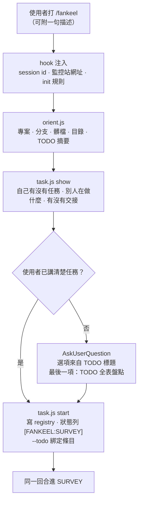
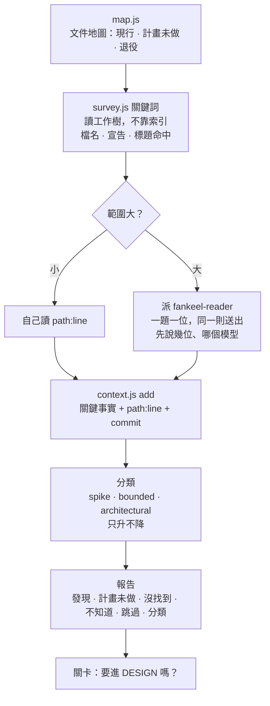
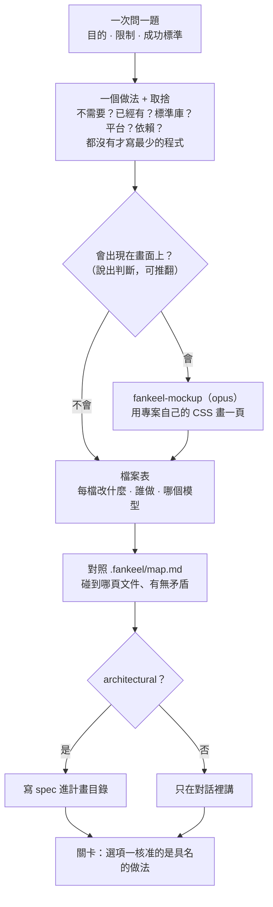
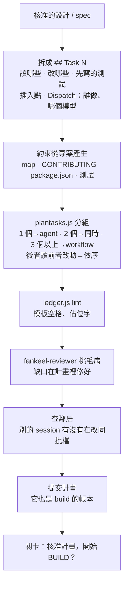
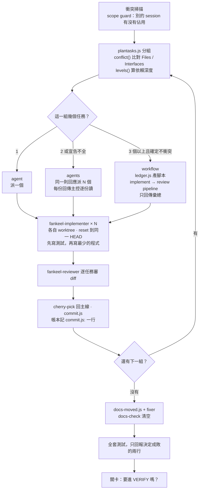
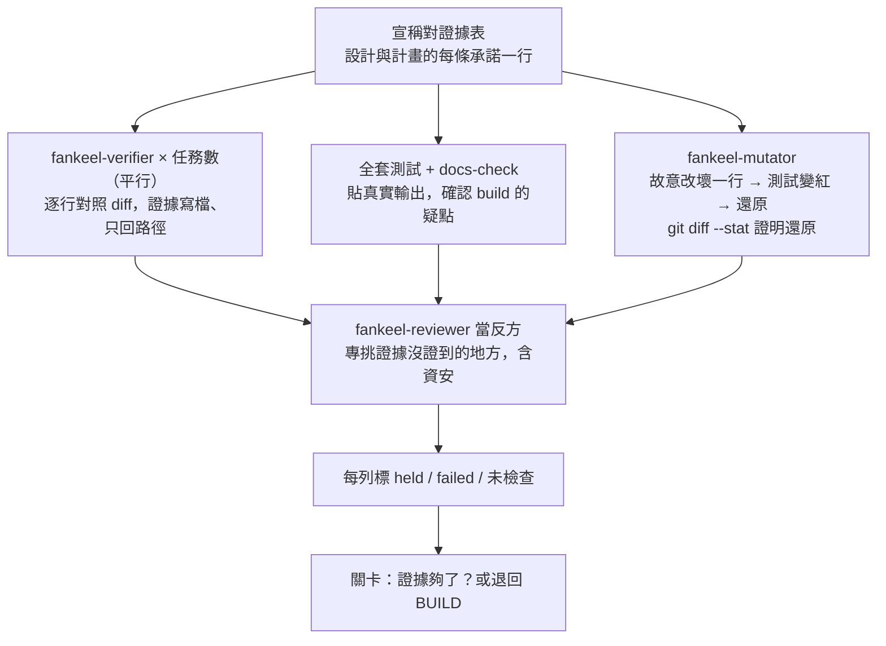
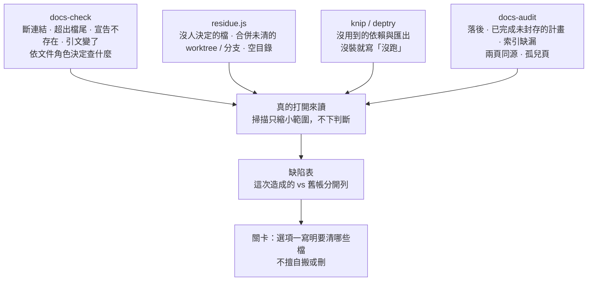
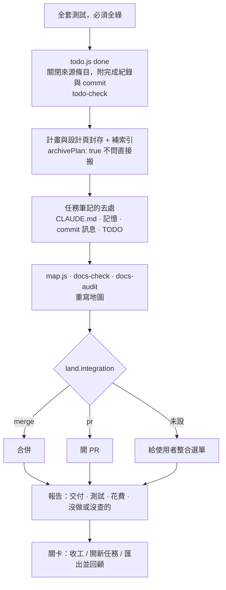

# 詳細設計：一件任務怎麼走完七段

這頁把一件任務從 `/fankeel` 到收工逐段拆開：每段做什麼、為什麼、產出什麼，各配一張流程圖。
例子是一件真實跑完七段的任務，已去識別化——「監控站掛上另一個專案的白板」，下稱白板任務。
同一件任務畫成一頁的版本在 [seven-stages.html](seven-stages.html)；每段的英文規格在 [pipeline.md](../02-architecture/pipeline.md)。

## 0. INIT — 還沒開始任務之前

搞清楚「在哪、要做什麼」，把任務登記下來。只讀、只問，不改任何程式碼。

| 步驟 | 做什麼 | 產出 |
|---|---|---|
| 1. 觸發 | `/fankeel`；hook 注入 session id、監控站網址、init 規則 | 模型知道自己是誰 |
| 2. 看現場 | `orient.js`：registry 位置、專案、分支、髒檔、目錄檔數、TODO 四類摘要 | 一張現況表，什麼都不寫 |
| 3. 看別人 | `task.js show`：自己有沒有進行中的任務、其他 session 在做什麼、有沒有交接可 Adopt | 不撞車 |
| 4. 問 | 用選項問，不用文字。只有一個專案就不問專案；任務選項取自 TODO 標題，最後固定是「TODO 全表盤點」；已講清楚就跳過 | 一句確認過的任務 |
| 5. 登記 | `task.js start`：任務、路線、分類、guard、版本、開始時間；`--todo` 綁 TODO 條目，land 時一起結案 | registry 一筆 |
| 6. 開工 | 同一回合直接進 survey，不問「要開始嗎」 | — |

**白板任務的 INIT**：任務來自 TODO 的 Needs a decision —「監控站能不能掛上另一個專案的白板？」。
使用者在選單選它，start 後直接進 survey。

## 1. SURVEY — 現在已經有什麼

動手之前先盤點現況、給任務分類，並把「沒找到」和「不知道」說出來。產出是一份報告，不改程式碼。

| 步驟 | 做什麼 | 產出 |
|---|---|---|
| 1. 先讀地圖 | `map.js`：專案自己寫的文件地圖，哪些現行、哪些計畫了還沒做、哪些已退役 | 知道哪些文件能信 |
| 2. 掃描 | `survey.js <關鍵詞>` 直接讀工作樹；報告註明來源是 git 還是走訪 | 命中清單附 `path:line` |
| 3. 派讀者 | 範圍小自己讀；範圍大派 `fankeel-reader`，一題一位，同一則送出，送出前先說幾位、哪個模型 | 只回能決定問題的那幾行 |
| 4. 記事實 | `context.js add` 記下事實與 `path:line`、commit | context.md，後段不再重查 |
| 5. 分類 | spike / bounded / architectural，決定路線；只往重的升 | class、route |
| 6. 報告與關卡 | 固定欄位：發現、計畫未做、沒找到、不知道、跳過、分類；用選項問要不要進 design | survey 報告 |

**白板任務的 SURVEY**：掃了 2075 個檔，找到三個事實——監控站只有單一 handler、沒地方掛子應用；
另一個專案的掛載 spike 已證明可行；對方的頁面要先 build 才有。列出三件不知道的事：白板檔放哪、
兩邊的 POST 防護怎麼統一、build 產物從哪來。分類 architectural（新增子系統，且動到 POST 驗證規矩）。
約 10 分鐘，其中 8 分鐘在關卡等使用者。

## 2. DESIGN — 決定怎麼做

只提一個做法、附取捨，再給一條「現在會失敗、做完會通過」的完成標準。使用者同意後才動手；這段不寫程式碼。

| 步驟 | 做什麼 | 產出 |
|---|---|---|
| 1. 一次問一題 | 目的、限制、成功標準；能給選項就給選項 | 需求釐清 |
| 2. 一個做法 | 只提一個、附取捨；依序問：不需要？專案已有？標準庫？平台？現有依賴？都沒有才寫最少的程式 | 一句話的做法 |
| 3. mockup（只限前端） | 先說出「會不會上畫面」的判斷；會就派 `fankeel-mockup`（opus）用專案 CSS 畫一頁，關卡核准的是這一頁 | mockup.html |
| 4. 檔案表 | 每個檔案改什麼、交給誰（implementer＋模型，或在 session 裡做並說理由） | file 表 |
| 5. 對照地圖 | 查 `.fankeel/map.md`：碰到哪頁、有無矛盾 | against the map |
| 6. spec | architectural 寫進計畫目錄；bounded 只在對話裡 | spec 檔 |
| 7. 關卡 | 選項一核准的是寫明內容的做法，不只是「進下一站」 | 核准的設計 |

**白板任務的 DESIGN**：做法一句話——監控站在驗 nonce 之前，把 `/board/<專案>/` 的請求轉交給對方的 handler。
survey 留下的三件不知道各給一筆裁定：白板檔固定放在專案的 `.fankeel/` 底下並提交；這條路徑不驗 nonce，
改由對方的 Host、Origin、JSON 檢查把關；build 產物直接引用對方的安裝路徑，不加 build 步驟。
檔案表 6 列；完成標準是一個新測試、驗五件事；判斷不畫 mockup（畫面上只多一條連結）。
關卡給 4 個選項，第 4 個是「改其中一筆裁定」。約 19 分鐘，其中 16 分鐘在等使用者。

## 3. PLAN — 拆成任務

把核准的設計拆成任務清單，細到一個完全沒背景的人照著做也不會走歪。只有 architectural 有這段，bounded 跳過。

| 步驟 | 做什麼 | 產出 |
|---|---|---|
| 1. 拆任務 | 每個 `## Task N` 用固定模板：Read、改哪些檔、先寫的測試、插入點錨點、`**Dispatch:**` | 計畫檔 |
| 2. 產生約束 | 從 map、CONTRIBUTING、package.json、測試套件產生，不靠模型記 | constraints |
| 3. 分組 | `lib/plantasks.js`：1 個任務 agent、2 個同時派、3 個以上 workflow；後者讀前者改動就依序 | 分組與派送方式 |
| 4. lint | `ledger.js lint`：模板有沒有空、有沒有佔位字 | lint: clean |
| 5. 審計畫 | `fankeel-reviewer` 專挑毛病，缺口修進計畫 | reviewer 報告 |
| 6. 查鄰居 | 有沒有別的 session 在改同一批檔 | neighbours: none |
| 7. 提交與關卡 | 計畫提交進 git；它就是 build 的帳本，對話被壓縮也接得上 | 核准的計畫 |

**白板任務的 PLAN**：3 個任務——加一個設定鍵；做請求轉交、專案帶「有沒有白板」旗標；專案卡片加白板連結。
後一個要讀前一個的改動，所以 3 個 sonnet 依序做。reviewer 抓到 2 個缺口並修好：插入點原本在某個宣告之前、
執行時會出錯；兩個測試任務要讀的共用檔沒列進去。另有一處偏離設計：要刪的 TODO 沒被 git 追蹤，
實作者的 worktree 看不到，改由 land 結案。約 16 分鐘，只有 1 分鐘在等使用者。

## 4. BUILD — 動手做

照計畫一個一個做完：中途不停下來問、進度記在帳本（ledger）、每個任務做完就審一次、提交一次。

| 步驟 | 做什麼 | 產出 |
|---|---|---|
| 1. 衝突掃描 | 要改的檔有沒有被別的 session 佔用；scope guard 擋或問 | 能不能動手 |
| 2. 派實作者 | 每個任務一個 `fankeel-implementer`，用計畫寫的模型、在自己的 worktree；先寫測試、再寫最少的程式 | 程式＋測試 |
| 3. 逐任務審查 | 每個做完派 `fankeel-reviewer` 對照計畫審 diff；問題修掉，或裁定不改並記進帳本 | 審查紀錄 |
| 4. 提交 | `commit.js` 提交，帳本記一行 `commit.js:`；對話壓縮後看帳本就知道做到哪 | 每任務一 commit |
| 5. 文件跟上 | 行號移動後 `docs-moved.js` 自動修引用，剩的交給 fixer；`docs-check` 要乾淨 | docs-check 清空 |
| 6. 全套測試 | 跑完整套件，只回報決定成敗的兩行 | 通過／失敗數 |
| 7. 只有四種會停 | 測試修不好、計畫對不上現實、需要產品判斷、碰到別人佔用的檔 | — |

### 平行處理與動態分配

| 機制 | 怎麼運作 |
|---|---|
| 判斷能否平行 | 計畫每個任務宣告 `**Files:**` 與 `**Interfaces:**`；`conflict()`（`lib/plantasks.js`）比對：改到同一檔、或後者用到前者產出的介面，就是衝突 |
| 依深度分組 | 由階段代理跑時用 `levels()`：每個任務的深度＝它依賴的最深任務＋1，同一層彼此不衝突、可一起跑。實測 15 個任務的盤點：依序要 15 組，依深度只要 6 組 |
| 依組大小選派送方式 | 1 個→agent；2 個→同一則回應兩個 agent；3 個以上且確定不相干→Workflow。宣告不全、看不出是否相干的組，最多派成 agents |
| `dispatch.inflight` 動態配額 | profile 鍵，預設 8（1–20 或 `unlimited`）。可開工的有 10 個就先派 8 個，每回來一個補一個（滑動視窗）；一則回應超過上限，`hooks/dispatch-gate.js` 先問。管的是 API 用量、主對話 context、共用 checkout 的檔案衝突，不是 CPU |
| 每人一個 worktree | 派出前記下 `HEAD`，每個實作者 `reset --hard` 到那點才動手，做完 cherry-pick 回主線；衝突就在新 HEAD 自動重派一次，同一任務第二次衝突才停下來問 |
| 模型下限 | 每次派送都指定模型；`dispatch.floor` 預設 sonnet，architectural 至少 opus |

### 多個 Agent 與 Workflow 的差別

| | 多個 Agent（`agents`） | Workflow（`workflow`） |
|---|---|---|
| 怎麼派 | 同一則回應發 N 個 Agent 呼叫 | `ledger.js workflow --group N` 產腳本，`Workflow({ scriptPath })` 執行 |
| 每個任務的流程 | 實作者回來後，主控另派 reviewer | 腳本裡每任務一條 pipeline：實作→審查，不等別人 |
| 回傳進哪裡 | 每份都進主控 context，逐份讀 | 中間產物留在腳本裡，只回彙總 |
| 何時提交 | 回來一個提交一個，用 commit 範圍審 | 跑的期間不提交，用任務宣告的檔案做 `git diff HEAD` 審 |
| 中途能否插手 | 能：衝突就重派、怪就停 | 不能：跑完前不回主控 |
| 什麼時候用 | 2 個，或宣告不全的組 | 3 個以上且確定不衝突 |
| 誰能開 | 主控、階段代理都能 | 只有主 session；階段代理在報告寫 `workflow: <path>`，主控開了再把結果轉回去 |
| 花費誰批准 | 超過 `dispatch.inflight` 由 dispatch-gate 問 | 開之前平台列出階段與 agent 數讓使用者確認 |
| 失敗處理 | 衝突自動重派一次，第二次停 | 某實作者回傳空值，當沒跑，改用單一 Agent 重派 |

為什麼要有 Workflow：10 月 9 日一次 plan 階段，階段代理逐份讀回傳，context 漲到 439,419、超過 400k 警戒線。
換成 Workflow 後中間產物不進 context；實跑盤點計畫第 1 組，8 個 agent 全部完成。

一句話：多個 Agent 是「主控坐鎮、一份一份收」，能插手但 context 會塞滿；
Workflow 是「整組打包丟出去、只收彙總」，省 context，代價是中途看不到也停不了，所以只給確定不衝突的組。

**白板任務的 BUILD**：3 個任務是一條依賴鏈（第 2 個任務讀第 1 個的設定鍵、第 3 個讀第 2 個的旗標），
深度 1、2、3，所以分 3 組各 1 個、依序做——平行機制都在，依賴決定它用不上。每組 1 個 sonnet 實作者＋1 個 reviewer；
第 2 組 reviewer 提 2 點，裁定不改並記入帳本；文件引用修了 15 條（自動 10、fixer 5）；全套 3686 項、1 項失敗，
單獨重跑會過，推測是並行搶埠，報告老實寫「未能獨立證明」。
牆鐘 5 小時 22 分：做事約 30 分鐘，其餘 4 小時 50 分是關卡在等使用者（報告半夜 3 點多出來，早上 8 點半才回答）。

## 5. VERIFY — 拿證據

每一條「做完了」都要配一個證據，不是信心。這段專門找做得不夠的地方。

| 步驟 | 做什麼 | 產出 |
|---|---|---|
| 1. 宣稱對證據表 | 設計與計畫的每條承諾一行，每行附證據（指令＋輸出、測試名、`path:line`），標 held / failed / 未檢查 | 對照表 |
| 2. 逐任務驗證 | 每任務一個 `fankeel-verifier`，平行派；證據寫進檔案、只回路徑 | verify-t1…tN.md |
| 3. 全套與 docs-check | 完整重跑、貼真實輸出；build 留下的疑點在這確認 | 測試數字 |
| 4. 先紅再綠 | `fankeel-mutator` 故意改壞一行、確認測試變紅、還原並以 `git diff --stat` 證明 | 突變前後的通過／失敗行 |
| 5. 對手審查 | `fankeel-reviewer` 當反方，專挑「證據其實沒證到」，含資安角度 | adversary 清單 |
| 6. 文件 | 這次改動讓哪些文件不再正確 | docs 欄 |
| 7. 關卡 | 選項一核准「證據夠了」；也可退回 build | — |

**白板任務的 VERIFY**：3 個 verifier 平行跑，各自測試全過（45/45、7/7、3/3）；全套 3686 項、失敗 0，
build 時那 1 項沒再出現，確認是並行搶埠。對手抓到 2 點：所有轉交測試都用假的對方 handler，真正接起來只在讀程式碼層面成立；
`close()` 會吞掉例外。先紅再綠沒做，報告直接寫「未檢查」。約 11 分鐘，其中 5 分鐘在等使用者。

## 6. AUDIT — 還有什麼不再是真的

只問一個問題：程式改完後，哪些文件、條目、索引已經不再正確？文件比它描述的程式活得久，
過時的文件被當現況讀，會得到一個有把握的錯誤答案。

| 步驟 | 做什麼 | 產出 |
|---|---|---|
| 1. `docs-check` | 一秒跑完的機械檢查：斷連結、`path:line` 超出檔尾、宣告不存在、引用那行內容變了；依文件角色決定查什麼（封存頁提到已刪程式是正常的，參考頁就是錯） | 斷參照 |
| 2. `residue.js` | 沒人決定要不要留的檔、已合併未清的 worktree 與分支、空目錄 | 殘留清單 |
| 3. 程式死碼 | knip（Node）／deptry（Python）；沒裝就寫「沒跑」 | 死碼清單 |
| 4. `docs-audit` | 落後於程式、已做完未封存的計畫、索引雙向缺漏、兩頁描述同一份程式、孤兒頁；只縮小範圍 | 候選清單 |
| 5. 讀 | 候選要真的打開讀，才知道是不是矛盾 | 缺陷表 |
| 6. 關卡 | 先報告再問；選項一寫明要清哪些檔 | — |

另有獨立的 `/fankeel-audit`：不需要任務就能跑，再加派 3 個 reviewer 從不同角度看程式碼哪裡可以砍，約兩週一次。

**白板任務的 AUDIT**：沒留下斷參照，但找到兩件這次造成的事——新的設計頁與計畫頁沒進文件索引（會讓 docs-audit 失敗）；
來源那筆 TODO 問的三件事都已在程式裡回答，條目卻還寫「待決定」，而且沒被提交。12 份落後的參考頁、
2 條過長句子是這次之前的舊帳，分開列、不混在一起。knip 沒裝，寫明沒跑。約 5 分半，其中 4 分鐘在等使用者。

## 7. LAND — 收尾

讓 repo 收尾後不比開工時更髒：測試全綠、文件結案、地圖重寫，怎麼整合由使用者決定。

| 步驟 | 做什麼 | 產出 |
|---|---|---|
| 1. 全套測試 | 最後一次，必須全綠 | 測試數字 |
| 2. TODO 結案 | `todo.js done` 關閉來源條目，附完成紀錄與 commit；`todo-check` 確認每筆還在對的分類標題下 | 條目關閉 |
| 3. 計畫封存 | 計畫、設計頁搬進封存目錄（`archivePlan: true` 不問），補進索引 | 封存＋索引 |
| 4. 筆記去處 | 任務筆記不保存；還有用的搬到 CLAUDE.md、記憶、commit 訊息或 TODO | — |
| 5. 重寫地圖 | 重跑 `map.js`、`docs-check`、`docs-audit` | 新 map.md |
| 6. 整合 | 依 `land.integration`（merge / PR / 保留分支）與 `land.push`；沒設就給選單 | commit／PR |
| 7. 收工 | 報告四件事：交付、測試、花費（各段 token 與牆鐘）、沒做或沒查的；關卡選項一收工、選項二開新任務，或「匯出並回顧」讓 retro 代理提技能改進 | 任務 down |

**白板任務的 LAND**：關閉來源 TODO 並附 4 個 commit；計畫與設計頁封存、補進索引（順手補了 2 個舊計畫缺的索引列）；
profile 是 merge、不推送，所以沒出整合選單；3686 項、3685 過、1 略過（舊的）、0 失敗。
老實列出沒做的：沒更新 `last_verified`（沒逐頁重讀）、沒發版、工作樹一個與本次無關的未追蹤檔不帶進提交。
各段 token：survey 3k、design 13k、plan 9k、build 66k、verify 2k、audit 4k。約 6 分鐘。

## 全程

| 段 | 牆鐘 | 等使用者 | 做事 |
|---|---|---|---|
| survey | 10 分 | 8 分 | 2 分 |
| design | 19 分 | 16 分 | 3 分 |
| plan | 16 分 | 1 分 | 15 分 |
| build | 5 時 22 分 | 4 時 50 分 | 32 分 |
| verify | 11 分 | 5 分 | 6 分 |
| audit | 5 分半 | 4 分 | 1 分半 |
| land | 6 分 | 0.5 分 | 5 分半 |
| **合計** | **6 時 30 分** | **5 時 24 分** | **約 1 時 6 分** |

時間大多花在等人，不是等機器。
