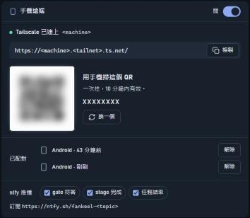

# 用自己的 Tailscale 開手機遠端

這一頁帶你從零把監控站接上自己的 Tailscale，讓手機能看 session、回答 gate。照著做大約十分鐘；卡住的地方多半在 Tailscale 後台的兩個開關，或 Windows 的 PATH。

## 先準備好什麼

桌面和手機都要裝 Tailscale，並登入同一個帳號（也就是同一個 tailnet，Tailscale 串起來的私人網路）。這是因為遠端只在你的 tailnet 裡開放，不在同一個 tailnet 的手機連不到。

接著到 Tailscale 後台的 DNS 頁（https://login.tailscale.com/admin/dns），打開兩個開關。一個是 MagicDNS，讓每台機器有一個名字。另一個是 HTTPS Certificates，讓這個名字能用 `https://`。兩個都在這一頁的設定裡。我們沒有後台的截圖，也沒有核對過頁面上的確切位置，所以只能請你在這一頁找名稱相同的開關；後台改版時位置也可能變。少開任何一個，監控站都不會給你網址，卡片上會寫「turn on MagicDNS and HTTPS certificates」。

在桌面確認有沒有開好：

```
tailscale status --json
```

輸出裡 `CurrentTailnet.MagicDNSEnabled` 要是 `true`，`CertDomains` 要有至少一個網域。

## 打開遠端

遠端預設關，因為監控站看得到每個 session 的整段對話，不該在你沒說要的時候離開這台機器。要打開，在監控站開 `#/settings`，找到精靈下面的「手機遠端」卡片，把開關打開；它會先跳出確認視窗，確認後才寫入設定。

也可以從 CLI 打開：

```
node <plugin>/scripts/task.js profile set station.remote true --confirm --default
```

這裡一定要帶 `--default`，寫進機器層 profile。監控站只讀機器層，寫進某個專案的 `.fankeel/profile.json` 不會有任何效果，這樣一個 clone 下來的 repo 才沒辦法替你開遠端。另外，從 CLI 改完要重啟監控站才會生效；從卡片開則是立即生效。

## Windows：`spawnSync tailscale ENOENT`

Tailscale 的 Windows 安裝程式把 `tailscale.exe` 放在 `%ProgramFiles%\Tailscale\`。
監控站先照 PATH 找 `tailscale`；找不到（`ENOENT`）時，自動改用
`%ProgramFiles%\Tailscale\tailscale.exe`，不必重開監控站。

只有裝在別的位置時才需要處理：把那個資料夾加進 PATH，再重開監控站。

## 成功的樣子



卡片會給出網址 `https://<機器名>.<tailnet 名>.ts.net/`、一張 QR、一組 8 個字元的配對碼，以及已配對手機的清單（每支可「解除」）。圖裡的主機名、配對碼和 QR 都已遮掉。

也可以在桌面用指令對一下：

```
tailscale serve status
```

應該只看到一條 `/` 代理到 `127.0.0.1:<埠號>`，並標著 `(tailnet only)`。Funnel（把服務公開到網際網路的功能）會維持關閉；監控站從不開它，Funnel 開著時遠端還會自己拒絕啟動。

## 配對手機

用手機相機掃卡片上的 QR，或在手機上打開那個網址、手動輸入 8 字元配對碼。配對碼一次性、10 分鐘內有效，因為沒配對過的手機從 tailnet 來的請求一律被擋。碼過期就重新整理卡片拿新的。

已知問題：手機配對成功後，桌面的卡片不會自己更新。想在桌面看到新的那支手機，重新整理桌面頁。

## 從手機回答 gate

要讓 gate 等手機，先設 `gate.station`，例如 300 秒：

```
node <plugin>/scripts/task.js profile set gate.station 300
```

沒設的話（內建 `off`），gate 不等監控站，直接在 terminal 問，手機上就沒有東西可答。每一題除了選項，還有「自己寫答案」欄位，文字原樣成為答案；手機鍵盤的語音鍵在這個欄位也能用，所以長一點的答案可以用講的。

## 把它裝到主畫面

在 Samsung Internet 上只會出現「新增至主螢幕」，裝起來是捷徑，不是安裝的 app。這個頁面的 manifest（網頁應用程式的描述檔）只有一個 SVG 圖示，沒有 PNG，可能就是原因，但沒有驗證過。Chrome 的選項可能不同，我們也沒測過。

## 關掉

把同一個卡片開關關上，監控站下一個請求起就拒絕 tailnet。如果那條 `/` 代理是監控站自己開的，它會只撤掉自己掛的那一條，你在 443 埠其他路徑上掛的 `tailscale serve` 不會動。
