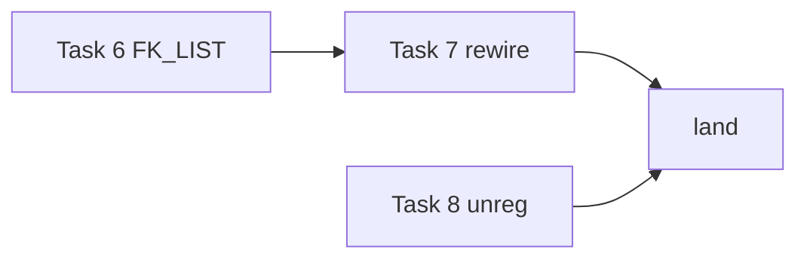

# TODO 全表盤點（2026-10-27 第四輪）Implementation Plan

**Goal:** 手機版 /m 改成像 app 的分頁、測站 sheet、六個 pane、TokenBar 與一次 4 張照片；tune 浮層換成底部置中的標註工具列，能選任意元素並畫標註；station 再拆一塊共用狀態；兩條真機驗證交給使用者。
**Architecture:** /m 的新資料（context、額度、holdUntil、這支手機）由 `lib/mobile.js` 與 `scripts/station.js` 放進 mobile.json／phone.json，`assets/station/mobile.js` 照已核准的 mockup 改寫外殼與輸入框，保住每 2 秒只重畫變動處的局部重畫。tune 浮層 `assets/tune/overlay.js` 換成底部工具列，每一則帶 `marks` 進同一個佇列，由 `scripts/tune.js` 清洗後印出。station 清單的共用狀態抽成 `FK_LIST`，照 days-page 的拆法先建模組再改接。
**Tech Stack:** Node `>=22.5`，零 runtime 依賴，CommonJS；站台與 tune 前端是 classic script 加 `window.FK_*`，測試以 `require` 直接載入。
**Spec:** ../../../.fankeel/build/task-20261027T133256/survey.md

## Global Constraints

- `package.json:7-9` — `"engines": { "node": ">=22.5" }`；不加 `dependencies`。
- `package.json:11-12` — 測試用 `node --test`；implementer 只跑自己的測試檔，父 session 在提交一組前跑 `suite.js --fast`。
- `.fankeel/map.md:25-26` — 計畫放 `docs/90-agent/plans/`，TODO 條目在 `docs/90-agent/todo/`（role `todo`）。
- `lib/plantasks.js:387-388` — `READ_CAP = 1500`、`FILE_CAP = 3`；超過 1500 行的檔以 `path:a-b` 列。
- `scripts/station.js:1012` — 每張圖上限 10 MB，不改；手機端先縮到長邊 1568px、JPEG 0.85。
- 已核准的 mockup（未進版控）：`.fankeel/build/2026-10-27-mobile-app/mockup.html`（含 round-2.md、round-3.md 需求），`.fankeel/build/2026-10-27-tune-toolbar/mockup.html`。icon 取自 Lucide（ISC），內嵌 SVG，不加 icon 字型。
- mobile.js 的字串 zh、en 兩張表都要加。
- 使用者這次的答案：五條全做；手機版「先這樣，有需要再調」；tune 桌面版 OK。

## Risks

- server 拿不到 context window：pane 的 `Context.window` 只從 engine 來，沒寫到磁碟 — Task 1 — 先 `grep -n "writeFile\|appendFile" hooks/pane.ts` 確認 pane 沒把 context 落地；沒有就照計畫送 `window: null`、量表以 compact.at 為分母（mockup 畫的 `380k / 1M` 在真資料上會是 `380k / 350k（到壓縮線）`）
- brief 說 manifest 改 `#10151d`，mockup 註 5 卻說 manifest 留品牌色、只改 meta — Task 1 — 照 brief 兩者都改，另加 light meta，計畫審查時請使用者確認
- `profile.read(got.root, ...)` 只讀 registry root 的 project profile，子專案的 compact.at 會讀不到 — Task 1 — 先看 fixture 的 session 有沒有 `project`；有的話改用 `profile.profileFor(got.root, { project, configDir })`
- 舊測試斷言舊 markup（`.ha-row`、禁止 `.tabbar`、`ha-hist`、`ha-gone`、`<span class="st ask">` 計數）— Task 2 — 先跑一次五個舊測試檔，失敗清單應正好是步驟 6 列的那幾條
- 計畫 pane 沒有 plan 任務資料（phone.json 不帶），只畫 route 並連到桌面版 plan 頁 — Task 2 — 若 review 認為要真的任務清單，需另開一個資料任務
- 概覽 pane 只看得到 mobile.json `done` 的 48 小時、最多 40 列 — Task 2 — 空的時候顯示 `ov.empty` 與完整頁連結
- TokenBar 展開若走 `draw()` 會重建 composer，丟掉焦點與錄音 — Task 2 — boot 測試斷言展開時 `app.innerHTML` 不變
- iPhone 的 HEIC 若 `createImageBitmap` 解不開，會原檔上傳，server 只收 png/jpeg/webp/gif 而回 415 — Task 3 — 失敗會顯示「測站沒收下（415）」；在真機確認 iOS 選圖時是否已轉 JPEG
- Task 2 之後 `mobile.js` 行號整段位移、總行數接近 1500 — Task 3 — 用函式名定位；完成後 `wc -l` 回報
- 測試用的 stub DOM 是手寫的 innerHTML 解析器與選擇器比對，只認 `tag`、`.class`、`:nth-of-type`、`[data-block]`；新標記若用到別的選擇器（例如 `[data-tool="pen"]`），測試會靜靜地找不到 — Task 4 — 程式只用 class 查元素、用 `getAttribute('data-tool')` 分辨工具鈕，先跑一次舊測試確認 stub 解析得了內嵌 SVG（`<path …/>` 自閉合）
- 真瀏覽器的版面、hover、焦點與工具列外觀 stub 驗不到 — Task 4 — 交給 verify 的 render reviewer，對照 mockup #s1–#s4
- Task 4 寫進 design skill §3 的 `marks` 那句在 Task 5 落地前還不成立（Task 5 的三個 Modify 名額給了 overlay、scripts/tune.js 與 mockup agent）— Task 4 — 兩個 task 都在 verify 之前落地；Task 4 的 reviewer 要被告知這句屬於 Task 5，Task 5 的測試斷言它在
- 工具字母（V P S L A R O N T）在項目開著時從頁面拿走按鍵，可能撞到頁面自己的快捷鍵 — Task 4 — 只在項目開著或焦點在工具列時攔，輸入欄、textarea、contenteditable 一律放行，Ctrl/⌘/Alt 組合不攔；測試斷言沒有項目時字母是頁面的
- 繪圖的 pointerdown／pointerup listener 若註冊在吞事件的 capture listener 之後就永遠收不到 — Task 5 — 步驟 3 (m) 指定插入位置；畫筆測試會先失敗
- 文字欄裡按 Esc 被既有的「Esc 放棄這則」先接走，整則消失 — Task 5 — 步驟 3 (n) 把文字欄分支放在 keydown 最前面；文字測試斷言 Esc 後卡片還在
- 墨跡層以 `<div>` 的 innerHTML 塞 `<svg>`，靠 HTML 解析器給 SVG 命名空間；用 `createElement('svg')` 會畫不出來 — Task 5 — 程式只走 innerHTML；真瀏覽器的樣子留給 verify
- `POST /__live/request` 上限 262144 bytes（`scripts/tune.js:157`），很多長筆畫可能超過 — Task 5 — overlay 每筆最多 500 點、點距至少 3px，伺服器每則最多 100 筆、每筆 500 點；測試斷言兩個上限
- `scroll`／`viewport` 取的是送出那一刻，不是畫的那一刻 — Task 5 — 標註本身是頁面座標，與捲動無關；這兩個欄位只說明使用者送出時看到哪一段
- A vm test boots station.js with a document but without the scripts index.html lists, so `w.FK_LIST` is undefined at line 2168 — Task 7 — first runs `grep -ln "station\.js'" tests/*.js | xargs grep -L "station-src.js\|station-module.js" | xargs grep -l "runInNewContext\|runInContext"` and reads each hit to see whether it runs `assets/station/station.js` itself (today's hits run only `station-data.js` and detail scripts).
- `picked` is reassigned by `tick`, so a station.js line that caches `LS.picked` in a local keeps a stale array — Task 7 — step 7's grep, then reads every `LS.picked` hit to see it is read at use.
- The focus shell (`lib/station.js` `focusShell`) loads station.js without list-state.js — Task 7 — confirms `if (w.STATION_FOCUS) return focusBoot();` (line 2166) stays above `var LS = w.FK_LIST;` and that `focusBoot` reads `w.STATION_DETAIL` directly (line 2096), not `DETAIL`.
- `tests/station-i18n.test.js` or `stringsLeft` rejects a new `loc` key whose zh has no EN entry — Task 8 — `lv.unregWhy` is added to live-page.js's own `EN` table in step 3 before the zh call in step 6.
- `gate.station` is `off` in `.fankeel/profile.json`, so the hook asks in the terminal and the station never answers — Task 9 — step 2 sets it to 300 before the gate is asked, step 6 sets it back.
- The gate page draws a mermaid fence only from the report's unrecognised lines (`gateRest`), so a fence inside a recognised section is not drawn — Task 9 — step 1 puts the fence at the end of the report, after every heading.
- The served station runs the installed plugin copy, which lags Task 8 — Task 10 — the preamble has it served from this checkout or updated first.

## Task 1: /m 的資料：context、額度、hold 到期、這支手機、theme-color

**Files:**
- Modify: `lib/mobile.js` — 新增 `contextOf`、`limitsOf`；`mobileModel` 多收 `me` 回 `device`、列多 `holdUntil`；`phoneModel` 多 `holdUntil`、`context: null`、`limits: null`；`shell()` 兩個 theme-color meta、`manifest()` 的 `theme_color` 改 `#10151d`
- Modify: `lib/phone.js` — `snapshot()` 多回 `holdUntil`
- Modify: `scripts/station.js:960-985` — `/station/mobile.json` 傳 `device`；`/station/phone.json` 補 `context` 與 `limits`（頂端 require 一行在第 64 行附近，在範圍外但只多一行）
- Read: `lib/context.js` — `inspect(transcriptPath) -> {dropped, used}|null`、`readTail(file, bytes)`
- Read: `lib/quota.js` — 只有 `limitsText(root)`（整個 root 所有 session 的檔串起來）和 `readings(text)`（只取 seven）；兩者都不是單一 session 的最新一列，所以不用
- Read: `hooks/pane-limits.ts` — `LimitRow {at, five, fiveResets, seven, sevenResets}`，`fiveResets`/`sevenResets` 是 ISO 字串
- Read: `hooks/pane-bar.ts:7` — `Context = { tokens; at; window? }`；`window` 只有 pane 從 engine 拿得到
- Read: `lib/remote.js:123-134` — `deviceFor()` 回 `{id, name, paired, seen}`
- Read: `lib/profile.js:414-444` — `read(root, configDir).values['compact.at']`（內建 `350000`，`off` 表示不壓縮）
- Read: `tests/station-mobile-route.test.js:1-105` — `fixture`、`fakeTailscale`、`get`、`served`、`phone` 的寫法，照抄進新測試
- Test: `tests/mobile-data.test.js`
- Test: `tests/station-mobile-data.test.js`

**Interfaces:**
- Consumes: none
- Produces:
  - `mobile.contextOf(seen: {used:number}|null, compactAt: string|number|undefined) -> {tokens:number, at:number|null, window:null}|null`
  - `mobile.limitsOf(text: string|null) -> {at:number, five:number|null, fiveResets:number|null, seven:number|null, sevenResets:number|null}|null`（時間都是 epoch ms）
  - `phone.snapshot(...).holdUntil: number|null`
  - `mobile.mobileModel(model, now, host, hidden, look, me)`：回傳多 `device: {name:string, paired:number|null}|null`；`tasks[]`、`stopped[]` 每列多 `holdUntil: number|null`
  - `mobile.phoneModel(...)`：多 `holdUntil`、`context`、`limits`（server 填入後兩者）
  - `/m` 的 `<meta name="theme-color">` 兩個（dark `#10151d`、light `#f2f4f3`），manifest `theme_color: "#10151d"`

**Dispatch:** implementer, sonnet, high — server 這邊拿不到 context window，要對著 pane 的 Context 與 profile 的 compact.at 推理出誠實的欄位；sonnet 高 effort 比 opus 便宜。

1. 寫 `tests/mobile-data.test.js`：

```js
'use strict';
// /station/mobile.json and phone.json for the 2026-10-27 /m redesign: the TokenBar's context and
// limits, when a held turn gives up (phone.hold), this phone as the station knows it, and the dark theme-color.
const test = require('node:test');
const assert = require('node:assert/strict');
const fs = require('node:fs');
const path = require('node:path');
const mobile = require('../lib/mobile.js');
const phone = require('../lib/phone.js');
const tmp = require('./tmp.js');

const NOW = Date.parse('2026-10-27T14:00:00.000Z');
const SID = 'bbbbbbbb-1111-4111-8111-00000000000a';
const row = (o) => Object.assign({ sessionId: 's', task: 't', project: '', stage: 'build', route: ['build'], state: 'live', updated: NOW - 60e3, ended: null, cost: null, agentCost: null, stages: [], pending: null, gateAt: null }, o);
const model = (sessions) => ({ registries: [{ root: '/ws/fankeel', profiles: {}, sessions }] });

test('limitsOf: the newest row by its time, resets in epoch ms; bad lines and empty rows skipped', () => {
    const text = [
        '{"at":"2026-10-27T13:00:00.000Z","task":"t","stage":"plan","five":2,"fiveResets":"2026-10-27T18:00:00.000Z","seven":45,"sevenResets":"2026-10-30T03:00:00.000Z"}',
        'not json',
        '{"at":"2026-10-27T13:30:00.000Z","task":"t","stage":"plan","five":4,"fiveResets":"2026-10-27T18:00:00.000Z","seven":46,"sevenResets":"2026-10-30T03:00:00.000Z"}',
        '{"at":"2026-10-27T13:10:00.000Z","task":"t","stage":"plan","five":3,"fiveResets":null,"seven":null,"sevenResets":null}',
        '{"at":"2026-10-27T13:40:00.000Z","task":"t","stage":"plan","five":null,"fiveResets":null,"seven":null,"sevenResets":null}',
    ].join('\n');
    assert.deepEqual(mobile.limitsOf(text), { at: Date.parse('2026-10-27T13:30:00.000Z'), five: 4, fiveResets: Date.parse('2026-10-27T18:00:00.000Z'), seven: 46, sevenResets: Date.parse('2026-10-30T03:00:00.000Z') });
    assert.equal(mobile.limitsOf(''), null);
    assert.equal(mobile.limitsOf(null), null);
});

test('contextOf: the transcript\'s tokens against compact.at; off or unknown is no line; no count is null', () => {
    assert.deepEqual(mobile.contextOf({ used: 380000, dropped: 0 }, '350000'), { tokens: 380000, at: 350000, window: null });
    assert.deepEqual(mobile.contextOf({ used: 380000, dropped: 0 }, 600000), { tokens: 380000, at: 600000, window: null });
    assert.deepEqual(mobile.contextOf({ used: 1000, dropped: 0 }, 'off'), { tokens: 1000, at: null, window: null });
    assert.equal(mobile.contextOf({ used: 0, dropped: 5 }, '350000'), null);
    assert.equal(mobile.contextOf(null, '350000'), null);
});

test('mobileModel: this phone as deviceFor names it, null from this machine; every row says when its hold gives up', () => {
    const look = () => ({ attached: true, holding: true, holdUntil: NOW + 1690e3, waiting: null, lastRole: 'assistant', last: null, background: [], chat: [] });
    const m = mobile.mobileModel(model([row()]), NOW, 'h', new Set(), look, { id: 'x', name: 'iPhone', paired: NOW - 5 * 864e5, seen: NOW });
    assert.deepEqual(m.device, { name: 'iPhone', paired: NOW - 5 * 864e5 });
    assert.equal(m.tasks[0].holdUntil, NOW + 1690e3);
    assert.equal(mobile.mobileModel(model([row()]), NOW, 'h', new Set(), look).device, null);
    assert.equal(mobile.mobileModel(model([row()]), NOW, 'h', new Set()).tasks[0].holdUntil, null, 'no look: no hold');
});

test('phoneModel carries holdUntil, and context and limits as null until the server fills them', () => {
    const look = () => ({ attached: true, holding: true, holdUntil: NOW + 60e3, waiting: null, lastRole: 'assistant', last: null, background: [], chat: [] });
    const p = mobile.phoneModel(model([row()]), 's', NOW, new Set(), look);
    assert.equal(p.holdUntil, NOW + 60e3);
    assert.equal(p.context, null);
    assert.equal(p.limits, null);
});

test('snapshot: holdUntil is holding.json\'s until while it is ahead, null after', () => {
    const root = tmp('fankeel-phone-hold-');
    fs.mkdirSync(phone.dirOf(root, SID), { recursive: true });
    fs.writeFileSync(path.join(phone.dirOf(root, SID), 'holding.json'), JSON.stringify({ since: 1000, until: 5000 }));
    assert.equal(phone.snapshot(root, SID, 3000, 0).holdUntil, 5000);
    assert.equal(phone.snapshot(root, SID, 6000, 0).holdUntil, null);
    assert.equal(phone.snapshot(tmp('fankeel-phone-hold-'), SID, 3000, 0).holdUntil, null);
});

test('the shell\'s status bar is the page ground in each theme; the manifest takes the dark ground', () => {
    const html = mobile.shell();
    assert.ok(html.includes('<meta name="theme-color" media="(prefers-color-scheme: dark)" content="#10151d">'));
    assert.ok(html.includes('<meta name="theme-color" media="(prefers-color-scheme: light)" content="#f2f4f3">'));
    assert.ok(!html.includes('#2d5bd8"'), 'the brand blue is the icon only');
    assert.equal(JSON.parse(mobile.manifest()).theme_color, '#10151d');
});
```

2. 跑 `node --test tests/mobile-data.test.js`，看它失敗（`limitsOf is not a function` 等）。

3. 在 `lib/phone.js` 的 `snapshot()`，`holding:` 那行下面加：

```js
        holdUntil: holding && Number(holding.until) > now ? Number(holding.until) : null,
```

4. 在 `lib/mobile.js`：
   - `const ON_KEEL = '#fbfcfc';` 下面加：

```js
// station.css's keel dark `--ground`: the standalone status bar blends into the screen in dark
// mode (the 2026-10-27 mockup, taken from VoiceLedger); the light theme's is GROUND.
const DARK = '#10151d';
```

   - `rowOf()` 的 `attached:` 那行改成：

In `lib/mobile.js`:

```js
        attached: Boolean(p && p.attached), background: p ? p.background : [], last: p ? p.last : null,
        holdUntil: p && Number.isFinite(p.holdUntil) ? p.holdUntil : null,
```

   - `function mobileModel(model, now, host, hidden, look) {` 改成 `function mobileModel(model, now, host, hidden, look, me) {`，它的 `return` 改成：

In `lib/mobile.js`:

```js
    // `me` is lib/remote.js deviceFor()'s answer for the phone asking; none from this machine.
    const device = me ? { name: String(me.name || ''), paired: Number.isFinite(me.paired) ? me.paired : null } : null;
    return { host: String(host || ''), at: now, device, gates, tasks, stopped, done: done.slice(0, DONE_MAX) };
```

   - `phoneModel()` 的 `gate, background: p ? p.background : [], at: now,` 改成：

In `lib/mobile.js`:

```js
        gate, background: p ? p.background : [], at: now,
        holdUntil: p && Number.isFinite(p.holdUntil) ? p.holdUntil : null,
        // The server fills these two (scripts/station.js, /station/phone.json).
        context: null, limits: null,
```

   - `phoneModel` 之後加：

In `lib/mobile.js`:

```js
// The TokenBar's context meter. hooks/pane-bar.ts's Context is {tokens, at, window}, but only the
// pane hears the engine's window, so the server sends `window: null` and the phone measures the
// transcript's last usage (lib/context.js inspect().used) against the profile's compact.at.
function contextOf(seen, compactAt) {
    if (!seen || !(seen.used > 0)) return null;
    const at = Number(compactAt);
    return { tokens: seen.used, at: Number.isFinite(at) && at > 0 ? at : null, window: null };
}

// The newest 5h / 7d reading in one session's .fankeel/build/limits/<sid>.jsonl (hooks/pane-limits.ts
// LimitRow), its times in epoch ms. A tail's first line is cut mid-row and does not parse.
function limitsOf(text) {
    const pct = (v) => (typeof v === 'number' && Number.isFinite(v) ? v : null);
    const when = (v) => (typeof v === 'string' && Number.isFinite(Date.parse(v)) ? Date.parse(v) : null);
    let best = null;
    for (const raw of String(text || '').split('\n')) {
        let j;
        try {
            j = JSON.parse(raw);
        } catch (e) {
            continue;
        }
        if (!j || typeof j.at !== 'string') continue;
        const at = Date.parse(j.at);
        if (!Number.isFinite(at) || (best && best.at >= at)) continue;
        if (pct(j.five) === null && pct(j.seven) === null) continue;
        best = { at, five: pct(j.five), fiveResets: when(j.fiveResets), seven: pct(j.seven), sevenResets: when(j.sevenResets) };
    }
    return best;
}
```

   - `shell()` 裡 `'<meta name="theme-color" content="' + KEEL + '">\n'` 換成：

In `lib/mobile.js`:

```js
        + '<meta name="theme-color" media="(prefers-color-scheme: dark)" content="' + DARK + '">\n'
        + '<meta name="theme-color" media="(prefers-color-scheme: light)" content="' + GROUND + '">\n'
```

   - `manifest()` 的 `theme_color: KEEL` 改 `theme_color: DARK`；`module.exports` 加 `contextOf, limitsOf`。

5. 再跑 `node --test tests/mobile-data.test.js`，全過。

6. 寫 `tests/station-mobile-data.test.js`（served 的接線；fixture 照 `tests/station-mobile-route.test.js:33-103` 縮成一個 live session）：

```js
'use strict';
// The station fills the new /m fields: phone.json's context (transcript usage against compact.at)
// and limits (the newest row of .fankeel/build/limits/<id>.jsonl), holdUntil from holding.json,
// and mobile.json's device for a paired phone.
const test = require('node:test');
const assert = require('node:assert/strict');
const fs = require('node:fs');
const path = require('node:path');
const http = require('node:http');
const registry = require('../lib/registry.js');
const profile = require('../lib/profile.js');
const remote = require('../lib/remote.js');
const phone = require('../lib/phone.js');
const { serve } = require('../scripts/station.js');
const tmp = require('./tmp.js');

const NAME = 'ymlab-pc.tail1234.ts.net';
const ONE = 'ffffffff-8888-4888-8888-88888888889a';

function fixture(on) {
    const base = tmp('fankeel-station-mobile-data-');
    const cfg = path.join(base, 'cfg');
    const r1 = path.join(base, 'ws');
    fs.mkdirSync(path.join(cfg, 'sessions'), { recursive: true });
    registry.ensureLayout(r1);
    registry.writeSession(r1, ONE, { task: '手機資料', stage: 'design', route: ['survey', 'design'], active: true, claims: [], started: '2026-10-27T08:00:00.000Z', updated: new Date().toISOString(), configDir: cfg });
    fs.writeFileSync(path.join(cfg, 'sessions', ONE + '.json'), JSON.stringify({ pid: process.pid, sessionId: ONE, cwd: r1, startedAt: Date.now() }));
    fs.mkdirSync(path.join(cfg, 'fankeel'), { recursive: true });
    fs.writeFileSync(path.join(cfg, 'fankeel', 'roots.json'), JSON.stringify({ [path.resolve(r1)]: '2026-10-27T08:00:00.000Z' }) + '\n');
    if (on) assert.equal(profile.write(profile.machineFile(cfg), 'station.remote', 'true').ok, true);
    const limits = path.join(r1, '.fankeel', 'build', 'limits');
    fs.mkdirSync(limits, { recursive: true });
    fs.writeFileSync(path.join(limits, ONE + '.jsonl'), [
        { at: '2026-10-27T13:00:00.000Z', task: 't', stage: 'design', five: 2, fiveResets: '2026-10-27T18:00:00.000Z', seven: 45, sevenResets: '2026-10-30T03:00:00.000Z' },
        { at: '2026-10-27T13:30:00.000Z', task: 't', stage: 'design', five: 4, fiveResets: '2026-10-27T18:00:00.000Z', seven: 46, sevenResets: '2026-10-30T03:00:00.000Z' },
    ].map((r) => JSON.stringify(r)).join('\n') + '\n');
    fs.mkdirSync(phone.dirOf(r1, ONE), { recursive: true });
    fs.writeFileSync(path.join(phone.dirOf(r1, ONE), 'holding.json'), JSON.stringify({ since: Date.now(), until: Date.now() + 600e3 }));
    const proj = path.join(cfg, 'projects', 'ws');
    fs.mkdirSync(proj, { recursive: true });
    fs.writeFileSync(path.join(proj, ONE + '.jsonl'), JSON.stringify({ type: 'assistant', timestamp: '2026-10-27T13:30:00.000Z', message: { role: 'assistant', model: 'claude-opus-5-5', usage: { input_tokens: 1000, cache_creation_input_tokens: 0, cache_read_input_tokens: 379000, output_tokens: 10 }, content: [] } }) + '\n');
    return { cfg, r1 };
}
function fakeTailscale() {
    let proxy = null;
    return (args) => {
        const a = args.join(' ');
        if (a === 'status --json') return { status: 0, stdout: JSON.stringify({ BackendState: 'Running', Self: { DNSName: NAME + '.' } }), stderr: '' };
        if (a === 'serve status --json') return { status: 0, stdout: proxy ? JSON.stringify({ Web: { [NAME + ':443']: { Handlers: { '/': { Proxy: proxy } } } } }) : '{}', stderr: '' };
        const bg = /^serve --bg (\d+)$/.exec(a);
        if (bg) { proxy = 'http://127.0.0.1:' + bg[1]; return { status: 0, stdout: '', stderr: '' }; }
        return { status: 1, stdout: '', stderr: 'unexpected: ' + a };
    };
}
const get = (port, pathname, headers) => new Promise((resolve, reject) => {
    const req = http.request({ hostname: '127.0.0.1', port, path: pathname, method: 'GET', headers: headers || {} }, (res) => {
        let text = '';
        res.setEncoding('utf8');
        res.on('data', (c) => { text += c; });
        res.on('end', () => resolve({ status: res.statusCode, text }));
    });
    req.on('error', reject);
    req.end();
});
async function served(on, f) {
    const fx = fixture(on);
    const s = await serve({ configDir: fx.cfg, port: 0, idleMs: 60e3, open: false, tailscaleRun: fakeTailscale() });
    try {
        await f(Object.assign({ port: Number(new URL(s.url).port) }, fx));
    } finally {
        s.close();
    }
}

test('phone.json carries the transcript\'s context against compact.at, the newest limits row, and holdUntil', () => served(false, async (s) => {
    const res = await get(s.port, '/station/phone.json?id=' + ONE);
    assert.equal(res.status, 200);
    const p = JSON.parse(res.text);
    assert.deepEqual(p.context, { tokens: 380000, at: 350000, window: null });
    assert.deepEqual(p.limits, { at: Date.parse('2026-10-27T13:30:00.000Z'), five: 4, fiveResets: Date.parse('2026-10-27T18:00:00.000Z'), seven: 46, sevenResets: Date.parse('2026-10-30T03:00:00.000Z') });
    assert.ok(p.holdUntil > Date.now(), 'holding.json is ahead');
}));

test('mobile.json: device is null from this machine, the paired phone through the tailnet; rows carry holdUntil', () => served(true, async (s) => {
    const local = JSON.parse((await get(s.port, '/station/mobile.json')).text);
    assert.equal(local.device, null);
    assert.ok(local.tasks[0].holdUntil > Date.now());
    const now = Date.now();
    const got = remote.pair(s.cfg, remote.newCode(s.cfg, now).value, 'S24', now);
    const away = JSON.parse((await get(s.port, '/station/mobile.json', { host: NAME, cookie: 'fk_device=' + got.token })).text);
    assert.equal(away.device.name, 'S24');
    assert.equal(typeof away.device.paired, 'number');
}));
```

7. 跑 `node --test tests/station-mobile-data.test.js`，看它失敗（`context` 為 null、`device` 為 undefined）。

8. 在 `scripts/station.js`：
   - `const phone = require('../lib/phone.js');`（約第 64 行）下面加 `const contextLib = require('../lib/context.js');`
   - `/station/mobile.json` 那支的 `mobile.mobileModel(model, Date.now(), host, station.hiddenPkeys(model), phone.snapshot)` 改成 `mobile.mobileModel(model, Date.now(), host, station.hiddenPkeys(model), phone.snapshot, device)`（`device` 是 `:541` 已經取好的那個，loopback 時為 null）。
   - `/station/phone.json` 那支的 `if (!got) return fail(404, 'no such session on this station');` 下面加：

In `scripts/station.js`:

```js
            // The TokenBar: this session's last usage against its profile's compact.at, and the
            // newest 5h / 7d row hooks/pane.ts wrote for it. quota.js's limitsText reads every
            // session's file in the root, so only this one's tail is read here.
            got.context = mobile.contextOf(contextLib.inspect(detail.transcriptOf(configDir, got.id)), profile.read(got.root, configDir).values['compact.at']);
            got.limits = mobile.limitsOf(contextLib.readTail(path.join(got.root, '.fankeel', 'build', 'limits', got.id + '.jsonl'), 16 * 1024));
```

9. 跑 `node --test tests/mobile-data.test.js tests/station-mobile-data.test.js tests/mobile-model.test.js tests/station-mobile-route.test.js tests/phone-state.test.js`，全過。

10. Commit：`feat: mobile.json and phone.json carry context, limits, holdUntil and this phone`。

## Task 2: /m 外殼：分頁列、可展開的卡片、測站 sheet、session 頁的 TokenBar 與六個 pane

**Files:**
- Modify: `assets/station/mobile.js` — 字串、sprite、路由、卡片、分頁列、sheet、session 頁、pane、boot 的 draw/patch/點擊/鍵盤/滑動
- Modify: `assets/station/mobile.css` — 抄 mockup 的 CSS、修 `body.m .ab.ab2`、刪舊 `.ha-*` 卡片規則、補 pane 列規則（station.css:962 的 `.pg` 用 `body.m .scr>.pg` 在這裡清掉，不改 station.css）
- Modify: `docs/90-agent/reference/station.md:783-797` — and its lines 1455-1493, /m 段落：分頁列、卡片、sheet、session 頁；mobile.json / phone.json 新欄位（Task 1 的）
- Read: `.fankeel/build/2026-10-27-mobile-app/mockup.html` — 第 98-321 行 CSS、第 329-395 行各 frame 的 markup
- Read: `lib/mobile.js` — Task 1 的欄位形狀
- Read: `lib/context.js` — `inspect`，文件裡講 context 的出處
- Read: .fankeel/build/limits/<id>.jsonl — 額度紀錄的形狀，文件裡講 limits 的出處
- Test: `tests/station-mobile-shell.test.js`
- Test: `tests/station-mobile-page.test.js`
- Test: `tests/station-mobile-cards.test.js`
- Test: `tests/station-mobile-resize.test.js`
- Test: `tests/station-mobile-route.test.js`

**Interfaces:**
- Consumes: Task 1 的 `device`、`holdUntil`、`context`、`limits`（形狀見 Task 1 Produces）
- Produces:
  - `parseRoute(hash)`：多 `{view:'ask', id:null, pair:null}`；chat 路由多 `pane`（`'talk'|'timeline'|'plan'|'dispatch'|'events'|'gate'`，預設 `'talk'`），`#/s/<id>/<pane>`
  - `screen(M, R, now, ui, P)`：`ui.open: {[key]: boolean}`（`sc:<id>`、`gp:<id>`、`rs:me|held|pair`、`tk`、`ov:<stage>:<at>`、`pl:<stage>`、`dp:<id>`、`ev:<toolid>`、`gt:<qi>`），`ui.sheet: boolean`
  - `swipeTo(pane, dx, dy) -> string|null`、`PANES`（匯出）
  - `composer(p, u)` 不動，talk pane 才畫；`#composer`、`#cmp-box`、`#cmp-file` id 不變
  - boot 內：`data-act="fold"`（toggle `st.ui.open[data-key]`）、`data-act="sheet"`、`pv()`、`patch()` 會重畫 `.cv` 或 `.ov` 與 `.tkb`
  - sprite 多 26 個 icon：`list x msg down clock server link layers activity checks coins timer info qr brain calclock wifi zap hourglass images ask chart imgplus alert flag`

**Dispatch:** implementer, opus — 大段 UI 改寫，必須保住每 2 秒只重畫 `.cv`（打字、勾選、語音不被洗掉）的部分重畫，還要把五個測試檔的舊 markup 斷言搬過來而不丟掉它們守的東西。

所有 `assets/station/mobile.js` 行號都是今天（Task 1 不碰這檔）的行號：**從檔尾往上改**，行號才一直對。

1. 寫 `tests/station-mobile-shell.test.js`：

```js
'use strict';
// The /m redesign (.fankeel/build/2026-10-27-mobile-app/mockup.html): the tab bar, cards that open,
// the 測站 sheet, the session screen's TokenBar and six panes, and the two safe-area fixes.
const test = require('node:test');
const assert = require('node:assert/strict');
const fs = require('node:fs');
const path = require('node:path');
const vm = require('node:vm');
const P = require('../assets/station/mobile.js');

const ASSETS = path.join(__dirname, '..', 'assets', 'station');
const CSS = fs.readFileSync(path.join(ASSETS, 'mobile.css'), 'utf8');
const NOW = new Date(2026, 9, 27, 22, 0).getTime();
const Q = [{ question: '版面照原樣排？', multiSelect: false, options: [{ label: '收成三種版型 (Recommended)' }, { label: '照原樣' }] }];
const row = (id, state, extra) => Object.assign({ id, root: '/w', task: 'task ' + id, project: 'proj', stage: 'build', route: ['survey', 'design', 'build', 'verify'], gate: state === 'gate', updated: NOW - 60e3, state, attached: false, background: [], last: null, holdUntil: null }, extra);
const BG = [{ id: 'b1', type: 'agent', status: 'running', description: 'mockup agent', command: '', since: NOW - 30e3 }];
const HOME = {
    host: 'sh-pro6000', at: NOW, device: { name: 'iPhone', paired: new Date(2026, 9, 22, 9, 0).getTime() },
    gates: [Object.assign(row('aaaaaaaa-1', 'gate'), { questions: Q, since: NOW - 60e3, until: NOW + 760e3 })],
    tasks: [row('aaaaaaaa-1', 'gate'), row('aaaaaaaa-2', 'running', { last: { role: 'desktop', text: '跑測試', at: NOW } }),
        row('aaaaaaaa-3', 'background', { background: BG }), row('aaaaaaaa-4', 'idle'),
        row('aaaaaaaa-5', 'holding', { attached: true, holdUntil: NOW + 1690e3 })],
    stopped: [],
    done: [
        { id: 'aaaaaaaa-5', root: '/w', task: 't5', project: 'proj', stage: 'survey', route: [], kind: 'stage', at: NOW - 3 * 3600e3, usd: 1.72 },
        { id: 'aaaaaaaa-5', root: '/w', task: 't5', project: 'proj', stage: 'design', route: [], kind: 'stage', at: NOW - 3 * 3600e3 + 15 * 60e3, usd: 6.49 },
    ],
};
const sess = (state, extra) => Object.assign({ id: 'aaaaaaaa-5', root: '/w', task: 't5', project: 'proj', stage: 'build', route: ['survey', 'design', 'build', 'verify'], state, attached: state === 'holding', waiting: null, chat: [], gate: null, background: [], at: NOW, holdUntil: null,
    context: { tokens: 380000, at: 350000, window: 1000000 },
    limits: { at: NOW, five: 4, fiveResets: NOW + 4 * 3600e3, seven: 46, sevenResets: NOW + 2.24 * 864e5 } }, extra);
const APP = (extra) => Object.assign({ mode: 'app', open: {} }, extra);
const count = (html, re) => (html.match(re) || []).length;

test('parseRoute: 等你 is #/ask, a session opens on 對話 and names any of the six panes', () => {
    assert.deepEqual(P.parseRoute('#/ask'), { view: 'ask', id: null, pair: null });
    assert.deepEqual(P.parseRoute('#/s/aaaaaaaa-2'), { view: 'chat', id: 'aaaaaaaa-2', pair: null, pane: 'talk' });
    for (const pane of ['talk', 'timeline', 'plan', 'dispatch', 'events', 'gate']) assert.equal(P.parseRoute('#/s/aaaaaaaa-2/' + pane).pane, pane);
    assert.equal(P.parseRoute('#/s/aaaaaaaa-2/nope').view, 'home');
});

test('the three list screens share a tab bar, last on screen, the current tab marked; 等你 counts the gates; a session and pairing hide it', () => {
    for (const hash of ['#/', '#/ask', '#/done']) {
        const html = P.screen(HOME, P.parseRoute(hash), NOW, APP());
        assert.equal(count(html, /<nav class="tabbar"/g), 1, hash);
        assert.match(html, new RegExp('<a href="' + hash + '" aria-current="page"><span class="tab-ico">'), hash);
        assert.match(html, /<b class="tab-n" aria-label="1 個等你">1<\/b>/, hash);
        assert.match(html, /<\/nav>$/, hash);
    }
    assert.doesNotMatch(P.screen(HOME, P.parseRoute('#/s/aaaaaaaa-5'), NOW, APP(), sess('holding')), /class="tabbar"/);
    assert.doesNotMatch(P.screen(null, null, NOW, { mode: 'pair', camera: false }), /class="tabbar"/);
});

test('home: 等你 cards first, then the running ones, then idle; a card shows one status line until its chevron opens', () => {
    const shut = P.screen(HOME, P.parseRoute('#/'), NOW, APP());
    const at = ['m-home-ask', 'm-home-run', 'm-home-idle'].map((b) => shut.indexOf('data-block="' + b + '"'));
    assert.ok(at.every((i, k) => i > 0 && (k === 0 || i > at[k - 1])), String(at));
    assert.equal(count(shut, /<div class="sc ask">/g), 1);
    assert.match(shut, /<span class="sc-q">.*版面照原樣排？/);
    assert.doesNotMatch(shut, /class="sc-more"/);
    assert.match(shut, /<button type="button" class="sc-tog" data-act="fold" data-key="sc:aaaaaaaa-2" aria-expanded="false"/);
    assert.match(shut, /手機接著 · 剩 28:10/);
    const open = P.screen(HOME, P.parseRoute('#/'), NOW, APP({ open: { 'sc:aaaaaaaa-2': true, 'sc:aaaaaaaa-3': true } }));
    assert.match(open, /<p class="sm-last">.*<b>電腦<\/b>跑測試/);
    assert.match(open, /<ul class="bgl"/);
    assert.match(open, /data-key="sc:aaaaaaaa-2" aria-expanded="true"/);
});

test('等你: each held gate with its time left, its options behind a tap, and 去答', () => {
    const shut = P.screen(HOME, P.parseRoute('#/ask'), NOW, APP());
    assert.match(shut, /data-block="m-ask-a"/);
    assert.match(shut, /<p class="sc-left">.*剩 12:40 · 之後轉回電腦<\/p>/);
    assert.match(shut, /2 個選項/);
    assert.doesNotMatch(shut, /class="gopt"/);
    const open = P.screen(HOME, P.parseRoute('#/ask'), NOW, APP({ open: { 'gp:aaaaaaaa-1': true } }));
    assert.match(open, /<ul class="gopt"><li>.*收成三種版型<\/span><span class="gq-rec">建議<\/span><\/li><li>/);
    assert.match(open, /<a class="sc-btn" href="#\/s\/aaaaaaaa-1">去答/);
    assert.match(P.screen(Object.assign({}, HOME, { gates: [], tasks: [] }), P.parseRoute('#/ask'), NOW, APP()), /沒有在等你答的/);
});

test('the host pill opens the 測站 sheet: one status line, then rows that open; never on a session', () => {
    const home = P.screen(HOME, P.parseRoute('#/'), NOW, APP());
    assert.match(home, /<button type="button" class="host" data-act="sheet" aria-haspopup="dialog" aria-expanded="false"/);
    assert.doesNotMatch(home, /m-remote-sheet/);
    const sheet = P.screen(HOME, P.parseRoute('#/'), NOW, APP({ sheet: true }));
    assert.match(sheet, /data-block="m-remote-sheet"/);
    assert.match(sheet, /已連上 sh-pro6000/);
    assert.match(sheet, /<span class="rs-v">iPhone<\/span><\/span><span class="rs-side">10\/22 配對<\/span>/);
    assert.match(sheet, /<span class="rs-v">task aaaaaaaa-5<\/span><\/span><span class="rs-side">剩 28:10<\/span>/);
    assert.doesNotMatch(sheet, /class="rs-x"/);
    assert.match(P.screen(HOME, P.parseRoute('#/'), NOW, APP({ sheet: true, open: { 'rs:held': true } })), /<div class="rs-x">.*data-act="detach" data-id="aaaaaaaa-5"/);
    assert.match(P.screen(Object.assign({}, HOME, { device: null }), P.parseRoute('#/'), NOW, APP({ sheet: true })), /<span class="rs-v">這台電腦<\/span>/);
    assert.doesNotMatch(P.screen(HOME, P.parseRoute('#/s/aaaaaaaa-5'), NOW, APP({ sheet: true }), sess('holding')), /m-remote-sheet/);
});

test('a session screen: header, a TokenBar of three meters that opens to labelled rows, and six pane tabs', () => {
    const R = P.parseRoute('#/s/aaaaaaaa-5');
    const shut = P.screen(HOME, R, NOW, APP(), sess('holding'));
    const top = shut.slice(shut.indexOf('<div class="dt-top">'), shut.indexOf('</nav>'));
    assert.ok(top.indexOf('<header class="ch-h">') < top.indexOf('class="tkb"') && top.indexOf('class="tkb"') < top.indexOf('<nav class="panes"'));
    assert.equal(count(shut, /<span class="tkm-i">/g), 3);
    assert.match(shut, /<b>38%<\/b>.*<b>4%<\/b>.*<b>46%<\/b>/);
    assert.match(shut, /data-key="tk" aria-expanded="false"/);
    assert.doesNotMatch(shut, /class="tkx"/);
    assert.equal(count(shut, /<nav class="panes"[^>]*>(?:<a [^>]*>[\s\S]*?<\/a>){6}<\/nav>/g), 1);
    assert.match(shut, /<a href="#\/s\/aaaaaaaa-5\/talk" aria-current="page">/);
    assert.match(shut, /id="cmp-box"/, '對話 keeps the composer');
    const open = P.screen(HOME, R, NOW, APP({ open: { tk: true } }), sess('holding'));
    assert.equal(count(open, /<div class="tkx-r">/g), 3);
    assert.match(open, /380k \/ 1M · 壓縮線 350k/);
    assert.match(open, /<b style="--p:20%"><\/b>/, 'the 5h line: where the time says it should be');
    assert.match(open, /<b style="--p:68%"><\/b>/);
    const bare = P.screen(HOME, R, NOW, APP({ open: { tk: true } }), sess('holding', { context: null, limits: null }));
    assert.equal(count(bare, /<b>—<\/b>/g), 3);
    assert.match(bare, /還沒有讀數/);
});

test('the panes: 概覽 finished stages, 計畫 the route, 派工 the background, 事件 the steps, 關卡 the questions; rows open', () => {
    const at = (pane, p, ui) => P.screen(HOME, P.parseRoute('#/s/aaaaaaaa-5/' + pane), NOW, APP(ui), p || sess('holding'));
    const ov = at('timeline');
    assert.match(ov, /data-block="m-pane-timeline"/);
    assert.match(ov, /<b class="usd">\$8\.21<\/b><span>2 站 · /);
    assert.equal(count(ov, /<li class="ov-r">/g), 2);
    assert.match(ov, /15 分/);
    assert.doesNotMatch(ov, /id="cmp-box"/, 'only 對話 has the composer');
    assert.match(at('timeline', null, { open: { ['ov:design:' + HOME.done[1].at]: true } }), /<dl class="ov-x">.*全部的 79%/);
    const pl = at('plan');
    assert.equal(count(pl, /<li class="ov-r ev">/g), 4);
    assert.match(pl, /進行中/);
    const dp = at('dispatch', sess('background', { background: BG }));
    assert.match(dp, /mockup agent/);
    assert.match(dp, /<i class="dot live"/);
    assert.match(at('dispatch'), /沒有在背景跑的 agent 或 shell/);
    const chat = [{ role: 'phone', text: 'go', at: NOW - 9e3 }, { role: 'tool', id: 't1', tool: 'Bash', label: 'npm test', at: NOW - 8e3 }, { role: 'tool-end', id: 't1', ok: false, at: NOW - 5e3 }];
    const ev = at('events', sess('holding', { chat }), { open: { 'ev:t1': true } });
    assert.match(ev, /<span class="lb">npm test<\/span><span class="tm">失敗 · 3\.0 秒<\/span>/);
    assert.match(ev, /<dd>Bash<\/dd>/);
    const gt = at('gate', sess('gate', { gate: { questions: Q, since: NOW - 60e3, until: NOW + 760e3 } }), { open: { 'gt:0': true } });
    assert.match(gt, /<span class="lb">版面照原樣排？<\/span><span class="tm">2 個選項<\/span>/);
    assert.match(gt, /<a class="sc-btn" href="#\/s\/aaaaaaaa-5\/talk">去答/);
    assert.match(at('gate'), /沒有在等你答的關卡/);
});

test('a sideways swipe moves one pane; a short or mostly vertical one does not', () => {
    assert.equal(P.swipeTo('talk', -90, 10), 'timeline');
    assert.equal(P.swipeTo('timeline', 90, 10), 'talk');
    assert.equal(P.swipeTo('talk', 90, 10), null);
    assert.equal(P.swipeTo('gate', -90, 10), null);
    assert.equal(P.swipeTo('plan', -40, 0), null);
    assert.equal(P.swipeTo('plan', -90, 80), null);
});

test('mobile.css: the header pads by the safe area, station.css\'s desktop .pg is cleared, the tab bar clears the home indicator, the old cards are gone', () => {
    assert.ok(CSS.includes('\nbody.m .ab.ab2{display:grid;gap:0;min-height:0;padding:calc(6px + env(safe-area-inset-top)) 8px 8px 20px}'));
    assert.ok(CSS.includes('\nbody.m .scr>.pg{flex:1;min-height:0;margin:0;padding:0;border:0;border-radius:0;background:none}'));
    assert.match(CSS, /\n\.tabbar\{[^}]*env\(safe-area-inset-bottom\)/);
    assert.doesNotMatch(CSS, /\.ha-row|\.ha-hist|\.ha-prev|\.ha-q\b/);
});

test('every class the new screens draw has a rule', () => {
    const css = CSS + fs.readFileSync(path.join(ASSETS, 'station.css'), 'utf8');
    const STATION = new Set(['dot', 'live', 'hm-stw', 'gq-rec', 'gate']);
    const chat = [{ role: 'tool', id: 't1', tool: 'Bash', label: 'x', at: NOW - 8e3 }, { role: 'tool-end', id: 't1', ok: true, at: NOW - 5e3 }];
    const open = { tk: true, ['ov:design:' + HOME.done[1].at]: true, 'pl:build': true, 'dp:b1': true, 'ev:t1': true, 'gt:0': true };
    const all = [P.screen(HOME, P.parseRoute('#/'), NOW, APP({ sheet: true, open: { 'sc:aaaaaaaa-2': true, 'rs:me': true, 'rs:held': true, 'rs:pair': true } })),
        P.screen(HOME, P.parseRoute('#/ask'), NOW, APP({ open: { 'gp:aaaaaaaa-1': true } })), P.screen(HOME, P.parseRoute('#/done'), NOW, APP())]
        .concat(['talk', 'timeline', 'plan', 'dispatch', 'events', 'gate'].map((pane) => P.screen(HOME, P.parseRoute('#/s/aaaaaaaa-5/' + pane), NOW, APP({ open }),
            sess('gate', { chat, background: BG, gate: { questions: Q, since: NOW, until: NOW + 60e3 } }))));
    for (const html of all) for (const m of html.matchAll(/class="([^"]+)"/g)) for (const c of m[1].split(/\s+/)) if (!STATION.has(c)) assert.ok(new RegExp('\\.' + c + '(?![\\w-])').test(css), c);
});

const SRC = fs.readFileSync(path.join(ASSETS, 'mobile.js'), 'utf8');
const reply = (status, body) => Promise.resolve({ status, ok: status >= 200 && status < 300, json: () => Promise.resolve(body), text: () => Promise.resolve(typeof body === 'string' ? body : JSON.stringify(body)) });
const settle = () => new Promise((r) => setTimeout(r, 30));
function boot(hash, one) {
    const app = { innerHTML: '' };
    const tkb = { innerHTML: '' };
    const on = { doc: {}, win: {} };
    const calls = [];
    const listen = (where) => (type, fn) => { (on[where][type] = on[where][type] || []).push(fn); };
    const doc = { getElementById: (id) => (id === 'app' ? app : null), documentElement: {}, body: { insertAdjacentHTML() {} },
        addEventListener: listen('doc'), querySelector: (s) => (s === '.tkb' ? tkb : null), visibilityState: 'visible' };
    const win = { document: doc, location: { hash }, navigator: { language: 'zh-TW', userAgent: 'x' },
        localStorage: { getItem: () => null, setItem() {} }, addEventListener: listen('win'), setInterval() {}, setTimeout, URLSearchParams,
        fetch: (url, init) => { calls.push({ url, init: init || {} }); return url === '/station/mobile.json' ? reply(200, HOME) : url.startsWith('/station/phone.json') ? reply(200, one) : reply(201, ''); } };
    vm.runInNewContext(SRC, { window: win });
    const fire = (where, type, e) => { (on[where][type] || []).forEach((fn) => fn(e)); return e; };
    return { app, tkb, win, calls, fire: (type, e) => fire('doc', type, e || {}), fireWin: (type, e) => fire('win', type, e || {}) };
}
const tap = (attrs) => {
    const el = { getAttribute: (a) => (Object.prototype.hasOwnProperty.call(attrs, a) ? attrs[a] : null) };
    el.closest = (s) => (s === '.cv,.ov' ? null : el);
    return { target: el, preventDefault() {} };
};

test('boot: the TokenBar opens in place, so the composer and its draft are not drawn again', async () => {
    const page = boot('#/s/aaaaaaaa-5', sess('holding'));
    await settle();
    const before = page.app.innerHTML;
    assert.match(before, /data-key="tk" aria-expanded="false"/);
    page.fire('click', tap({ 'data-act': 'fold', 'data-key': 'tk' }));
    assert.equal(page.app.innerHTML, before, 'no full redraw');
    assert.match(page.tkb.innerHTML, /aria-expanded="true"/);
    assert.equal(count(page.tkb.innerHTML, /class="tkx-r"/g), 3);
});

test('boot: the host pill opens and closes the sheet; Escape and a new hash close it', async () => {
    const page = boot('#/', sess('holding'));
    await settle();
    page.fire('click', tap({ 'data-act': 'sheet' }));
    assert.match(page.app.innerHTML, /data-block="m-remote-sheet"/);
    page.fire('keydown', { key: 'Escape', target: { closest: () => null }, preventDefault() {} });
    assert.doesNotMatch(page.app.innerHTML, /m-remote-sheet/);
    page.fire('click', tap({ 'data-act': 'sheet' }));
    page.win.location.hash = '#/done';
    page.fireWin('hashchange');
    assert.doesNotMatch(page.app.innerHTML, /m-remote-sheet/);
});

test('boot: 交還電腦 in the sheet detaches the session it names and reads the list again', async () => {
    const page = boot('#/', sess('holding'));
    await settle();
    const reads = page.calls.filter((c) => c.url === '/station/mobile.json').length;
    page.fire('click', tap({ 'data-act': 'detach', 'data-id': 'aaaaaaaa-5' }));
    await settle();
    const sent = page.calls.filter((c) => c.url === '/phone/detach');
    assert.equal(sent.length, 1);
    assert.equal(sent[0].init.body, new URLSearchParams({ root: '/w', id: 'aaaaaaaa-5' }).toString());
    assert.ok(page.calls.filter((c) => c.url === '/station/mobile.json').length > reads);
});
```

2. 跑 `node --test tests/station-mobile-shell.test.js`，看它失敗。

3. 改 `assets/station/mobile.js`（從檔尾往上）。
   - 第 1032-1035 行 `var api = {...}` 的物件多加 `swipeTo: swipeTo, PANES: PANES,`。
   - 第 1017-1025 行 hashchange handler 的 `st.ui.pin = false;` 下面加 `st.ui.sheet = false;`。在第 1026 行 `win.setInterval(` 之前加滑動換 pane：

```js
        // A sideways swipe on a pane moves to the pane beside it (the mockup's scroll-snap, note 6).
        var touch = null;
        d.addEventListener('touchstart', function (e) {
            var p0 = e.touches && e.touches[0];
            touch = p0 && e.target && e.target.closest && e.target.closest('.cv,.ov') ? { x: p0.clientX, y: p0.clientY } : null;
        }, { passive: true });
        d.addEventListener('touchend', function (e) {
            var p1 = e.changedTouches && e.changedTouches[0];
            var R = route();
            if (!touch || !p1 || R.view !== 'chat') { touch = null; return; }
            var to = swipeTo(R.pane, p1.clientX - touch.x, p1.clientY - touch.y);
            touch = null;
            if (to) win.location.hash = '#/s/' + R.id + '/' + to;
        }, { passive: true });
```

   - 第 936-967 行 click handler：`else if (what === 'detach' && p) act(...)` 那行換成下面這段，並在 `else if (what === 'steps') {` 之前插入 `fold` 與 `sheet`：

In `assets/station/mobile.js`:

```js
            else if (what === 'detach') {
                var did = el.getAttribute('data-id');
                var dp = did ? ((st.M && st.M.tasks) || []).filter(function (x) { return x.id === did; })[0] : p;
                if (dp) act('/phone/detach', { root: dp.root, id: dp.id }, function () { st.ui.sheet = false; });
            } else if (what === 'sheet') {
                st.ui.sheet = !st.ui.sheet;
                draw();
            } else if (what === 'fold') {
                var fk = el.getAttribute('data-key');
                st.ui.open[fk] = !st.ui.open[fk];
                // The TokenBar opens in place: a full draw would build the composer again.
                var tkb = fk === 'tk' && d.querySelector ? d.querySelector('.tkb') : null;
                var tp = tkb ? current() : null;
                if (tkb && tp) { tkb.innerHTML = tokenInner(tp, Date.now(), st.ui); return; }
                if (el.closest && el.closest('.cv,.ov') && st.P) patch(); else draw();
            }
```

   - 第 930-935 行 keydown handler 的第一行加：

In `assets/station/mobile.js`:

```js
            if (e.key === 'Escape' && st.ui.sheet) { st.ui.sheet = false; draw(); return; }
```

   - 第 871-878 行 `act()` 的 `if (r.ok) { if (done) done(); return loadChat(); }` 改成 `if (r.ok) { if (done) done(); return route().view === 'chat' ? loadChat() : load(); }`。
   - 第 780-789 行 `patch()` 整段換成：

In `assets/station/mobile.js`:

```js
        // The pane's own contents and the TokenBar, never the composer: what is typed, picked or said stays.
        function pv() { return d.querySelector ? d.querySelector('.cv') || d.querySelector('.ov') : null; }
        function patch() {
            var c = pv();
            if (!c) return draw();
            var R = route();
            var at = Date.now();
            var talk = !R.pane || R.pane === 'talk';
            var end = c.scrollHeight - c.scrollTop - c.clientHeight < 48;
            var keep = keepOpen(c);
            c.innerHTML = talk ? cvInner(st.P, at, st.ui) : paneInner(st.P, R.pane, at, st.ui, st.M);
            keep(c);
            var tk = d.querySelector('.tkb');
            if (tk) tk.innerHTML = tokenInner(st.P, at, st.ui);
            if (end && talk) toEnd();
        }
```

   - 第 778 行 `if (R.view === 'chat') toEnd();` 改 `if (R.view === 'chat' && R.pane === 'talk') toEnd();`。
   - 第 687 行 `APP` 加 `sheet: false`（`open: {}` 已有）。
   - 第 604-616 行 `screen()` 換成：

In `assets/station/mobile.js`:

```js
    // What #app holds: pair-scan, pair-error, one of the three tabs with the tab bar under it
    // (and the 測站 sheet over it), or one session's screen drawn from its phone.json `P`.
    function screen(M, R, now, ui, P) {
        var u = ui || {};
        if (u.mode === 'pair') return pairHtml(u);
        if (u.mode === 'off') return offHtml(u.host);
        var m = M || {};
        var r = R || parseRoute('');
        var at = num(now) ? now : Date.now();
        if (r.view === 'chat') return chatHtml(m, r.id, at, u, P, r.pane || 'talk');
        var sheet = u.sheet ? sheetHtml(m, at, u) : '';
        if (r.view === 'done') return doneScreen(m, at, u) + sheet;
        if (r.view === 'ask') return askHtml(m, at, u) + sheet;
        return homeHtml(m, at, u) + sheet;
    }
```

   - 第 573 行 `'<div class="grp-h">' + head` 改 `'<div class="grp-h">' + ic('calclock') + head`。
   - 第 546-557 行 `doneRow` 與 `doneBar` 換成：

In `assets/station/mobile.js`:

```js
    function doneRow(x) {
        var meta = x.kind === 'end'
            ? '<span class="end">' + ic('flag') + t('done.end') + '</span>'
            : stw(x.stage) + '<span class="dn">' + ic('cc') + t('done.dn') + '</span>';
        return '<a class="row' + (x.kind === 'end' ? ' fin' : '') + '" href="/f/' + esc(x.id) + '/' + esc(x.stage || 'gate') + '">'
            + '<div class="r-l"><div class="r-meta">' + meta + '<span class="pj">' + esc(x.project) + '</span></div><p class="r-t">' + esc(x.task) + '</p></div>'
            + '<div class="r-side"><span class="usd">' + usd(x.usd) + '</span><span class="ago">' + ic('clock') + hm(x.at) + '</span></div></a>';
    }

    function doneScreen(m, at, u) {
        return '<div class="pg" data-block="m-done-a"><header class="ab tab-ab"><div class="ab-1"><h1>' + t('done.title') + '</h1><span class="sp"></span>' + hostHtml(m, u) + '</div></header>'
            + doneHtml(m, at) + '</div>' + tabbar('done', m);
    }
```

   - 第 538 行 `function optionHtml` 之前加 `optList`（askCard 與關卡 pane 共用）：

In `assets/station/mobile.js`:

```js
    function optList(opts) {
        return opts.map(function (o) {
            var l = String((o && o.label) || '');
            var rec = REC.test(l);
            return '<li>' + ic('cc', rec ? '' : 'no') + '<span>' + esc(l.replace(REC, '')) + '</span>' + (rec ? '<span class="gq-rec">' + t('gate.rec') + '</span>' : '') + '</li>';
        }).join('');
    }
```

   - 第 511-536 行 `chatHtml` 換成下面整段（TokenBar、pane 列、五個 pane、chatHtml）：

In `assets/station/mobile.js`:

```js
    // The TokenBar: context against the compact line (or the window when the pane knows it),
    // and the 5h and 7d limits with where the time says they should be.
    function meters(p, at) {
        var c = p.context || null;
        var l = p.limits || {};
        var wnd = c && num(c.window) && c.window > 0 ? c.window : null;
        var line = c && num(c.at) && c.at > 0 ? c.at : null;
        var of = wnd || line;
        var resets = function (r, span) {
            return num(r) ? t('tk.resets', { t: (span === SEVEN_MS ? md(r) + ' ' : '') + hm(r), n: paceOf(r, span, at) }) : t('tk.none');
        };
        return [
            { icon: 'brain', label: t('tk.ctx'), v: c && of ? pct(c.tokens / of * 100) : null, mark: wnd && line ? pct(line / wnd * 100) : null,
                sub: c ? kTok(c.tokens) + (of ? ' / ' + kTok(of) : '') + (wnd && line ? t('tk.at', { n: kTok(line) }) : !wnd && line ? t('tk.ofAt') : '') : t('tk.none') },
            { icon: 'timer', label: t('tk.five'), v: pct(l.five), mark: paceOf(l.fiveResets, FIVE_MS, at), sub: resets(l.fiveResets, FIVE_MS) },
            { icon: 'calclock', label: t('tk.seven'), v: pct(l.seven), mark: paceOf(l.sevenResets, SEVEN_MS, at), sub: resets(l.sevenResets, SEVEN_MS) },
        ];
    }

    function tokenInner(p, at, u) {
        var ms = meters(p, at);
        var open = Boolean(u.open && u.open.tk);
        var val = function (v) { return v === null ? '—' : v + '%'; };
        return '<button type="button" class="tkm" data-act="fold" data-key="tk" aria-expanded="' + open + '" aria-controls="tkx" aria-label="' + esc(t('tk.aria', { c: val(ms[0].v), f: val(ms[1].v), s: val(ms[2].v) })) + '">'
            + ms.map(function (x) { return '<span class="tkm-i">' + ic(x.icon) + '<span class="mb"><i style="--v:' + (x.v || 0) + '%"></i></span><b>' + val(x.v) + '</b></span>'; }).join('')
            + ic('down', 'tgl') + '</button>'
            + (open ? '<div class="tkx" id="tkx">' + ms.map(function (x) {
                return '<div class="tkx-r">' + ic(x.icon) + '<span class="tkx-l">' + x.label + '</span><b class="tk-v">' + val(x.v) + '</b>'
                    + '<span class="tk-bar"><i style="--v:' + (x.v || 0) + '%"></i>' + (x.mark === null ? '' : '<b style="--p:' + x.mark + '%"></b>') + '</span>'
                    + '<span class="tk-s">' + esc(x.sub) + '</span></div>';
            }).join('') + '</div>' : '');
    }

    function panesNav(p, pane) {
        var bg = (p.background || []).length;
        return '<nav class="panes" aria-label="' + t('pn.nav') + '" data-block="m-pane-tabs">' + PANES.map(function (x) {
            return '<a href="#/s/' + esc(p.id) + '/' + x[0] + '"' + (x[0] === pane ? ' aria-current="page"' : '') + '>' + ic(x[1]) + '<span>' + t('pn.' + x[0]) + '</span>'
                + (x[0] === 'dispatch' && bg ? '<i class="dot live" aria-label="' + esc(t('pn.bg', { n: bg })) + '"></i>' : '') + '</a>';
        }).join('') + '</nav>';
    }

    // The desktop page for what the phone draws only a summary of.
    function full(p, tab) { return '<a class="ov-link" href="/f/' + esc(p.id) + '/' + tab + '">' + ic('laptop') + t('ov.full') + '</a>'; }
    function empty(key) { return '<p class="ov-empty">' + ic('info') + t(key) + '</p>'; }
    // One summary row of the list panes: an icon, a label over its time, the chevron; open, its details.
    function evRow(key, u, icon, label, time, side, more) {
        var open = Boolean(u.open && u.open[key]);
        return '<li class="ov-r ev' + (open ? ' open' : '') + '"><button type="button" class="ov-b ev" data-act="fold" data-key="' + esc(key) + '" aria-expanded="' + open + '">' + icon
            + '<span class="lb">' + label + '</span><span class="tm">' + time + '</span>' + (side ? '<b class="usd">' + side + '</b>' : '') + ic('down', 'tgl') + '</button>'
            + (open ? more : '') + '</li>';
    }
    function dl(rows) {
        return '<dl class="ov-x">' + rows.filter(Boolean).map(function (r) { return '<div><dt>' + ic(r[0]) + r[1] + '</dt><dd>' + r[2] + '</dd></div>'; }).join('') + '</dl>';
    }

    // 概覽: this session's finished stages from mobile.json's done rows, how long each took and what it cost.
    function overviewInner(p, m, at, u) {
        var rows = (m.done || []).filter(function (x) { return x.id === p.id && x.kind === 'stage'; }).sort(function (a, b) { return a.at - b.at; });
        var end = (m.done || []).filter(function (x) { return x.id === p.id && x.kind === 'end'; })[0];
        if (!rows.length) return empty('ov.empty') + full(p, 'timeline');
        var total = 0;
        var top = 0;
        rows.forEach(function (x) { if (num(x.usd)) { total += x.usd; top = Math.max(top, x.usd); } });
        var list = rows.map(function (x, i) {
            var key = 'ov:' + x.stage + ':' + x.at;
            var open = Boolean(u.open && u.open[key]);
            var span = i ? x.at - rows[i - 1].at : null;
            var share = total > 0 && num(x.usd) ? Math.round(x.usd / total * 100) : null;
            return '<li class="ov-r' + (open ? ' open' : '') + '"><button type="button" class="ov-b" data-act="fold" data-key="' + esc(key) + '" aria-expanded="' + open + '">'
                + stwI(x.stage) + '<span class="tm">' + ic('clock') + (span === null ? t('ov.doneAt', { t: hm(x.at) }) : esc(took(span))) + '</span>'
                + '<span class="bar" style="--c:' + stVar(x.stage) + '"><i style="--v:' + (top > 0 && num(x.usd) ? Math.round(x.usd / top * 100) : 0) + '%"></i></span>'
                + '<b class="usd">' + usd(x.usd) + '</b>' + ic('down', 'tgl') + '</button>'
                + (open ? dl([['cc', t('ov.at'), hm(x.at)], span === null ? null : ['timer', t('ov.took'), t('ov.tookV', { t: esc(took(span)) })],
                    ['coins', t('ov.cost'), usd(x.usd) + (share === null ? '' : t('ov.share', { n: share }))]]) : '') + '</li>';
        }).join('');
        return '<p class="ov-sum">' + ic('coins') + '<b class="usd">' + usd(total) + '</b><span>' + t('ov.sum', { n: rows.length, from: hm(rows[0].at), to: hm(rows[rows.length - 1].at) }) + '</span></p>'
            + '<ol class="ov-list">' + list + '</ol>'
            + (end ? '<p class="ov-end"><span class="end">' + ic('flag') + t('done.end') + '</span><span>' + hm(end.at) + '</span></p>' : '') + full(p, 'timeline');
    }

    // 計畫: phone.json carries no plan tasks, so the route — done, in progress, not yet — and the desktop plan page.
    function planInner(p, m, at, u) {
        var route = (p.route || []).filter(function (s) { return typeof s === 'string'; });
        if (!route.length) return empty('pl.empty') + full(p, 'plan');
        var cur = route.indexOf(p.stage);
        var done = (m.done || []).filter(function (x) { return x.id === p.id && x.kind === 'stage'; });
        return '<ol class="ov-list">' + route.map(function (s, i) {
            var hit = done.filter(function (x) { return x.stage === s; }).pop();
            var state = hit || (cur >= 0 && i < cur) ? 'done' : i === cur ? 'now' : 'todo';
            return evRow('pl:' + s, u, ic(state === 'done' ? 'cc' : state === 'now' ? 'activity' : 'clock'), stwI(s), t('pl.' + state), hit ? usd(hit.usd) : '',
                dl([['cc', t('ov.at'), hit ? hm(hit.at) : t('pl.notyet')]]));
        }).join('') + '</ol>' + full(p, 'plan');
    }

    // 派工: the agents and shells still running in the background.
    function dispatchInner(p, at, u) {
        var list = p.background || [];
        if (!list.length) return empty('dp.empty') + full(p, 'dispatch');
        return '<ol class="ov-list">' + list.map(function (b, i) {
            return evRow('dp:' + (b.id || i), u, ic(b.type === 'shell' ? 'term' : 'bot'), esc(b.description || b.command), (num(b.since) ? esc(ago(at - b.since)) + ' · ' : '') + t('bg.run'), '',
                dl([['layers', t('dp.kind'), esc(b.type || '')], b.command ? ['term', t('dp.cmd'), esc(b.command)] : null, num(b.since) ? ['clock', t('dp.start'), hm(b.since)] : null]));
        }).join('') + '</ol>' + full(p, 'dispatch');
    }

    // 事件: the conversation's tool steps, newest first.
    function eventsInner(p, at, u) {
        var steps = [];
        turnsOf(p.chat).forEach(function (g) { if (g.kind === 'steps') steps = steps.concat(g.items); });
        steps = steps.slice(-30).reverse();
        if (!steps.length) return empty('ev.empty');
        return '<ol class="ov-list">' + steps.map(function (s) {
            var live = s.end === null || s.end === undefined;
            var icon = live ? ic('spin') : s.ok === false ? ic('alert') : ic(TOOL_IC[s.tool] || 'check');
            var time = live ? (num(s.at) ? clock(at - s.at) : '') : num(s.at) && num(s.end) ? dur(s.end - s.at) : '';
            return evRow('ev:' + s.id, u, icon, esc(s.label), (s.ok === false ? t('steps.fail') + ' · ' : '') + time, '',
                dl([['term', t('ev.tool'), esc(s.tool || '')], num(s.at) ? ['clock', t('ev.start'), hm(s.at)] : null, time ? ['timer', t('ev.took'), time] : null]));
        }).join('') + '</ol>';
    }

    // 關卡: the held gate's questions, each opening on its options; 去答 goes to the card in 對話.
    function gateInner(p, at, u) {
        var qs = (p.gate && p.gate.questions) || [];
        if (!qs.length) return empty('gt.empty');
        return (num(p.gate.until) ? '<p class="sc-left">' + ic('timer') + t('gc.left', { t: clock(p.gate.until - at) }) + '</p>' : '')
            + '<ol class="ov-list">' + qs.map(function (q, qi) {
                var opts = Array.isArray(q.options) ? q.options : [];
                return evRow('gt:' + qi, u, ic('ask'), esc(q.question || ''), t('ask.opts', { n: opts.length }), '', '<ul class="gopt">' + optList(opts) + '</ul>');
            }).join('') + '</ol><p class="ov-end"><a class="sc-btn" href="#/s/' + esc(p.id) + '/talk">' + t('home.go') + ic('chev') + '</a></p>';
    }

    function paneInner(p, pane, at, u, m) {
        if (pane === 'timeline') return overviewInner(p, m || {}, at, u);
        if (pane === 'plan') return planInner(p, m || {}, at, u);
        if (pane === 'dispatch') return dispatchInner(p, at, u);
        if (pane === 'events') return eventsInner(p, at, u);
        if (pane === 'gate') return gateInner(p, at, u);
        return cvInner(p, at, u);
    }

    // One session: its header, the TokenBar and the pane tabs on top, then the pane; 對話 keeps
    // the gate pin, the composer or the attach / idle card. No tab bar: it is a drill-down.
    function chatHtml(m, id, at, u, P, pane) {
        var row = (m.tasks || []).concat(m.stopped || []).filter(function (x) { return x.id === id; })[0];
        // Until its phone.json arrives, the session's mobile.json row stands in.
        var p = P || (row ? Object.assign({}, row, { chat: row.last ? [row.last] : [], waiting: null, gate: null }) : null);
        var back = '<a class="bk" href="#/" aria-label="' + t('chat.back') + '">' + ic('back') + '</a>';
        if (!p) return '<div class="pg dt"><header class="ch-h">' + back + '<span></span><span></span></header><div class="empty"><h2>' + t('chat.gone') + '</h2></div></div>';
        if (p.state === 'gate' && !p.gate) p = Object.assign({}, p, { gate: (m.gates || []).filter(function (g) { return g.id === id; })[0] || null });
        var attached = p.attached && p.state !== 'gate' && p.state !== 'idle';
        var side = attached ? '<button type="button" class="give" data-act="detach">' + ic('laptop') + t('give') + '</button>'
            : p.state === 'idle' ? '<span class="ro">' + ic('eye') + t('ro') + '</span>' : '<span></span>';
        var body;
        if (pane === 'talk') {
            var bottom = '';
            if (p.state === 'idle') {
                bottom = '<div class="idl" role="note"><h3><span class="ic-w">' + ic('kbd') + '</span>' + t('idle.title') + '</h3><p>' + t('idle.why') + '</p>'
                    + '<dl><dt>' + t('idle.give.t') + '</dt><dd>' + t('idle.give') + '</dd><dt>' + t('idle.wait.t') + '</dt><dd>' + t('idle.wait') + '</dd></dl></div>';
            } else if (p.state === 'holding' || attached) {
                bottom = composer(p, u);
            } else if (p.state === 'running' || p.state === 'background') {
                bottom = '<div class="att"><button type="button" class="cta" data-act="attach">' + ic('phone') + t('att.go') + '</button><p>'
                    + t(p.state === 'background' ? 'att.bg' : 'att.run') + '</p></div>';
            }
            body = (p.state === 'gate' && p.gate ? gpinHtml(p, at, u) : '')
                + '<div class="cv" role="log" aria-label="' + t('chat.log') + '">' + cvInner(p, at, u) + '</div>'
                + (u.note ? '<p class="note" role="status">' + esc(u.note) + '</p>' : '') + bottom;
        } else {
            body = '<div class="ov" data-block="m-pane-' + pane + '" role="region" aria-label="' + t('pn.' + pane) + '">' + paneInner(p, pane, at, u, m) + '</div>';
        }
        return '<div class="pg dt" ' + SCREEN[attached ? 'attached' : p.state] + '><div class="dt-top"><header class="ch-h">' + back
            + '<div><p class="ch-t">' + esc(p.task) + '</p><p class="ch-m">' + avatar(p.project) + esc(p.project) + stwI(p.stage) + chip(p) + '</p></div>' + side + '</header>'
            + '<div class="tkb" data-block="m-tokenbar">' + tokenInner(p, at, u) + '</div>' + panesNav(p, pane) + '</div>' + body + '</div>';
    }
```

   - 第 285-352 行（`chip`、`hostHtml`、`bgList`、`homeRow`、`homeHtml`）換成下面整段（`bgList` 原樣保留）：

In `assets/station/mobile.js`:

```js
    // One state chip; a session the phone holds or is attached to reads 手機接著.
    function chip(x) {
        var bg = (x.background || []).length;
        if (x.state === 'gate') return '<span class="st ask">' + ic('gate') + t('st.ask') + '</span>';
        if (x.state === 'idle') return '<span class="st idle">' + ic('kbd') + t('st.idle') + '</span>';
        if (x.state === 'holding' || x.attached) return '<span class="st held">' + ic('phone') + t('st.held') + '</span>';
        if (x.state === 'background') return '<span class="st bg">' + ic('bot') + t('st.bg', { n: bg }) + '</span>';
        return '<span class="st run">' + ic('activity') + t('st.run') + '</span>';
    }

    // The host pill: opens the 測站 sheet (the mockup's round 2: not a fourth tab).
    function hostHtml(m, u) {
        var host = m.host || t('host.station');
        return '<button type="button" class="host" data-act="sheet" aria-haspopup="dialog" aria-expanded="' + Boolean(u && u.sheet) + '" aria-label="' + esc(t('host.open', { host: host })) + '">'
            + ic('wifi', 'on') + esc(host) + ic('down', 'hc') + '</button>';
    }

    function bgList(items, at) {
        var shown = items.slice(0, 2).map(function (b) {
            return '<li>' + ic(b.type === 'shell' ? 'term' : 'bot') + '<span class="d">' + esc(b.description || b.command) + '</span>'
                + (num(b.since) ? '<span class="t">' + esc(ago(at - b.since)) + '</span>' : '') + '</li>';
        }).join('');
        return '<ul class="bgl" aria-label="' + t('bg.label') + '">' + shown
            + (items.length > 2 ? '<li class="more">' + t('home.more', { n: items.length - 2 }) + '</li>' : '') + '</ul>';
    }

    // A card's one status line.
    function stLine(x, at) {
        var bg = x.background || [];
        if (x.state === 'idle') return ic('pause') + '<span>' + t('home.stopped') + '</span>';
        if (x.state === 'holding' || x.attached) {
            return ic('phone') + '<span>' + (num(x.holdUntil) && x.holdUntil > at ? t('sc.held', { t: clock(x.holdUntil - at) }) : t('sc.attached')) + '</span>';
        }
        if (x.state === 'background' && bg.length) return ic(bg.some(function (b) { return b.type === 'shell'; }) ? 'term' : 'bot') + '<span>' + t('sc.bg', { n: bg.length }) + '</span>';
        return ic('activity') + '<span>' + t('chat.work') + '</span>';
    }

    // A session card: title, project, stage chip and one status line; the latest line and the
    // background list behind the chevron (round 3: progressive disclosure).
    function card(x, at, u, kind) {
        var key = 'sc:' + x.id;
        var open = Boolean(u.open && u.open[key]);
        var more = [];
        if (x.last && x.last.text) {
            more.push('<p class="sm-last">' + ic('msg') + '<span><b>' + t(x.last.role === 'assistant' ? 'who.ai' : x.last.role === 'phone' ? 'who.ph' : 'who.pc') + '</b>' + esc(x.last.text) + '</span></p>');
        }
        if ((x.background || []).length) more.push(bgList(x.background, at));
        return '<div class="sc' + (kind ? ' ' + kind : '') + '"><a class="sc-main" href="#/s/' + esc(x.id) + '"><span class="sc-top"><span class="sc-t">' + esc(x.task) + '</span>'
            + (num(x.updated) ? '<time>' + ic('clock') + esc(ago(at - x.updated)) + '</time>' : '') + '</span>'
            + '<span class="sc-meta">' + avatar(x.project) + '<span class="pj">' + esc(x.project) + '</span>' + stwI(x.stage) + '<span class="sp"></span>' + chip(x) + '</span>'
            + '<span class="sc-stat">' + stLine(x, at) + '</span></a>'
            + (more.length ? '<button type="button" class="sc-tog" data-act="fold" data-key="' + esc(key) + '" aria-expanded="' + open + '" aria-label="' + t(open ? 'sc.less' : 'sc.more') + '">' + ic('down') + '</button>'
                + (open ? '<div class="sc-more">' + more.join('') + '</div>' : '') : '')
            + '</div>';
    }

    // A held gate's card: the question in ink; on the 等你 tab (`wide`) its time left on its own
    // line and its options behind a tap.
    function askCard(x, m, at, u, wide) {
        var g = ((m.gates || []).filter(function (y) { return y.id === x.id; })[0]) || {};
        var q = (g.questions || [])[0];
        var opts = q && Array.isArray(q.options) ? q.options : [];
        var key = 'gp:' + x.id;
        var open = Boolean(u.open && u.open[key]);
        var left = num(g.until) ? ic('timer') + t(wide ? 'gc.left' : 'home.left', { t: clock(g.until - at) }) : '';
        var go = '<a class="sc-btn" href="#/s/' + esc(x.id) + '">' + t('home.go') + ic('chev') + '</a>';
        return '<div class="sc ask"><a class="sc-main" href="#/s/' + esc(x.id) + '"><span class="sc-top"><span class="sc-t">' + esc(x.task) + '</span></span>'
            + '<span class="sc-meta">' + avatar(x.project) + '<span class="pj">' + esc(x.project) + '</span>' + stwI(x.stage) + '</span>'
            + '<span class="sc-q">' + ic('ask') + '<span>' + esc((q && q.question) || '') + '</span></span></a>'
            + (wide
                ? (left ? '<p class="sc-left">' + left + '</p>' : '') + '<div class="sc-go">'
                    + (opts.length ? '<button type="button" class="sc-pv" data-act="fold" data-key="' + esc(key) + '" aria-expanded="' + open + '">' + ic('checks') + t('ask.opts', { n: opts.length }) + ic('down', 'tgl') + '</button>' : '')
                    + go + '</div>' + (open && opts.length ? '<ul class="gopt">' + optList(opts) + '</ul>' : '')
                : '<div class="sc-go"><span class="left">' + left + '</span>' + go + '</div>')
            + '</div>';
    }

    // The bottom tab bar (VoiceLedger's nav#tabs): Session, 等你 with its count, 完成.
    function tabbar(view, m) {
        var n = (m.tasks || []).filter(function (x) { return x.state === 'gate'; }).length + (m.stopped || []).length;
        var tab = function (href, v, icon, label, badge) {
            return '<a href="' + href + '"' + (view === v ? ' aria-current="page"' : '') + '><span class="tab-ico">' + ic(icon) + (badge || '') + '</span><span>' + label + '</span></a>';
        };
        return '<nav class="tabbar" aria-label="' + t('tab.nav') + '" data-block="m-tabbar">' + tab('#/', 'home', 'list', t('home.title'))
            + tab('#/ask', 'ask', 'gate', t('tab.ask'), n ? '<b class="tab-n" aria-label="' + esc(t('tab.n', { n: n })) + '">' + n + '</b>' : '')
            + tab('#/done', 'done', 'hist', t('done.title')) + '</nav>';
    }

    function homeHtml(m, at, u) {
        var tasks = m.tasks || [];
        var asks = tasks.filter(function (x) { return x.state === 'gate'; });
        var idle = tasks.filter(function (x) { return x.state === 'idle'; });
        var gone = m.stopped || [];
        var live = tasks.filter(function (x) { return x.state !== 'gate' && x.state !== 'idle'; })
            .map(function (x, i) { return { x: x, i: i }; })
            .sort(function (a, b) {
                var oa = ORDER[a.x.state] === undefined ? 3 : ORDER[a.x.state];
                var ob = ORDER[b.x.state] === undefined ? 3 : ORDER[b.x.state];
                return oa - ob || a.i - b.i;
            }).map(function (o) { return o.x; });
        var ask = function (x) { return askCard(x, m, at, u, false); };
        var one = function (x) { return card(x, at, u, x.state === 'idle' ? 'idle' : ''); };
        function group(block, icon, key, list, draw) {
            return list.length ? '<div data-block="' + block + '"><p class="ha-gh">' + ic(icon) + t(key) + ' <span>' + list.length + '</span></p><div class="sc-list">' + list.map(draw).join('') + '</div></div>' : '';
        }
        var any = tasks.length || gone.length;
        var body = !any ? '<div class="empty"><h2>' + t('home.empty') + '</h2></div>'
            : group('m-home-ask', 'ask', 'grp.ask', asks, ask) + group('m-home-run', 'activity', 'grp.run', live, one)
                + group('m-home-idle', 'pause', 'grp.idle', idle, one) + group('m-home-gone', 'gate', 'grp.gone', gone, ask);
        var sum = any ? '<div class="ab-2"><p class="ha-sum"><span class="a">' + ic('ask') + t('sum.ask', { n: asks.length }) + '</span><span class="r">' + ic('activity') + t('sum.run', { n: live.length })
            + '</span><span class="i">' + ic('pause') + t('sum.idle', { n: idle.length }) + '</span></p></div>' : '';
        return '<div class="pg" data-block="m-home-a"><header class="ab ab2"><div class="ab-1"><h1>' + t('home.title') + '</h1>' + (tasks.length ? '<span class="n">' + tasks.length + '</span>' : '')
            + '<span class="sp"></span>' + hostHtml(m, u) + '</div>' + sum + '</header>'
            + '<div class="ha-body">' + body + '</div></div>' + tabbar('home', m);
    }

    function askHtml(m, at, u) {
        var list = (m.tasks || []).filter(function (x) { return x.state === 'gate'; }).concat(m.stopped || []);
        return '<div class="pg" data-block="m-ask-a"><header class="ab tab-ab"><div class="ab-1"><h1>' + t('grp.ask') + '</h1>' + (list.length ? '<span class="n">' + list.length + '</span>' : '')
            + '<span class="sp"></span>' + hostHtml(m, u) + '</div></header><div class="ha-body">'
            + (list.length ? '<div class="sc-list" data-block="m-ask-list">' + list.map(function (x) { return askCard(x, m, at, u, true); }).join('') + '</div>'
                : '<div class="empty"><h2>' + t('ask.empty') + '</h2></div>')
            + '</div></div>' + tabbar('ask', m);
    }

    // The 測站 sheet from the host pill: the connection on one line, then this phone, the session
    // it holds and re-pairing, each opening on a tap. Unpairing has no phone route
    // (/station/remote/revoke is LOCAL in lib/remote.js), so the row says where on the desktop.
    function sheetHtml(m, at, u) {
        var me = m.device || null;
        var held = (m.tasks || []).filter(function (x) { return num(x.holdUntil) && x.holdUntil > at; })[0] || null;
        var paired = me && num(me.paired) ? md(me.paired) : '';
        function row(key, icon, k, v, side, body) {
            var open = Boolean(u.open && u.open[key]);
            return '<li class="rs-i' + (open ? ' open' : '') + '"><button type="button" class="rs-row" data-act="fold" data-key="' + key + '" aria-expanded="' + open + '">' + ic(icon)
                + '<span class="rs-m"><span class="rs-k">' + k + '</span><span class="rs-v">' + v + '</span></span><span class="rs-side">' + side + '</span>' + ic('down', 'tgl') + '</button>'
                + (open ? '<div class="rs-x">' + body + '</div>' : '') + '</li>';
        }
        return '<div class="rs-scrim" data-act="sheet" aria-hidden="true"></div><div class="rs" role="dialog" aria-modal="true" aria-labelledby="rs-t" data-block="m-remote-sheet"><span class="rs-grab" aria-hidden="true"></span>'
            + '<div class="rs-h"><h2 id="rs-t">' + ic('server') + t('host.station') + '</h2><span class="sp"></span><span class="on">' + ic('wifi') + esc(t('host.on', { host: m.host || '' })) + '</span>'
            + (num(m.at) ? '<time>' + ic('clock') + hm(m.at) + '</time>' : '') + '</div><ul class="rs-list">'
            + row('rs:me', 'phone', t('rs.me'), esc(me ? me.name : t('rs.local')), paired ? t('rs.paired', { d: paired }) : '', '<p>' + ic('info') + '<span>' + t(me ? 'rs.unpair' : 'rs.localWhy') + '</span></p>')
            + (held ? row('rs:held', 'link', t('st.held'), esc(held.task), t('home.left', { t: clock(held.holdUntil - at) }),
                '<p>' + ic('hourglass') + '<span>' + t('rs.hold') + '</span></p><button type="button" class="give" data-act="detach" data-id="' + esc(held.id) + '">' + ic('laptop') + t('give') + '</button>') : '')
            + row('rs:pair', 'refresh', t('off.repair'), t('rs.pairV'), '', '<p>' + ic('qr') + '<span>' + t('rs.pairWhy') + '</span></p><button type="button" class="ghost" data-act="repair">' + ic('qr') + t('off.repair') + '</button>')
            + '</ul>' + (u.note ? '<p class="note" role="status">' + esc(u.note) + '</p>' : '') + '</div>';
    }
```

   - 第 170-181 行 `parseRoute` 換成：

In `assets/station/mobile.js`:

```js
    // #/ the session list, #/ask the held gates, #/done the history, #/s/<id>[/<pane>] one
    // session on one of its six panes (#/gate/<id> and #/task/<id> land on 對話), #/pair/<code>
    // the desktop QR's pairing url.
    function parseRoute(hash) {
        var h = String(hash || '').replace(/^#/, '');
        var m = /^\/pair\/([A-Za-z0-9]{8})$/.exec(h);
        if (m) return { view: 'home', id: null, pair: m[1].toUpperCase() };
        m = /^\/(?:s|gate|task)\/([0-9A-Za-z-]+)(?:\/(talk|timeline|plan|dispatch|events|gate))?$/.exec(h);
        if (m) return { view: 'chat', id: m[1], pair: null, pane: m[2] || 'talk' };
        if (h === '/done') return { view: 'done', id: null, pair: null };
        if (h === '/ask') return { view: 'ask', id: null, pair: null };
        return { view: 'home', id: null, pair: null };
    }

    // The pane a sideways swipe lands on: one over, only for a long and mostly sideways one.
    function swipeTo(pane, dx, dy) {
        if (Math.abs(dx) < 60 || Math.abs(dx) < 2 * Math.abs(dy)) return null;
        var ids = PANES.map(function (x) { return x[0]; });
        var i = ids.indexOf(pane || 'talk') + (dx < 0 ? 1 : -1);
        return i >= 0 && i < ids.length ? ids[i] : null;
    }
```

   - 第 168 行 `usd()` 之後加：

In `assets/station/mobile.js`:

```js
    function stwI(stage) { return '<span class="hm-stw stw-i" style="--c:' + stVar(stage) + '">' + ic('layers') + esc(stage) + '</span>'; }
    function md(at) { var d = new Date(at); return (d.getMonth() + 1) + '/' + d.getDate(); }
    // A stage's length: 15 分, 1 小時 30 分.
    function took(ms) {
        var m = Math.max(0, Math.round(ms / 60e3));
        return m < 60 ? t('ago.min', { n: m }) : t('span.hm', { h: Math.floor(m / 60), m: m % 60 });
    }
    function kTok(n) { return n >= 1e6 ? (Math.round(n / 1e5) / 10) + 'M' : Math.round(n / 1e3) + 'k'; }
    function pct(v) { return num(v) ? Math.max(0, Math.min(100, Math.round(v))) : null; }
    // How much of a window that resets at `resets` and lasts `span` has gone by, in percent.
    function paceOf(resets, span, at) { return num(resets) ? pct((1 - (resets - at) / span) * 100) : null; }
```

   - 第 96 行 `var STAGES = ...` 下面加：

In `assets/station/mobile.js`:

```js
    var FIVE_MS = 5 * 3600e3;
    var SEVEN_MS = 7 * 864e5;
    // A session's panes in tab order: route key, icon, the pn.<key> label (the desktop focus page's tabs).
    var PANES = [['talk', 'msg'], ['timeline', 'chart'], ['plan', 'checks'], ['dispatch', 'bot'], ['events', 'zap'], ['gate', 'gate']];
```

   - 第 130 行 `+ '</svg>';` 之前插入 26 個 symbol（Lucide, ISC，從 mockup 第 324 行 sprite 原樣取出）：

In `assets/station/mobile.js`:

```js
        + '<symbol id="i-list" viewBox="0 0 24 24"><path d="M8 6h13"></path><path d="M8 12h13"></path><path d="M8 18h13"></path><path d="M3 6h.01"></path><path d="M3 12h.01"></path><path d="M3 18h.01"></path></symbol>'
        + '<symbol id="i-x" viewBox="0 0 24 24"><path d="M18 6 6 18"></path><path d="m6 6 12 12"></path></symbol>'
        + '<symbol id="i-msg" viewBox="0 0 24 24"><path d="M22 17a2 2 0 0 1-2 2H6.828a2 2 0 0 0-1.414.586l-2.202 2.202A.71.71 0 0 1 2 21.286V5a2 2 0 0 1 2-2h16a2 2 0 0 1 2 2z"/></symbol>'
        + '<symbol id="i-down" viewBox="0 0 24 24"><path d="m6 9 6 6 6-6"/></symbol>'
        + '<symbol id="i-clock" viewBox="0 0 24 24"><circle cx="12" cy="12" r="10"/><path d="M12 6v6l4 2"/></symbol>'
        + '<symbol id="i-server" viewBox="0 0 24 24"><rect width="20" height="8" x="2" y="2" rx="2" ry="2"/><rect width="20" height="8" x="2" y="14" rx="2" ry="2"/><line x1="6" x2="6.01" y1="6" y2="6"/><line x1="6" x2="6.01" y1="18" y2="18"/></symbol>'
        + '<symbol id="i-link" viewBox="0 0 24 24"><path d="M9 17H7A5 5 0 0 1 7 7h2"/><path d="M15 7h2a5 5 0 1 1 0 10h-2"/><line x1="8" x2="16" y1="12" y2="12"/></symbol>'
        + '<symbol id="i-layers" viewBox="0 0 24 24"><path d="M12.83 2.18a2 2 0 0 0-1.66 0L2.6 6.08a1 1 0 0 0 0 1.83l8.58 3.91a2 2 0 0 0 1.66 0l8.58-3.9a1 1 0 0 0 0-1.83z"/><path d="M2 12a1 1 0 0 0 .58.91l8.6 3.91a2 2 0 0 0 1.65 0l8.58-3.9A1 1 0 0 0 22 12"/><path d="M2 17a1 1 0 0 0 .58.91l8.6 3.91a2 2 0 0 0 1.65 0l8.58-3.9A1 1 0 0 0 22 17"/></symbol>'
        + '<symbol id="i-activity" viewBox="0 0 24 24"><path d="M22 12h-2.48a2 2 0 0 0-1.93 1.46l-2.35 8.36a.25.25 0 0 1-.48 0L9.24 2.18a.25.25 0 0 0-.48 0l-2.35 8.36A2 2 0 0 1 4.49 12H2"/></symbol>'
        + '<symbol id="i-checks" viewBox="0 0 24 24"><path d="M13 5h8"/><path d="M13 12h8"/><path d="M13 19h8"/><path d="m3 17 2 2 4-4"/><path d="m3 7 2 2 4-4"/></symbol>'
        + '<symbol id="i-coins" viewBox="0 0 24 24"><circle cx="12" cy="12" r="10"/><path d="M16 8h-6a2 2 0 1 0 0 4h4a2 2 0 1 1 0 4H8"/><path d="M12 18V6"/></symbol>'
        + '<symbol id="i-timer" viewBox="0 0 24 24"><line x1="10" x2="14" y1="2" y2="2"/><line x1="12" x2="15" y1="14" y2="11"/><circle cx="12" cy="14" r="8"/></symbol>'
        + '<symbol id="i-info" viewBox="0 0 24 24"><circle cx="12" cy="12" r="10"/><path d="M12 16v-4"/><path d="M12 8h.01"/></symbol>'
        + '<symbol id="i-qr" viewBox="0 0 24 24"><rect width="5" height="5" x="3" y="3" rx="1"/><rect width="5" height="5" x="16" y="3" rx="1"/><rect width="5" height="5" x="3" y="16" rx="1"/><path d="M21 16h-3a2 2 0 0 0-2 2v3"/><path d="M21 21v.01"/><path d="M12 7v3a2 2 0 0 1-2 2H7"/><path d="M3 12h.01"/><path d="M12 3h.01"/><path d="M12 16v.01"/><path d="M16 12h1"/><path d="M21 12v.01"/><path d="M12 21v-1"/></symbol>'
        + '<symbol id="i-brain" viewBox="0 0 24 24"><path d="M12 18V5"/><path d="M15 13a4.17 4.17 0 01-3-4 4.17 4.17 0 01-3 4"/><path d="M17.707 6.294A3 3 0 1012 5a3 3 0 10-5.707 1.294"/><path d="M17.996 5.125a4 4 0 012.526 5.77"/><path d="M18 18a4 4 0 002-7.465"/><path d="M19.967 17.482a4 4 0 11-7.967.517 4 4 0 11-7.967-.517"/><path d="M6 18a4 4 0 01-2-7.465"/><path d="M6.004 5.125a4 4 0 00-2.526 5.77"/></symbol>'
        + '<symbol id="i-calclock" viewBox="0 0 24 24"><path d="M16 14v2.2l1.6 1"/><path d="M16 2v3"/><path d="M21 7.338V5a2 2 0 00-2-2H5a2 2 0 00-2 2v14a2 2 0 002 2h2.338"/><path d="M3 9h5.859"/><path d="M8 2v3"/><circle cx="16" cy="16" r="6"/></symbol>'
        + '<symbol id="i-wifi" viewBox="0 0 24 24"><path d="M12 20h.01"/><path d="M2 8.82a15 15 0 0 1 20 0"/><path d="M5 12.859a10 10 0 0 1 14 0"/><path d="M8.5 16.429a5 5 0 0 1 7 0"/></symbol>'
        + '<symbol id="i-zap" viewBox="0 0 24 24"><path d="M15.914 4a1.5 1.5 0 00-2.474-1.561l-9 9A1.5 1.5 0 005.5 14h4.002a.5.5 0 01.471.666L8.086 20a1.5 1.5 0 002.475 1.56l9-9A1.5 1.5 0 0018.5 10h-3.997a.5.5 0 01-.472-.667z"/></symbol>'
        + '<symbol id="i-hourglass" viewBox="0 0 24 24"><path d="M5 22h14"/><path d="M5 2h14"/><path d="M17 22v-4.172a2 2 0 0 0-.586-1.414L12 12l-4.414 4.414A2 2 0 0 0 7 17.828V22"/><path d="M7 2v4.172a2 2 0 0 0 .586 1.414L12 12l4.414-4.414A2 2 0 0 0 17 6.172V2"/></symbol>'
        + '<symbol id="i-images" viewBox="0 0 24 24"><path d="m22 11-1.296-1.296a2.4 2.4 0 0 0-3.408 0L11 16"/><path d="M4 8a2 2 0 0 0-2 2v10a2 2 0 0 0 2 2h10a2 2 0 0 0 2-2"/><circle cx="13" cy="7" r="1" fill="currentColor"/><rect x="8" y="2" width="14" height="14" rx="2"/></symbol>'
        + '<symbol id="i-ask" viewBox="0 0 24 24"><path d="M2.992 16.342a2 2 0 0 1 .094 1.167l-1.065 3.29a1 1 0 0 0 1.236 1.168l3.413-.998a2 2 0 0 1 1.099.092 10 10 0 1 0-4.777-4.719"/><path d="M9.09 9a3 3 0 0 1 5.83 1c0 2-3 3-3 3"/><path d="M12 17h.01"/></symbol>'
        + '<symbol id="i-chart" viewBox="0 0 24 24"><path d="M3 3v16a2 2 0 0 0 2 2h16"/><path d="M18 17V9"/><path d="M13 17V5"/><path d="M8 17v-3"/></symbol>'
        + '<symbol id="i-imgplus" viewBox="0 0 24 24"><path d="M16 5h6"/><path d="M19 2v6"/><path d="M21 11.5V19a2 2 0 0 1-2 2H5a2 2 0 0 1-2-2V5a2 2 0 0 1 2-2h7.5"/><path d="m21 15-3.086-3.086a2 2 0 0 0-2.828 0L6 21"/><circle cx="9" cy="9" r="2"/></symbol>'
        + '<symbol id="i-alert" viewBox="0 0 24 24"><circle cx="12" cy="12" r="10"/><line x1="12" x2="12" y1="8" y2="12"/><line x1="12" x2="12.01" y1="16" y2="16"/></symbol>'
        + '<symbol id="i-flag" viewBox="0 0 24 24"><path d="M4 22V4a1 1 0 0 1 .4-.8A6 6 0 0 1 8 2c3 0 5 2 7.333 2q2 0 3.067-.8A1 1 0 0 1 20 4v10a1 1 0 0 1-.4.8A6 6 0 0 1 16 16c-3 0-5-2-8-2a6 6 0 0 0-4 1.528"/></symbol>'
```

   - 第 90 行（en 的 `'off.title'` 那行）之後、第 53 行（zh 的 `'off.title'` 那行）之後，各加一段字串（兩表 key 必須一致，en 不得有 CJK）：

In `assets/station/mobile.js`:

```js
            'tab.nav': '分頁', 'tab.ask': '等你', 'tab.n': '{n} 個等你', 'ask.empty': '沒有在等你答的', 'ask.opts': '{n} 個選項',
            'host.open': '已連上 {host}，看測站與配對', 'done.dn': '完成', 'span.hm': '{h} 小時 {m} 分',
            'sc.more': '展開最新一句與背景工作', 'sc.less': '收起最新一句與背景工作', 'sc.held': '手機接著 · 剩 {t}', 'sc.attached': '這回合結束時換手機接', 'sc.bg': '{n} 個背景工作在跑',
            'rs.me': '這支手機', 'rs.local': '這台電腦', 'rs.paired': '{d} 配對', 'rs.unpair': '要解除配對，到電腦的 <b>設定</b> › <b>手機遠端</b> 按「解除」。', 'rs.localWhy': '從這台電腦打開，不用配對。',
            'rs.hold': '每回合結束等你下一句；時間到就交還電腦。', 'rs.pairV': '換一台測站或重設', 'rs.pairWhy': '掃電腦上新的 QR，或輸入新的配對碼。',
            'pn.nav': 'session 檢視，左右滑動也能換', 'pn.talk': '對話', 'pn.timeline': '概覽', 'pn.plan': '計畫', 'pn.dispatch': '派工', 'pn.events': '事件', 'pn.gate': '關卡', 'pn.bg': '{n} 個在背景跑',
            'tk.ctx': 'context', 'tk.five': '5 小時', 'tk.seven': '7 天', 'tk.aria': '用量：context {c}，5 小時 {f}，7 天 {s}；點開看重置時間',
            'tk.at': ' · 壓縮線 {n}', 'tk.ofAt': '（到壓縮線）', 'tk.resets': '{t} 重置 · 時間已過 {n}%', 'tk.none': '還沒有讀數',
            'ov.empty': '這個 session 48 小時內沒有完成的站', 'ov.sum': '{n} 站 · {from} 到 {to}', 'ov.doneAt': '{t} 完成', 'ov.at': '完成於', 'ov.took': '這一站', 'ov.tookV': '{t}（從上一站完成算起）',
            'ov.cost': '花費', 'ov.share': ' · 全部的 {n}%', 'ov.full': '在完整頁面打開',
            'pl.empty': '這個 session 沒有路線', 'pl.done': '完成', 'pl.now': '進行中', 'pl.todo': '還沒到', 'pl.notyet': '還沒完成',
            'dp.empty': '沒有在背景跑的 agent 或 shell', 'dp.kind': '種類', 'dp.cmd': '指令', 'dp.start': '開始',
            'ev.empty': '還沒有步驟', 'ev.tool': '工具', 'ev.start': '開始', 'ev.took': '花了', 'gt.empty': '沒有在等你答的關卡',
```

In `assets/station/mobile.js`:

```js
            'tab.nav': 'Tabs', 'tab.ask': 'Needs you', 'tab.n': '{n} need you', 'ask.empty': 'Nothing is waiting for you', 'ask.opts': '{n} options',
            'host.open': 'Connected to {host}; see the station and pairing', 'done.dn': 'done', 'span.hm': '{h} h {m} min',
            'sc.more': 'Show the latest line and background work', 'sc.less': 'Hide the latest line and background work', 'sc.held': 'On the phone · {t} left', 'sc.attached': 'The phone takes over when this turn ends', 'sc.bg': '{n} background jobs running',
            'rs.me': 'This phone', 'rs.local': 'This computer', 'rs.paired': 'paired {d}', 'rs.unpair': 'To unpair, press Remove under <b>Settings</b> › <b>Phone remote</b> on the desktop.', 'rs.localWhy': 'Opened on this computer; no pairing needed.',
            'rs.hold': 'Each turn waits for your next message; when time runs out it goes back to the desktop.', 'rs.pairV': 'Another station, or start over', 'rs.pairWhy': 'Scan the new QR on the desktop, or type a new code.',
            'pn.nav': 'Session views; swipe to switch', 'pn.talk': 'Talk', 'pn.timeline': 'Overview', 'pn.plan': 'Plan', 'pn.dispatch': 'Dispatch', 'pn.events': 'Events', 'pn.gate': 'Gate', 'pn.bg': '{n} running in the background',
            'tk.ctx': 'context', 'tk.five': '5 hours', 'tk.seven': '7 days', 'tk.aria': 'Usage: context {c}, 5 hours {f}, 7 days {s}; tap for reset times',
            'tk.at': ' · compacts at {n}', 'tk.ofAt': ' (to the compact line)', 'tk.resets': 'resets {t} · {n}% of the window gone', 'tk.none': 'No reading yet',
            'ov.empty': 'No stage of this session finished in the last 48 hours', 'ov.sum': '{n} stages · {from} to {to}', 'ov.doneAt': 'done {t}', 'ov.at': 'Done at', 'ov.took': 'This stage', 'ov.tookV': '{t} (since the stage before ended)',
            'ov.cost': 'Cost', 'ov.share': ' · {n}% of the total', 'ov.full': 'Open the full page',
            'pl.empty': 'This session has no route', 'pl.done': 'done', 'pl.now': 'in progress', 'pl.todo': 'not yet', 'pl.notyet': 'not finished',
            'dp.empty': 'No agent or shell is running in the background', 'dp.kind': 'Kind', 'dp.cmd': 'Command', 'dp.start': 'Started',
            'ev.empty': 'No steps yet', 'ev.tool': 'Tool', 'ev.start': 'Started', 'ev.took': 'Took', 'gt.empty': 'No gate is waiting for you',
```

   （第一段進 zh 表、第二段進 en 表。）檔頭註解第 3-15 行補一句：tab bar、`#/ask`、`#/s/<id>/<pane>`、測站 sheet 出自 `.fankeel/build/2026-10-27-mobile-app/mockup.html`。

4. 改 `assets/station/mobile.css`：

```sh
cd F:/ymlab/fankeel
node -e "const f='assets/station/mobile.css';const fs=require('fs');const re=/\.ha-(row|hist|list|ask|main|top|t|sub|q|prev|held|idle|stop|gone)(?![\w-])/;fs.writeFileSync(f,fs.readFileSync(f,'utf8').split('\n').filter(l=>!re.test(l)).join('\n'))"
printf '\n/* ---- 2026-10-27 redesign (.fankeel/build/2026-10-27-mobile-app/mockup.html): tab bar, cards, the 測站 sheet, the session screen ---- */\n' >> assets/station/mobile.css
sed -n '98p;100p;102,254p;291,321p' .fankeel/build/2026-10-27-mobile-app/mockup.html >> assets/station/mobile.css
grep -c "ha-row\|ha-hist" assets/station/mobile.css
```

   最後一行要印 `0`。然後把 `body.m .ab.ab2{display:grid;gap:0;min-height:0;padding:6px 8px 8px 20px}` 改成下面這行（它比 `body.m .ab` 具體，蓋掉了 safe-area-inset-top）：

In `assets/station/mobile.css`:

```css
body.m .ab.ab2{display:grid;gap:0;min-height:0;padding:calc(6px + env(safe-area-inset-top)) 8px 8px 20px}
```

   再在 `assets/station/mobile.css` 檔尾加 pane 列與 sheet 的規則（mockup 只畫了概覽）：

```css
/* the four list panes beside 概覽: an icon, a label over its time, the chevron */
.ov-b.ev{grid-template-columns:20px minmax(0,1fr) auto 18px}
.ov-b.ev>.ic:first-child{grid-column:1;grid-row:1 / span 2;width:18px;height:18px;color:var(--muted)}
.ov-b .lb{grid-column:2;grid-row:1;min-width:0;overflow:hidden;text-overflow:ellipsis;white-space:nowrap;font-size:14.5px;color:var(--ink)}
.ov-b.ev .tm{grid-row:2}
.ov-r.ev .ov-x{padding-left:44px}
.ov-r .gopt{margin:0 14px 14px 44px}
.ov-empty{display:flex;align-items:center;gap:8px;margin:24px 6px;font-size:14px;color:var(--muted)}
.ov-empty .ic{width:16px;height:16px}
.ov-link{display:inline-flex;align-items:center;gap:6px;min-height:44px;margin:12px 6px 0;font-size:13.5px;color:var(--keel)}
.ov-link .ic{width:16px;height:16px}
.rs .note{margin:0 4px}
```

5. 跑 `node --test tests/station-mobile-shell.test.js`，全過。

6. 改舊測試裡畫面已經換掉的斷言（它們守的東西搬到新 markup，不刪）：
   - `tests/station-mobile-page.test.js` 第 36-38 行：三個 chat 的 `deepEqual` 期待值各加 `pane: 'talk'`。
   - `tests/station-mobile-page.test.js` 第 43-52 行整個 test 換成：

```js
test('home: 等你答 first, then holding, running and background, then idle, under three counts', () => {
    const html = P.screen(HOME, P.parseRoute('#/'), NOW, Object.assign({ open: { 'sc:aaaaaaaa-2': true, 'sc:aaaaaaaa-3': true } }, APP));
    assert.match(html, /data-block="m-home-a"/);
    const order = ['m-home-ask', 'm-home-run', 'm-home-idle'].map((b) => html.indexOf('data-block="' + b + '"'));
    assert.ok(order.every((i, k) => i > 0 && (k === 0 || i > order[k - 1])), String(order));
    assert.equal(count(html, /<div class="sc ask">/g), 1);
    assert.ok(html.indexOf('aaaaaaaa-5') < html.indexOf('aaaaaaaa-2') && html.indexOf('aaaaaaaa-2') < html.indexOf('aaaaaaaa-3'));
    assert.match(html, /\+1 個/, 'a background row names two items and +N for the rest');
    assert.match(html, /<b>電腦<\/b>跑測試/);
});
```

   - `tests/station-mobile-page.test.js` 第 195 行標題改成 `'every class the page draws has a rule, the real page\'s overrides stay, and the old sheet is gone'`；第 214 行改成 `assert.doesNotMatch(mcss, /\.gest|\.mk|\.phone\{|\.cbar|\.shade|\.nt-|\.rm-|\.m-switch|\.sheet/);`（分頁列回來了，`.tabbar` 不再禁止）。
   - `tests/station-mobile-cards.test.js` 整檔換成：

```js
'use strict';
// The /m home cards after the 2026-10-27 redesign: one rounded .sc card per session — title,
// project, stage and one status line — with the rest behind the chevron.
const test = require('node:test');
const assert = require('node:assert/strict');
const fs = require('node:fs');
const path = require('node:path');
const P = require('../assets/station/mobile.js');

const CSS = fs.readFileSync(path.join(__dirname, '..', 'assets', 'station', 'mobile.css'), 'utf8');
const NOW = new Date(2026, 9, 26, 11, 2).getTime();
const rule = (sel) => {
    const at = CSS.indexOf('\n' + sel + '{');
    assert.ok(at >= 0, sel + ' rule');
    const from = at + sel.length + 2;
    return CSS.slice(from, CSS.indexOf('}', from));
};
const HOME = { host: 'h', at: NOW, gates: [], done: [], tasks: [
    { id: 'aaaaaaaa-1', root: '/w', task: 'a task', project: 'proj', stage: 'build', route: [], updated: NOW, state: 'running', background: [], last: null }] };

// red when: .sc loses its background, radius or ring
test('.sc is a card with its own background, radius and ring', () => {
    const r = rule('.sc');
    assert.match(r, /background:var\(--panel\)/);
    assert.match(r, /border-radius:var\(--r\)/);
    assert.match(r, /box-shadow:inset 0 0 0 1px var\(--rule\)/);
});

// red when: .sc-t stops clamping a long title at two lines
test('.sc-t clamps the title at two lines', () => {
    assert.match(rule('.sc-t'), /-webkit-line-clamp:2/);
});

// red when: the list wrapper gets a background or loses its 10px gap
test('.sc-list is a gap grid with no shared background', () => {
    const r = rule('.sc-list');
    assert.match(r, /display:grid/);
    assert.match(r, /gap:10px/);
    assert.doesNotMatch(r, /background|border|box-shadow/);
});

// red when: card() drops the title row, the meta row or the status line
test('a card is the title with its time, then project and stage, then one status line', () => {
    const html = P.screen(HOME, P.parseRoute('#/'), NOW, { mode: 'app' });
    assert.match(html, /<div class="sc"><a class="sc-main" href="#\/s\/aaaaaaaa-1"><span class="sc-top"><span class="sc-t">a task<\/span><time>.*?<\/time><\/span><span class="sc-meta">.*?<span class="pj">proj<\/span>.*?<\/span><span class="sc-stat">/);
});
```

   - `tests/station-mobile-resize.test.js` 第 20-25 行整個 test 換成：

```js
test('home header: the title and the host pill on the first line, the counts on the second', () => {
    const html = P.screen(HOME, P.parseRoute('#/'), NOW, APP);
    assert.match(html, /<header class="ab ab2"><div class="ab-1"><h1>/);
    assert.ok(html.indexOf('class="host"') < html.indexOf('class="ab-2"'), 'the host is on the first line');
    assert.ok(html.indexOf('class="ab-2"') < html.indexOf('class="ha-sum"'), 'the counts are on the second');
});
```

   - `tests/station-mobile-resize.test.js` 第 59 行的清單拿掉 `'body.m .ha-t{', 'body.m .ha-prev{', `；刪第 62 行 `assert.match(CSS, /body\.m \.ha-t\{font-size:16px;line-height:1\.55/);`。
   - `tests/station-mobile-route.test.js` 第 177 行改 `assert.equal((html.match(/<div class="sc ask">/g) || []).length, json.gates.length);`；第 191 行改 `assert.match(html, /data-block="m-home-gone"/);`。

7. 跑 `node --test tests/station-mobile-shell.test.js tests/station-mobile-page.test.js tests/station-mobile-cards.test.js tests/station-mobile-resize.test.js tests/station-mobile-route.test.js tests/station-mobile-harness-turns.test.js`，全過。

8. 改 `docs/90-agent/reference/station.md`：
   - 把第 783 行 `On \`/m\` each home session is its own rounded card` 起、到第 789 行 `` `body.m .ab.ab2{display:grid;gap:0;min-height:0;padding:6px 8px 8px 20px}`). A `` 為止這段，換成下面這段（結尾的 `A` 接回原本下一行的 `chat whose session is at a gate`）：

```md
On `/m` the three list screens — Session (`#/`), 等你 (`#/ask`) and 完成 (`#/done`) — share a bottom tab bar of 64px tabs padded by the home indicator, the 等你 tab carrying the number of held gates (`assets/station/mobile.js:LINE`, `function tabbar(view, m) {`; `assets/station/mobile.css:LINE`, `.tabbar{flex:none;display:grid;`); a session's own screen hides it. Each session is a card with its title, project, stage and one status line, and the latest line and background list behind its chevron (`assets/station/mobile.js:LINE`, `function card(x, at, u, kind) {`); a gate's card is the amber one, listed first, with the question and 去答. The host pill in each list screen's header opens the 測站 sheet: the connection, this phone (`device`), the session the phone holds and its time left (`holdUntil`), and re-pairing; unpairing stays on the desktop's 手機遠端 card, since `/station/remote/revoke` is this machine's only (`assets/station/mobile.js:LINE`, `function sheetHtml(m, at, u) {`). The header pads by the safe area (`assets/station/mobile.css:LINE`, `body.m .ab.ab2{display:grid;gap:0;min-height:0;padding:calc(6px + env(safe-area-inset-top)) 8px 8px 20px}`), and station.css's desktop `.pg` frame is cleared on the phone (`assets/station/mobile.css:LINE`, `body.m .scr>.pg{flex:1;min-height:0;margin:0;padding:0;border:0;border-radius:0;background:none}`). A session's screen, `#/s/<id>/<pane>`, holds a TokenBar — context against the compact line, the 5h and 7d limits with where the time says each should be, one line of three meters that opens to labelled rows in place without redrawing the composer — and six pane tabs, 對話 概覽 計畫 派工 事件 關卡, which a sideways swipe also moves between (`assets/station/mobile.js:LINE`, `function chatHtml(m, id, at, u, P, pane) {`; `assets/station/mobile.js:LINE`, `function swipeTo(pane, dx, dy) {`). 概覽 is the session's stages finished in `done`, 計畫 its route (phone.json carries no plan tasks; the row links the desktop plan page), 派工 its background items, 事件 its tool steps and 關卡 its held questions; every row opens on a tap. A
```

     每個 `LINE` 換成 `grep -n -F '<引號裡的那段>' <檔>` 印出的行號；同一段後面原有的 `assets/station/mobile.js:502`、`:533`、`:471` 與 `assets/station/mobile.css:374` 也照同法更新成改完後的行號。
   - 第 1467 行 `conversation (\`#/s/<id>\`) reads \`/station/phone.json\` every 2 s instead.` 之後加：

```md
`mobile.json` also carries `device`, this phone as `remote.deviceFor` knows it (`name`, `paired`; null from this machine), and each row a `holdUntil`, when the Stop hook's `phone.hold` wait gives up, or null. The shell's `theme-color` is the page ground per theme (`#10151d` dark, `#f2f4f3` light) and the manifest's is `#10151d`.
```

   - 第 1476 行 `the held \`gate\` and the \`background\`` 改成 `the held \`gate\`, the \`background\` items, \`holdUntil\`, \`context\` (\`tokens\` from lib/context.js's \`inspect\` of the transcript, \`at\` the profile's \`compact.at\`, \`window\` null: only the pane hears the engine's window) and \`limits\` (the newest \`five\`, \`fiveResets\`, \`seven\`, \`sevenResets\` in .fankeel/build/limits/<id>.jsonl, the resets in epoch ms)`，後面接原本的 `items, from lib/mobile.js's phoneModel`（把原句多出來的 `items` 刪掉）。

8b. 同一次也寫好照片的段落（Task 3 會讓它成真；Task 3 的測試守著行為）：在 `docs/90-agent/reference/station.md` 的 `/phone/upload` 段，把 `absolute path, which the answer box appends to its text as \`[圖片] <path>\` so the
session can read it.` 換成：

```md
absolute path. The composer takes up to four photos a message (`multiple`), each drawn on a canvas at a 1568 px long edge and sent as JPEG quality 0.85 (`shrink` in `assets/station/mobile.js`), one request per photo with its progress as a ring on its thumbnail; the message goes out with one `[圖片] <path>` line per photo after the text, so the session can read them. A gate question's own photo button still puts its one path into that question's box. The 10 MB cap is per request.
```

9. 跑 `node scripts/docs-check.js 2>&1 | grep "reference/station.md"`，沒有輸出（引號都在它說的那一行）。

10. Commit：`feat: /m tab bar, cards that open, the station sheet, and a session screen with a TokenBar and six panes`。

## Task 3: 對話框一次最多 4 張照片，手機上先縮圖

**Files:**
- Modify: `assets/station/mobile.js:488-1004` — 今天 `composer()` 到 boot 的 `change` handler 這一段；Task 2 之後行號會移，用函式名找：`composer`、`upload`、`say`、`typed`、`change` handler、click handler
- Modify: `assets/station/mobile.css` — 抄 mockup 照片與輸入列的 CSS，補 `.cmp-row.v2.no-mic` 與 `.ph-box`
- Read: `.fankeel/build/2026-10-27-mobile-app/mockup.html` — 第 255-289、322 行 CSS；第 380、388 行 `m-composer`、`m-composer-full` 的 markup
- Read: `scripts/station.js:982-1018` — `/phone/upload`：raw body、`ext` 必須是 png/jpeg/webp/gif 且 magic bytes 對得上、每個 request 10 MB 上限（413）、回 201 與存檔的絕對路徑；不改
- Test: `tests/station-mobile-photos.test.js`
- Test: `tests/station-mobile-page.test.js`

**Interfaces:**
- Consumes: Task 2 的 `chatHtml` 在 talk pane 呼叫 `composer(p, u)`；`st.ui`、`current()`、`act()`、`draw()`、click handler 的 `data-act` 分派；sprite 的 `x`、`imgplus`、`images`、`info`、`alert`、`down`、`phone` icon；`.tgl` 規則
- Produces: `shrink(win, file) -> Promise<Blob|File>`、`fitEdge(w, h, edge) -> {w, h}`（匯出）；`ui.photos: [{key, url, pct, path}]`、`ui.over: boolean`、`ui.lim: boolean`；`#ph-box`

**Dispatch:** implementer, sonnet, high — 上傳流程（canvas 縮圖、每張的進度、只重畫縮圖列不碰輸入框）有非同步順序要推理；sonnet 高 effort 比 opus 便宜。

今天的做法（不改的部分）：照片 raw body `POST /phone/upload?root=&id=&ext=`，station 存成 uploads/<ms>-<rand>.<ext> 回絕對路徑，框裡加一行 `[圖片] <path>`，`/phone/say` 把整段文字送進 session，session 自己讀檔。10 MB 是每個 request 的上限（`scripts/station.js:1003`），四張就是四個 request，server 不用改。

1. 寫 `tests/station-mobile-photos.test.js`：

```js
'use strict';
// The composer's photos (.fankeel/build/2026-10-27-mobile-app/round-3.md §3): up to four a message,
// each shrunk on the phone to a 1568 px long edge as JPEG 0.85, a strip with remove keys, a count,
// a ring per upload, a hint for a fifth, the limits behind a tap, and the paths sent after the text.
const test = require('node:test');
const assert = require('node:assert/strict');
const fs = require('node:fs');
const path = require('node:path');
const vm = require('node:vm');
const P = require('../assets/station/mobile.js');

const ASSETS = path.join(__dirname, '..', 'assets', 'station');
const SRC = fs.readFileSync(path.join(ASSETS, 'mobile.js'), 'utf8');
const NOW = new Date(2026, 9, 27, 22, 0).getTime();
const one = { id: 'aaaaaaaa-5', root: '/w', task: 't', project: 'proj', stage: 'build', route: [], state: 'holding', attached: true, waiting: null, chat: [], gate: null, background: [], at: NOW };
const HOME = { host: 'h', at: NOW, gates: [], tasks: [Object.assign({}, one, { updated: NOW, last: null })], done: [] };
const reply = (status, body) => Promise.resolve({ status, ok: status >= 200 && status < 300, json: () => Promise.resolve(body), text: () => Promise.resolve(typeof body === 'string' ? body : JSON.stringify(body)) });
const settle = () => new Promise((r) => setTimeout(r, 30));
const ui = (photos, extra) => Object.assign({ mode: 'app', open: {}, photos, mic: true }, extra);
const R = P.parseRoute('#/s/aaaaaaaa-5');

test('fitEdge keeps the ratio and never enlarges', () => {
    assert.deepEqual(P.fitEdge(4032, 3024, 1568), { w: 1568, h: 1176 });
    assert.deepEqual(P.fitEdge(1179, 2556, 1568), { w: 723, h: 1568 });
    assert.deepEqual(P.fitEdge(800, 600, 1568), { w: 800, h: 600 });
});

test('shrink draws the photo on a canvas at the long edge as JPEG 0.85; without the API, or a photo it cannot decode, it sends the file as picked', async () => {
    const drawn = [];
    const canvas = { width: 0, height: 0, getContext: () => ({ fillStyle: '', fillRect() {}, drawImage: (b, x, y, w, h) => drawn.push([w, h]) }),
        toBlob: (cb, type, q) => { drawn.push([type, q]); cb({ type, size: 400e3 }); } };
    const win = { createImageBitmap: () => Promise.resolve({ width: 4032, height: 3024, close() {} }), document: { createElement: (n) => (n === 'canvas' ? canvas : null) } };
    const file = { type: 'image/heic', name: 'a.heic' };
    const blob = await P.shrink(win, file);
    assert.equal(blob.type, 'image/jpeg');
    assert.deepEqual([canvas.width, canvas.height], [1568, 1176]);
    assert.deepEqual(drawn, [[1568, 1176], ['image/jpeg', 0.85]]);
    assert.equal(await P.shrink({ document: {} }, file), file);
    assert.equal(await P.shrink({ createImageBitmap: () => Promise.reject(new Error('heic')), document: { createElement: () => canvas } }, file), file);
});

test('the strip: a thumbnail per photo with its remove key, a ring while it uploads, the count, the add tile, and send held until every upload lands', () => {
    const html = P.screen(HOME, R, NOW, ui([{ key: 'ph1', url: 'blob:1', pct: 100, path: '/u/1.jpeg' }, { key: 'ph2', url: 'blob:2', pct: 60, path: null }], { draft: '看這兩張' }), one);
    assert.equal((html.match(/<li class="ph">/g) || []).length, 2);
    assert.match(html, /<button type="button" class="ph-x" data-act="ph-x" data-key="ph2" aria-label="拿掉第 2 張">/);
    assert.equal((html.match(/<span class="ring"/g) || []).length, 1);
    assert.match(html, /style="stroke-dasharray:60 100"/);
    assert.match(html, /<span class="ph-n">.*?2\/4<\/span>/);
    assert.match(html, /data-act="ph-add" aria-label="加照片，還能加 2 張"/);
    assert.match(html, /<input type="file" id="cmp-file" accept="image\/\*" multiple hidden>/);
    assert.match(html, /<button type="submit" class="send"[^>]* disabled>/);
    assert.match(html, /第 2 張還在上傳，傳完才能送出/);
    assert.match(html, /<details class="ph-lim"><summary data-act="lim">.*?最多 4 張 · 自動縮到 1568px/);
});

test('four photos: no add tile, 4/4, the fifth-photo hint, the limits open from ui.lim, and photos alone can be sent', () => {
    const four = [1, 2, 3, 4].map((n) => ({ key: 'ph' + n, url: 'blob:' + n, pct: 100, path: '/u/' + n + '.jpeg' }));
    const html = P.screen(HOME, R, NOW, ui(four, { over: true, lim: true }), one);
    assert.doesNotMatch(html, /data-act="ph-add"/);
    assert.match(html, /4\/4/);
    assert.match(html, /<p class="ph-hint" role="status">.*?最多 4 張：多選的沒有加進來<\/p>/);
    assert.match(html, /<details class="ph-lim" open>/);
    assert.match(html, /300–600 KB/);
    assert.match(html, /<button type="submit" class="send" aria-label="送出">/);
    assert.doesNotMatch(P.screen(HOME, R, NOW, ui([]), one), /class="ph-strip"|class="ph-meta"/);
});

function boot(o) {
    const app = { innerHTML: '' };
    const box = { innerHTML: '' };
    const sendBtn = { disabled: true };
    const hint = { innerHTML: '' };
    const on = { doc: {}, win: {} };
    const calls = [];
    const listen = (where) => (type, fn) => { (on[where][type] = on[where][type] || []).push(fn); };
    const doc = {
        getElementById: (id) => (id === 'app' ? app : id === 'ph-box' ? box : null), documentElement: {}, body: { insertAdjacentHTML() {} },
        addEventListener: listen('doc'), visibilityState: 'visible',
        querySelector: (s) => (s === '#composer .send' ? sendBtn : s === '#composer .cmp-hint' ? hint : null),
    };
    let n = 0;
    const win = Object.assign({
        document: doc, location: { hash: '#/s/aaaaaaaa-5' }, navigator: { language: 'zh-TW', userAgent: 'x' },
        localStorage: { getItem: () => null, setItem() {} }, addEventListener: listen('win'), setInterval() {}, setTimeout, URLSearchParams,
        URL: { createObjectURL: () => 'blob:' + (++n), revokeObjectURL() {} },
        fetch: (url, init) => {
            calls.push({ url, init: init || {} });
            if (url === '/station/mobile.json') return reply(200, HOME);
            if (url.startsWith('/station/phone.json')) return reply(200, one);
            if (url.startsWith('/phone/upload?')) return o.upload ? o.upload(url, init) : reply(201, '/u/' + calls.filter((c) => c.url.startsWith('/phone/upload?')).length + '.png\n');
            return reply(201, '');
        },
    }, o.win);
    vm.runInNewContext(SRC, { window: win });
    const fire = (type, e) => { (on.doc[type] || []).forEach((fn) => fn(e)); return e; };
    return { app, box, sendBtn, hint, calls, win, fire };
}
const files = (k) => Array.from({ length: k }, (_, i) => ({ type: 'image/png', name: i + '.png' }));
const picked = (list) => ({ target: { id: 'cmp-file', files: list, value: 'C:\\fake', getAttribute: () => null } });
const tap = (attrs) => {
    const el = { getAttribute: (a) => (Object.prototype.hasOwnProperty.call(attrs, a) ? attrs[a] : null) };
    el.closest = (s) => (s === '.cv,.ov' ? null : el);
    return { target: el, preventDefault() {} };
};
const composerForm = (text) => ({ id: 'composer', getAttribute: () => null, querySelector: (s) => (s === 'textarea' ? { value: text } : null) });
const submit = (target) => ({ target, preventDefault() {} });
const said = (page) => new URLSearchParams(page.calls.find((c) => c.url === '/phone/say').init.body).get('text');

test('boot: five picked at once: four go up one request each, the fifth is named, and the message carries four paths after the text', async () => {
    const page = boot({});
    await settle();
    const input = picked(files(5));
    page.fire('change', input);
    await settle();
    const up = page.calls.filter((c) => c.url.startsWith('/phone/upload?'));
    assert.equal(up.length, 4);
    assert.ok(up.every((c) => /root=%2Fw&id=aaaaaaaa-5&ext=png/.test(c.url)), 'no canvas here: each goes up as picked');
    assert.equal(input.target.value, '', 'the same photo can be picked again');
    assert.equal((page.box.innerHTML.match(/<li class="ph">/g) || []).length, 4);
    assert.match(page.box.innerHTML, /class="ph-hint"/);
    assert.equal(page.sendBtn.disabled, false);
    page.fire('submit', submit(composerForm('看這四張')));
    await settle();
    assert.equal(said(page), '看這四張\n[圖片] /u/1.png\n[圖片] /u/2.png\n[圖片] /u/3.png\n[圖片] /u/4.png');
});

test('boot: a photo removed before sending is not sent, and removing one clears the fifth-photo hint', async () => {
    const page = boot({});
    await settle();
    page.fire('change', picked(files(5)));
    await settle();
    page.fire('click', tap({ 'data-act': 'ph-x', 'data-key': 'ph2' }));
    assert.equal((page.box.innerHTML.match(/<li class="ph">/g) || []).length, 3);
    assert.doesNotMatch(page.box.innerHTML, /class="ph-hint"/);
    page.fire('submit', submit(composerForm('')));
    await settle();
    assert.equal(said(page), '[圖片] /u/1.png\n[圖片] /u/3.png\n[圖片] /u/4.png');
});

test('boot: with XMLHttpRequest the ring follows the upload, and send waits for it', async () => {
    const sent = [];
    class XHR {
        constructor() { this.upload = {}; this.headers = {}; sent.push(this); }
        open(method, url) { this.method = method; this.url = url; }
        setRequestHeader(k, v) { this.headers[k] = v; }
        send(body) { this.body = body; }
    }
    const page = boot({ win: { XMLHttpRequest: XHR } });
    await settle();
    page.fire('change', picked(files(1)));
    await settle();
    assert.equal(sent.length, 1);
    assert.equal(sent[0].method, 'POST');
    assert.match(sent[0].url, /^\/phone\/upload\?root=%2Fw&id=aaaaaaaa-5&ext=png$/);
    assert.equal(sent[0].headers['content-type'], 'image/png');
    sent[0].upload.onprogress({ lengthComputable: true, loaded: 50, total: 100 });
    assert.match(page.box.innerHTML, /stroke-dasharray:50 100/);
    assert.equal(page.sendBtn.disabled, true);
    assert.match(page.hint.innerHTML, /第 1 張還在上傳/);
    sent[0].status = 201;
    sent[0].responseText = '/u/x.jpeg\n';
    sent[0].onload();
    await settle();
    assert.doesNotMatch(page.box.innerHTML, /class="ring"/);
    assert.equal(page.sendBtn.disabled, false);
});

test('boot: a refused upload drops that photo and says why', async () => {
    const page = boot({ upload: () => reply(413, 'image over 10 MB') });
    await settle();
    page.fire('change', picked(files(1)));
    await settle();
    assert.doesNotMatch(page.app.innerHTML, /<li class="ph">/);
    assert.ok(page.app.innerHTML.includes('測站沒收下（413）：image over 10 MB'));
});

test('boot: the limits caption opens and stays open when the strip is drawn again', async () => {
    const page = boot({});
    await settle();
    page.fire('change', picked(files(1)));
    await settle();
    page.fire('click', tap({ 'data-act': 'lim' }));
    assert.match(page.box.innerHTML, /<details class="ph-lim" open>/);
});

test('mobile.css: the strip, the ring, the hint, the caption, and a row of mic, field and send', () => {
    const css = fs.readFileSync(path.join(ASSETS, 'mobile.css'), 'utf8');
    for (const r of ['.ph-strip{', '.ph{', '.ph-x{', '.ring{', '.ph-add{', '.ph-hint{', '.ph-meta{', '.ph-lim summary{', '.cmp-field{']) assert.ok(css.includes('\n' + r), r);
    assert.ok(css.includes('\n.cmp-row.v2{grid-template-columns:44px minmax(0,1fr) 44px}'));
    assert.ok(css.includes('\n.cmp-row.v2.no-mic{grid-template-columns:minmax(0,1fr) 44px}'));
    const all = fs.readFileSync(path.join(ASSETS, 'station.css'), 'utf8') + css;
    const html = P.screen(HOME, R, NOW, ui([{ key: 'ph1', url: 'blob:1', pct: 40, path: null }, { key: 'ph2', url: '', pct: 100, path: '/u/2' }], { over: true, lim: true }), one);
    for (const m of html.slice(html.indexOf('<form class="cmp"')).matchAll(/class="([^"]+)"/g)) for (const c of m[1].split(/\s+/)) assert.ok(new RegExp('\\.' + c + '(?![\\w-])').test(all), c);
});
```

2. 跑 `node --test tests/station-mobile-photos.test.js`，看它失敗。

3. 改 `assets/station/mobile.js`：
   - `var CHAT_MS = 2000;` 下面加：

```js
    // A message's photos (round 3): four at most, each shrunk on the phone to the long edge Claude
    // reads images at, as JPEG at this quality — larger only costs upload time and tokens.
    var PH_MAX = 4;
    var PH_EDGE = 1568;
    var PH_Q = 0.85;
```

   - 兩個字串表各加（zh 進 zh 表、en 進 en 表）：

In `assets/station/mobile.js`:

```js
            'ph.list': '要附上的照片', 'ph.alt': '第 {n} 張照片', 'ph.x': '拿掉第 {n} 張', 'ph.add': '加照片，還能加 {n} 張', 'ph.over': '最多 {n} 張：多選的沒有加進來',
            'ph.lim': '最多 {n} 張 · 自動縮到 {px}px', 'ph.limWhy': '每張在手機上先縮成長邊 {px}px 的 JPEG（品質 {q}），通常 300–600 KB。這是 Claude 讀圖的大小，再大只多花上傳時間和 token。單張上傳上限 10 MB。',
            'ph.pick': '加照片，一次可選多張', 'ph.up': '上傳中 {n}%', 'ph.wait': '第 {n} 張還在上傳，傳完才能送出',
```

In `assets/station/mobile.js`:

```js
            'ph.list': 'Photos to attach', 'ph.alt': 'Photo {n}', 'ph.x': 'Remove photo {n}', 'ph.add': 'Add photos, {n} more allowed', 'ph.over': 'Up to {n} photos: the extra ones were not added',
            'ph.lim': 'Up to {n} · shrunk to {px}px', 'ph.limWhy': 'Each photo is shrunk on the phone to a {px}px long edge as JPEG (quality {q}), usually 300-600 KB. That is the size Claude reads images at; larger only costs upload time and tokens. One upload is capped at 10 MB.',
            'ph.pick': 'Add photos, several at once', 'ph.up': 'Uploading {n}%', 'ph.wait': 'Photo {n} is still uploading; send once it is done',
```

   - `composer(p, u)` 整個換成下面這段（`fitEdge`、`shrink` 放在它前面，都在 boot 之外，可測）：

In `assets/station/mobile.js`:

```js
    function fitEdge(w, h, edge) {
        var s = Math.min(1, edge / Math.max(w, h));
        return { w: Math.round(w * s), h: Math.round(h * s) };
    }

    // The photo drawn on a canvas at PH_EDGE as JPEG PH_Q, on white (a transparent PNG would turn
    // black). A browser with no createImageBitmap, or one that cannot decode the photo, sends it as picked.
    function shrink(win, file) {
        if (!win || !win.createImageBitmap || !win.document || !win.document.createElement) return Promise.resolve(file);
        return win.createImageBitmap(file).then(function (bmp) {
            var to = fitEdge(bmp.width, bmp.height, PH_EDGE);
            var c = win.document.createElement('canvas');
            c.width = to.w;
            c.height = to.h;
            var g = c.getContext('2d');
            g.fillStyle = '#fff';
            g.fillRect(0, 0, to.w, to.h);
            g.drawImage(bmp, 0, 0, to.w, to.h);
            if (bmp.close) bmp.close();
            return new Promise(function (ok) { c.toBlob(function (b) { ok(b || file); }, 'image/jpeg', PH_Q); });
        }, function () { return file; });
    }

    function pending(u) {
        var at = -1;
        (u.photos || []).forEach(function (x, i) { if (!x.path && at < 0) at = i; });
        return at;
    }
    function canSend(p, u) { return !p.waiting && pending(u) < 0 && Boolean(String(u.draft || '').trim() || (u.photos || []).length); }
    function hintOf(p, u) {
        var waiting = Boolean(p.waiting);
        var up = pending(u);
        var hint = waiting ? t('cmp.waiting') : up >= 0 ? t('ph.wait', { n: up + 1 }) : p.state === 'holding' ? t('cmp.held') : t('cmp.next');
        return ic('phone') + hint + (u.mic && !waiting && up < 0 ? ' · ' + t('cmp.voice') : '');
    }
    function ring(pct) {
        return '<span class="ring" role="img" aria-label="' + esc(t('ph.up', { n: pct })) + '"><svg viewBox="0 0 36 36" aria-hidden="true"><circle cx="18" cy="18" r="15" pathLength="100"/>'
            + '<circle class="v" cx="18" cy="18" r="15" pathLength="100" style="stroke-dasharray:' + pct + ' 100"/></svg><b>' + pct + '</b></span>';
    }
    // The strip, the fifth-photo hint, the count and the limits: what a pick, a remove or an
    // upload's progress draws again into #ph-box, never touching the field.
    function photosHtml(u) {
        var list = u.photos || [];
        if (!list.length) return '';
        return '<ul class="ph-strip" aria-label="' + t('ph.list') + '">' + list.map(function (x, i) {
            return '<li class="ph">' + (x.url ? '' : ic('image')) + (x.path ? '' : ring(x.pct || 0))
                + '<button type="button" class="ph-x" data-act="ph-x" data-key="' + esc(x.key) + '" aria-label="' + esc(t('ph.x', { n: i + 1 })) + '"><span>' + ic('x') + '</span></button></li>';
        }).join('')
            + (list.length < PH_MAX ? '<li><button type="button" class="ph-add" data-act="ph-add" aria-label="' + esc(t('ph.add', { n: PH_MAX - list.length })) + '">' + ic('imgplus') + '</button></li>' : '') + '</ul>'
            + (u.over ? '<p class="ph-hint" role="status">' + ic('alert') + t('ph.over', { n: PH_MAX }) + '</p>' : '')
            + '<div class="ph-meta"><span class="ph-n">' + ic('images') + list.length + '/' + PH_MAX + '</span><span class="sep">·</span>'
            + '<details class="ph-lim"' + (u.lim ? ' open' : '') + '><summary data-act="lim">' + ic('info') + t('ph.lim', { n: PH_MAX, px: PH_EDGE }) + ic('down', 'tgl') + '</summary>'
            + '<p>' + t('ph.limWhy', { px: PH_EDGE, q: PH_Q }) + '</p></details></div>';
    }

    function composer(p, u) {
        var waiting = Boolean(p.waiting);
        return '<form class="cmp" id="composer" data-block="m-composer-a"><div class="ph-box" id="ph-box">' + photosHtml(u) + '</div>'
            + '<div class="cmp-row v2' + (u.mic ? '' : ' no-mic') + '">'
            + (u.mic ? '<button type="button" class="mic" data-mic="cmp-box" aria-label="' + t('mic.label') + '">' + ic('mic') + '</button>' : '')
            + '<div class="cmp-field"><label class="vh" for="cmp-box">' + t('cmp.label') + '</label>'
            + '<textarea id="cmp-box" name="text" rows="1" placeholder="' + t('cmp.ph') + '"' + (waiting ? ' disabled' : '') + '>' + esc(String(u.draft || '')) + '</textarea>'
            + '<label class="gmic" aria-label="' + t('ph.pick') + '"><input type="file" id="cmp-file" accept="image/*" multiple hidden>' + ic('imgplus') + '</label></div>'
            + '<button type="submit" class="send" aria-label="' + t('cmp.send') + '"' + (canSend(p, u) ? '' : ' disabled') + '>' + ic('up') + '</button></div>'
            + '<p class="cmp-hint" data-say>' + hintOf(p, u) + '</p></form>';
    }
```

   - boot 的 `APP` 加 `photos: [], over: false, lim: false`。
   - boot 的 `upload(file, p)` 換成下面這段（URL 抽出來，XHR 給進度；沒有 XHR 時走原本的 fetch）：

In `assets/station/mobile.js`:

```js
        function upUrl(file, p) {
            var ext = (String(file.type || '').split('/')[1] || 'png').replace(/[^a-z0-9]/g, '');
            return '/phone/upload?root=' + encodeURIComponent(p.root) + '&id=' + encodeURIComponent(p.id) + '&ext=' + encodeURIComponent(ext);
        }
        function refused(code, text) {
            var bad = new Error(t('gate.refused', { code: code, why: String(text || '').trim() }));
            bad.refused = true;
            return bad;
        }
        // A photo goes up raw, not through post(): the station answers the saved file's path.
        function upload(file, p) {
            return win.fetch(upUrl(file, p), { method: 'POST', credentials: 'same-origin', headers: { 'content-type': file.type }, body: file })
                .then(function (r) { return r.text().then(function (text) { if (!r.ok) throw refused(r.status, text); return String(text).trim(); }); });
        }
        // The same with its progress, 0 to 1, where XMLHttpRequest can report it.
        function push(blob, p, prog) {
            if (!win.XMLHttpRequest) return upload(blob, p);
            return new Promise(function (ok, no) {
                var x = new win.XMLHttpRequest();
                x.open('POST', upUrl(blob, p));
                x.setRequestHeader('content-type', blob.type);
                x.upload.onprogress = function (e) { if (e.lengthComputable && e.total) prog(e.loaded / e.total); };
                x.onload = function () {
                    var text = String(x.responseText || '').trim();
                    if (x.status >= 200 && x.status < 300) ok(text); else no(refused(x.status, text));
                };
                x.onerror = function () { no(new Error('network')); };
                x.send(blob);
            });
        }
        var seq = 0;
        // Only #ph-box, the send button and the hint: the field keeps its focus, its text and its mic.
        function strip() {
            var box = d.getElementById('ph-box');
            if (box) box.innerHTML = photosHtml(st.ui);
            var p = current();
            var send = d.querySelector ? d.querySelector('#composer .send') : null;
            if (send && p) send.disabled = !canSend(p, st.ui);
            var line = d.querySelector ? d.querySelector('#composer .cmp-hint') : null;
            if (line && p && !st.rec) line.innerHTML = hintOf(p, st.ui);
        }
        function drop(key) {
            st.ui.photos = st.ui.photos.filter(function (x) {
                if (x.key !== key) return true;
                if (x.url && win.URL && win.URL.revokeObjectURL) win.URL.revokeObjectURL(x.url);
                return false;
            });
        }
        // Up to PH_MAX in the strip; past that the rest are named in the hint, not added.
        function pick(files, p, input) {
            var room = PH_MAX - st.ui.photos.length;
            st.ui.over = files.length > room;
            files.slice(0, Math.max(0, room)).forEach(function (file) {
                var x = { key: 'ph' + (++seq), url: win.URL && win.URL.createObjectURL ? win.URL.createObjectURL(file) : '', pct: 0, path: null };
                st.ui.photos.push(x);
                shrink(win, file).then(function (blob) {
                    return push(blob, p, function (f) { x.pct = Math.min(99, Math.round(f * 100)); strip(); });
                }).then(function (where) {
                    x.path = where;
                    x.pct = 100;
                    strip();
                }).catch(function (err) {
                    drop(x.key);
                    st.ui.note = err && err.refused ? err.message : t('gate.failed');
                    draw();
                });
            });
            if (input) input.value = '';
            strip();
        }
```

   - `say(f)` 換成：

In `assets/station/mobile.js`:

```js
        // The text, then one [圖片] line per photo; nothing goes while a photo is still uploading.
        function say(f) {
            var p = current();
            var box = f.querySelector('textarea');
            var text = String((box && box.value) || '').trim();
            var list = st.ui.photos || [];
            if (!p || (!text && !list.length) || pending(st.ui) >= 0) return;
            var body = [text].concat(list.map(function (x) { return '[圖片] ' + x.path; })).filter(Boolean).join('\n');
            st.ui.draft = text;
            act('/phone/say', { root: p.root, id: p.id, text: body }, function () {
                st.ui.draft = '';
                list.forEach(function (x) { drop(x.key); });
                st.ui.over = false;
                st.P = null;
            });
        }
```

   - `typed()` 裡 `cmp-box` 那段的 `if (send) send.disabled = !String(el.value || '').trim();` 換成：

In `assets/station/mobile.js`:

```js
                var cp = current();
                if (send) send.disabled = !cp || !canSend(cp, st.ui);
```

   - click handler 在 `else if (what === 'steps') {` 之前加：

In `assets/station/mobile.js`:

```js
            else if (what === 'ph-x') { drop(el.getAttribute('data-key')); st.ui.over = false; strip(); }
            else if (what === 'ph-add') { var inp = d.getElementById('cmp-file'); if (inp && inp.click) inp.click(); }
            else if (what === 'lim') { if (e.preventDefault) e.preventDefault(); st.ui.lim = !st.ui.lim; strip(); }
```

   - `change` handler 整個換成：

In `assets/station/mobile.js`:

```js
        d.addEventListener('change', function (e) {
            var el = e.target;
            var p = current();
            if (!el || !el.files || !el.files.length || !p) return;
            if (el.id === 'cmp-file') return pick(Array.prototype.slice.call(el.files), p, el);
            // A gate question's own photo: one, its path into that question's box.
            if (!el.getAttribute || el.getAttribute('data-pic') === null) return;
            var box = (el.closest('fieldset') || el.closest('form')).querySelector('.own');
            if (!box) return;
            shrink(win, el.files[0]).then(function (b) { return upload(b, p); }).then(function (where) {
                box.value += (box.value ? '\n' : '') + '[圖片] ' + where;
                typed({ target: box, type: 'input' });
            }).catch(function (err) { st.ui.note = err && err.refused ? err.message : t('gate.failed'); draw(); });
        });
```

   - `api` 加 `shrink: shrink, fitEdge: fitEdge,`。

4. 改 `assets/station/mobile.css`：

```sh
cd F:/ymlab/fankeel
sed -n '255,289p;322p' .fankeel/build/2026-10-27-mobile-app/mockup.html >> assets/station/mobile.css
```

   然後在 `assets/station/mobile.css` 檔尾加：

```css
.cmp-row.v2.no-mic{grid-template-columns:minmax(0,1fr) 44px}
.ph-box:empty{display:none}
.ph>.ic{display:block;width:56px;height:56px;padding:16px;border-radius:var(--r);background:var(--inset);color:var(--muted)}
```

5. 跑 `node --test tests/station-mobile-photos.test.js`，全過。

6. 改 `tests/station-mobile-page.test.js` 裡已經不成立的兩個 test：
   - 第 335-352 行 `'boot: a photo picked in the composer is uploaded raw and its path lands in the box'` 整個換成：

```js
test('boot: a photo picked in the composer is uploaded raw and its path goes out after the text', async () => {
    const one = sess('holding', { id: 'aaaaaaaa-5', attached: true });
    const ok = routed(one);
    const page = boot({ hash: '#/s/aaaaaaaa-5', fetch: (url) => (url.startsWith('/phone/upload?') ? reply(201, '/w/.fankeel/station/phone/aaaaaaaa-5/uploads/1.png\n') : ok(url)) });
    await settle();
    const input = { id: 'cmp-file', files: [{ type: 'image/png', name: 'a.png' }], getAttribute: () => null, classList: { contains: () => false } };
    page.fire('change', { target: input });
    await settle();
    const up = page.calls.filter((c) => c.url.startsWith('/phone/upload'));
    assert.equal(up.length, 1);
    assert.equal(up[0].init.method, 'POST');
    assert.equal(up[0].init.headers['content-type'], 'image/png');
    assert.equal(up[0].init.body, input.files[0]);
    assert.match(up[0].url, /root=%2Fw&id=aaaaaaaa-5&ext=png/);
    page.fire('submit', submit(composerForm('看這張')));
    await settle();
    const sent = callsTo(page, '/phone/say');
    assert.equal(new URLSearchParams(sent[0].init.body).get('text'), '看這張\n[圖片] /w/.fankeel/station/phone/aaaaaaaa-5/uploads/1.png');
});
```

   - 第 389-399 行 `'mobile.css: the composer grid has one column for every item the composer emits'` 整個換成：

In `tests/station-mobile-page.test.js`:

```js
test('mobile.css: the composer grid has one column for every item the composer row emits', async () => {
    const page = boot({ hash: '#/s/aaaaaaaa-5', fetch: routed(sess('holding', { id: 'aaaaaaaa-5', attached: true })) });
    await settle();
    const css = read('mobile.css');
    const cols = (sel) => css.match(new RegExp('\\n' + sel.replace(/\./g, '\\.') + '\\{[^}]*grid-template-columns:([^;}]+)'))[1].trim().split(/\s+(?![^()]*\))/).length;
    const html = page.app.innerHTML;
    const row = html.slice(html.indexOf('<div class="cmp-row'), html.indexOf('<p class="cmp-hint"'));
    const items = (row.match(/<button\b|<div class="cmp-field"/g) || []).length;
    assert.equal(cols(row.includes('no-mic') ? '.cmp-row.v2.no-mic' : '.cmp-row.v2'), items);
    assert.equal(cols('.cmp-row.v2') - 1, cols('.cmp-row.v2.no-mic'));
});
```

7. 跑 `node --test tests/station-mobile-photos.test.js tests/station-mobile-page.test.js tests/station-mobile-shell.test.js tests/station-mobile-resize.test.js tests/station-phone.test.js`，全過；`wc -l assets/station/mobile.js` 若超過 1500 行，在回報裡說。


8. Commit：`feat: /m composer takes up to four photos, shrunk on the phone before upload`。

## Task 4: tune 浮層換成底部置中的 icon 工具列，任何元素都選得到

**Files:**
- Modify: `assets/tune/overlay.js` — 整檔改寫：右下角 logo 與托盤拿掉，換成底部置中的工具列（選取 V、畫筆 P、形狀下拉 S、文字 T、修改項與件數、收起 X）、修改項面板、停靠在工具列上方的「這一則」卡片、收起後的 logo 鈕；滑過標籤同時寫元素與它歸到的 data-block，並在那塊上畫虛線框
- Modify: `skills/fankeel-design/SKILL.md:130-165` — §3「Before the gate, the page can be tuned block by block」那段描述浮層的句子（約 :136-142）
- Modify: `skills/fankeel-build/SKILL.md:455-465` — :459-460 那一句（「the fankeel logo in its bottom-right corner」）
- Read: `.fankeel/build/2026-10-27-tune-toolbar/mockup.html` — 已核准的外觀：#s1 待命、#s2 選取、#s3 畫標註、#s4 修改項面板；CSS 在 :32-160，Lucide 圖示路徑在 :164-190
- Test: `tests/tune-overlay.test.js`

**Interfaces:**
- Consumes: none
- Produces（Task 5 要用的名字，全在 `assets/tune/overlay.js`）：
  - 純函式匯出 `SHAPES`（`[{ id, key, name }]`，依序 line/l/直線、arrow/a/箭頭、rect/r/方框、ellipse/o/橢圓、step/n/步驟編號）、`toolOfKey(key: string, shape: string) -> string | null`
  - DOM 半邊的變數與函式：`tool`（`null | 'select' | 'pen' | 'text' | <SHAPES id>`）、`shape`、`setTool(id)`、`startPick(i, fresh, as)`、`endPick(keep)`、`editable(node) -> boolean`、`icon(name, cls) -> string`、`UI`（station 字型堆疊字串）、`drawPins()`、`draw()`、元素 `bar`、`panel`、`draft`、`fab`、`list`
  - class：`.fk-live-bar`、`.fk-live-tool[data-tool]`、`.fk-live-shape`、`.fk-live-menu`、`.fk-live-mi[data-shape]`、`.fk-live-items`、`.fk-live-count`、`.fk-live-close`、`.fk-live-fab`、`.fk-live-panel`、`.fk-live-draft`、`.fk-live-say`、`.fk-live-cur`、`.fk-live-anc`、`.fk-live-pin`、`.fk-live-icon`
  - 測試 helper（`tests/tune-overlay.test.js` 的 `loadOverlay()` 回傳）：`t.bar`、`t.panel`、`t.fab`、`t.tool(id)`、`t.openTray()`（打開修改項面板）
  - 數字徽章由 `.fk-live-badge` 改名 `.fk-live-count`

**Dispatch:** implementer, sonnet, high — 整個 DOM 半邊改寫，還要把 745 行的 stub 測試逐條對到新結構；哪條舊測試留、改、刪要對著程式推理，不是照抄。

1. 改測試 `tests/tune-overlay.test.js`，十處：

   (a) `tests/tune-overlay.test.js` 檔頭註解（第 2-18 行）換成：

```js
'use strict';
// assets/tune/overlay.js has two halves. The pure helpers (itemsOf,
// toolOfKey, selectorOf...) are called directly. The DOM half is EXECUTED
// here against a small hand-written stub document (no jsdom): the toolbar,
// its tools and shape menu, the 修改項 panel, the item card, the per-item
// notes, 全部送出, and the capture-phase swallowing while picking are driven
// by dispatching events through the listeners the script registered. Still
// not checked: a real browser, real hit-testing, layout, focus, or how it
// looks. That is the render reviewer's question, at verify. Text checks that
// remain: wording, endpoint names, radii and the font stack, and three code
// shapes (the CSS pulse rule and its reduced-motion rule, `q.editing`,
// `setInterval(refreshQueue, 2000)`), which assert the source says so, not
// that it runs. Listeners no test dispatches: the fold and clear buttons,
// window blur, keyup and keypress, scroll and resize, the draft delete
// button, the chip remove button, and the diff link.
```

   (b) 「the five states carry the words…」裡的 `'這塊要怎麼改？'` 改成 `'這則要怎麼改？'`。

   (c) 「the assistant carries the words the approved mockup shows, and the station glyph」整條換成下面三條，寫入 `tests/tune-overlay.test.js`：

```js
test('the toolbar carries the words the approved mockup shows, and the station glyph', () => {
    const text = fs.readFileSync(SRC, 'utf8');
    for (const s of ['修改項', '新增一則', '收合修改項', '刪除這則', '個元素共用一段備註，要怎麼改？', '點元素加入，再點一次移出', '往外一層', '或滾輪：上 往外，下 往內', '完成這則', '全部送出（', '清空', '則待送', '選取元素', '畫筆', '形狀：', '文字', '收起工具列', '直線', '箭頭', '方框', '橢圓', '步驟編號', '歸到 data-block']) {
        assert.ok(text.includes(s), 'overlay.js is missing ' + s);
    }
    assert.ok(text.includes('M60.00 39.00L78.19 49.50L78.19 70.50L60.00 81.00L41.81 70.50L41.81 49.50Z'), 'the logo is not the station glyph');
    assert.ok(!/class="g(seg|edge|core)"/.test(text), 'a glyph class without the fk-live- prefix picks up the page\'s own .gseg rules');
});

test('the toolbar takes the station\'s radii and font, and no square corner is left', () => {
    const text = fs.readFileSync(SRC, 'utf8');
    assert.match(text, /\.fk-live-bar\{[^}]*border-radius:10px/);
    assert.match(text, /\.fk-live-tool\{[^}]*border-radius:6px/);
    assert.ok(!/border-radius:0[;}]/.test(text), 'a square corner is left over from the old tray');
    assert.ok(text.includes('"Bahnschrift","Microsoft JhengHei UI","Microsoft JhengHei","PingFang TC","Noto Sans TC",system-ui,sans-serif'), 'the station font stack is missing');
});

test('toolOfKey maps V, P, T, S and each shape\'s letter, in either case, and nothing else', () => {
    const { toolOfKey, SHAPES } = require('../assets/tune/overlay.js');
    assert.deepEqual(SHAPES.map((s) => s.id + ':' + s.key), ['line:l', 'arrow:a', 'rect:r', 'ellipse:o', 'step:n']);
    assert.equal(toolOfKey('V', 'arrow'), 'select');
    assert.equal(toolOfKey('p', 'arrow'), 'pen');
    assert.equal(toolOfKey('t', 'arrow'), 'text');
    assert.equal(toolOfKey('s', 'ellipse'), 'ellipse');
    assert.deepEqual(['l', 'A', 'r', 'o', 'n'].map((k) => toolOfKey(k, 'arrow')), ['line', 'arrow', 'rect', 'ellipse', 'step']);
    assert.equal(toolOfKey('x', 'arrow'), null);
    assert.equal(toolOfKey('Escape', 'arrow'), null);
});
```

   (d) 刪掉整條 `test('clampTo keeps the logo inside the viewport', …)`。

   (e) 「the design and build skills and the mockup agent describe the assistant and items, not Alt」裡這一行
   `assert.match(text, /fankeel logo/, p + ' does not name the assistant');` 改成
   `assert.match(text, /fankeel toolbar/, p + ' does not name the toolbar');`。

   (f) `loadOverlay()` 結尾從 `const q = (sel) => doc.querySelector(sel);` 到 `t.openTray = …;` 那一段換成，寫入 `tests/tune-overlay.test.js`：

```js
    const q = (sel) => doc.querySelector(sel);
    const t = {
        doc, win, page, fire, q, fetched, localStorage, sessionStorage,
        bar: q('.fk-live-bar'), panel: q('.fk-live-panel'), fab: q('.fk-live-fab'),
        tool: (id) => doc.all('.fk-live-tool').find((b) => b.getAttribute('data-tool') === id),
        tick: () => new Promise((r) => setImmediate(r)),
    };
    // The panel holds 新增一則 and 全部送出; opening it is one click on 修改項.
    t.openTray = () => { if (t.panel.hidden) fire(q('.fk-live-items'), 'click'); };
```

   （`t.draft` helper 不動。）

   (g) 刪掉這四條：`dragging the logo moves it…`、`another pointer's move does not drag the logo`、`a freshly loaded page shows the tray open…`（連同它上面的 `// tune-5:` 兩行註解）、`a plain press and release of the logo toggles…`。在原位置加，寫入 `tests/tune-overlay.test.js`：

```js
test('a fresh page shows the toolbar with no tool pressed, the panel shut and no count', () => {
    const t = loadOverlay();
    assert.equal(t.bar.hidden, false);
    assert.equal(t.bar.getAttribute('role'), 'toolbar');
    assert.equal(t.panel.hidden, true);
    assert.equal(t.fab.hidden, true);
    assert.equal(t.q('.fk-live-count').hidden, true);
    assert.deepEqual(['select', 'pen', 'text'].map((id) => t.tool(id).getAttribute('aria-pressed')), ['false', 'false', 'false']);
    assert.equal(t.q('.fk-live-shape').getAttribute('aria-label'), '形狀：箭頭');
    assert.equal(t.q('.fk-live-items').getAttribute('aria-label'), '修改項，0 則待送');
});

test('修改項 opens and shuts the panel, and X folds the toolbar into the logo, which a click or F2 opens again', () => {
    const t = loadOverlay();
    const items = t.q('.fk-live-items');
    t.fire(items, 'click');
    assert.equal(t.panel.hidden, false);
    assert.equal(items.getAttribute('aria-expanded'), 'true');
    t.fire(items, 'click');
    assert.equal(t.panel.hidden, true);
    t.fire(t.q('.fk-live-close'), 'click');
    assert.equal(t.bar.hidden, true);
    assert.equal(t.fab.hidden, false);
    t.fire(t.fab, 'click');
    assert.equal(t.bar.hidden, false);
    assert.equal(t.fab.hidden, true);
    t.fire(t.q('.fk-live-close'), 'click');
    t.fire(t.doc.body, 'keydown', { key: 'F2' });
    assert.equal(t.bar.hidden, false, 'F2 did not open the folded toolbar');
    assert.equal(t.tool('select').getAttribute('aria-pressed'), 'true');
});

test('the select tool opens an item; 完成這則 releases every tool and opens the panel on the item\'s note', () => {
    const t = loadOverlay();
    t.fire(t.tool('select'), 'click');
    assert.equal(t.tool('select').getAttribute('aria-pressed'), 'true');
    assert.equal(t.q('.fk-live-draft').hidden, false);
    assert.equal(t.q('.fk-live-say').textContent, '第 1 則：點元素加入，再點一次移出 · 已選 0 個');
    t.fire(t.page.hero, 'click');
    t.fire(t.q('.fk-live-fin'), 'click');
    assert.equal(t.tool('select').getAttribute('aria-pressed'), 'false');
    assert.equal(t.q('.fk-live-draft').hidden, true);
    assert.equal(t.panel.hidden, false, '完成這則 did not open the panel');
    assert.equal(t.doc.activeElement, t.doc.all('textarea').pop());
    assert.equal(t.q('.fk-live-count').textContent, '1');
});

test('the shape menu: the button opens it on the current shape, a click or a letter picks a shape, and Escape shuts only the menu', () => {
    const t = loadOverlay();
    const shapeBtn = t.q('.fk-live-shape');
    const menu = t.q('.fk-live-menu');
    const items = () => t.doc.all('.fk-live-mi');
    assert.deepEqual(items().map((b) => b.getAttribute('data-shape')), ['line', 'arrow', 'rect', 'ellipse', 'step']);
    t.fire(shapeBtn, 'click');
    assert.equal(menu.hidden, false);
    assert.equal(shapeBtn.getAttribute('aria-expanded'), 'true');
    assert.equal(shapeBtn.getAttribute('aria-pressed'), 'true', 'the shape tool is not pressed');
    t.fire(items()[2], 'click');
    assert.equal(menu.hidden, true);
    assert.equal(shapeBtn.getAttribute('aria-label'), '形狀：方框');
    assert.deepEqual(items().map((b) => b.getAttribute('aria-checked')), ['false', 'false', 'true', 'false', 'false']);
    t.fire(t.page.hero, 'keydown', { key: 'n' });
    assert.equal(shapeBtn.getAttribute('aria-label'), '形狀：步驟編號');
    t.fire(t.page.hero, 'keydown', { key: 's' });
    assert.equal(menu.hidden, false);
    t.fire(shapeBtn, 'keydown', { key: 'Escape' });
    assert.equal(menu.hidden, true);
    assert.equal(t.q('.fk-live-draft').hidden, false, 'Escape on the open menu closed the item');
    t.fire(t.page.hero, 'keydown', { key: 'Escape' });
    assert.equal(t.q('.fk-live-draft').hidden, true);
});

test('a letter typed into a note is the note\'s, and with no item open a letter on the page is the page\'s', () => {
    const t = loadOverlay();
    assert.equal(t.fire(t.page.hero, 'keydown', { key: 'p' })._stopNow, false, 'the page lost a letter while no item was open');
    assert.equal(t.tool('pen').getAttribute('aria-pressed'), 'false');
    t.fire(t.tool('select'), 'click');
    const area = t.q('.fk-live-draft').querySelector('textarea');
    assert.equal(t.fire(area, 'keydown', { key: 'p' }).defaultPrevented, false, 'a letter typed into the note was taken');
    assert.equal(t.tool('select').getAttribute('aria-pressed'), 'true');
    t.fire(t.page.hero, 'keydown', { key: 'p' });
    assert.equal(t.tool('pen').getAttribute('aria-pressed'), 'true');
    t.fire(t.page.hero, 'keydown', { key: 'v' });
    assert.equal(t.tool('select').getAttribute('aria-pressed'), 'true');
});

test('the hover label names the element and the data-block it goes to, a dashed box sits on that block, and the item carries both', async () => {
    const t = loadOverlay();
    const span = t.doc.createElement('span');
    span.className = 'gop';
    t.page.card.appendChild(span);
    t.page.card.rect = { left: 10, top: 300, width: 500, height: 200 };
    t.fire(t.tool('select'), 'click');
    t.fire(span, 'mousemove');
    assert.equal(t.q('.fk-live-tag').textContent, 'span.gop歸到 data-blockcard');
    const anc = t.q('.fk-live-anc');
    assert.equal(anc.style.display, '');
    assert.equal(anc.style.left, '10px');
    assert.equal(anc.style.top, '300px');
    t.fire(t.page.hero, 'mousemove');
    assert.equal(anc.style.display, 'none', 'a dashed box was drawn on a block that is the element itself');
    t.fire(span, 'mousemove');
    t.fire(span, 'click');
    assert.deepEqual(t.doc.all('.fk-live-chip').map((c) => c.textContent), ['span.gop歸到card']);
    t.fire(t.q('.fk-live-fin'), 'click');
    const area = t.doc.all('textarea').pop();
    area.value = '按鈕改成圖示';
    t.fire(area, 'input');
    t.fire(t.q('.fk-live-all'), 'click');
    const item = JSON.parse(t.fetched.find((f) => f.url === '/__live/request').init.body).items[0];
    assert.equal(item.block, 'card');
    assert.match(item.selector, /section:nth-of-type\(2\) > span:nth-of-type\(1\)$/);
    assert.deepEqual(item.classes, ['gop']);
    await t.tick();
});

test('with a drawing tool pressed, a click on the page picks nothing and the outline stays off', () => {
    const t = loadOverlay();
    t.fire(t.tool('pen'), 'click');
    assert.equal(t.q('.fk-live-draft').hidden, false, 'the pen did not open an item');
    t.fire(t.page.hero, 'mousemove');
    assert.equal(t.q('.fk-live-box').style.display, 'none');
    assert.equal(t.fire(t.page.hero, 'click')._stopNow, true, 'the page saw a click while drawing');
    assert.equal(t.doc.all('.fk-live-chip').length, 0);
    t.fire(t.tool('select'), 'click');
    t.fire(t.page.hero, 'click');
    assert.equal(t.doc.all('.fk-live-chip').length, 1);
});
```

   (h) 「while picking, the capture listeners swallow…」整條換成（logo 換成 修改項 鈕），寫入 `tests/tune-overlay.test.js`：

```js
test('while picking, the capture listeners swallow the page\'s pointer and click events, never the overlay\'s own, and never when not picking', () => {
    const TYPES = ['pointerdown', 'pointerup', 'mousedown', 'mouseup', 'dblclick', 'auxclick', 'click'];
    const t = loadOverlay();
    const seen = [];
    for (const type of TYPES) t.page.hero.addEventListener(type, () => seen.push(type));
    const items = t.q('.fk-live-items');
    const own = [];
    for (const type of TYPES) items.addEventListener(type, () => own.push(type));

    // Not picking: all of it is the page's, Alt or not.
    for (const type of TYPES) {
        const ev = t.fire(t.page.hero, type, { button: type === 'auxclick' ? 1 : 0, altKey: type === 'click' });
        assert.equal(ev.defaultPrevented, false, type + ' prevented while not picking');
    }
    assert.deepEqual(seen, TYPES, 'the page missed an event while not picking');
    assert.equal(t.q('.fk-live-count').hidden, true, 'an Alt click picked something');

    t.openTray();
    t.fire(t.q('.fk-live-add'), 'click');
    seen.length = 0;
    for (const type of TYPES) {
        const ev = t.fire(t.page.hero, type, { button: type === 'auxclick' ? 2 : 0 });
        assert.equal(ev._stopNow, true, type + ' reached the page while picking');
        assert.equal(ev.defaultPrevented, type === 'mousedown' || type === 'click', type + ' preventDefault');
    }
    assert.deepEqual(seen, [], 'the page saw ' + seen);
    assert.equal(t.fire(t.page.hero, 'pointerdown', { button: 2 })._stopNow, false, 'a right-button press is not the assistant\'s');

    // The overlay's own elements are never swallowed: 完成這則 in the item
    // being picked, and 修改項 on the toolbar while a new item is open.
    assert.equal(t.fire(t.q('.fk-live-fin'), 'click').defaultPrevented, false);
    t.fire(t.q('.fk-live-add'), 'click');
    own.length = 0;
    for (const type of TYPES) {
        const ev = t.fire(items, type, { button: type === 'auxclick' ? 1 : 0 });
        assert.equal(ev.defaultPrevented, false, type + ' on 修改項 was prevented');
    }
    assert.deepEqual(own, TYPES, '修改項 missed an event while picking');
});
```

   (i) 全檔把字串 `'.fk-live-badge'` 換成 `'.fk-live-count'`（`t.q(…)`、`b.q(…)` 都是）；「F2 starts a pick…」裡的 `t.q('.fk-live-hint').hidden` 換成 `t.q('.fk-live-draft').hidden`。

   (j) 晶片與標籤的文字跟著新的標記改：
   - 「the row being picked has its note field…」刪掉 `assert.equal(t.q('.fk-live-hint').querySelector('button'), null, 'the hint still carries a button');` 這一行；它的 `['section.hero-c×', 'section.card-c×']` 改成 `['section.hero-c歸到hero', 'section.card-c歸到card']`。
   - 「while picking, a click on a frame takes every block inside it…」裡 `'div.gap · 沒有 data-block，往外或往內一層'` 改成 `'div.gap沒有 data-block，往外或往內一層'`，`'div.term · 外框·2 塊'` 改成 `'div.term外框·2 塊'`，`['div.term · 外框·2 塊×']` 改成 `['div.term外框·2 塊']`。

2. 跑測試，看它失敗：

```
node --test tests/tune-overlay.test.js
```

   預期：新加的各條與 (h) 失敗（`t.bar` 是 null、`toolOfKey` 不是函式、`.fk-live-count` 不存在），文字檢查那條說 `overlay.js is missing 收合修改項`。

3. 把 `assets/tune/overlay.js` 整檔換成下面的內容（純函式半邊只多 `SHAPES`、`toolOfKey`，拿掉 `clampTo`；`selectorOf`、`labelOf`、`pathOf`、`toggleIn`、`itemsOf`、`blockOf`、`blocksOf`、`describe`、`save`、`load`、`sendAll`、`walk`、`refreshQueue`、`showLast` 與 EventSource 照舊）。寫入 `assets/tune/overlay.js`：

```js
// assets/tune/overlay.js: injected by `scripts/tune.js serve` into every page
// it sends. A click belongs to the page until the assistant asks for one. The
// assistant is a toolbar centred at the bottom of the viewport: select (V),
// pen (P), a shape menu (S), text (T), 修改項 and X, which folds it into the
// fankeel logo. Select, 新增一則 or F2 opens an item: a click on any element
// then toggles it in or out of the item, and the request takes the nearest
// data-block around it; 往外一層 goes out to its parents (out only), and
// the wheel goes both ways; 完成這則 ends it and Esc throws the pick away.
// Each item is one note for one or more elements; 全部送出 in the 修改項
// panel sends every item as one POST /__live/request with `items`, which
// `tune.js wait` hands out as one job. The drafts outlive a reload in
// sessionStorage. The server's events reload the page, and the state that
// caused the reload is shown on the element afterwards. Its own elements all
// carry `fk-live-` classes and never take `data-block`.
(function () {
    'use strict';

    // The pure half, run by tests/tune-overlay.test.js under Node: a CSS path
    // to any element (ending at the nearest id, or at `stop`), a short label,
    // the chain of ancestors, a pick toggle, the request's items, and the
    // toolbar's shapes and letters.
    function selectorOf(node, stop) {
        var parts = [];
        while (node && node.nodeType === 1 && node !== stop) {
            var tag = String(node.tagName).toLowerCase();
            if (node.id && /^[A-Za-z][\w-]*$/.test(node.id)) { parts.unshift(tag + '#' + node.id); break; }
            var parent = node.parentNode, n = 1, kids = parent && parent.children ? parent.children : [];
            for (var i = 0; i < kids.length && kids[i] !== node; i++) if (kids[i].tagName === node.tagName) n++;
            parts.unshift(tag + ':nth-of-type(' + n + ')');
            node = parent;
        }
        return parts.join(' > ');
    }
    function labelOf(node) {
        var tag = String(node.tagName).toLowerCase();
        if (node.id) return tag + '#' + node.id;
        var cls = [].slice.call(node.classList || []).filter(function (c) { return c.indexOf('fk-live-') !== 0; });
        return tag + (cls.length ? '.' + cls.join('.') : '');
    }
    function pathOf(node, stop) {
        var out = [];
        while (node && node.nodeType === 1 && node !== stop && out.length < 8) { out.push(node); node = node.parentNode; }
        return out;
    }
    // A pick: a second click on an element takes it back out of the item.
    function toggleIn(list, item) {
        return list.indexOf(item) < 0 ? list.concat([item]) : list.filter(function (x) { return x !== item; });
    }
    // The request's items: one per draft that has a note and an element, the
    // first element's selector, classes and text on the item, and every block
    // its picks resolved to, once each: the first as `block`, all of them as
    // `blocks` when there is more than one. A pick that is a frame carries
    // its own `blocks`; `selectors` lists every pick when there are several.
    function itemsOf(drafts) {
        return drafts.filter(function (d) { return String(d.note || '').trim() && d.picks.length; }).map(function (d) {
            var first = d.picks[0];
            var union = [];
            d.picks.forEach(function (p) {
                (p.blocks || [p.block]).forEach(function (b) { if (b && union.indexOf(b) < 0) union.push(b); });
            });
            var item = { note: String(d.note).trim(), block: union[0] || '', selector: first.selector, classes: first.classes, text: first.text };
            if (first.opener) item.opener = first.opener;
            if (union.length > 1) item.blocks = union;
            if (d.picks.length > 1) item.selectors = d.picks.map(function (p) { return p.selector; });
            return item;
        });
    }
    // The shape menu, in its order: the tool each entry is, its letter, its name.
    var SHAPES = [
        { id: 'line', key: 'l', name: '直線' },
        { id: 'arrow', key: 'a', name: '箭頭' },
        { id: 'rect', key: 'r', name: '方框' },
        { id: 'ellipse', key: 'o', name: '橢圓' },
        { id: 'step', key: 'n', name: '步驟編號' }
    ];
    // The tool a letter picks: V select, P pen, T text, S the shape the menu
    // shows now, and each shape's own letter; null for any other key.
    function toolOfKey(key, shape) {
        var k = String(key || '').toLowerCase();
        if (k === 'v') return 'select';
        if (k === 'p') return 'pen';
        if (k === 't') return 'text';
        if (k === 's') return shape;
        for (var i = 0; i < SHAPES.length; i++) if (SHAPES[i].key === k) return SHAPES[i].id;
        return null;
    }
    if (typeof document === 'undefined') {
        if (typeof module !== 'undefined') module.exports = { selectorOf: selectorOf, labelOf: labelOf, pathOf: pathOf, toggleIn: toggleIn, itemsOf: itemsOf, SHAPES: SHAPES, toolOfKey: toolOfKey };
        return;
    }

    if (window.__fkLive) return;
    window.__fkLive = true;

    // The station's look: its UI font stack and monospace, radii 10 and 6,
    // the overlay's dark tokens and cyan for selection.
    var UI = '"Bahnschrift","Microsoft JhengHei UI","Microsoft JhengHei","PingFang TC","Noto Sans TC",system-ui,sans-serif';
    var MONO = '"Cascadia Mono",Consolas,ui-monospace,monospace';
    var LIFT = 'box-shadow:0 8px 28px rgba(14,16,20,.32)';
    var CSS = [
        '.fk-live-bar,.fk-live-panel,.fk-live-draft,.fk-live-fab,.fk-live-tag,.fk-live-pill{box-sizing:border-box;font:400 13px/1.5 ' + UI + ';color:#e8e8e3}',
        '.fk-live-bar button,.fk-live-panel button,.fk-live-draft button,.fk-live-fab{font:inherit;color:inherit;cursor:pointer}',
        '.fk-live-bar :focus-visible,.fk-live-panel :focus-visible,.fk-live-draft :focus-visible,.fk-live-fab:focus-visible{outline:2px solid #22b8cf;outline-offset:2px}',
        '.fk-live-bar[hidden],.fk-live-panel[hidden],.fk-live-draft[hidden],.fk-live-fab[hidden],.fk-live-menu[hidden],.fk-live-count[hidden]{display:none!important}',
        '.fk-live-ico{width:20px;height:20px;display:block;fill:none;stroke:currentColor;stroke-width:2;stroke-linecap:round;stroke-linejoin:round}',
        '.fk-live-ico-s{width:16px;height:16px}',
        '.fk-live-ico text{font:700 13px ' + UI + ';fill:currentColor;stroke:none}',
        '.fk-live-bar{position:fixed;left:50%;bottom:16px;transform:translateX(-50%);z-index:2147483001;display:flex;align-items:center;gap:2px;padding:4px;background:#1d2026;border:1px solid #3a3e46;border-radius:10px;' + LIFT + '}',
        '.fk-live-glyph{width:40px;height:40px;display:grid;place-items:center}',
        '.fk-live-glyph svg,.fk-live-fab svg{width:24px;height:24px;display:block}',
        '.fk-live-gseg{fill:#22b8cf}',
        '.fk-live-gedge{fill:none;stroke:#e8e8e3;stroke-linejoin:round}',
        '.fk-live-gcore{fill:#e8e8e3}',
        '.fk-live-sep{width:1px;height:24px;margin:0 4px;background:#3a3e46}',
        '.fk-live-tool{display:inline-flex;align-items:center;justify-content:center;gap:2px;min-width:40px;height:40px;padding:0 10px;border:0;border-radius:6px;background:transparent;color:#b8b8b0;transition:background-color .15s ease-out,color .15s ease-out}',
        '.fk-live-tool:hover{background:#2a2e36;color:#e8e8e3}',
        '.fk-live-tool[aria-pressed=true]{background:rgba(34,184,207,.16);color:#22b8cf;box-shadow:inset 0 0 0 1px rgba(34,184,207,.55)}',
        '.fk-live-shape{padding:0 6px 0 10px}',
        '.fk-live-caret{width:14px;height:14px;opacity:.8}',
        '.fk-live-shape[aria-expanded=true]{background:#2a2e36;color:#e8e8e3}',
        '.fk-live-items{display:inline-flex;align-items:center;gap:8px;height:40px;padding:0 10px;border:0;border-radius:6px;background:transparent}',
        '.fk-live-items:hover{background:#2a2e36}',
        '.fk-live-items[aria-expanded=true]{background:#2a2e36;box-shadow:inset 0 0 0 1px #555a63}',
        '.fk-live-count{display:inline-grid;place-items:center;min-width:20px;height:20px;padding:0 5px;border-radius:6px;background:#22b8cf;color:#1d2026;font:600 12px/1 ' + MONO + ';font-variant-numeric:tabular-nums}',
        '.fk-live-close{color:#8f939b}',
        '.fk-live-pop{position:relative;display:inline-flex}',
        '.fk-live-menu{position:absolute;left:-6px;bottom:calc(100% + 12px);width:208px;margin:0;padding:4px;list-style:none;background:#1d2026;border:1px solid #3a3e46;border-radius:10px;' + LIFT + '}',
        '.fk-live-mi{display:grid;grid-template-columns:16px 20px 1fr auto;align-items:center;gap:10px;width:100%;height:36px;padding:0 10px 0 8px;border:0;border-radius:6px;background:transparent;text-align:left}',
        '.fk-live-mi:hover,.fk-live-mi[aria-checked=true]{background:#2a2e36}',
        '.fk-live-mi .fk-live-ico{color:#b8b8b0}',
        '.fk-live-mi .fk-live-chk{color:#22b8cf;visibility:hidden}',
        '.fk-live-mi[aria-checked=true] .fk-live-chk{visibility:visible}',
        '.fk-live-k{min-width:20px;padding:0 5px;border:1px solid #555a63;border-radius:4px;font:12px/18px ' + MONO + ';color:#8f939b;text-align:center}',
        '.fk-live-fab{position:fixed;left:50%;bottom:16px;transform:translateX(-50%);z-index:2147483001;width:48px;height:48px;padding:0;display:grid;place-items:center;background:#1d2026;border:1px solid #3a3e46;border-radius:10px;' + LIFT + '}',
        '.fk-live-box{position:absolute;pointer-events:none;outline:2px solid #22b8cf;outline-offset:2px;border-radius:4px;z-index:2147483000}',
        '.fk-live-box.fk-live-wait{outline-style:dashed}',
        '.fk-live-box.fk-live-bad{outline:2px dashed #e0a526}',
        '.fk-live-anc{position:absolute;pointer-events:none;outline:1px dashed rgba(34,184,207,.6);z-index:2147482999}',
        '.fk-live-tag{position:absolute;display:flex;align-items:center;gap:6px;height:24px;padding:0 8px;border-radius:6px;background:#1d2026;white-space:nowrap;pointer-events:none;z-index:2147483001;' + LIFT + '}',
        '.fk-live-tag code,.fk-live-chip code{font:12px ' + MONO + ';color:#e8e8e3}',
        '.fk-live-to{color:#8f939b;font-size:12px}',
        '.fk-live-tag b,.fk-live-chip .fk-live-blk{font:600 12px ' + MONO + ';color:#22b8cf}',
        '.fk-live-tag.fk-live-bad{background:#e0a526}',
        '.fk-live-tag.fk-live-bad code,.fk-live-tag.fk-live-bad .fk-live-to{color:#1d2026}',
        '.fk-live-hatch{position:absolute;pointer-events:none;z-index:2147482999;outline:2px dashed #e0a526;background:repeating-linear-gradient(135deg,rgba(224,165,38,.14) 0 6px,transparent 6px 12px)}',
        '.fk-live-flash{position:absolute;pointer-events:none;z-index:2147482999;background:rgba(47,158,68,.22);transition:opacity 1.2s ease-out}',
        '.fk-live-pill{position:absolute;padding:2px 8px;border-radius:6px;background:#1d2026;white-space:nowrap;z-index:2147483001}',
        '.fk-live-pill i{display:inline-block;width:7px;height:7px;border-radius:50%;background:#22b8cf;margin-right:6px;animation:fk-live-pulse 1s infinite alternate}',
        '.fk-live-pill.fk-live-ok i{background:#2f9e44;animation:none}',
        '.fk-live-pill.fk-live-bad{background:#e0a526;color:#1d2026}',
        '.fk-live-pill.fk-live-bad i{background:#1d2026;animation:none}',
        '.fk-live-pill a{color:inherit;text-decoration:underline;margin-left:6px;cursor:pointer}',
        '.fk-live-num{display:inline-grid;place-items:center;min-width:22px;height:22px;padding:0 5px;border:0;border-radius:6px;background:#22b8cf;color:#1d2026;font:600 12px/1 ' + MONO + ';font-variant-numeric:tabular-nums}',
        '.fk-live-num.fk-live-open{background:#1d2026;color:#22b8cf;box-shadow:inset 0 0 0 1px #22b8cf}',
        '.fk-live-pin{position:absolute;pointer-events:none;z-index:2147483000}',
        '.fk-live-draft,.fk-live-panel{position:fixed;left:50%;bottom:76px;transform:translateX(-50%);z-index:2147483001;max-width:calc(100vw - 32px);background:#1d2026;border:1px solid #3a3e46;border-radius:10px;' + LIFT + '}',
        '.fk-live-draft{width:460px;padding:10px 12px 12px}',
        '.fk-live-say{margin:0 0 8px;color:#b8b8b0}',
        '.fk-live-cur{list-style:none;margin:0;padding:0}',
        '.fk-live-cur .fk-live-item{padding:0;border:0}',
        '.fk-live-panel{width:480px;display:flex;flex-direction:column;max-height:calc(100vh - 100px)}',
        '.fk-live-panel>header{display:flex;align-items:center;gap:10px;padding:8px 8px 8px 14px;border-bottom:1px solid #3a3e46}',
        '.fk-live-panel h2{margin:0;font:inherit;font-size:14px;font-weight:600;color:inherit}',
        '.fk-live-sub{color:#8f939b;margin-right:auto}',
        '.fk-live-btn{display:inline-flex;align-items:center;gap:6px;height:32px;padding:0 12px;border:1px solid #555a63;border-radius:6px;background:#2a2e36}',
        '.fk-live-btn:disabled{opacity:.55;cursor:default}',
        '.fk-live-btn.fk-live-go{background:#22b8cf;border-color:#22b8cf;color:#1d2026;font-weight:600}',
        '.fk-live-btn.fk-live-go:focus-visible{outline-color:#e8e8e3}',
        '.fk-live-btn.fk-live-quiet{background:transparent;border-color:transparent;color:#b8b8b0}',
        '.fk-live-icon{display:grid;place-items:center;width:32px;height:32px;padding:0;border:0;border-radius:6px;background:transparent;color:#b8b8b0}',
        '.fk-live-icon:hover{background:#2a2e36;color:#e8e8e3}',
        '.fk-live-icon:disabled{opacity:.4;cursor:default}',
        '.fk-live-list{list-style:none;margin:0;padding:0;overflow:auto}',
        '.fk-live-item{padding:10px 14px 12px;border-bottom:1px solid #3a3e46}',
        '.fk-live-item:last-child{border-bottom:0}',
        '.fk-live-item>header{display:flex;align-items:flex-start;gap:8px;margin-bottom:8px}',
        '.fk-live-item>header>.fk-live-num{margin-top:2px;cursor:pointer}',
        '.fk-live-item>header>.fk-live-icon{margin:-3px -6px 0 auto;flex:none}',
        '.fk-live-chips{display:flex;flex-wrap:wrap;gap:4px;margin:0;padding:0;list-style:none;min-width:0}',
        '.fk-live-chip{display:inline-flex;align-items:center;gap:5px;height:26px;padding:0 2px 0 8px;border-radius:6px;background:#2a2e36}',
        '.fk-live-chip code{max-width:180px;overflow:hidden;text-overflow:ellipsis;white-space:nowrap}',
        '.fk-live-chip button{display:grid;place-items:center;width:22px;height:22px;padding:0;border:0;border-radius:4px;background:transparent;color:#8f939b}',
        '.fk-live-chip button:hover{color:#e8e8e3;background:#3a3e46}',
        '.fk-live-field{display:block;color:#b8b8b0;font-size:12px}',
        '.fk-live-field textarea{display:block;box-sizing:border-box;width:100%;min-height:46px;margin-top:4px;padding:6px 8px;resize:vertical;background:#2a2e36;color:#e8e8e3;border:1px solid #555a63;border-radius:6px;font:13px/1.5 ' + UI + '}',
        '.fk-live-field textarea:focus{outline:2px solid #22b8cf;outline-offset:0;border-color:transparent}',
        '.fk-live-field textarea.fk-live-err{border-color:#e0a526}',
        '.fk-live-item.fk-live-err{box-shadow:inset 3px 0 0 #e0a526}',
        '.fk-live-acts{margin-bottom:8px}',
        '.fk-live-send{padding:10px 14px 12px;border-top:1px solid #3a3e46}',
        '.fk-live-queue{display:flex;align-items:center;gap:6px;margin:0 0 8px;color:#b8b8b0;font-size:12px}',
        '.fk-live-queue i{display:inline-block;width:7px;height:7px;border-radius:50%;background:#22b8cf;animation:fk-live-pulse 1s infinite alternate}',
        '.fk-live-queue b{color:#e8e8e3;font-weight:600;font-variant-numeric:tabular-nums}',
        '.fk-live-queue.fk-live-err{color:#e0a526}',
        '.fk-live-queue.fk-live-err i{background:#e0a526;animation:none}',
        '.fk-live-row{display:flex;align-items:center;justify-content:space-between;gap:8px}',
        '.fk-live-send .fk-live-row{justify-content:flex-end}',
        '.fk-live-aside{color:#8f939b;font-size:12px}',
        '.fk-live-aside kbd{padding:0 4px;border:1px solid #555a63;border-radius:4px;font:12px ' + MONO + '}',
        '@keyframes fk-live-pulse{from{opacity:.35}to{opacity:1}}',
        '.fk-live-edp{position:absolute;pointer-events:none;z-index:2147482998;border-radius:6px;box-shadow:0 0 0 1.5px #22b8cf,0 0 0 5px rgba(34,184,207,.18);animation:fk-live-edp 2.8s ease-in-out infinite}',
        '.fk-live-edp span{position:absolute;top:-9px;right:14px;padding:0 7px;font:600 11px/18px ' + MONO + ';color:#1d2026;background:#22b8cf;border-radius:4px}',
        '@keyframes fk-live-edp{0%,100%{opacity:.4}50%{opacity:1}}',
        '@media (prefers-reduced-motion:reduce){.fk-live-tool{transition:none}.fk-live-pill i{animation:none}.fk-live-queue i{animation:none}.fk-live-flash{transition:none}.fk-live-edp{animation:none;opacity:.85}}',
    ].join('\n');

    var doc = document;
    var style = doc.createElement('style');
    style.textContent = CSS;
    doc.head.appendChild(style);

    function el(tag, cls, html) {
        var e = doc.createElement(tag);
        e.className = cls;
        if (html !== undefined) e.innerHTML = html;
        doc.body.appendChild(e);
        return e;
    }
    function esc(s) {
        return String(s).replace(/[&<>"]/g, function (c) { return { '&': '&amp;', '<': '&lt;', '>': '&gt;', '"': '&quot;' }[c]; });
    }
    function blockOf(node) {
        while (node && node !== doc.body) {
            if (node.nodeType === 1 && node.hasAttribute('data-block')) return node;
            node = node.parentNode;
        }
        return null;
    }
    function blockName(node) {
        var b = blockOf(node);
        return b ? b.getAttribute('data-block') : '';
    }
    // What a pick stands for: the block it sits in; for a frame around
    // blocks, every block inside it, once each; nothing when it has neither.
    function blocksOf(node) {
        var own = blockName(node);
        if (own) return [own];
        return [].slice.call(node.querySelectorAll('[data-block]'))
            .map(function (b) { return b.getAttribute('data-block'); })
            .filter(function (b, i, all) { return b && all.indexOf(b) === i; });
    }
    function find(name) {
        if (!name) return null;
        return doc.querySelector('[data-block="' + String(name).replace(/"/g, '\\"') + '"]');
    }
    // The overlay's own elements, and anything inside them.
    function ours(node) {
        for (; node && node.nodeType === 1; node = node.parentNode) {
            var cls = node.classList || [];
            for (var i = 0; i < cls.length; i++) if (cls[i].indexOf('fk-live-') === 0) return true;
        }
        return false;
    }
    // What a pick can outline and take: a page element below the body.
    function pickable(node) {
        return !!node && node.nodeType === 1 && node !== doc.body && node !== doc.documentElement && !ours(node);
    }
    // A field a letter is typed into: the letter is the field's, not a tool's.
    function editable(node) {
        if (!node || node.nodeType !== 1) return false;
        var t = String(node.tagName).toUpperCase();
        return t === 'TEXTAREA' || t === 'INPUT' || t === 'SELECT' || !!node.isContentEditable;
    }
    function place(e, target, pad) {
        var r = target.getBoundingClientRect();
        e.style.left = (r.left + (e.style.position === 'fixed' ? 0 : window.scrollX) - (pad || 0)) + 'px';
        e.style.top = (r.top + (e.style.position === 'fixed' ? 0 : window.scrollY) - (pad || 0)) + 'px';
        e.style.width = (r.width + 2 * (pad || 0)) + 'px';
        e.style.height = (r.height + 2 * (pad || 0)) + 'px';
    }
    function above(e, target) {
        var r = target.getBoundingClientRect();
        e.style.left = (r.left + (e.style.position === 'fixed' ? 0 : window.scrollX)) + 'px';
        e.style.top = Math.max(0, r.top + (e.style.position === 'fixed' ? 0 : window.scrollY) - e.offsetHeight - 2) + 'px';
    }

    // The station's hexagon, from assets/station/index.html, with its classes
    // renamed so the page's own .gseg rules cannot reach it.
    var GLYPH = '<svg viewBox="0 0 120 120" aria-hidden="true">'
        + '<path class="fk-live-gseg" d="M56.50 107.98L20.20 87.02L36.65 77.52L56.50 88.98Z"/>'
        + '<path class="fk-live-gseg" d="M16.70 80.96L16.70 39.04L33.15 48.54L33.15 71.46Z"/>'
        + '<path class="fk-live-gseg" d="M20.20 32.98L56.50 12.02L56.50 31.02L36.65 42.48Z"/>'
        + '<path class="fk-live-gseg" d="M63.50 12.02L99.80 32.98L83.35 42.48L63.50 31.02Z"/>'
        + '<path class="fk-live-gseg" d="M103.30 39.04L103.30 80.96L86.85 71.46L86.85 48.54Z"/>'
        + '<path class="fk-live-gseg" d="M99.80 87.02L63.50 107.98L63.50 88.98L83.35 77.52Z"/>'
        + '<path class="fk-live-gedge" d="M60.00 10.00L103.30 35.00L103.30 85.00L60.00 110.00L16.70 85.00L16.70 35.00Z" stroke-width="8"/>'
        + '<path class="fk-live-gcore" d="M60.00 39.00L78.19 49.50L78.19 70.50L60.00 81.00L41.81 70.50L41.81 49.50Z"/></svg>';

    // Lucide 1.62.0 (lucide-static), ISC licence, Copyright (c) Lucide
    // Contributors: the inner markup of each 24x24 icon the toolbar draws.
    // Inline, because the page the overlay lands on has no sprite of ours.
    var ICONS = {
        select: '<path d="M4.037 4.688a.495.495 0 0 1 .651-.651l16 6.5a.5.5 0 0 1-.063.947l-6.124 1.58a2 2 0 0 0-1.438 1.435l-1.579 6.126a.5.5 0 0 1-.947.063z"/>',
        pen: '<path d="M13 21h8"/><path d="M21.174 6.812a1 1 0 0 0-3.986-3.987L3.842 16.174a2 2 0 0 0-.5.83l-1.321 4.352a.5.5 0 0 0 .623.622l4.353-1.32a2 2 0 0 0 .83-.497z"/>',
        line: '<path d="M5 12h14"/>',
        arrow: '<path d="M13 5H19V11"/><path d="M19 5L5 19"/>',
        rect: '<rect width="18" height="18" x="3" y="3" rx="2"/>',
        ellipse: '<circle cx="12" cy="12" r="10"/>',
        step: '<circle cx="12" cy="12" r="10"/><text x="12" y="16.5" text-anchor="middle">1</text>',
        chev: '<path d="m6 9 6 6 6-6"/>',
        type: '<path d="M12 4v16"/><path d="M4 7V5a1 1 0 0 1 1-1h14a1 1 0 0 1 1 1v2"/><path d="M9 20h6"/>',
        x: '<path d="M18 6 6 18"/><path d="m6 6 12 12"/>',
        list: '<path d="M13 5h8"/><path d="M13 12h8"/><path d="M13 19h8"/><path d="m3 17 2 2 4-4"/><rect x="3" y="4" width="6" height="6" rx="1"/>',
        send: '<path d="M14.536 21.686a.5.5 0 0 0 .937-.024l6.5-19a.496.496 0 0 0-.635-.635l-19 6.5a.5.5 0 0 0-.024.937l7.93 3.18a2 2 0 0 1 1.112 1.11z"/><path d="m21.854 2.147-10.94 10.939"/>',
        undo: '<path d="M9 14 4 9l5-5"/><path d="M4 9h10.5a5.5 5.5 0 0 1 5.5 5.5a5.5 5.5 0 0 1-5.5 5.5H11"/>',
        trash: '<path d="M10 11v6"/><path d="M14 11v6"/><path d="M19 6v14a2 2 0 0 1-2 2H7a2 2 0 0 1-2-2V6"/><path d="M3 6h18"/><path d="M8 6V4a2 2 0 0 1 2-2h4a2 2 0 0 1 2 2v2"/>',
        check: '<path d="M20 6 9 17l-5-5"/>'
    };
    function icon(name, cls) {
        return '<svg class="fk-live-ico' + (cls ? ' ' + cls : '') + '" viewBox="0 0 24 24" aria-hidden="true">' + ICONS[name] + '</svg>';
    }
    function toolButton(id, name, key) {
        return '<button type="button" class="fk-live-tool" data-tool="' + id + '" aria-pressed="false" aria-label="' + name + '" title="' + name + ' · ' + key + '">'
            + icon(id === 'text' ? 'type' : id) + '</button>';
    }

    var box = el('div', 'fk-live-box');
    var anc = el('div', 'fk-live-anc');
    var tag = el('div', 'fk-live-tag');
    box.style.display = anc.style.display = tag.style.display = 'none';

    var bar = el('div', 'fk-live-bar',
        '<span class="fk-live-glyph" aria-hidden="true">' + GLYPH + '</span><span class="fk-live-sep"></span>'
        + toolButton('select', '選取元素', 'V') + toolButton('pen', '畫筆', 'P')
        + '<span class="fk-live-pop"><button type="button" class="fk-live-tool fk-live-shape" aria-pressed="false" aria-haspopup="menu" aria-expanded="false" title="形狀 · S"></button>'
        + '<ul class="fk-live-menu" role="menu" aria-label="形狀" hidden>'
        + SHAPES.map(function (s) {
            return '<li><button type="button" class="fk-live-mi" role="menuitemradio" aria-checked="false" data-shape="' + s.id + '">'
                + icon('check', 'fk-live-ico-s fk-live-chk') + icon(s.id) + '<span>' + s.name + '</span><kbd class="fk-live-k">' + s.key.toUpperCase() + '</kbd></button></li>';
        }).join('')
        + '</ul></span>'
        + toolButton('text', '文字', 'T')
        + '<span class="fk-live-sep"></span>'
        + '<button type="button" class="fk-live-items" aria-expanded="false">' + icon('list') + '<span>修改項</span><span class="fk-live-count" hidden></span></button>'
        + '<span class="fk-live-sep"></span>'
        + '<button type="button" class="fk-live-tool fk-live-close" aria-label="收起工具列" title="收起 · Esc">' + icon('x') + '</button>');
    bar.setAttribute('role', 'toolbar');
    bar.setAttribute('aria-label', 'fankeel 標註工具');

    var panel = el('section', 'fk-live-panel',
        '<header><h2>修改項</h2><span class="fk-live-sub"></span>'
        + '<button type="button" class="fk-live-btn fk-live-add">新增一則</button>'
        + '<button type="button" class="fk-live-icon fk-live-fold" aria-label="收合修改項">' + icon('x', 'fk-live-ico-s') + '</button></header>'
        + '<ol class="fk-live-list"></ol>'
        + '<footer class="fk-live-send"><p class="fk-live-queue"></p>'
        + '<div class="fk-live-row"><button type="button" class="fk-live-btn fk-live-quiet fk-live-clear">清空</button>'
        + '<button type="button" class="fk-live-btn fk-live-go fk-live-all"></button></div></footer>');
    panel.setAttribute('aria-label', '修改項');
    panel.hidden = true;

    // The item being made: one card docked above the bar.
    var draft = el('section', 'fk-live-draft', '<p class="fk-live-say" role="status"></p><ol class="fk-live-cur"></ol>');
    draft.setAttribute('aria-label', '這一則');
    draft.hidden = true;

    // X folds the bar into this one logo; a click on it or F2 opens it again.
    var fab = el('button', 'fk-live-fab', GLYPH);
    fab.type = 'button';
    fab.setAttribute('aria-label', '打開 fankeel 標註工具 · F2');
    fab.hidden = true;

    // The assistant's own presses and clicks end at the assistant, so a
    // page's "click outside closes it" handler does not shut the dropdown or
    // dialog that is about to be picked from.
    ['pointerdown', 'pointerup', 'mousedown', 'mouseup', 'click'].forEach(function (type) {
        [bar, panel, draft, fab].forEach(function (e) { e.addEventListener(type, function (ev) { ev.stopPropagation(); }); });
    });

    var menu = bar.querySelector('.fk-live-menu');
    var shapeBtn = bar.querySelector('.fk-live-shape');
    var itemsBtn = bar.querySelector('.fk-live-items');
    var count = bar.querySelector('.fk-live-count');
    var list = panel.querySelector('.fk-live-list');
    var sub = panel.querySelector('.fk-live-sub');
    var addBtn = panel.querySelector('.fk-live-add');
    var allBtn = panel.querySelector('.fk-live-all');
    var queueLine = panel.querySelector('.fk-live-queue');
    var cur = draft.querySelector('.fk-live-cur');
    var draftSay = draft.querySelector('.fk-live-say');

    var SAVE = 'fk-live-drafts';
    // drafts: the items not sent yet, each { note, picks: [element] }.
    // picking: the index of the draft a press on the page goes to; -1 when
    // none does, and then every click, wheel and press is the page's.
    // pickWas: that draft's picks when picking began, for Esc to put back,
    // or null for a draft that picking created.
    var drafts = [];
    var picking = -1;
    var pickWas = null;
    // tool: what a press on the page does while an item is open — 'select'
    // toggles the element under it, a drawing tool draws — and null when no
    // item is open. shape: the shape the menu shows, arrow until one is chosen.
    var tool = null;
    var shape = 'arrow';
    // under: the innermost element last under the pointer. hover: the
    // element outlined now. trail: the elements the wheel walked out of,
    // innermost first, so the other direction walks back in.
    var under = null;
    var hover = null;
    var trail = [];
    var pins = [];
    var rings = [];
    var pending = 0;
    var sent = '';
    var sendErr = '';
    var busy = false;
    // opener: the last block-bearing element clicked while not picking — what a
    // dialog or dropdown opened from — described when it was clicked. host:
    // the open <dialog> the outline and the item card are drawn inside while
    // picking, so a modal one's top layer does not hide them. seen: each
    // pick's description, taken when it was picked, for a pick its dialog has
    // since removed.
    var opener = null;
    var host = null;
    var seen = typeof WeakMap === 'function' ? new WeakMap() : null;
    function openDialog() {
        var all = [].slice.call(doc.querySelectorAll('dialog'));
        for (var i = all.length - 1; i >= 0; i--) if (all[i].open) return all[i];
        return null;
    }
    function hostIn(to) {
        host = to;
        [box, anc, tag, draft].forEach(function (e) {
            (to || doc.body).appendChild(e);
            e.style.position = to ? 'fixed' : '';
        });
    }

    // The label says what a click here would take and where the request goes:
    // the element, then the data-block around it, which the dashed box
    // outlines; or 外框 and how many blocks it holds; amber, and why, when
    // it would take nothing.
    function show(target) {
        box.style.display = tag.style.display = '';
        place(box, target, 0);
        var names = blocksOf(target);
        var own = blockOf(target);
        box.classList.toggle('fk-live-bad', !names.length);
        tag.classList.toggle('fk-live-bad', !names.length);
        tag.innerHTML = '<code>' + esc(labelOf(target)) + '</code><span class="fk-live-to">'
            + (!names.length ? '沒有 data-block，往外或往內一層</span>'
                : own ? '歸到 data-block</span><b>' + esc(names[0]) + '</b>'
                    : '外框·' + names.length + ' 塊</span>');
        var outer = own && own !== target;
        anc.style.display = outer ? '' : 'none';
        if (outer) place(anc, own, 0);
        above(tag, target);
    }
    function hide() {
        box.style.display = anc.style.display = tag.style.display = 'none';
    }
    function pill(target, cls, html) {
        var p = el('div', 'fk-live-pill ' + cls, html);
        above(p, target);
        return p;
    }
    function describe(node) {
        if (seen && seen.has(node) && !doc.contains(node)) return seen.get(node);
        var names = blocksOf(node);
        var d = { block: names[0] || '', blocks: names, selector: selectorOf(node, doc.body), classes: [].slice.call(node.classList).filter(function (c) { return c.indexOf('fk-live-') !== 0; }), text: String(node.textContent || '').replace(/\s+/g, ' ').trim().slice(0, 80) };
        if (!names.length && opener && opener.block) { d.block = opener.block; d.blocks = [opener.block]; d.opener = opener.selector; }
        return d;
    }

    // The drafts survive the reload a finished request causes: each pick is
    // kept as its selector and found again on the fresh page.
    function save() {
        try {
            sessionStorage.setItem(SAVE, JSON.stringify(drafts.map(function (d) {
                return { note: d.note, picks: d.picks.map(function (p) { return selectorOf(p, doc.body); }) };
            })));
        } catch (e) {
            return;
        }
    }
    function found(sel) {
        try {
            return doc.querySelector('body > ' + sel) || doc.querySelector(sel);
        } catch (e) {
            return null;
        }
    }
    function load() {
        var raw;
        try {
            raw = JSON.parse(sessionStorage.getItem(SAVE) || '[]');
        } catch (e) {
            raw = [];
        }
        drafts = (Array.isArray(raw) ? raw : []).map(function (d) {
            return { note: String(d.note || ''), picks: (Array.isArray(d.picks) ? d.picks : []).map(found).filter(Boolean) };
        }).filter(function (d) { return d.picks.length; });
    }
    function remove(i) {
        drafts.splice(i, 1);
        if (picking > i) picking--;
    }

    function row(d, i) {
        var li = doc.createElement('li');
        li.className = 'fk-live-item' + (i === picking ? ' fk-live-picking' : '');
        var head = doc.createElement('header');
        var num = doc.createElement('button');
        num.type = 'button';
        num.className = 'fk-live-num' + (i === picking ? ' fk-live-open' : '');
        num.textContent = String(i + 1);
        num.title = '重新選取';
        num.setAttribute('aria-label', '重新選取第 ' + (i + 1) + ' 則');
        num.addEventListener('click', function () { if (picking < 0) startPick(i, false); });
        head.appendChild(num);
        var chips = doc.createElement('ul');
        chips.className = 'fk-live-chips';
        // A chip names the element and the block the request takes for it.
        d.picks.forEach(function (p) {
            var c = doc.createElement('li');
            c.className = 'fk-live-chip';
            c.innerHTML = '<code></code><span class="fk-live-to"></span><code class="fk-live-blk"></code><button type="button">' + icon('x', 'fk-live-ico-s') + '</button>';
            var codes = c.querySelectorAll('code');
            var names = blocksOf(p);
            var own = blockName(p);
            codes[0].textContent = labelOf(p);
            c.querySelector('.fk-live-to').textContent = own ? '歸到' : names.length ? '外框·' + names.length + ' 塊' : '沒有 data-block';
            codes[1].textContent = own;
            c.title = labelOf(p) + (own ? ' → ' + own : '');
            var x = c.querySelector('button');
            x.setAttribute('aria-label', '移除 ' + labelOf(p));
            x.addEventListener('click', function () {
                d.picks = toggleIn(d.picks, p);
                if (!d.picks.length && i !== picking) remove(i);
                draw();
            });
            chips.appendChild(c);
        });
        head.appendChild(chips);
        if (i !== picking) {
            var del = doc.createElement('button');
            del.type = 'button';
            del.className = 'fk-live-icon';
            del.title = '刪除這則';
            del.setAttribute('aria-label', '刪除第 ' + (i + 1) + ' 則');
            del.innerHTML = icon('trash', 'fk-live-ico-s');
            del.addEventListener('click', function () { remove(i); draw(); });
            head.appendChild(del);
        }
        li.appendChild(head);
        // The item being picked carries its own two buttons, above its note.
        if (i === picking) {
            var acts = doc.createElement('div');
            acts.className = 'fk-live-row fk-live-acts';
            acts.innerHTML = '<button type="button" class="fk-live-btn fk-live-out">往外一層</button>'
                + '<span class="fk-live-aside">或滾輪：上 往外，下 往內 · <kbd>Esc</kbd> 放棄這則</span>'
                + '<button type="button" class="fk-live-btn fk-live-go fk-live-fin">完成這則</button>';
            acts.querySelector('.fk-live-out').addEventListener('click', function () { walk(true); });
            acts.querySelector('.fk-live-fin').addEventListener('click', function () { endPick(true); });
            li.appendChild(acts);
        }
        var label = doc.createElement('label');
        label.className = 'fk-live-field';
        label.textContent = d.picks.length > 1 ? '這 ' + d.picks.length + ' 個元素共用一段備註，要怎麼改？' : '這則要怎麼改？';
        var area = doc.createElement('textarea');
        area.rows = 2;
        area.value = d.note;
        area.addEventListener('input', function () {
            d.note = area.value;
            area.classList.remove('fk-live-err');
            if (sendErr) { sendErr = ''; drawQueue(); }
            save();
        });
        label.appendChild(area);
        li.appendChild(label);
        return li;
    }

    // Every picked element carries the outline and its item's number; the
    // item being picked is dashed.
    function drawPins() {
        pins.forEach(function (m) { m.remove(); });
        pins = [];
        drafts.forEach(function (d, i) {
            d.picks.forEach(function (p) {
                if (!doc.contains(p)) return;
                var b = el('div', 'fk-live-box' + (i === picking ? ' fk-live-wait' : ''));
                place(b, p, 0);
                var n = el('div', 'fk-live-num fk-live-pin' + (i === picking ? ' fk-live-open' : ''), String(i + 1));
                var r = p.getBoundingClientRect();
                n.style.left = (r.left + window.scrollX - 4) + 'px';
                n.style.top = (r.top + window.scrollY - (r.top < 24 ? 2 : 24)) + 'px';
                pins.push(b, n);
            });
        });
    }
    // The card above the bar holds the item being made: what a press does
    // now, then its row — elements, buttons, note.
    function drawDraft() {
        draft.hidden = picking < 0;
        cur.innerHTML = '';
        if (picking < 0) return;
        cur.appendChild(row(drafts[picking], picking));
        draftSay.textContent = '第 ' + (picking + 1) + ' 則：' + (tool === 'select' ? '點元素加入，再點一次移出' : '在頁面上畫標註')
            + ' · 已選 ' + drafts[picking].picks.length + ' 個';
    }
    function drawQueue() {
        queueLine.classList.toggle('fk-live-err', !!sendErr);
        if (sendErr) {
            queueLine.innerHTML = '<i></i><span></span>';
            queueLine.querySelector('span').textContent = sendErr;
            return;
        }
        queueLine.innerHTML = (pending ? '<i></i>' : '') + '<span>佇列 <b>' + pending + '</b>'
            + (sent ? ' · 上一批已送出，等待改寫… #' + esc(sent) : '') + '</span>';
    }
    function draw() {
        var n = drafts.length;
        count.hidden = !n;
        count.textContent = String(n);
        itemsBtn.setAttribute('aria-expanded', String(!panel.hidden));
        itemsBtn.setAttribute('aria-label', '修改項，' + n + ' 則待送');
        [].slice.call(bar.querySelectorAll('.fk-live-tool')).forEach(function (b) {
            var id = b.getAttribute('data-tool');
            if (id) b.setAttribute('aria-pressed', String(id === tool));
        });
        var named = SHAPES.filter(function (s) { return s.id === shape; })[0];
        shapeBtn.innerHTML = icon(shape) + icon('chev', 'fk-live-caret');
        shapeBtn.setAttribute('aria-pressed', String(tool === shape));
        shapeBtn.setAttribute('aria-expanded', String(!menu.hidden));
        shapeBtn.setAttribute('aria-label', '形狀：' + named.name);
        [].slice.call(menu.querySelectorAll('.fk-live-mi')).forEach(function (b) {
            b.setAttribute('aria-checked', String(b.getAttribute('data-shape') === shape));
        });
        sub.textContent = n + ' 則待送';
        addBtn.disabled = picking >= 0;
        allBtn.disabled = picking >= 0 || !n || busy;
        allBtn.innerHTML = icon('send', 'fk-live-ico-s') + '全部送出（' + n + ' 則）';
        // The panel lists every item but the one being made, which is in the
        // card; while nothing is being made, row i is drafts[i].
        list.innerHTML = '';
        drafts.forEach(function (d, i) { if (i !== picking) list.appendChild(row(d, i)); });
        drawDraft();
        drawQueue();
        drawPins();
        save();
    }

    // A tool button or its letter. With no item open, a tool opens a new one.
    function setTool(id) {
        menu.hidden = true;
        if (picking < 0) {
            drafts.push({ note: '', picks: [] });
            startPick(drafts.length - 1, true, id);
            return;
        }
        tool = id;
        hover = null;
        trail = [];
        hide();
        draw();
    }
    function startPick(i, fresh, as) {
        picking = i;
        tool = as || 'select';
        pickWas = fresh ? null : drafts[i].picks.slice();
        hover = null;
        trail = [];
        sendErr = '';
        panel.hidden = true;
        hostIn(openDialog());
        draw();
    }
    // keep: 完成這則 keeps what was picked and opens the panel on the item's
    // note; Esc puts the draft back as it was, and a draft left with nothing
    // picked goes.
    function endPick(keep) {
        if (picking < 0) return;
        var d = drafts[picking];
        var at = picking;
        picking = -1;
        tool = null;
        hover = null;
        trail = [];
        hide();
        if (host) hostIn(null);
        if (!keep) d.picks = pickWas || [];
        pickWas = null;
        if (!d.picks.length) remove(at);
        if (keep && drafts.indexOf(d) >= 0) panel.hidden = false;
        draw();
        var i = drafts.indexOf(d);
        var area = keep && i >= 0 && list.children[i] ? list.children[i].querySelector('textarea') : null;
        if (area) area.focus();
    }
    // Out to the parent, or back in along the trail.
    function walk(out) {
        if (!hover) return;
        if (out && hover.parentNode && hover.parentNode !== doc.body && hover.parentNode.nodeType === 1) {
            trail.push(hover);
            hover = hover.parentNode;
        } else if (!out && trail.length) {
            hover = trail.pop();
        }
        show(hover);
    }
    // X folds the bar into the logo, ending an open item as 完成這則 would.
    function toggleBar(open) {
        if (!open && picking >= 0) endPick(true);
        bar.hidden = !open;
        fab.hidden = open;
        if (!open) {
            panel.hidden = true;
            menu.hidden = true;
        }
        draw();
    }

    function sendAll() {
        if (busy || picking >= 0 || !drafts.length) return;
        var empty = -1;
        drafts.forEach(function (d, i) { if (empty < 0 && !String(d.note).trim()) empty = i; });
        if (empty >= 0) {
            var area = list.children[empty] ? list.children[empty].querySelector('textarea') : null;
            if (area) { area.classList.add('fk-live-err'); area.focus(); }
            sendErr = '第 ' + (empty + 1) + ' 則還沒寫備註';
            drawQueue();
            return;
        }
        var payload = { page: location.pathname, items: itemsOf(drafts.map(function (d) { return { note: d.note, picks: d.picks.map(describe) }; })) };
        busy = true;
        sendErr = '';
        draw();
        fetch('/__live/request', {
            method: 'POST',
            headers: { 'content-type': 'application/json' },
            body: JSON.stringify(payload)
        })
            .then(function (res) {
                if (!res.ok) return res.text().then(function (why) { throw new Error(why || 'HTTP ' + res.status); });
                return res.json();
            })
            .then(function (got) {
                busy = false;
                sent = String(got.id);
                drafts = [];
                draw();
                refreshQueue();
            }, function (err) {
                // The drafts stay; the server's reason goes on the queue line.
                // `item <n>: ` on its front names the draft at fault, whose
                // row is marked until the next draw — picking it again is one.
                busy = false;
                var why = err && err.message ? err.message : String(err);
                var named = /^item (\d+): ([\s\S]*)$/.exec(why);
                sendErr = named ? '第 ' + named[1] + ' 則：' + named[2] : why;
                draw();
                var li = named ? list.children[named[1] - 1] : null;
                if (li) li.classList.add('fk-live-err');
            });
    }

    [].slice.call(bar.querySelectorAll('.fk-live-tool')).forEach(function (b) {
        var id = b.getAttribute('data-tool');
        if (id) b.addEventListener('click', function () { setTool(id); });
    });
    // The shape button takes up the shape it shows and opens or shuts the menu.
    shapeBtn.addEventListener('click', function () {
        var open = menu.hidden;
        if (tool !== shape) setTool(shape);
        menu.hidden = !open;
        draw();
    });
    [].slice.call(menu.querySelectorAll('.fk-live-mi')).forEach(function (b) {
        b.addEventListener('click', function () {
            shape = b.getAttribute('data-shape');
            setTool(shape);
        });
    });
    itemsBtn.addEventListener('click', function () {
        panel.hidden = !panel.hidden;
        menu.hidden = true;
        draw();
    });
    bar.querySelector('.fk-live-close').addEventListener('click', function () { toggleBar(false); });
    fab.addEventListener('click', function () { toggleBar(true); });
    addBtn.addEventListener('click', function () { if (picking < 0) setTool('select'); });
    panel.querySelector('.fk-live-fold').addEventListener('click', function () {
        panel.hidden = true;
        draw();
    });
    panel.querySelector('.fk-live-clear').addEventListener('click', function () {
        if (picking >= 0) endPick(false);
        drafts = [];
        sendErr = '';
        draw();
    });
    allBtn.addEventListener('click', sendAll);

    doc.addEventListener('mousemove', function (ev) {
        if (ours(ev.target)) return;
        var moved = ev.target !== under;
        under = ev.target;
        if (picking < 0 || tool !== 'select') return;
        if (!pickable(under)) {
            hover = null;
            trail = [];
            hide();
            return;
        }
        // Only a move onto another element resets the walk: a twitch inside
        // the element the wheel walked out of must not throw the walk away.
        if (!moved && hover) return;
        trail = [];
        show(hover = under);
    }, true);
    window.addEventListener('blur', function () {
        hover = null;
        trail = [];
        hide();
    });

    // While selecting, the wheel walks the outline out to the parent (up) or
    // back in (down). Otherwise, and over the assistant, it is the page's.
    doc.addEventListener('wheel', function (ev) {
        if (picking < 0 || tool !== 'select' || !hover || ours(ev.target)) return;
        ev.preventDefault();
        ev.stopPropagation();
        walk(ev.deltaY < 0);
    }, { passive: false, capture: true });

    // While picking, a press on the page is the assistant's from the first
    // press: the page's own pointer and mouse handlers do not see it, and
    // mousedown's default (focus, text selection) does not happen.
    // Registered on window, capture, so it runs ahead of the page's
    // document-level listeners.
    ['pointerdown', 'pointerup', 'mousedown', 'mouseup', 'dblclick', 'auxclick'].forEach(function (type) {
        window.addEventListener(type, function (ev) {
            if (picking < 0 || (type !== 'auxclick' && ev.button !== 0) || ours(ev.target)) return;
            if (type === 'mousedown') ev.preventDefault();
            ev.stopImmediatePropagation();
        }, true);
    });

    // A click is the page's unless an item is open. Then, with select
    // pressed, it toggles the outlined element if the click is inside it (the
    // wheel may have walked it out), else the innermost element clicked;
    // preventDefault stops a link from following. With a drawing tool it
    // picks nothing.
    window.addEventListener('click', function (ev) {
        if (picking < 0) {
            if (!ours(ev.target) && pickable(ev.target) && blocksOf(ev.target).length) opener = { selector: selectorOf(ev.target, doc.body), block: blocksOf(ev.target)[0] };
            return;
        }
        if (ours(ev.target)) return;
        ev.preventDefault();
        ev.stopImmediatePropagation();
        if (tool !== 'select') return;
        var picked = hover && hover.contains(ev.target) ? hover : ev.target;
        if (!pickable(picked)) return;
        // An element with no block in or around it is shown why, and not
        // taken — unless the click that opened it was on a block.
        if (!blocksOf(picked).length && !(opener && opener.block)) { show(picked); return; }
        drafts[picking].picks = toggleIn(drafts[picking].picks, picked);
        if (seen) seen.set(picked, describe(picked));
        draw();
    }, true);

    // F2 opens an item, and the folded bar with it. Escape shuts the shape
    // menu first, then drops an open item; from inside the assistant it
    // shuts the panel, then folds the bar. While an item is open, or from
    // inside the toolbar, a letter picks a tool (S also opens the menu); a
    // letter typed into a field is the field's. Keys typed into the
    // assistant do not reach the page's shortcut handlers.
    window.addEventListener('keydown', function (ev) {
        var mine = ours(ev.target);
        if (ev.key === 'F2' && picking < 0 && !mine) {
            ev.preventDefault();
            ev.stopImmediatePropagation();
            if (bar.hidden) toggleBar(true);
            setTool('select');
            return;
        }
        if (ev.key === 'Escape' && !menu.hidden) {
            ev.stopImmediatePropagation();
            menu.hidden = true;
            draw();
            return;
        }
        if (ev.key === 'Escape' && picking >= 0) {
            ev.stopImmediatePropagation();
            endPick(false);
            return;
        }
        var id = !bar.hidden && (picking >= 0 || mine) && !ev.ctrlKey && !ev.metaKey && !ev.altKey && !editable(ev.target) ? toolOfKey(ev.key, shape) : null;
        if (id) {
            ev.preventDefault();
            ev.stopImmediatePropagation();
            if (id !== 'select' && id !== 'pen' && id !== 'text') shape = id;
            setTool(id);
            if (String(ev.key).toLowerCase() === 's') {
                menu.hidden = false;
                draw();
            }
            return;
        }
        if (!mine) return;
        ev.stopImmediatePropagation();
        if (ev.key !== 'Escape') return;
        if (!panel.hidden) {
            panel.hidden = true;
            draw();
            itemsBtn.focus();
        } else {
            toggleBar(false);
            fab.focus();
        }
    }, true);
    ['keyup', 'keypress'].forEach(function (type) {
        window.addEventListener(type, function (ev) {
            if (ours(ev.target)) ev.stopImmediatePropagation();
        }, true);
    });

    // The outlines follow their elements when the page scrolls or resizes.
    function reflow() {
        if (hover && box.style.display !== 'none') show(hover);
        drawPins();
    }
    window.addEventListener('scroll', reflow, { passive: true, capture: true });
    window.addEventListener('resize', reflow);

    // The queue count, and a ring on every block `tune.js wait` has handed out
    // and `done` has not settled — read every two seconds, because `wait`
    // runs in another process and says nothing to this page when it picks a
    // request up.
    function refreshQueue() {
        fetch('/__live/queue').then(function (res) { return res.json(); }).then(function (q) {
            pending = q.pending;
            if (!pending) sent = '';
            drawQueue();
            rings.forEach(function (r) { r.remove(); });
            rings = [];
            (q.editing || []).forEach(function (job) {
                (job.blocks || [job.block]).forEach(function (name) {
                    var target = find(name);
                    if (!target) return;
                    var ring = el('div', 'fk-live-edp', '<span>編輯中 第 ' + job.round + ' 輪</span>');
                    place(ring, target, 5);
                    rings.push(ring);
                });
            });
        });
    }
    setInterval(refreshQueue, 2000);

    // After a reload the page does not know why it reloaded; the event that
    // caused it waits in sessionStorage for the fresh page to show.
    function showLast() {
        var raw = sessionStorage.getItem('fk-live-last');
        if (!raw) return;
        sessionStorage.removeItem('fk-live-last');
        var ev = JSON.parse(raw);
        var target = null;
        if (ev.selector) {
            try {
                target = doc.querySelector(ev.selector);
            } catch (e) {
                target = null;
            }
        }
        if (!target) target = find(ev.block);
        if (!target) return;
        if (ev.type === 'done') {
            var lit = (ev.blocks || []).map(find).filter(Boolean);
            (lit.length ? lit : [target]).forEach(function (t) {
                var flash = el('div', 'fk-live-flash');
                place(flash, t, 0);
                setTimeout(function () { flash.style.opacity = '0'; }, 50);
                setTimeout(function () { flash.remove(); }, 1400);
            });
            pill(target, 'fk-live-ok', '<i></i>已改寫 · 只動了 ' + esc((ev.blocks || []).join('、') || ev.block || labelOf(target)));
            return;
        }
        var bad = el('div', 'fk-live-box fk-live-bad');
        place(bad, target, 0);
        (ev.touched || []).forEach(function (n) {
            var t = find(n);
            if (!t) return;
            var h = el('div', 'fk-live-hatch');
            place(h, t, 0);
            var label = el('div', 'fk-live-tag', '區塊外 <b>"' + esc(n) + '"</b>');
            above(label, t);
        });
        var p = pill(target, 'fk-live-bad', '<i></i>退回：改到區塊外（' + esc((ev.touched || []).join('、')) + '），原檔未變 · <a>看差異</a>');
        p.querySelector('a').addEventListener('click', function () { window.open('/__live/diff/' + ev.id, '_blank'); });
    }

    var source = new EventSource('/__live/events');
    source.onmessage = function (msg) {
        var ev = JSON.parse(msg.data);
        if (ev.type === 'queued') return refreshQueue();
        if (ev.type === 'done' || ev.type === 'rejected') {
            sessionStorage.setItem('fk-live-last', JSON.stringify(ev));
            location.reload();
        }
        return undefined;
    };

    load();
    draw();
    refreshQueue();
    showLast();
}());
```

4. 改兩份 skill 的描述，讓它們跟浮層相符（測試 (e) 斷言 `fankeel toolbar`）。

   在 `skills/fankeel-design/SKILL.md` §3，把

```text
that url: a click reaches the page until the fankeel logo in the
bottom-right corner asks for one. The logo drags anywhere; the tray is open
when the page loads, and a click on the logo folds or reopens it; 新增一則
starts an item, and while it picks, a click on the page
adds an element or takes it back out, the wheel or 往外一層 walks out to its
parents, and Esc drops the pick. Each item is one or more elements under one
note, and 全部送出 sends every item as one request. List what you see, block by
```

   換成（最後一句講 `marks`，那是 Task 5 交出的欄位；放在這裡是因為 Task 5 的三個 Modify 名額已滿，見 Risks），寫入 `skills/fankeel-design/SKILL.md`：

```md
that url: a click reaches the page until the fankeel toolbar, centred at
the bottom, asks for one. Select (V), 新增一則 in its 修改項 panel, or F2
opens an item, and while it is open a click on any element adds it or takes
it back out — the request takes the element's nearest `data-block`
ancestor, and the hover label names both — the wheel or 往外一層 walks out
to its parents, and Esc drops the item. The pen (P), the shape menu (S:
line, arrow, rectangle, ellipse, numbered step) and text (T) draw on the
page for the open item, and X folds the toolbar into the logo. Each item is
one or more elements under one note, and 全部送出 in the panel sends every
item as one request. An item may carry `marks` — what the user drew, each a
`type` with `points` in page coordinates — beside the `scroll` and
`viewport` the page had when it was sent; read them as where the note
points on the screen the user saw. List what you see, block by
```

   在 `skills/fankeel-build/SKILL.md` :459-460，把

```text
   user. A click reaches the page until the fankeel logo in its bottom-right
   corner asks for one, and 全部送出 sends its drafted items as one request.
```

   換成，寫入 `skills/fankeel-build/SKILL.md`：

```md
   user. A click reaches the page until the fankeel toolbar centred at its
   bottom asks for one, and 全部送出 sends its drafted items as one request.
```

5. 跑測試，看它通過：

```
node --test tests/tune-overlay.test.js
```

   預期：全部 pass、0 fail。

6. 提交：

```
git add assets/tune/overlay.js tests/tune-overlay.test.js skills/fankeel-design/SKILL.md skills/fankeel-build/SKILL.md
git commit -m "feat: tune overlay becomes a bottom-centred toolbar; any element selects into its data-block"
```

## Task 5: 在頁面上畫標註，標註跟著那一則進佇列

**Files:**
- Modify: `assets/tune/overlay.js` — 全檔（Task 4 之後約 1080 行、Task 5 之後約 1200 行，低於 READ_CAP 1500，不需行號範圍）：純函式 `inkOf`、`stretch`、`kept`，`itemsOf(drafts, view)` 帶 `marks`、`scroll`、`viewport`；整頁 SVG 墨跡層 `.fk-live-ink`；畫筆、直線、箭頭、方框、橢圓、步驟編號、文字的按下／拖曳／放開；復原鈕與 Ctrl+Z；草稿存 `marks`；只畫了標註沒選元素的那則送不出並說明
- Modify: `scripts/tune.js` — 新增 `marksOf`、`pairOf`（匯出）；`itemOf` 收 `marks`、`scroll`、`viewport`；檔頭 `wait` 那行註解
- Modify: `agents/fankeel-mockup.md` — 「Tuning one block」節，`items` 那段後面加一句怎麼讀 `marks`
- Read: `lib/tune.js` — `queueState`（:103-117）把同一 id 的各行依序合併、保留第一行的欄位，所以 `items[].marks` 在 `taken`／`done` 之後原樣留在佇列裡，不用改；`wait` 直接印出 `next.items`（`scripts/tune.js:250`）
- Read: `skills/fankeel-design/SKILL.md` — Task 4 已寫進 §3 的 `An item may carry \`marks\`` 那句；本 task 的測試斷言它在
- Test: `tests/tune-overlay.test.js`
- Test: `tests/tune.test.js`

**Interfaces:**
- Consumes（Task 4，`assets/tune/overlay.js`）：`tool`、`shape`、`setTool(id)`、`startPick(i, fresh, as)`、`endPick(keep)`、`editable(node)`、`icon(name, cls)`、`UI`、`draw()`、`drawPins()`、`panel`、`list`、`toolOfKey`；測試 helper `t.tool(id)`、`t.panel`
- Produces：
  - `assets/tune/overlay.js` 純函式匯出 `inkOf(mark) -> string`（SVG 片段）、`stretch(mark, x, y) -> mark`、`kept(mark) -> boolean`；`itemsOf(drafts, view?)`，`view = { scroll: [x, y], viewport: [w, h] }`
  - 標註的形狀：`{ type: 'pen'|'line'|'arrow'|'rect'|'ellipse'|'step'|'text', points: [[x, y], ...], text?: string, n?: number }`，座標是頁面座標（`clientX + scrollX`）
  - 請求 item 多三個欄位：`marks`、`scroll: [x, y]`、`viewport: [w, h]`（只在有標註的 item 上）
  - `scripts/tune.js` 匯出 `marksOf(v) -> mark[]`、`pairOf(v) -> [number, number] | null`

**Dispatch:** implementer, sonnet, high — 繪圖的按下／拖曳／放開要跟 Task 4 吞掉頁面事件的 capture listener 排好先後，文字欄的 Enter／Esc 要搶在「Esc 放棄這則」之前，這些順序要推理。

1. 寫失敗的測試。

   在 `tests/tune-overlay.test.js` 檔尾加：

```js
// tune-8: what the user draws on the page goes with the item it was drawn
// for, in page coordinates, with the scroll and viewport it was seen at.
test('inkOf draws each kind of mark in page coordinates, and escapes a text', () => {
    const { inkOf } = require('../assets/tune/overlay.js');
    assert.equal(inkOf({ type: 'pen', points: [[1, 2], [5, 6]] }), '<polyline points="1,2 5,6"/>');
    assert.equal(inkOf({ type: 'line', points: [[0, 0], [10, 5]] }), '<line x1="0" y1="0" x2="10" y2="5"/>');
    assert.equal(inkOf({ type: 'arrow', points: [[0, 0], [100, 0]] }), '<path d="M0 0L100 0M88 7L100 0L88 -7"/>');
    assert.equal(inkOf({ type: 'rect', points: [[50, 40], [10, 20]] }), '<rect x="10" y="20" width="40" height="20" rx="6"/>');
    assert.equal(inkOf({ type: 'ellipse', points: [[10, 20], [50, 40]] }), '<ellipse cx="30" cy="30" rx="20" ry="10"/>');
    assert.equal(inkOf({ type: 'step', points: [[7, 8]], n: 3 }), '<g class="fk-live-step"><circle cx="7" cy="8" r="12"/><text x="7" y="8">3</text></g>');
    assert.equal(inkOf({ type: 'text', points: [[1, 2]], text: 'a<b' }), '<text class="fk-live-ntext" x="1" y="2">a&lt;b</text>');
});

test('stretch keeps a pen\'s points 3px apart and moves a shape\'s end; kept drops a shape that never moved', () => {
    const { stretch, kept } = require('../assets/tune/overlay.js');
    const pen = { type: 'pen', points: [[0, 0]] };
    stretch(pen, 1, 1);
    stretch(pen, 3, 0);
    stretch(pen, 3, 5);
    assert.deepEqual(pen.points, [[0, 0], [3, 0], [3, 5]]);
    const box = { type: 'rect', points: [[0, 0]] };
    stretch(box, 5, 5);
    stretch(box, 9, 4);
    assert.deepEqual(box.points, [[0, 0], [9, 4]]);
    assert.equal(kept(box), true);
    assert.equal(kept({ type: 'line', points: [[2, 2]] }), false);
    assert.equal(kept({ type: 'arrow', points: [[2, 2], [2, 2]] }), false);
    assert.equal(kept({ type: 'step', points: [[2, 2]], n: 1 }), true);
});

test('itemsOf puts the marks, the scroll and the viewport on an item that drew, and none on one that did not', () => {
    const { itemsOf } = require('../assets/tune/overlay.js');
    const p = { block: 'hero', blocks: ['hero'], selector: 'section', classes: [], text: '' };
    const marks = [{ type: 'step', points: [[5, 6]], n: 1 }];
    const got = itemsOf([{ note: 'a', picks: [p], marks }, { note: 'b', picks: [p], marks: [] }], { scroll: [0, 40], viewport: [1280, 800] });
    assert.deepEqual(got[0].marks, marks);
    assert.deepEqual(got[0].scroll, [0, 40]);
    assert.deepEqual(got[0].viewport, [1280, 800]);
    assert.equal('marks' in got[1], false);
    assert.equal('scroll' in got[1], false);
});

test('coral is the ink\'s alone', () => {
    const coral = fs.readFileSync(SRC, 'utf8').split('\n').filter((l) => /ef6f6c/i.test(l));
    assert.ok(coral.length > 0, 'the ink has no coral');
    for (const l of coral) assert.match(l, /^\s*'\.fk-live-(ink|step|ntext|type|inkline)/, 'coral outside the ink: ' + l.trim());
});

test('the pen, a box and steps draw in page coordinates, undo and Ctrl+Z take the last mark back, and the marks go out with the item', async () => {
    const t = loadOverlay();
    t.win.scrollY = 100;
    const down = (x, y) => t.fire(t.page.hero, 'pointerdown', { clientX: x, clientY: y });
    const move = (x, y) => t.fire(t.page.hero, 'pointermove', { clientX: x, clientY: y });
    const up = () => t.fire(t.page.hero, 'pointerup', {});
    t.fire(t.tool('pen'), 'click');
    down(10, 10); move(20, 10); move(20, 30); up();
    const ink = t.q('.fk-live-ink');
    assert.equal(ink.querySelectorAll('polyline').length, 1);
    t.fire(t.page.hero, 'keydown', { key: 'r' });
    down(50, 50); move(90, 80); up();
    down(5, 5); up();
    assert.equal(ink.querySelectorAll('rect').length, 1, 'a box that never moved was kept');
    t.fire(t.page.hero, 'keydown', { key: 'n' });
    down(200, 20); up();
    down(200, 60); up();
    assert.deepEqual(ink.querySelectorAll('text').map((x) => x.textContent), ['1', '2']);
    assert.equal(t.q('.fk-live-inkline').textContent, '標註 4 筆');
    t.fire(t.q('.fk-live-undo'), 'click');
    assert.equal(t.q('.fk-live-inkline').textContent, '標註 3 筆');
    t.fire(t.page.hero, 'keydown', { key: 'z', ctrlKey: true });
    assert.equal(t.q('.fk-live-inkline').textContent, '標註 2 筆');
    t.fire(t.page.hero, 'keydown', { key: 'v' });
    t.fire(t.page.hero, 'click');
    t.fire(t.q('.fk-live-fin'), 'click');
    const area = t.doc.all('textarea').pop();
    area.value = '輸入框太矮';
    t.fire(area, 'input');
    t.fire(t.q('.fk-live-all'), 'click');
    const item = JSON.parse(t.fetched.find((f) => f.url === '/__live/request').init.body).items[0];
    assert.equal(item.block, 'hero');
    assert.deepEqual(item.marks, [
        { type: 'pen', points: [[10, 110], [20, 110], [20, 130]] },
        { type: 'rect', points: [[50, 150], [90, 180]] },
    ]);
    assert.deepEqual(item.scroll, [0, 100]);
    assert.deepEqual(item.viewport, [1280, 800]);
    await t.tick();
});

test('the text tool asks for words where the press landed; Enter keeps them, Escape drops only the words', () => {
    const t = loadOverlay();
    t.fire(t.tool('text'), 'click');
    t.fire(t.page.hero, 'pointerdown', { clientX: 40, clientY: 50 });
    const field = t.q('.fk-live-type');
    assert.ok(field, 'no field for the words');
    assert.equal(field.style.left, '40px');
    assert.equal(t.doc.activeElement, field);
    field.value = '至少三行';
    t.fire(field, 'keydown', { key: 'Enter' });
    assert.equal(t.q('.fk-live-type'), null);
    assert.deepEqual(t.q('.fk-live-ink').querySelectorAll('text').map((x) => x.textContent), ['至少三行']);
    t.fire(t.page.hero, 'pointerdown', { clientX: 60, clientY: 90 });
    const again = t.q('.fk-live-type');
    again.value = '不要';
    t.fire(again, 'keydown', { key: 'Escape' });
    assert.equal(t.q('.fk-live-type'), null);
    assert.equal(t.q('.fk-live-draft').hidden, false, 'Escape in the field closed the item');
    assert.equal(t.q('.fk-live-ink').querySelectorAll('text').length, 1);
});

test('an item that drew but picked no element is kept, and 全部送出 says which one still needs an element', () => {
    const t = loadOverlay();
    t.fire(t.tool('pen'), 'click');
    t.fire(t.page.hero, 'pointerdown', { clientX: 0, clientY: 0 });
    t.fire(t.page.hero, 'pointermove', { clientX: 30, clientY: 0 });
    t.fire(t.page.hero, 'pointerup', {});
    t.fire(t.q('.fk-live-fin'), 'click');
    assert.equal(t.q('.fk-live-count').textContent, '1', 'an item with marks and no element was thrown away');
    const area = t.doc.all('textarea').pop();
    area.value = '這裡';
    t.fire(area, 'input');
    t.fire(t.q('.fk-live-all'), 'click');
    assert.equal(t.fetched.filter((f) => f.url === '/__live/request').length, 0);
    assert.equal(t.q('.fk-live-queue').querySelector('span').textContent, '第 1 則還沒選元素');
});

test('the marks are saved with the drafts and drawn again on a fresh page; Escape on a re-opened item puts its marks back', () => {
    const a = loadOverlay();
    a.fire(a.tool('pen'), 'click');
    a.fire(a.page.hero, 'keydown', { key: 'l' });
    a.fire(a.page.hero, 'pointerdown', { clientX: 0, clientY: 0 });
    a.fire(a.page.hero, 'pointermove', { clientX: 40, clientY: 0 });
    a.fire(a.page.hero, 'pointerup', {});
    a.fire(a.page.hero, 'keydown', { key: 'v' });
    a.fire(a.page.hero, 'click');
    a.fire(a.q('.fk-live-fin'), 'click');
    const saved = JSON.parse(a.sessionStorage.m['fk-live-drafts']);
    assert.deepEqual(saved[0].marks, [{ type: 'line', points: [[0, 0], [40, 0]] }]);
    const b = loadOverlay({ sessionStorage: a.sessionStorage });
    assert.equal(b.q('.fk-live-ink').querySelectorAll('line').length, 1);
    b.openTray();
    b.fire(b.q('.fk-live-num'), 'click');
    b.fire(b.page.hero, 'keydown', { key: 'z', ctrlKey: true });
    assert.equal(b.q('.fk-live-ink').querySelectorAll('line').length, 0);
    b.fire(b.page.hero, 'keydown', { key: 'Escape' });
    assert.equal(b.q('.fk-live-ink').querySelectorAll('line').length, 1, 'Escape did not put the undone mark back');
});

test('the design skill and the mockup agent say how to read an item\'s marks', () => {
    const read = (p) => fs.readFileSync(path.join(__dirname, '..', p), 'utf8').replace(/\s+/g, ' ');
    assert.match(read('skills/fankeel-design/SKILL.md'), /An item may carry `marks`/);
    assert.match(read('agents/fankeel-mockup.md'), /An item may also carry `marks`/);
});
```

   在 `tests/tune.test.js`，第 12 行
   `const { WAIT_TIMEOUT_SEC } = require('../scripts/tune.js');` 改成
   `const { WAIT_TIMEOUT_SEC, marksOf, pairOf } = require('../scripts/tune.js');`，檔尾加：

```js
// tune-8: an item's marks are hints beside its note: kept when they are one
// of the seven kinds with whole-pixel points, dropped otherwise, never a
// reason to refuse the request.
test('marksOf keeps the seven kinds of mark with whole-pixel points, and drops the rest', () => {
    assert.deepEqual(marksOf([
        { type: 'pen', points: [[1.4, 2.6], [3, 'x'], [5, 6]] },
        { type: 'step', points: [[10, 20]], n: 2 },
        { type: 'text', points: [[0, 0]], text: '  太矮  ' },
        { type: 'text', points: [[0, 0]], text: '   ' },
        { type: 'blob', points: [[0, 0]] },
        { type: 'rect', points: [] },
        null,
    ]), [
        { type: 'pen', points: [[1, 3], [5, 6]] },
        { type: 'step', points: [[10, 20]], n: 2 },
        { type: 'text', points: [[0, 0]], text: '太矮' },
    ]);
    assert.deepEqual(marksOf('no'), []);
    assert.equal(marksOf(Array(150).fill({ type: 'line', points: [[0, 0], [1, 1]] })).length, 100);
    assert.equal(marksOf([{ type: 'pen', points: Array(900).fill([1, 1]) }])[0].points.length, 500);
    assert.deepEqual(pairOf([0, 812.6]), [0, 813]);
    assert.equal(pairOf([1]), null);
    assert.equal(pairOf(['a', 1]), null);
});

test('queueState keeps an item\'s marks when the request moves on', () => {
    const marks = [{ type: 'arrow', points: [[0, 0], [10, 10]] }];
    const rows = queueState(JSON.stringify({ id: 'r-0001', status: 'queued', items: [{ note: 'x', block: 'a', marks, scroll: [0, 40], viewport: [1280, 800] }] }) + '\n'
        + JSON.stringify({ id: 'r-0001', status: 'taken' }) + '\n');
    assert.equal(rows[0].status, 'taken');
    assert.deepEqual(rows[0].items[0].marks, marks);
});

test('an item\'s marks, scroll and viewport reach wait; a bad mark is dropped and an item that drew nothing carries none', async (t) => {
    const cwd = tmp('fankeel-tune-marks-');
    fs.mkdirSync(path.join(cwd, 'site'));
    fs.writeFileSync(path.join(cwd, 'site', 'page.html'), PAGE);
    const base = await startServer(t, cwd);
    const made = await request(base + '__live/request', 'POST', { page: '/page.html', items: [
        { note: '照 1 到 3 排', block: 'now', marks: [{ type: 'step', points: [[712.4, 212]], n: 1 }, { type: 'blob', points: [[0, 0]] }], scroll: [0, 120], viewport: [1280, 800] },
        { note: '不用畫', block: 'sessions', scroll: [0, 120], viewport: [1280, 800] },
    ] });
    assert.equal(made.status, 200, made.text);
    const waited = spawnSync(process.execPath, [CLI, 'wait', '--timeout', '5'], { cwd, encoding: 'utf8' });
    assert.equal(waited.status, 0, waited.stderr);
    const job = JSON.parse(waited.stdout);
    assert.deepEqual(job.items[0].marks, [{ type: 'step', points: [[712, 212]], n: 1 }]);
    assert.deepEqual(job.items[0].scroll, [0, 120]);
    assert.deepEqual(job.items[0].viewport, [1280, 800]);
    assert.equal(job.items[1].marks, undefined);
    assert.equal(job.items[1].scroll, undefined);
});
```

2. 跑兩個測試檔，看它們失敗：

```
node --test tests/tune-overlay.test.js
node --test tests/tune.test.js
```

   預期：overlay 那邊 `inkOf is not a function`、`.fk-live-ink` 是 null、文件那條說找不到 `An item may also carry`；tune 那邊 `marksOf is not a function`，以及 `job.items[0].marks` 是 undefined。

3. 改 `assets/tune/overlay.js`（以下每一處都以 Task 4 寫進去的文字為錨點）。

   (a) 檔頭註解，把

```text
// Each item is one note for one or more elements; 全部送出 in the 修改項
```

   換成，寫入 `assets/tune/overlay.js`：

```js
// Each item is one note for one or more elements, and for the marks the
// pen, a shape or text drew while it was open; 全部送出 in the 修改項
```

   (b) 純函式半邊：把整個 `function itemsOf(drafts) { … }` 連同它上面的註解換成下面這段，並在 `toolOfKey` 之後、`if (typeof document === 'undefined')` 之前加上 `inkOf`、`stretch`、`kept`；`module.exports` 那行加上三個名字。寫入 `assets/tune/overlay.js`：

```js
    // The request's items: one per draft that has a note and an element, the
    // first element's selector, classes and text on the item, and every block
    // its picks resolved to, once each: the first as `block`, all of them as
    // `blocks` when there is more than one. A pick that is a frame carries
    // its own `blocks`; `selectors` lists every pick when there are several.
    // A draft that drew carries its `marks`, and `view` — the page's
    // `scroll` and `viewport` when it was sent — goes beside them.
    function itemsOf(drafts, view) {
        return drafts.filter(function (d) { return String(d.note || '').trim() && d.picks.length; }).map(function (d) {
            var first = d.picks[0];
            var union = [];
            d.picks.forEach(function (p) {
                (p.blocks || [p.block]).forEach(function (b) { if (b && union.indexOf(b) < 0) union.push(b); });
            });
            var item = { note: String(d.note).trim(), block: union[0] || '', selector: first.selector, classes: first.classes, text: first.text };
            if (first.opener) item.opener = first.opener;
            if (union.length > 1) item.blocks = union;
            if (d.picks.length > 1) item.selectors = d.picks.map(function (p) { return p.selector; });
            if (d.marks && d.marks.length) {
                item.marks = d.marks;
                if (view) {
                    item.scroll = view.scroll;
                    item.viewport = view.viewport;
                }
            }
            return item;
        });
    }
```

   加在 `toolOfKey` 之後，寫入 `assets/tune/overlay.js`：

```js
    // A mark as the SVG the ink layer draws, in page coordinates: a pen's
    // polyline, a line, an arrow with its two-stroke head, a box or an
    // ellipse in the box its two points span, a numbered circle, or a text.
    // `esc` is a function declaration further down this IIFE, hoisted, so it
    // is there under Node too.
    function inkOf(m) {
        var p = m.points;
        var a = p[0];
        var b = p[p.length - 1];
        if (m.type === 'pen') return '<polyline points="' + p.map(function (q) { return q[0] + ',' + q[1]; }).join(' ') + '"/>';
        if (m.type === 'line') return '<line x1="' + a[0] + '" y1="' + a[1] + '" x2="' + b[0] + '" y2="' + b[1] + '"/>';
        if (m.type === 'arrow') {
            var t = Math.atan2(b[1] - a[1], b[0] - a[0]);
            var wing = function (s) { return Math.round(b[0] - 14 * Math.cos(t + s)) + ' ' + Math.round(b[1] - 14 * Math.sin(t + s)); };
            return '<path d="M' + a[0] + ' ' + a[1] + 'L' + b[0] + ' ' + b[1] + 'M' + wing(-0.5) + 'L' + b[0] + ' ' + b[1] + 'L' + wing(0.5) + '"/>';
        }
        if (m.type === 'step') return '<g class="fk-live-step"><circle cx="' + a[0] + '" cy="' + a[1] + '" r="12"/><text x="' + a[0] + '" y="' + a[1] + '">' + m.n + '</text></g>';
        if (m.type === 'text') return '<text class="fk-live-ntext" x="' + a[0] + '" y="' + a[1] + '">' + esc(m.text) + '</text>';
        var x = Math.min(a[0], b[0]);
        var y = Math.min(a[1], b[1]);
        var w = Math.abs(b[0] - a[0]);
        var h = Math.abs(b[1] - a[1]);
        if (m.type === 'rect') return '<rect x="' + x + '" y="' + y + '" width="' + w + '" height="' + h + '" rx="6"/>';
        if (m.type === 'ellipse') return '<ellipse cx="' + (x + w / 2) + '" cy="' + (y + h / 2) + '" rx="' + w / 2 + '" ry="' + h / 2 + '"/>';
        return '';
    }
    // A move while drawing: the pen keeps every point 3px or more from its
    // last one, 500 at most; a line, an arrow, a box and an ellipse keep
    // their start and move their end.
    function stretch(m, x, y) {
        if (m.type === 'pen') {
            var last = m.points[m.points.length - 1];
            if (m.points.length < 500 && Math.abs(last[0] - x) + Math.abs(last[1] - y) >= 3) m.points.push([x, y]);
        } else {
            m.points[1] = [x, y];
        }
        return m;
    }
    // Whether a finished mark is kept: a step and a text always; any other
    // only once its end has left its start.
    function kept(m) {
        if (m.type === 'step' || m.type === 'text') return true;
        var a = m.points[0];
        var b = m.points[m.points.length - 1];
        return m.points.length > 1 && (a[0] !== b[0] || a[1] !== b[1]);
    }
```

   `module.exports` 那行換成，寫入 `assets/tune/overlay.js`：

```js
        if (typeof module !== 'undefined') module.exports = { selectorOf: selectorOf, labelOf: labelOf, pathOf: pathOf, toggleIn: toggleIn, itemsOf: itemsOf, SHAPES: SHAPES, toolOfKey: toolOfKey, inkOf: inkOf, stretch: stretch, kept: kept };
```

   (c) CSS：在 `'@keyframes fk-live-pulse{from{opacity:.35}to{opacity:1}}',` 前面加這幾行（珊瑚色 #ef6f6c 只出現在這幾條；測試 `coral is the ink's alone` 會檢查）。寫入 `assets/tune/overlay.js`：

```js
        '.fk-live-ink{position:absolute;left:0;top:0;pointer-events:none;z-index:2147482998}',
        '.fk-live-ink svg{display:block;overflow:visible;fill:none;stroke:#ef6f6c;stroke-width:3;stroke-linecap:round;stroke-linejoin:round}',
        '.fk-live-ink.fk-live-dim{opacity:.45}',
        '.fk-live-step circle{fill:#ef6f6c;stroke:#1d2026;stroke-width:2}',
        '.fk-live-step text{fill:#1d2026;stroke:none;font:700 13px ' + UI + ';text-anchor:middle;dominant-baseline:central}',
        '.fk-live-ntext{fill:#ef6f6c;stroke:#1d2026;stroke-width:4;paint-order:stroke;font:600 14px ' + UI + '}',
        '.fk-live-type{position:absolute;z-index:2147483001;box-sizing:border-box;min-width:160px;height:28px;padding:0 8px;border:1px solid #ef6f6c;border-radius:6px;background:rgba(29,32,38,.94);color:#ef6f6c;font:600 14px ' + UI + '}',
        '.fk-live-inkline{display:inline-flex;align-items:center;gap:6px;color:#b8b8b0;font-size:12px;white-space:nowrap}',
        '.fk-live-inkline svg{color:#ef6f6c}',
```

   (d) 元素與狀態：在 `var tag = el('div', 'fk-live-tag');` 的下一行（建立元素那段的 `box.style.display = anc.style.display = tag.style.display = 'none';`，不是 `hide()` 裡同樣文字的那行）之後加一行 `var ink = el('div', 'fk-live-ink');`；在 `var shape = 'arrow';` 之後加，寫入 `assets/tune/overlay.js`：

```js
    // inking: the mark the pointer is drawing now, null between marks.
    // textBox: the field a text mark is being typed into, at textAt.
    var inking = null;
    var textBox = null;
    var textAt = null;
```

   (e) `save()` 裡 `return { note: d.note, picks: … };` 改成也存標註；`load()` 讀回標註、留下只有標註的草稿。寫入 `assets/tune/overlay.js`：

```js
    function save() {
        try {
            sessionStorage.setItem(SAVE, JSON.stringify(drafts.map(function (d) {
                return { note: d.note, picks: d.picks.map(function (p) { return selectorOf(p, doc.body); }), marks: d.marks || [] };
            })));
        } catch (e) {
            return;
        }
    }
```

   以及 `load()` 裡 `drafts = …` 那個運算式換成，寫入 `assets/tune/overlay.js`：

```js
        drafts = (Array.isArray(raw) ? raw : []).map(function (d) {
            return { note: String(d.note || ''), picks: (Array.isArray(d.picks) ? d.picks : []).map(found).filter(Boolean), marks: Array.isArray(d.marks) ? d.marks : [] };
        }).filter(function (d) { return d.picks.length || d.marks.length; });
```

   （這兩段都寫入 `assets/tune/overlay.js`。）

   (f) `row()`：在 `head.appendChild(chips);` 之後、`if (i !== picking) {`（刪除鈕）之前加標註筆數與復原鈕。寫入 `assets/tune/overlay.js`：

```js
        var drawn = (d.marks || []).length;
        if (drawn) {
            var inkline = doc.createElement('span');
            inkline.className = 'fk-live-inkline';
            inkline.innerHTML = icon('pen', 'fk-live-ico-s') + '標註 ' + drawn + ' 筆';
            head.appendChild(inkline);
        }
        if (i === picking) {
            var undo = doc.createElement('button');
            undo.type = 'button';
            undo.className = 'fk-live-icon fk-live-undo';
            undo.title = '復原 · Ctrl Z';
            undo.setAttribute('aria-label', '復原上一筆標註');
            undo.disabled = !drawn;
            undo.innerHTML = icon('undo', 'fk-live-ico-s');
            undo.addEventListener('click', undoMark);
            head.appendChild(undo);
        }
```

   (g) 在 `function drawPins() { … }` 之後加墨跡層、復原與文字欄。寫入 `assets/tune/overlay.js`：

```js
    // Every item's marks on one SVG over the whole page, in page coordinates,
    // with the mark being drawn on top; faded while the panel is open. The
    // SVG goes in through innerHTML so the parser gives it the SVG namespace.
    function drawInk() {
        var root = doc.documentElement;
        var w = Math.max(root.scrollWidth || 0, root.clientWidth);
        var h = Math.max(root.scrollHeight || 0, root.clientHeight);
        var body = '';
        drafts.forEach(function (d) { (d.marks || []).forEach(function (m) { body += inkOf(m); }); });
        if (inking) body += inkOf(inking);
        ink.classList.toggle('fk-live-dim', !panel.hidden);
        ink.innerHTML = body ? '<svg width="' + w + '" height="' + h + '" viewBox="0 0 ' + w + ' ' + h + '" aria-hidden="true">' + body + '</svg>' : '';
    }
    function undoMark() {
        if (picking < 0 || !drafts[picking].marks.length) return;
        drafts[picking].marks.pop();
        draw();
    }
    // The text tool: a field where the press landed; Enter or leaving it
    // keeps the words as a mark on the open item, Escape drops them.
    function askText(p) {
        putText(true);
        textAt = p;
        textBox = el('input', 'fk-live-type');
        textBox.setAttribute('type', 'text');
        textBox.setAttribute('aria-label', '標註文字');
        textBox.style.left = p[0] + 'px';
        textBox.style.top = (p[1] - 14) + 'px';
        textBox.addEventListener('blur', function () { putText(true); });
        textBox.focus();
    }
    function putText(keep) {
        if (!textBox) return;
        var field = textBox;
        var words = String(field.value || '').trim();
        textBox = null;
        field.remove();
        if (keep && words && picking >= 0) drafts[picking].marks.push({ type: 'text', points: [textAt], text: words });
        draw();
    }
```

   (h) `draw()` 裡 `drawPins();` 那行後面加一行 `drawInk();`。

   (i) `setTool(id)`：開頭（`menu.hidden = true;` 之前）加 `putText(true);`，新草稿那行改成 `drafts.push({ note: '', picks: [], marks: [] });`。

   (j) `startPick`：`pickWas = …` 那行換成
   `pickWas = fresh ? null : { picks: drafts[i].picks.slice(), marks: drafts[i].marks.slice() };`。

   (k) `endPick(keep)` 整個換成（Esc 連標註一起放回；只有標註的草稿留著）。寫入 `assets/tune/overlay.js`：

```js
    function endPick(keep) {
        if (picking < 0) return;
        putText(keep);
        inking = null;
        var d = drafts[picking];
        var at = picking;
        picking = -1;
        tool = null;
        hover = null;
        trail = [];
        hide();
        if (host) hostIn(null);
        if (!keep) {
            d.picks = pickWas ? pickWas.picks : [];
            d.marks = pickWas ? pickWas.marks : [];
        }
        pickWas = null;
        if (!d.picks.length && !d.marks.length) remove(at);
        if (keep && drafts.indexOf(d) >= 0) panel.hidden = false;
        draw();
        var i = drafts.indexOf(d);
        var area = keep && i >= 0 && list.children[i] ? list.children[i].querySelector('textarea') : null;
        if (area) area.focus();
    }
```

   (l) `sendAll()`：在「還沒寫備註」那段 `if (empty >= 0) { … }` 之後加「還沒選元素」的檢查，並把 `var payload = …` 換成帶標註與視窗的版本。寫入 `assets/tune/overlay.js`：

```js
        var bare = -1;
        drafts.forEach(function (d, i) { if (bare < 0 && !d.picks.length) bare = i; });
        if (bare >= 0) {
            sendErr = '第 ' + (bare + 1) + ' 則還沒選元素';
            drawQueue();
            if (list.children[bare]) list.children[bare].classList.add('fk-live-err');
            return;
        }
        var view = { scroll: [Math.round(window.scrollX), Math.round(window.scrollY)], viewport: [doc.documentElement.clientWidth, doc.documentElement.clientHeight] };
        var payload = { page: location.pathname, items: itemsOf(drafts.map(function (d) { return { note: d.note, picks: d.picks.map(describe), marks: d.marks }; }), view) };
```

   (m) 繪圖的指標事件：加在註解 `// While picking, a press on the page is the assistant's from the first` 那一行**之前**——它們必須比那組會 `stopImmediatePropagation` 的 window capture listener 先註冊，否則永遠收不到 pointerdown／pointerup。寫入 `assets/tune/overlay.js`：

```js
    // While an item is open with a drawing tool, a press on the page starts a
    // mark where it lands, in page coordinates; a move stretches it and the
    // release keeps it, unless it never left the spot. A step and a text are
    // placed by the press alone. Registered ahead of the swallowing listeners
    // below, which stop every later listener on window.
    function pageAt(ev) {
        return [Math.round(ev.clientX + window.scrollX), Math.round(ev.clientY + window.scrollY)];
    }
    window.addEventListener('pointerdown', function (ev) {
        if (picking < 0 || !tool || tool === 'select' || ev.button !== 0 || ours(ev.target)) return;
        var p = pageAt(ev);
        var d = drafts[picking];
        if (tool === 'step') {
            d.marks.push({ type: 'step', points: [p], n: d.marks.filter(function (m) { return m.type === 'step'; }).length + 1 });
            draw();
        } else if (tool === 'text') {
            askText(p);
        } else {
            inking = { type: tool, points: [p] };
        }
    }, true);
    window.addEventListener('pointermove', function (ev) {
        if (!inking) return;
        var p = pageAt(ev);
        stretch(inking, p[0], p[1]);
        drawInk();
    }, true);
    window.addEventListener('pointerup', function () {
        if (!inking) return;
        var m = inking;
        inking = null;
        if (picking >= 0 && kept(m)) drafts[picking].marks.push(m);
        draw();
    }, true);
```

   (n) keydown：在 `window.addEventListener('keydown', function (ev) {` 下一行、`var mine = ours(ev.target);` 之前加。文字欄的鍵要先於「Esc 放棄這則」處理；Ctrl+Z 在項目開著、焦點不在輸入欄時復原上一筆。寫入 `assets/tune/overlay.js`：

```js
        if (textBox && ev.target === textBox) {
            if (ev.key === 'Enter') {
                ev.preventDefault();
                putText(true);
            } else if (ev.key === 'Escape') {
                putText(false);
            }
            ev.stopImmediatePropagation();
            return;
        }
        if (picking >= 0 && (ev.ctrlKey || ev.metaKey) && String(ev.key).toLowerCase() === 'z' && !editable(ev.target)) {
            ev.preventDefault();
            ev.stopImmediatePropagation();
            undoMark();
            return;
        }
```

   (o) `window.addEventListener('resize', reflow);` 換成
   `window.addEventListener('resize', function () { reflow(); drawInk(); });`。

4. 改 `scripts/tune.js`。

   檔頭第 8 行
   `//   node scripts/tune.js wait [--timeout 3600]         block until the next request; print it as JSON, with its items`
   改成
   `//   node scripts/tune.js wait [--timeout 3600]         block until the next request; print it as JSON, with its items and their marks`。

   在 `function send(res, status, type, body) { … }` 之後加。寫入 `scripts/tune.js`：

```js
// What a request item's `marks` may hold: up to 100 marks of the seven kinds
// the overlay draws, each with up to 500 `[x, y]` points in page
// coordinates, rounded to whole pixels; a text keeps up to 500 characters and
// a step its number. Anything else is dropped rather than refused: a mark is
// a hint beside the note, never the request itself.
const MARK_TYPES = ['pen', 'line', 'arrow', 'rect', 'ellipse', 'step', 'text'];
function marksOf(v) {
    if (!Array.isArray(v)) return [];
    const whole = (x) => (typeof x === 'number' && Number.isFinite(x) ? Math.round(x) : null);
    const out = [];
    for (const m of v.slice(0, 100)) {
        if (!m || typeof m !== 'object' || !MARK_TYPES.includes(m.type)) continue;
        const points = (Array.isArray(m.points) ? m.points.slice(0, 500) : [])
            .map((p) => (Array.isArray(p) ? [whole(p[0]), whole(p[1])] : [null, null]))
            .filter((p) => p[0] !== null && p[1] !== null);
        if (!points.length) continue;
        const one = { type: m.type, points };
        if (m.type === 'text') {
            const text = typeof m.text === 'string' ? m.text.trim().slice(0, 500) : '';
            if (!text) continue;
            one.text = text;
        }
        if (m.type === 'step' && whole(m.n) > 0) one.n = whole(m.n);
        out.push(one);
    }
    return out;
}

// An item's `scroll` or `viewport`: two finite numbers, rounded; null otherwise.
function pairOf(v) {
    return Array.isArray(v) && v.length === 2 && v.every((x) => typeof x === 'number' && Number.isFinite(x)) ? [Math.round(v[0]), Math.round(v[1])] : null;
}
```

   在 `itemOf` 裡 `if (selectors.length > 1) one.selectors = selectors;` 之後加。寫入 `scripts/tune.js`：

```js
                    const marks = marksOf(d.marks);
                    if (marks.length) {
                        one.marks = marks;
                        const scroll = pairOf(d.scroll);
                        const viewport = pairOf(d.viewport);
                        if (scroll) one.scroll = scroll;
                        if (viewport) one.viewport = viewport;
                    }
```

   檔尾 `module.exports = { WAIT_TIMEOUT_SEC };` 改成 `module.exports = { WAIT_TIMEOUT_SEC, marksOf, pairOf };`。

5. 改 `agents/fankeel-mockup.md`「Tuning one block」節，在「A request with `items` is several changes sent together: … leave a block no item names alone.」那段之後加一段。寫入 `agents/fankeel-mockup.md`：

```md
An item may also carry `marks` — what the user drew on the page with the
tune toolbar: `pen`, `line`, `arrow`, `rect`, `ellipse`, a numbered `step`
or a `text`, each with `points` in page coordinates — beside the item's
`scroll` and `viewport`. Read them as where on the page the note points,
and in what order for steps; never draw them into the mockup.
```

6. 跑兩個測試檔，看它們通過：

```
node --test tests/tune-overlay.test.js
node --test tests/tune.test.js
```

   預期：兩個檔都全部 pass、0 fail（`tune.test.js` 裡標 `@slow` 的 live mode 兩條照常跑）。

7. 提交：

```
git add assets/tune/overlay.js scripts/tune.js agents/fankeel-mockup.md tests/tune-overlay.test.js tests/tune.test.js
git commit -m "feat: tune overlay draws pen, shape, step and text marks that go with the item into the queue"
```

## Task 6: 清單的共用狀態成為自己的模組 FK_LIST

**Files:**
- Modify: `assets/station/list-state.js` — new: `FK_LIST`, 清單's selected row, sort, 比較 ticks and the detail-script loader state (`asked`), with no element touched and no listener added at load.
- Modify: `assets/station/index.html` — `<script src="station/list-state.js"></script>` between `remote-card.js` and `station.js` (today lines 55-56).
- Read: `assets/station/station.js:2160-2930` — the state this module copies: `sel`, `sortKey`, `sortDir` (line 2168), `picked` (2179), the sort flip (4938-4939), the tick rule (4893-4895), `DETAIL`/`asked`/`needDetail` (2909-2922). Not changed in this task.
- Read: `assets/station/days-page.js:1-5` and its last 4 lines — the classic-script wrapper and CJS guard this module copies.
- Test: `tests/station-list-state.test.js`
- Test: `tests/station-modules.test.js`

**Interfaces:**
- Consumes: none
- Produces: `w.FK_LIST = { sel, sortKey, sortDir, picked, details, sortBy(k), tick(id, on), status(id) -> 'loading'|'loaded'|'failed'|null, need(s, redraw) }`. `details` is the same object as `window.STATION_DETAIL` (created when missing). `picked` is replaced by `tick`, so a reader reads `FK_LIST.picked` each time, never a cached array.

**Dispatch:** implementer, sonnet

1. Write the failing test `tests/station-list-state.test.js`:

```js
'use strict';
// station-52: 清單's shared state — the selected row, the sort, the 比較 ticks
// and which station/detail/<id>.js scripts were asked for — as its own
// module, assets/station/list-state.js (FK_LIST).
const test = require('node:test');
const assert = require('node:assert/strict');
const fs = require('node:fs');
const path = require('node:path');
const vm = require('node:vm');
const ASSETS = path.join(__dirname, '..', 'assets', 'station');
const SRC = fs.readFileSync(path.join(ASSETS, 'list-state.js'), 'utf8');

function load(win, doc) {
    vm.runInNewContext(SRC, { window: win, document: doc, module: { exports: {} } });
    return win.FK_LIST;
}
function fakeDoc() {
    const added = [], scripts = [];
    return { added, scripts, addEventListener(t) { added.push(t); }, createElement: () => ({}), head: { appendChild(el) { scripts.push(el); } } };
}

test('list-state.js sets FK_LIST on updated, newest first, nothing picked, and adds no listener at load', () => {
    const doc = fakeDoc();
    const L = load({}, doc);
    assert.deepEqual(doc.added, []);
    assert.equal(L.sel, null);
    assert.equal(L.sortKey, 'updated');
    assert.equal(L.sortDir, -1);
    assert.deepEqual(L.picked, []);
});

test('sortBy flips the same column; a new one starts ascending for task, descending otherwise', () => {
    const L = load({}, fakeDoc());
    L.sortBy('updated');
    assert.equal(L.sortDir, 1);
    L.sortBy('task');
    assert.deepEqual([L.sortKey, L.sortDir], ['task', 1]);
    L.sortBy('cost');
    assert.deepEqual([L.sortKey, L.sortDir], ['cost', -1]);
});

test('tick keeps the two newest ticks, oldest first, and an untick drops one', () => {
    const L = load({}, fakeDoc());
    L.tick('a', true);
    L.tick('b', true);
    L.tick('c', true);
    assert.deepEqual(L.picked, ['b', 'c']);
    L.tick('b', false);
    assert.deepEqual(L.picked, ['c']);
});

test('need loads station/detail/<id>.js once, shares window.STATION_DETAIL, and records how it ended', () => {
    const win = { STATION_DETAIL: { have: { requests: 1 } } };
    const doc = fakeDoc();
    const L = load(win, doc);
    assert.equal(L.details, win.STATION_DETAIL);
    let redraws = 0;
    L.need({ id: 'have', hasDetail: true }, () => redraws++);
    L.need({ id: 'none', hasDetail: false }, () => redraws++);
    assert.equal(doc.scripts.length, 0);
    L.need({ id: 'a b', hasDetail: true }, () => redraws++);
    L.need({ id: 'a b', hasDetail: true }, () => redraws++);
    assert.equal(doc.scripts.length, 1);
    assert.equal(doc.scripts[0].src, 'station/detail/a%20b.js');
    assert.equal(L.status('a b'), 'loading');
    doc.scripts[0].onerror();
    assert.equal(L.status('a b'), 'failed');
    assert.equal(redraws, 1);
    assert.equal(L.status('never'), null);
});
```

In `tests/station-modules.test.js`, in the test `the shell loads tip.js and the page modules after i18n.js and before the spend modules, each with its stylesheet` (today line 59), change the tail of the expected script list from `SPEND, ['remote-card.js', 'station.js']));` to:

```js
        assert.deepEqual(scripts, ['i18n.js'].concat(BEFORE.map((n) => n + '.js'), ['talk-acts.js', 'diagram.js'], AFTER.map((n) => n + '.js'), SPEND, ['remote-card.js', 'list-state.js', 'station.js']));
```

`list-state` is a script with no stylesheet, so it is not added to `PAGES` or `ALL` (those tests demand a `.css`), the same as `talk-acts.js` and `remote-card.js`.

2. Run `node --test tests/station-list-state.test.js tests/station-modules.test.js` and watch both fail (no such file; the shell lists no `list-state.js`).

3. Write `assets/station/list-state.js`:

```js
// 清單's shared state (FK_LIST): the selected row, the sort, the sessions
// ticked for 比較 and which station/detail/<id>.js scripts were asked for.
// station.js's list page, its detail panel, the session page and the 3 s
// poll read and write them here (station-52), so the list page can leave
// station.js later without carrying its closure along. Touches no element
// and adds no listener at load.
(function (w, doc) {
    'use strict';
    // `asked[id]` is 'loading', 'loaded' or 'failed'; a session never asked has none.
    var asked = {};
    // The same object every station/detail/<id>.js script writes into
    // (lib/station.js serializeDetail), so a detail the poll re-read is here too.
    var details = w ? (w.STATION_DETAIL || (w.STATION_DETAIL = {})) : {};
    var api = {
        sel: null,
        sortKey: 'updated',
        sortDir: -1,
        // The sessions ticked for 比較, oldest tick first; a third tick drops the first.
        picked: [],
        details: details,
        // A click on header cell `k`: the same column flips; a new one starts
        // ascending for 任務 and descending for the rest.
        sortBy: function (k) {
            if (k === api.sortKey) api.sortDir = -api.sortDir;
            else { api.sortKey = k; api.sortDir = k === 'task' ? 1 : -1; }
        },
        tick: function (id, on) {
            api.picked = api.picked.filter(function (x) { return x !== id; });
            if (on) api.picked.push(id);
            if (api.picked.length > 2) api.picked.shift();
        },
        status: function (id) { return asked[id] || null; },
        // One session's detail is a script of its own, loaded the first time
        // it is opened; `redraw` runs when it lands or fails.
        need: function (s, redraw) {
            if (!s || !s.hasDetail || details[s.id] || asked[s.id] || !doc) return;
            asked[s.id] = 'loading';
            var el = doc.createElement('script');
            el.src = 'station/detail/' + encodeURIComponent(s.id) + '.js';
            el.onload = function () { asked[s.id] = 'loaded'; if (redraw) redraw(); };
            el.onerror = function () { asked[s.id] = 'failed'; if (redraw) redraw(); };
            doc.head.appendChild(el);
        }
    };
    if (typeof module !== 'undefined' && module.exports) module.exports = api;
    if (w) w.FK_LIST = api;
}(typeof window !== 'undefined' ? window : null, typeof document !== 'undefined' ? document : null));
```

4. In `assets/station/index.html`, between `<script src="station/remote-card.js"></script>` and `<script src="station/station.js"></script>`, add:

```html
<script src="station/list-state.js"></script>
```

5. Run `node --test tests/station-list-state.test.js tests/station-modules.test.js tests/station-module-lists.test.js` and watch them pass.

6. Commit: `refactor: 清單's shared state becomes its own module FK_LIST`.

## Task 7: station.js 改讀 FK_LIST，刪掉自己那份狀態

**Files:**
- Modify: `assets/station/station.js:2168-2927` — `sel`, `sortKey`, `sortDir`, `picked`, `asked` and the body of `needDetail` removed; every read goes through `LS = w.FK_LIST`; `DETAIL` becomes `LS.details`.
- Modify: `assets/station/station.js:4638-5365` — the hashchange, 比較 tick/clear, header sort, row select, `selbarDraw` and `watched()` lines rewired to `LS`.
- Modify: `docs/90-agent/reference/station.md:1375-1380` — one sentence at the end of the paragraph at line 1377 naming `FK_LIST`.
- Read: `assets/station/list-state.js` — the `FK_LIST` API from Task 6.
- Read: `tests/station-claims-keep.test.js:9-35` — the `boot()` harness this task's test copies.
- Test: `tests/station-list-state.test.js`

**Interfaces:**
- Consumes: `w.FK_LIST` from Task 6, exactly as its Interfaces block names it.
- Produces: none

**Dispatch:** implementer, sonnet, high — every read and write of five shared names across two ranges has to be found and rewired, and a missed one still runs (it becomes an undeclared global) instead of failing.

1. Append to `tests/station-list-state.test.js` the failing tests that station.js draws 清單 from FK_LIST:

```js
const { SRC: PAGE } = require('./station-src.js');

// tests/station-claims-keep.test.js's boot(): every script index.html loads, in order, on a stub document.
function boot(sessions) {
    const els = {}, heads = [];
    const el = () => ({ innerHTML: '', textContent: '', className: '', title: '', attrs: {}, style: {}, hidden: false, addEventListener() {}, setAttribute() {}, getAttribute() { return null; }, hasAttribute() { return false; }, removeAttribute() {}, appendChild() {}, querySelectorAll: () => [] });
    const doc = { hidden: false, documentElement: el(), body: el(), title: '', head: { appendChild(x) { heads.push(x); } },
        getElementById: (id) => els[id] || (els[id] = el()), addEventListener() {}, createElement: el, querySelectorAll: () => [], querySelector: () => null };
    const win = { location: { hash: '#/list' }, addEventListener() {}, scrollTo() {}, setInterval: () => 1, setTimeout: () => 1, clearTimeout() {},
        navigator: { language: 'zh-TW' }, localStorage: { getItem: () => null, setItem() {}, removeItem() {} }, STATION_DETAIL: {},
        STATION: { generatedAt: new Date().toISOString(), configDir: 'C:\\cfg', pricesVerified: '2026-09-24', serve: false,
            projects: [{ root: 'F:\\ws\\a', gone: false, unreadable: 0, build: [], mapAt: null, docs: [] }],
            profiles: { machine: { values: {}, sources: {}, unreadable: [] }, projects: {} }, profileKeys: {}, classes: {}, sessions } };
    const ctx = vm.createContext({ window: win, document: doc, URLSearchParams, fetch() { return Promise.resolve({ ok: true, text: () => Promise.resolve('') }); }, module: { exports: {} } });
    vm.runInContext(PAGE, ctx);
    return { els, win, heads, x: ctx.module.exports };
}
const SES = { id: 'a', root: 'F:\\ws\\a', project: null, pkey: 'F:\\ws\\a', task: 'b task', stage: 'build', route: ['build'], state: 'live',
    started: new Date().toISOString(), updated: Date.now() - 60000, usd: 0, agentUsd: 0, estimated: [], unpriced: [], hasDetail: false,
    stages: [], notes: [], claims: [], conflicts: [], burn: 0, backtracks: 0, days: [], spans: [] };
const drawList = (p) => { try { p.x.drawList(); } catch (e) { /* the detail panel is drawn after the list */ } };

test('清單 sorts by FK_LIST, selects through FK_LIST.sel, and loads a detail through FK_LIST.need', () => {
    const a = { ...SES, id: 'a', task: 'b task' };
    const b = { ...SES, id: 'b', task: 'a task', updated: Date.now() - 120000, hasDetail: true };
    const p = boot([a, b]);
    // The boot's own draw already selected the newest row; clear it so the sorted list picks its first.
    p.win.FK_LIST.sel = null;
    p.win.FK_LIST.sortBy('task');
    drawList(p);
    const lb = p.els.lb.innerHTML;
    assert.ok(lb.indexOf('data-id="b"') < lb.indexOf('data-id="a"'), 'sorted by task, ascending');
    assert.equal(p.win.FK_LIST.sel, 'b');
    assert.equal(p.win.FK_LIST.status('b'), 'loading');
    assert.equal(p.heads.filter((h) => h.src === 'station/detail/b.js').length, 1);
});

test('station.js keeps none of 清單\'s state itself', () => {
    const src = fs.readFileSync(path.join(ASSETS, 'station.js'), 'utf8');
    for (const gone of ['sel = null, sortKey', 'var picked = []', 'var asked = {}', "el.src = 'station/detail/'"]) assert.ok(!src.includes(gone), gone);
    assert.match(src, /var LS = w\.FK_LIST;/);
    assert.match(src, /var DETAIL = LS\.details;/);
});
```

2. Run `node --test tests/station-list-state.test.js` and watch the two new tests fail (station.js sorts by its own `sortKey`, so `a` comes first; the old declarations are still there).

3. In `assets/station/station.js`, replace line 2168:

```js
    var route = parseHash(w.location && w.location.hash), sel = null, sortKey = 'updated', sortDir = -1;
```

with, in `assets/station/station.js`:

```js
    var route = parseHash(w.location && w.location.hash);
    // 清單's selected row, sort, 比較 ticks and detail scripts are FK_LIST (assets/station/list-state.js).
    var LS = w.FK_LIST;
```

and delete the two lines `// The sessions ticked for 比較, oldest tick first; a third tick drops the first.` and `var picked = [];` (today 2178-2179). `LS` is a new name: `grep -n "\bLS\b" assets/station/station.js` prints nothing today.

4. In `assets/station/station.js:2670-2780`, rewrite every bare read of the removed names to `LS.`: in `selbarInner` and `selbarHtml` `picked.length` → `LS.picked.length`; in `drawList` `val(a, sortKey)`/`val(b, sortKey)` → `LS.sortKey`, both `sortDir *` → `LS.sortDir *`, `sortKey === c[0]` → `LS.sortKey === c[0]`, `sortDir > 0` → `LS.sortDir > 0`, `listAskRow(s, sel)` → `listAskRow(s, LS.sel)`, `sel === s.id` → `LS.sel === s.id`, `picked.indexOf(s.id)` → `LS.picked.indexOf(s.id)`, and the line after the rows of `assets/station/station.js` becomes:

```js
        if (R.length && !R.some(function (s) { return s.id === LS.sel; })) LS.sel = R[0].id;
```

In `drawDetail`, `return x.id === sel;` → `return x.id === LS.sel;`.

5. In `assets/station/station.js`, replace from `var DETAIL = w.STATION_DETAIL || (w.STATION_DETAIL = {});` through the closing `}` of `needDetail` (today 2909-2923) with:

```js
    var DETAIL = LS.details;
    function needDetail(s) {
        LS.need(s, function () {
            if (route.view === 'cmp' || (route.view === 'session' && route.id === s.id)) draw();
            else if (LS.sel === s.id) drawDetail();
        });
    }
```

and in `detailNote` (same file) replace `asked[s.id] === 'failed'` with `LS.status(s.id) === 'failed'`. Keep the comment above `var DETAIL` that explains the per-session detail script.

6. In `assets/station/station.js:4638-5365`:
   - hashchange listener: `sel = null;` → `LS.sel = null;`
   - `[data-cmpclear]` branch: `picked = [];` → `LS.picked = [];`
   - `input[data-cmp]` branch of `assets/station/station.js`: replace the three lines `picked = picked.filter(...)`, `if (cb.checked) picked.push(id);`, `if (picked.length > 2) picked.shift();` with:

```js
            LS.tick(id, cb.checked);
```

   - `th[data-k]` branch of `assets/station/station.js`: replace `if (k === sortKey) sortDir = -sortDir;` and the `else { sortKey = k; ... }` line with:

```js
            LS.sortBy(k);
```

   - `tr[data-id]` branch: `sel = tr.getAttribute('data-id');` → `LS.sel = tr.getAttribute('data-id');` and `=== sel)` → `=== LS.sel)`.
   - `selbarDraw`: `if (picked.length)` → `if (LS.picked.length)`.
   - `watched()`: `route.view === 'list' ? sel : null` → `route.view === 'list' ? LS.sel : null`.

7. Check nothing was missed: `grep -nE "[^.A-Za-z_](sel|sortKey|sortDir|picked|asked)\b" assets/station/station.js | grep -vE "LS\.|function [a-zA-Z]+\([^)]*(sel|picked)|var near|//"` must print only lines where the name is a function's own parameter (`homeOpts(sel)`, `listAskRow(s, sel)`'s definition, `gateFreeHtml(s, picked, lock)`, `floatHtml(..., picked, ...)`, `projectSessionsHtml(list, picked)` and their bodies) — read each line it prints.

8. Run `node --test tests/station-list-state.test.js tests/station-claims-keep.test.js tests/station-estimated.test.js tests/station-record.test.js tests/station-hdl-j.test.js` and watch them pass.

9. In `docs/90-agent/reference/station.md`, at the end of the paragraph on line 1377 (after `` `settings-detail`, each a script and a stylesheet.``), append:

```markdown
 清單's shared state — the selected row, the sort, the 比較 ticks and which `station/detail/<id>.js` scripts were asked for — is `FK_LIST` (`assets/station/list-state.js`), a script with no stylesheet, loaded last before `station.js`.
```

10. Commit: `refactor: station.js reads 清單's state off FK_LIST`.

## Task 8: 未登記卡片帶 name、說明改字

**Files:**
- Modify: `assets/station/live-page.js:30-45` and `:190-227` — `unreg()` carries `name`; `unregRow` dims only a row with no name; the card's note reads 「還開著、fankeel 沒在追的 session」 with a title naming both kinds of row; `EN` gains `lv.unregWhy`.
- Modify: `docs/90-agent/todo/station-58.md` — a dated progress line: (2) and (3) fixed with tests, (1)(4)(5) left to Task 10.
- Read: `lib/station.js:767-776` — `unregisteredOf` already sends `name`; the page dropped it.
- Test: `tests/station-live-unregistered.test.js`

**Interfaces:**
- Consumes: none
- Produces: `FK_LIVE.unreg(S)` rows gain `name: string` (`''` when the session has none).

**Dispatch:** implementer, sonnet

1. Append to `tests/station-live-unregistered.test.js` the failing tests:

```js
// station-58 (3): a session named the same as its folder is named; only one with no name is dimmed.
test('unreg carries the name; a row dims only when the session has none', () => {
    const S2 = { sessions: [], unregistered: [
        { id: 'n', cwd: 'F:\\ymlab\\Quick-IME', entrypoint: 'cli', name: 'Quick-IME', status: 'idle', bridge: false, started: 2 },
        { id: 'u', cwd: 'F:\\ymlab\\Quick-IME', entrypoint: 'cli', name: '', status: 'idle', bridge: false, started: 1 },
    ] };
    assert.deepEqual(L.unreg(S2).map((u) => [u.id, u.name, u.label]), [['n', 'Quick-IME', 'Quick-IME'], ['u', '', 'Quick-IME']]);
    const rows = block(draw(S2), 'live-unreg').split('class="hm-lv sxu"').slice(1);
    assert.match(rows[0], /class="hm-lv-t">Quick-IME</);
    assert.match(rows[1], /class="hm-lv-t un">Quick-IME</);
});

// station-58 (2): an ended registry session with Remote Control still attached is on this card too,
// so the note no longer says every row never ran /fankeel; the title names both kinds.
test('the 未登記 note says open and untracked, and its title names both kinds of row', () => {
    const card = block(draw(S), 'live-unreg');
    assert.doesNotMatch(card, /沒跑過 \/fankeel 的 session</);
    assert.match(card, /<span class="sx-hnote" title="[^"]*\/fankeel[^"]*Remote Control[^"]*">還開著、fankeel 沒在追的 session<\/span>/);
    const en = block(draw(S, 'en'), 'live-unreg');
    assert.match(en, /<span class="sx-hnote" title="[^"]*Remote Control[^"]*">Open, not tracked by fankeel<\/span>/);
});
```

2. Run `node --test tests/station-live-unregistered.test.js` and watch both new tests fail (`u.name` is undefined and both rows carry ` un`; the note is the old text with no title).

3. In `assets/station/live-page.js`'s `EN` table, replace the line `'lv.unregNote': 'Open, but never ran /fankeel',` with:

```js
        'lv.unregNote': 'Open, not tracked by fankeel',
        'lv.unregWhy': 'Never ran /fankeel, or ended in fankeel with Remote Control still attached',
```

4. In `assets/station/live-page.js`'s `unreg`, replace the returned object line with:

```js
            return { id: u.id, name: u.name || '', label: u.name || tail, via: VIA[u.entrypoint] || u.entrypoint || '', cwd: u.cwd, status: u.status, bridge: Boolean(u.bridge), started: u.started };
```

and update the comment above `unreg` to end: `The label is the session's own name, or the last folder of its cwd; only a row with no name is drawn dimmed (station-58).`

5. In `assets/station/live-page.js`'s `unregRow`, replace the label line with:

```js
            + '<span class="hm-lv-t' + (u.name ? '' : ' un') + '">' + esc(u.label) + '</span>'
```

6. In `assets/station/live-page.js`'s `unregCard`, replace the note span with:

```js
            + '<span class="sp"></span><span class="sx-hnote" title="' + esc(loc('lv.unregWhy', '沒跑過 /fankeel 的，或 fankeel 裡已結束、仍掛著 Remote Control 的')) + '">' + loc('lv.unregNote', '還開著、fankeel 沒在追的 session') + '</span></div>'
```

7. Run `node --test tests/station-live-unregistered.test.js tests/station-i18n.test.js` and watch them pass.

8. Append to `docs/90-agent/todo/station-58.md`:

```markdown

進度（2026-10-27）：(2) 卡片說明改成「還開著、fankeel 沒在追的 session」，title 寫明「沒跑過 /fankeel 的，或 fankeel 裡已結束、仍掛著 Remote Control 的」；(3) `unreg()` 帶 `name`，只有沒名字的列淡化。兩項的測試在 tests/station-live-unregistered.test.js。(1)、(4)、(5) 待使用者真機驗。
```

9. Commit: `fix: 未登記 rows keep their name and the card note covers ended Remote Control sessions`.

## Task 9: 真 gate 上標記 mermaid 節點並送出

**Files:**
- Modify: `docs/90-agent/todo/entry-4.md` — a line recording the round and its answer file.
- Modify: `.fankeel/build/task-20261027T133256/build.md` — the build gate's report, where the session appends the mermaid fence (uncommitted).
- Read: `hooks/gate.js:170-198` — `emit` returns `permissionDecisionReason: 'fankeel: answered on the station'` when the station answered.

**Interfaces:**
- Consumes: none
- Produces: none

**Dispatch:** user — a person clicks a node on a real gate page in their own browser; render.js's headless profile has no pairing and no live gate to answer.

1. The session, before it asks the build gate after Tasks 6–8 land, adds this fence to the end of that gate's report `.fankeel/build/task-20261027T133256/build.md`, so the gate page has a diagram to mark:

`.fankeel/build/task-20261027T133256/build.md`
````markdown

````

2. The user turns on the station's hold for this one round: `node scripts/task.js profile set gate.station 300`.
3. The user opens the station (`node scripts/station.js serve --open`, or the tab already open on `http://127.0.0.1:28888/`), goes to `#/s/<this session id>/gate` (the session prints the id), opens 報告其餘, and clicks the node `T7`.
4. The user checks the answer box now holds `標記：T7「Task 7 rewire」`, picks any option, and sends it.
5. The session checks the hook received it, reading `.fankeel/build/task-20261027T133256/build-answer.md`:

```bash
grep -n "標記：" F:/ymlab/fankeel/.fankeel/build/task-20261027T133256/build-answer.md
```

It must print a line holding `T7「Task 7 rewire」`, and the gate's AskUserQuestion result must come back carrying that answer (the hook allowed it with `fankeel: answered on the station`), not as a terminal answer.
6. The user puts the hold back: `node scripts/task.js profile set gate.station off`.
7. If step 5 passed, the session appends to `docs/90-agent/todo/entry-4.md`:

```markdown

2026-10-27 真 gate：在 build gate 的 mermaid 圖上標記 T7 後送出，build-answer.md 收到「標記：T7「Task 7 rewire」」，hooks/gate.js 以 answered on the station 放行。
```

commits it with `docs: entry-4 real gate round recorded`, and closes the entry with `scripts/todo.js`:

```bash
node scripts/todo.js done entry-4 --sha $(git rev-parse --short HEAD) --session <this session id>
```

If step 5 printed nothing, the entry stays open and the line records what the answer file held instead.

## Task 10: 未登記卡片與設定頁的真機檢查

**Files:**
- Modify: `docs/90-agent/todo/station-52.md` — the dated progress line with station.js's line count after Task 7; the entry stays open.
- Modify: `docs/90-agent/todo/station-58.md` — one line per check with its screenshot path and pass or fail.
- Read: `assets/station/live-page.js:209-227` — the 未登記 row and card as Task 8 left them.
- Read: `assets/station/settings-page.js:640-735` — the 全域｜個別 switch, the project picker's filter (`data-sq-pq`) and `data-block="global-foot"`.

**Interfaces:**
- Consumes: none
- Produces: none

**Dispatch:** user — widths, a real phone's CSS and how a filter feels under typing are seen by a person, not asserted by a vm test.

Before starting, the user keeps one Claude session open that has not run `/fankeel` (a plain `claude` in any folder), so the 未登記 card has a row; Task 8's code must be in the served copy (the session runs `plugin update` after Task 8 lands, or the user serves this checkout with `node scripts/station.js serve --open`). Each screenshot goes under `.fankeel/build/render/station-58/`.

1. **(1) 未登記卡片右側欄位在 412 與 390 寬度.** Open `http://127.0.0.1:28888/#/live` in Chrome, DevTools device toolbar, set 412 × 915 then 390 × 844. Look at the 未登記 card's rows. Pass: on each width the right-hand columns (cwd, 閒置/忙碌, 開始 …) stay inside the card with no horizontal scroll bar and no text overlapping the next column; a long cwd is cut with an ellipsis rather than pushing 開始 off the edge. Screenshots `unreg-412.png`, `unreg-390.png`.
2. **(2) 卡片說明.** On the same page at full width, read the card head. Pass: it says 「還開著、fankeel 沒在追的 session」, and hovering it shows 「沒跑過 /fankeel 的，或 fankeel 裡已結束、仍掛著 Remote Control 的」. Screenshot `unreg-note.png`.
3. **(3) unreg() 帶 name.** In the open non-fankeel session, `/rename` it to exactly its folder's name; wait one 3 s re-read. Pass: that row's name is drawn at full strength, not dimmed; an unnamed row (if any) is still dimmed. Screenshot `unreg-name.png`. (The rule itself is already tested by Task 8; this confirms the served copy has it.)
4. **(4) 設定頁全域面.** Open `#/settings`, switch to 全域. Change one answer and look at the bottom block (`global-foot`): Pass: it says 「有 1 項要改」 and changes back to 「跟現在一樣，沒有要改的」 when the answer is put back. Then switch to 個別, open the project picker and type part of one project's folder name. Pass: the list narrows to matching projects on every keystroke without the picker closing or losing focus. Screenshots `settings-global-foot.png`, `settings-picker-filter.png`.
5. **(5) 設定頁在真手機.** On the phone paired through 手機遠端 (station.remote on), open the full station's `#/settings` (not `/m`). Pass: 全域 and 個別 both fit the screen width with no sideways scroll, the rail opens and closes, and the foot block's buttons can be tapped. Screenshot from the phone, `settings-phone.png`.

6. The session writes one line per check into `docs/90-agent/todo/station-58.md` (`(n) pass|fail — <screenshot path> — <what was seen>`) and commits `docs: station-58 real-device checks recorded`. If all five pass, it closes the entry with `scripts/todo.js`:

```bash
node scripts/todo.js done station-58 --sha $(git rev-parse --short HEAD) --session <this session id>
```

A failed check leaves the entry open with its line saying what broke.


7. After Task 7 has landed, the session also records station-52's progress: Run `wc -l < assets/station/station.js` (about 5540 expected). Append to `docs/90-agent/todo/station-52.md`, after the 2026-10-27 paragraph, writing the number `wc` printed where `<n>` stands:

```markdown

進度（2026-10-27 第二輪）：清單、明細面板、session 頁與 3 秒輪詢共用的狀態（選取列、排序、比較勾選、detail 腳本的載入狀態）搬成 `FK_LIST`（assets/station/list-state.js），station.js 的 `sel`、`sortKey`、`sortDir`、`picked`、`asked` 改讀它；前端 `assets/station/station.js` 降到 <n> 行，(b) 的 1,500 行仍未達成。下一份計畫可把 `listPage`、`drawList`、`drawDetail` 與 `facetsHtml` 搬成清單模組，它們現在只靠 FK_LIST 與 FK_KIT 就能讀到狀態。
```

The entry stays `state: ready`; do not run `todo.js done`.

## Coverage

| promise | task |
|---|---|
| the session's context use (tokens, window, compact threshold; see the Context type in hooks/pane-bar.ts | Task 1 |
| the account limits five / fiveResets / seven / sevenResets, from `.fankeel/build/limits/<sid>.jsonl` | Task 1 |
| `holdUntil`, the phone.hold deadline | Task 1 |
| this phone `{name, paired}` from lib/remote.js `deviceFor()` | Task 1 |
| Change theme-color to #10151d in lib/mobile.js manifest | Task 1 |
| A bottom tab bar (Session / 等你 / 完成) with safe-area | Task 2 |
| Session cards with progressive disclosure and 等你 first | Task 2 |
| A remote sheet opened from the host pill | Task 2 |
| The session detail screen with the tab bar hidden | Task 2 |
| the collapsible TokenBar | Task 2 |
| six pane tabs (對話 / 概覽 / 計畫 / 派工 / 事件 / 關卡) whose rows expand | Task 2 |
| Icons everywhere | Task 2 |
| `body.m .ab.ab2` overriding the safe-area-inset-top padding | Task 2 |
| station.css:962 `.pg` hitting the phone | Task 2 |
| keep the 2-second partial redraws that preserve typing and picks | Task 2 |
| Swiping sideways between pages, each page snapping into place (mockup note 6) | Task 2 |
| Up to 4 photos per message (`multiple`) | Task 3 |
| each downscaled on the phone to a 1568 px long edge as JPEG quality 0.85 via canvas before `POST` | Task 3 |
| A thumbnail strip with remove buttons, a `n/4` count and a progress ring | Task 3 |
| An inline hint when a fifth is picked | Task 3 |
| The collapsible limits caption | Task 3 |
| Voice is kept | Task 3 |
| Check how /phone/say carries an uploaded photo today and keep the server 10 MB per-image cap | Task 3 |
| docs/90-agent/reference/station.md's /m section as a Modify | Task 2, Task 3 |
| "Replace the bottom-right logo and tray with a bottom-centred icon toolbar" | Task 4 |
| "select V, pen P, a shape dropdown S (Line L, Arrow A, Rectangle R, Ellipse O, Step N), text T" | Task 4 |
| "the item panel (修改項 with a count), and close" | Task 4 |
| "The item panel holds the items list and 全部送出" | Task 4 |
| "Select-any-element: a click on any element selects it, and the request maps it to the nearest data-block ancestor" | Task 4 |
| "The hover label names both the element and the ancestor" | Task 4 |
| "Use the mockup's look: station radii 10/6, the station font stack, coral #ef6f6c only for drawn ink" | Task 4（半徑、字型），Task 5（珊瑚色只在墨跡） |
| "Keep all of it working: 新增一則, click to add or remove, the wheel or 往外一層 to walk out to the parent, Esc, 全部送出" | Task 4（沿用並改寫的舊測試） |
| "live mode ranking a literal data-block first" | Task 4、Task 5 都不碰 `rankSources`；請求仍帶 `block`，`tests/tune.test.js` 的 rankSources 與 live mode 測試照跑 |
| "Drawing pen / line / arrow / rect / ellipse / numbered step / text on an SVG layer over the page, with undo" | Task 5 |
| "Each item carries `marks: [{type, points:[[x,y]...], text?, n?}]` in page coordinates, plus the page scroll and viewport size" | Task 5 |
| "lib/tune.js keeps marks in the queue" | Task 5（`queueState` 不改即保留，測試斷言） |
| "`tune.js wait` prints them" | Task 5 |
| "The fankeel-design skill §3 … gain[s] one sentence on reading marks" | Task 4（句子），Task 5（測試） |
| "the fankeel-mockup agent file (agents/fankeel-mockup.md) gain[s] one sentence on reading marks" | Task 5 |
| "station 留 vanilla、拆完模組" — the next slice: the state days/list share with the chart tooltip and the detail panel, extracted into its own `window.FK_*` classic-script module, loaded in index.html, required in tests | Task 6, Task 7 (the chart tooltip state already moved into FK_DAYS on 10-27; what remained shared is 清單's `sel`/sort/`picked` and the detail loader's `asked`, now `FK_LIST`) |
| "add a dated progress line to station-52.md stating the new line count", entry not closed | Task 10 step 7 |
| "station 圖需要真瀏覽器驗證" — user marks a node on a real gate, sends it, hooks/gate.js receives it; grep of the received record; `todo.js done` close line | Task 9 |
| station-58 (1) 未登記卡片右側欄位在 412 與 390 寬度 | Task 10 step 1 |
| station-58 (2) 卡片說明「開著、但沒跑過 /fankeel 的 session」要改字 | Task 8 (fix and test), Task 10 step 2 (seen) |
| station-58 (3) unreg() 沒帶 name — a code bug, test and fix | Task 8 (fix and test), Task 10 step 3 (seen) |
| station-58 (4) 設定頁全域面的 global-foot、專案選擇器打字過濾 | Task 10 step 4 |
| station-58 (5) 設定頁 CSS 在真手機 | Task 10 step 5 |
