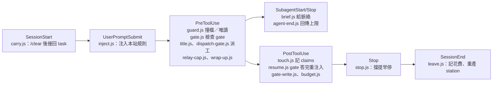

做法：tour 整組刪掉（包括 tour-record.js 和 promo30 的舊測試），各處引用一併拿掉，保留 promo30 決定紀錄與封存頁，另開一筆 TODO 記著之後要做回來；pipeline.md 第 286 行那一節之後，加一張從頭到尾的總覽圖和一張 hooks 時間軸；gate 頁的圖框改成依圖的比例決定高度，不再固定 460px。

| file | change | dispatch |
|---|---|---|
| assets/station/tour*.js, tour.css, tour.html（10 檔） | 刪除 | implementer, sonnet |
| scripts/tour-record.js, tests/tour*.test.js, tests/tour-ctx.js, tests/station-docs-tour.test.js | 刪除 | 同上 |
| assets/station/station.js, chart.js, nav.js, i18n.js, station.css, dash.js, fmt.js | 拿掉 tour 頁與導覽入口（只是註解者照改） | 同上 |
| scripts/station.js:75-79 | STATIC 正規式拿掉 `tour(?:-…)` | 同上 |
| tests/station-view, station-module-lists, station-mod-chart, station-quota-chart, station-todo-panel, station-memo-static, station-dead-wizard, render-cli 的 .test.js | 拿掉 tour 斷言 | 同上 |
| docs/01-guide/station.md, docs/90-agent/reference/station.md, docs/02-architecture/layout.md, docs/README.md, skills/fankeel-ask/SKILL.md, skills/fankeel-land/SKILL.md, skills/fankeel-design/catalog/exclude.json | 拿掉 tour 描述 | 同上 |
| docs/90-agent/todo/（新一筆） | `todo.js new`：station tour 之後做回來，body ≥200 字 | 同上 |
| package.json, .claude-plugin/plugin.json | minor 升版（移除 UI） | 同上 |
| docs/02-architecture/pipeline.md | 加下方兩張 mermaid | implementer, sonnet（與上一組不共用檔案） |
| assets/station/diagram.css:13-14, diagram.js:one() | `.dg-pan` 高度＝圖原生高 × 縮放（下限 80%），夾在 180px 到 85vh 之間；拿掉 `.gt-frame .dg-pan{height:460px}`；`.gt-frame .dg` 寬度＝min(視窗寬−48px, 圖原生寬＋24px)，至少原欄寬，置中突破 1440px 欄寬；縮放下限 80% 不變；手機 mobile.css:699 不動 | implementer, sonnet |
| tests/（diagram 高度測試） | 直立圖框高 > 460、橫向圖框高 < 300 | 同上 |

保留：docs/03-decisions/2026-09-29-promo30.md、docs/99-archive、judgements、reports/patrols、todo/tour-1.md（done）、.claude/worktrees/*。

proves it done: `grep -rli tour assets/station scripts/station.js tests/station-*.test.js` 無結果；全套 suite 綠；station 頁導覽無 tour；gate 頁直立總覽圖的框高超過 460px、hooks 時間軸的框高低於 300px（現在兩者都是 460）；1920 寬視窗下總覽圖框寬 > 1300px（現在受 1440px 欄寬與內距限制）；docs-check.js --root . 對 pipeline.md 無新錯誤。
against the map: .fankeel/map.md:46 寫著 assets/ 含 tour.html——land 時 map.js 會重寫。
unverified: board.js、review-check.js、ci-status.js、skills-check.js 在哪一站呼叫，reader 標成推斷（?）；圖上照標。
spec: in chat → 本檔；畫面原型直接套在 gate 頁上試過（瀏覽器內暫改，未寫檔）：1920×1080 下總覽圖框 1344×918、整張可見，時間軸框 1540×275

## 總覽圖（加進 pipeline.md）

```mermaid
flowchart TB
  U([/fankeel]) --> INIT
  subgraph INIT["進場 init"]
    i1["orient.js — 盤點專案、目錄、TODO"]
    i2["task.js start — 寫 registry，定 class 與 route"]
    i3["onboard.js — 有 onboard: 才跑；docs 樹、CLAUDE.md 是否就緒"]
  end
  INIT --> S
  subgraph S["① survey — 已經有什麼"]
    s1["map.js — 寫 .fankeel/map.md：各目錄用途"]
    s2["survey.js 詞 — 掃檔名、宣告、markdown 標題"]
    s3["todo.js list、layout.js — 相關 TODO、目錄結構"]
    s4["task.js route — 依 class 調整路線"]
  end
  S -->|gate| D
  subgraph D["② design — 同意的做法"]
    d1["render.js、tune.js — 前端才有：mockup 截圖、逐塊微調"]
    d2["board.js check (?) — 交出前檢查 .board"]
  end
  D -->|gate| P
  subgraph P["③ plan — 無脈絡也能執行的拆解"]
    p1["ledger.js --plan — 檢查每項需求都有 task 覆蓋"]
    p2["task.js intends — 預告會碰哪些檔"]
  end
  P -->|gate| B
  subgraph B["④ build — 改動本身"]
    b1["ledger.js groups/ready/complete — 帳本：哪些可並行、做到哪"]
    b2["commit.js — 每個 task 一個 commit"]
    b3["review-check.js (?)、lenses.js — 逐 task 審查"]
    b4["suite.js、docs-check.js — gate 前：全套測試、文件引用"]
  end
  B -->|gate| V
  subgraph V["⑤ verify — 證據，不是信心"]
    v1["ledger.js ranges — 每列需求派一個 verifier"]
    v3["verify-map.js --range — 改了的程式對到哪些測試"]
    v4["security-local.js --range — 本地安全掃描"]
    v5["suite.js、docs-check.js — 全套測試；這次改動讓哪些文件變假"]
  end
  V -->|gate| A
  subgraph A["⑥ audit — 什麼不再為真"]
    a1["docs-check.js、residue.js — 死連結、殘留檔"]
    a2["memory-check.js、input-check.js — 記憶、每回合讀入量"]
    a3["docs-audit.js — 約兩週一次：drift、已落地的 plan、索引"]
    a4["knip、deptry — 沒用到的程式與相依"]
  end
  A -->|gate| L
  subgraph L["⑦ land — 不比你來時更髒"]
    l1["suite.js — 合併前後各一次"]
    l2["todo-check.js、version.js、archive.js — TODO 仍真、版號、封存 plan"]
    l3["map.js — 重寫地圖"]
    l4["land.js merge/clean — 合併、清 worktree"]
    l5["record.js、conversation.js — 紀錄、retro bundle"]
  end
  L --> E([task.js land → 收工])
```



## hooks 時間軸




```json gate
{"questions":[{"header":"Design→Plan","question":"Design -> Plan | fankeel : 移除 tour 並畫 7 階段 mermaid","options":[{"label":"Go to Plan (Recommended)","description":"接受三件事：tour 整組刪＋補 TODO＋升 minor；總覽圖與 hooks 時間軸進 pipeline.md；gate 頁圖框放寬到視窗寬、高度依圖比例（1920 寬下總覽圖整張可見）。"},{"label":"Stay in Design","description":"沒有待決的設計問題；選這個代表圖的內容（哪支腳本放哪站）還想再改。"},{"label":"暫停","description":"next 設為：design 待確認三件事（design.md），gate 圖框原型在瀏覽器內試過。"}],"multiSelect":false}],"next":"design 待確認三件事（design.md）"}
```
