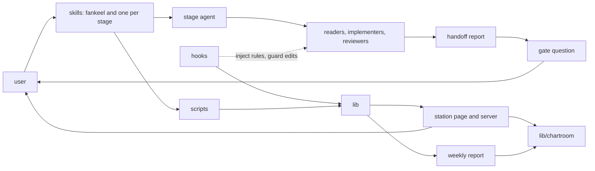

# TODO 全表盤點 Implementation Plan

**Goal:** build the seven do-now entries the 2026-10-27 survey found, and carry out the three TODO decisions the user made at its gate.
**Architecture:** each entry is its own task with its own test or check; TODO bookkeeping is folded into the task that changes the entry it describes. The station days page leaves `station.js` as one module, `assets/station/days-page.js` (`FK_DAYS`), in two tasks: the module first, then the shell rewired to it and the old copy deleted.
**Tech Stack:** Node >=22.5 (`package.json` `engines`), no dependencies, `node --test`; station pages are vanilla classic scripts loaded by `assets/station/index.html`.
**Spec:** [survey.md](../../../.fankeel/build/task-20261027T075400/survey.md)

## Global Constraints

From `CONTRIBUTING.md`, `package.json`, `.fankeel/map.md` and the tests:

- No dependency may be added: `package.json` has `{}` for both `dependencies` and `devDependencies`.
- Tests are `node --test` files under `tests/`; a new test file must be `git add`ed before `tests/source.test.js` can see it, and every exported name needs an importer (`tests/source.test.js`).
- `lib/` never requires from `scripts/` or `hooks/`; `scripts/*.js` are thin wrappers over `lib/` (CONTRIBUTING.md, Scope and ownership).
- A new station route or CLI flag needs its row in `docs/90-agent/reference/station.md`, or `tests/station-doc.test.js` / `tests/station-phone.test.js:133-138` fail.
- TODO entries are written by `scripts/todo.js` (`list | new | done <id> --sha <sha> [--disposition done|measured-no-change|abandoned] [--record <text> --commits <sha,sha>]`, `scripts/todo.js:22-23`); it has no edit command, so a timing or state change is a frontmatter edit followed by `node scripts/todo-check.js`. A Blocked timing is `on: MM-DD`, `after: <what>` or `upstream: <what>` with a `stamp:` (`scripts/todo-check.js:26,62,320`). A body is at least 200 characters (`lib/todo.js:33`).
- `.fankeel/map.md` carries at most `MAX_TREE = 50` rows of `docs/02-architecture/layout.md`'s tree (`lib/map.js:102`), and that tree is already 50 rows: new names are folded into existing rows, never added as rows.
- A mermaid graph naming at least 3 files and 60% of a directory of 4+ files is reported by docs-audit (`scripts/docs-audit.js:51-60`): diagrams name directories and roles, not `.js` files.
- `tests/cjk-docs.test.js:22-23` asserts the exact layout.md phrase "a SubagentHandback is refused while an agent that subagent dispatched has not stopped" — do not reword the budget.js row.
- A station page module is a classic script `(function (w, doc) {...}(typeof window !== 'undefined' ? window : null, typeof document !== 'undefined' ? document : null))` that sets `w.FK_X = api` and `module.exports = api`, adds no listener at load, and is listed once in `assets/station/index.html` before `station.js` (`tests/station-module-lists.test.js:15-23`, `tests/station-modules.test.js:16,20`).
- Each implementer runs only its own test file; the parent runs `node scripts/suite.js --fast` before committing a group. Every release bumps the version with `node scripts/version.js` at land.

## Risks

- `station.js` line numbers move as soon as Task 9 lands — Task 10 — Task 10 re-finds every range below by searching for the quoted names, not by number.
- The mobile file input may not fire `change` the same way in the fake window of `tests/mobile-dom.js` — Task 8 — Task 8 reads `tests/mobile-dom.js` first and dispatches the event through its `fire`.
- The 64 KB `readBody` cap (`lib/body.js:10`) truncates silently — Task 7 — the upload route reads the raw request itself and never calls `formOf`.
- quota-1 and spend-2 bodies still name TokenBar — Task 4 — it rewrites body, description and `group:` too, then runs todo-check.

## Task 1: 板子面板截圖併入 station-61

**Files:**
- Modify: `docs/90-agent/todo/station-61.md` — append the screenshot criteria that 「gate 板子面板缺真截圖」 still owes.

**Interfaces:**
- Consumes: none
- Produces: none — land closes 「gate 板子面板缺真截圖」 with `--disposition abandoned --record "併入 station-61"`, because its own criterion was not met.

**Dispatch:** implementer, sonnet — a paragraph append and one check.

1. Append to the body of `docs/90-agent/todo/station-61.md`, after its done-when line:

```md

併入：2026-10-27 起，「gate 板子面板缺真截圖」(build-15) 的驗收一併在這裡做。那條在 10-27 拍過 412 與 1440，但截圖在 SVG 載入前就拍了，412 寬還會溢出，所以本條完成時要再加兩件事：截圖等板子 SVG 載入後才拍（render.js 的 `--act` 先 `wait`），以及 412 寬不溢出。
```

2. Run `node scripts/todo-check.js` and expect it to exit 0.
3. Commit: `docs: station-61 takes over the board screenshot criteria`.

## Task 2: 三條 TODO 依 gate 的決定處置

**Files:**
- Modify: `docs/90-agent/todo/compact-7.md` — closed by `todo.js done`.
- Modify: `docs/90-agent/todo/spend-6.md` — timing becomes `on: 11-03`.
- Modify: `docs/90-agent/todo/await-16.md` — `state: decision` becomes `state: ready`, with the decided handling.

**Interfaces:**
- Consumes: none
- Produces: none

**Dispatch:** implementer, sonnet — frontmatter edits and two CLI runs.

1. In `docs/90-agent/todo/spend-6.md` frontmatter set `timing: on: 11-03` and `stamp: 2026-10-27`, and append to its body:

```md

2026-10-27 決定：再量一週。session 數 4307 → 475、subagent 佔比 33% → 57%，分母變了，前後兩週不能直接比。2026-11-03 用同一個 usage-compare 指令再量，--before 2026-10-13..2026-10-19、--after 2026-10-27..2026-11-02。
```

2. In `docs/90-agent/todo/await-16.md` frontmatter set `state: ready`, and append to its body:

```md

2026-10-27 決定：做。await.js 在 worktree 與 handoff 都久無寫入時印 `stalled`；固定處置是先用 SendMessage 叫醒一次，仍無進展就停掉重派，交接時列出已 commit 的範圍與未 commit 的 worktree 路徑。
```

3. Run `node scripts/todo-check.js`, expect exit 0, and commit: `docs: spend-6 measured again on 11-03; await-16 is ready`.
4. Close compact-7 against that commit:

```
node scripts/todo.js done compact-7 --sha <the commit from step 3> --disposition measured-no-change --session e79bfd5e-08fd-4a90-98d3-155b25ed1c5b --record "2026-10-27 重量：39 個 session，最高峰值 418279 超過 compact.at 350000 共 68279，p90 318899；只有最高那個超出，接受並結案。"
```

5. Run `node scripts/todo-check.js`, expect exit 0, and commit: `docs: close compact-7, measured with no change`.

## Task 3: quota.js 改讀 limits 記錄

**Files:**
- Modify: `lib/quota.js` — `readings(text)` accepts a limits row as well as a TokenBar line.
- Modify: `scripts/quota.js` — the default source is every `.fankeel/build/limits/*.jsonl` joined; `--log` still overrides.
- Read: `hooks/pane-limits.ts` — the `LimitRow` shape (`at`, `seven`, `sevenResets`, ISO strings, whole percent).
- Test: `tests/quota.test.js`

**Interfaces:**
- Consumes: none
- Produces: `readings(text) -> [{at: seconds, pct, resetsAt: seconds}]`, unchanged in shape; `limitsText(root) -> string` exported from `lib/quota.js`.

**Dispatch:** implementer, sonnet — the plan carries the code.

1. Write the failing tests, in `tests/quota.test.js` beside the existing `readings` test:

```js
test('readings take a limits row too: ISO times become seconds, seven is the percent', () => {
    const row = JSON.stringify({ at: '2026-10-27T05:23:13.593Z', task: 't', stage: 'survey', five: 9, fiveResets: null, seven: 40, sevenResets: '2026-10-29T19:00:00.000Z' });
    assert.deepEqual(quota.readings([row, line(100, 10, 9000)].join('\n')), [
        { at: 100, pct: 10, resetsAt: 9000 },
        { at: Date.parse('2026-10-27T05:23:13.593Z') / 1000, pct: 40, resetsAt: Date.parse('2026-10-29T19:00:00.000Z') / 1000 },
    ]);
});

test('limitsText joins every session file under .fankeel/build/limits', () => {
    const root = mkTmp('fankeel-quota-limits-');
    const dir = path.join(root, '.fankeel', 'build', 'limits');
    fs.mkdirSync(dir, { recursive: true });
    fs.writeFileSync(path.join(dir, 'a.jsonl'), '{"x":1}\n');
    fs.writeFileSync(path.join(dir, 'b.jsonl'), '{"x":2}\n');
    fs.writeFileSync(path.join(dir, 'skip.txt'), 'no');
    assert.equal(quota.limitsText(root).split('\n').filter(Boolean).length, 2);
    assert.equal(quota.limitsText(path.join(root, 'none')), '');
});
```

2. Run `node --test tests/quota.test.js` and watch both fail.
3. In `lib/quota.js`, replace `readings` and add `limitsText` (export it beside the others at the `module.exports` line):

```js
// Two sources: a limits row (hooks/pane-limits.ts — ISO times, `seven` in
// whole percent) and the older TokenBar line (seconds, `seven_day_pct`).
function readings(text) {
    const out = [];
    for (const raw of String(text || '').split('\n')) {
        if (!raw.trim()) continue;
        let j;
        try { j = JSON.parse(raw); } catch (e) { continue; }
        if (!j) continue;
        if (typeof j.at === 'string' && typeof j.seven === 'number' && typeof j.sevenResets === 'string') {
            const at = Date.parse(j.at) / 1000, resetsAt = Date.parse(j.sevenResets) / 1000;
            if (Number.isFinite(at) && Number.isFinite(resetsAt)) out.push({ at, pct: j.seven, resetsAt });
            continue;
        }
        if (typeof j.at !== 'number' || typeof j.seven_day_pct !== 'number' || typeof j.seven_day_resets_at !== 'number') continue;
        out.push({ at: j.at, pct: j.seven_day_pct, resetsAt: j.seven_day_resets_at });
    }
    return out.sort((a, b) => a.at - b.at);
}

// Every session's limits file, one text: sessions overlap in time, and
// readings() sorts what it keeps.
function limitsText(root) {
    const dir = path.join(root, '.fankeel', 'build', 'limits');
    let names;
    try { names = fs.readdirSync(dir); } catch (e) { return ''; }
    return names.filter((n) => n.endsWith('.jsonl')).sort()
        .map((n) => fs.readFileSync(path.join(dir, n), 'utf8')).join('\n');
}
```

Add `const fs = require('fs'); const path = require('path');` at the top of `lib/quota.js` if they are not there.

4. In `scripts/quota.js`, where it reads `<claude dir>/tokenbar-usage.jsonl` (line 32), make the text `--log`'s file when given and `quota.limitsText(<registry root>)` otherwise, finding the registry root the way `scripts/task.js` does (`require('../lib/registry')`'s root lookup); rewrite the header comment (lines 4-12) and `lib/quota.js:17` to name the limits records instead of TokenBar.
5. Run `node --test tests/quota.test.js` and watch it pass.
6. Commit: `feat: quota.js reads the limits records`.

## Task 4: quota-1 與 spend-2 改等 limits 記錄

**Files:**
- Modify: `docs/90-agent/todo/quota-1.md` — timing, description, body and `group:` stop naming TokenBar.
- Modify: `docs/90-agent/todo/spend-2.md` — the same.

**Interfaces:**
- Consumes: `limitsText(root)` and the new `readings` from Task 3, by name in the entry bodies.
- Produces: none

**Dispatch:** implementer, sonnet — two frontmatter edits.

1. In `docs/90-agent/todo/quota-1.md` set `timing: after: .fankeel/build/limits 的 sevenResets 跨過一次 7d reset`, `stamp: 2026-10-27` and `group: limits 記錄跨過一次 reset`; in the description and body replace every mention of TokenBar or tokenbar-usage.jsonl with the limits records (hooks/pane-limits.ts writes them, lib/quota.js's readings reads them since this task's commit).
2. In `docs/90-agent/todo/spend-2.md` set `timing: after: .fankeel/build/limits 在一個 7 天視窗內 seven 累積動 10 點以上`, `stamp: 2026-10-27` and the same `group:`; rewrite its TokenBar mentions the same way and keep `MIN_POINTS = 10` as the reason.
3. Write the paths without backticks around the glob, so todo-check does not try to resolve them.
4. Run `node scripts/todo-check.js`, expect exit 0, and commit: `docs: quota-1 and spend-2 wait on the limits records`.

## Task 5: layout 補列與框架圖

**Files:**
- Modify: `docs/02-architecture/layout.md` — board, chartroom and weekly folded into existing rows; one mermaid diagram above the tree.

**Interfaces:**
- Consumes: none
- Produces: none

**Dispatch:** implementer, sonnet — text into existing rows and one diagram, checked by scripts.

1. In `docs/02-architecture/layout.md`, in the tree under `## What lives where`, extend the lib station.js row (the one ending "…mobile.js and phone.js are the phone page's data and its channel to a session") with:

```md
; board.js lists a task's Chartroom .board files and board-edit.js applies the gate page's edits to them, drawn by the vendored chartroom/ (core/ 6, geometry/ 7, dynamic import() only); weekly-*.js are the weekly report (git, collect, modules, render, store)
```

2. In `docs/02-architecture/layout.md`, extend the scripts station.js row ("writes the station page, or serves it live") with:

```md
; board.js checks a .board before it is handed on, weekly.js is the weekly report's command line
```

3. In `docs/02-architecture/layout.md`, insert above the tree's fence, after the section's first paragraph:

````md

````

4. Set `last_verified: 2026-10-27` in the frontmatter.
5. Run `node scripts/map.js` and check `.fankeel/map.md` still says `tree — 50 rows` and still ends its tree with the `tests/` row; then run `node scripts/docs-check.js --root .` and `node scripts/docs-audit.js` and expect neither to report layout.md.
6. Commit: `docs: layout names board, chartroom and weekly; framework diagram`.

## Task 6: plan 展開渲染 markdown

**Files:**
- Modify: `assets/station/focus-page.js` — `md(text)` added and used by `fpBody`.
- Modify: `assets/station/station.css:2250-2275` — rules for `.tb-md` beside `.tb-pre` (line 2260).
- Test: `tests/station-focus-page.test.js`

**Interfaces:**
- Consumes: `esc` (focus-page.js:63, over `FK_KIT.esc`)
- Produces: `FK_FOCUS.md(text) -> string` (HTML)

**Dispatch:** implementer, sonnet — the plan carries the renderer.

1. Write the failing tests in `tests/station-focus-page.test.js`, and change the existing test at lines 47-59 to read the body from `<div class="tb-md">` instead of `<pre class="tb-pre">`, asserting the first heading's text is present rather than byte equality:

```js
test('md: headings, lists, bold, inline code, tables and fenced code, all escaped', () => {
    const html = F.md('## Task 1: a <b>\n\n- **Files:** `x.js`\n1. one\n\n| a | b |\n|---|---|\n| `c` | d |\n\n```js\nif (a < b) { /* ## not a heading */ }\n```');
    assert.match(html, /<h2>Task 1: a &lt;b&gt;<\/h2>/);
    assert.match(html, /<ul><li><strong>Files:<\/strong> <code>x\.js<\/code><\/li><\/ul>/);
    assert.match(html, /<ol><li>one<\/li><\/ol>/);
    assert.match(html, /<table><thead><tr><th>a<\/th><th>b<\/th><\/tr><\/thead><tbody><tr><td><code>c<\/code><\/td><td>d<\/td><\/tr><\/tbody><\/table>/);
    assert.match(html, /<pre><code class="lang-js">if \(a &lt; b\) \{ \/\* ## not a heading \*\/ \}<\/code><\/pre>/);
});

test('md: a checkbox stays its literal text, and plain lines become a paragraph', () => {
    assert.equal(F.md('- [ ] step\n\nsome\ntext'), '<ul><li>[ ] step</li></ul><p>some text</p>');
});
```

2. Run `node --test tests/station-focus-page.test.js` and watch them fail.
3. In `assets/station/focus-page.js`, above `fpBody`, add:

```js
  // A plan task's body as HTML: the subset plans use — ## to ####, - and 1.
  // lists, | tables, ``` fences, **bold** and `code`. Everything is escaped
  // first; a fence's contents are never parsed.
  function mdInline(s) {
    return esc(s).replace(/`([^`]+)`/g, '<code>$1</code>').replace(/\*\*([^*]+)\*\*/g, '<strong>$1</strong>');
  }
  function mdCells(line) {
    return line.trim().replace(/^\||\|$/g, '').split('|').map(function (c) { return c.trim(); });
  }
  function md(text) {
    var lines = String(text || '').replace(/\r/g, '').split('\n'), out = [], i = 0, para = [];
    function flush() { if (para.length) { out.push('<p>' + mdInline(para.join(' ')) + '</p>'); para = []; } }
    while (i < lines.length) {
      var l = lines[i], m;
      if ((m = /^```(\S*)/.exec(l))) {
        flush();
        var code = [];
        for (i++; i < lines.length && !/^```/.test(lines[i]); i++) code.push(lines[i]);
        i++;
        out.push('<pre><code' + (m[1] ? ' class="lang-' + esc(m[1]) + '"' : '') + '>' + esc(code.join('\n')) + '</code></pre>');
        continue;
      }
      if ((m = /^(#{2,4})\s+(.*)$/.exec(l))) { flush(); out.push('<h' + m[1].length + '>' + mdInline(m[2]) + '</h' + m[1].length + '>'); i++; continue; }
      if (/^\s*\|/.test(l) && i + 1 < lines.length && /^\s*\|?\s*:?-{3,}/.test(lines[i + 1])) {
        flush();
        var head = mdCells(l), body = [];
        for (i += 2; i < lines.length && /^\s*\|/.test(lines[i]); i++) body.push(mdCells(lines[i]));
        out.push('<table><thead><tr>' + head.map(function (c) { return '<th>' + mdInline(c) + '</th>'; }).join('') + '</tr></thead><tbody>'
          + body.map(function (r) { return '<tr>' + r.map(function (c) { return '<td>' + mdInline(c) + '</td>'; }).join('') + '</tr>'; }).join('')
          + '</tbody></table>');
        continue;
      }
      if ((m = /^\s*([-*]|\d+\.)\s+(.*)$/.exec(l))) {
        flush();
        var tag = /\d/.test(m[1]) ? 'ol' : 'ul', items = [];
        while (i < lines.length && (m = /^\s*([-*]|\d+\.)\s+(.*)$/.exec(lines[i])) && (/\d/.test(m[1]) ? 'ol' : 'ul') === tag) { items.push('<li>' + mdInline(m[2]) + '</li>'); i++; }
        out.push('<' + tag + '>' + items.join('') + '</' + tag + '>');
        continue;
      }
      if (!l.trim()) { flush(); i++; continue; }
      para.push(l.trim());
      i++;
    }
    flush();
    return out.join('');
  }
```

4. In `fpBody`, replace `'<pre class="tb-pre">' + esc(t.body) + '</pre></details>'` with `'<div class="tb-md">' + md(t.body) + '</div></details>'`, and add `md: md` to `var api = { ... }` at the end of the file.
5. In `assets/station/station.css`, after the `.tb-pre` rule (line 2260-2262), add:

```css
.tb-md{margin:6px 0 2px;padding:10px 12px;max-height:28em;overflow:auto;overscroll-behavior:contain;background:var(--inset);border:1px solid var(--rule);border-radius:var(--r-sm);color:var(--ink2);overflow-wrap:anywhere}
.tb-md h2,.tb-md h3,.tb-md h4{margin:10px 0 4px;font-size:13px;color:var(--ink)}
.tb-md p,.tb-md ul,.tb-md ol{margin:4px 0}
.tb-md ul,.tb-md ol{padding-left:1.4em}
.tb-md code{font:11.5px var(--f-mono)}
.tb-md pre{margin:6px 0;padding:8px 10px;overflow-x:auto;background:var(--paper,transparent);border:1px solid var(--rule);border-radius:var(--r-sm);font:12px/1.6 var(--f-mono);white-space:pre;tab-size:4}
.tb-md table{display:block;overflow-x:auto;border-collapse:collapse;margin:6px 0}
.tb-md th,.tb-md td{border:1px solid var(--rule);padding:3px 8px;text-align:left;vertical-align:top}
```

6. Run `node --test tests/station-focus-page.test.js tests/station-focus-module.test.js` and watch them pass.
7. Commit: `feat: the gate focus page renders a plan task's markdown`.

## Task 7: 站台收手機上傳的圖片

**Files:**
- Modify: `scripts/station.js:960-1010` — `POST /phone/upload` beside the `PHONE_ACT` block (line 984).
- Modify: `docs/90-agent/reference/station.md:1470-1490` — the route's sentence beside `/phone/say` (line 1479).
- Read: `lib/phone.js` — `dirOf(root, sid)`.
- Test: `tests/station-phone.test.js`

**Interfaces:**
- Consumes: none
- Produces: `POST /phone/upload?root=<root>&id=<sid>&ext=<png|jpeg|webp|gif>[&nonce=<nonce>]`, raw image body, 201 with the saved file's absolute path and a newline; 403 unpaired, 404 unknown session, 413 over 10 MB, 415 not an image.

**Dispatch:** implementer, sonnet — the plan carries the route; the test copies the file's own fixture.

1. Write the failing test in `tests/station-phone.test.js`, using its `fixture()`, `start()`, `request()` and `as(cookie)` helpers the way the say test at :72-99 does:

```js
test('POST /phone/upload saves an image under the session and answers its path', async () => {
    const f = fixture();
    const s = await start(f);
    try {
        const q = '?root=' + encodeURIComponent(f.r1) + '&id=' + SID + '&ext=png';
        const png = Buffer.from([0x89, 0x50, 0x4e, 0x47, 1, 2, 3]);
        assert.equal((await request(s.url + 'phone/upload' + q, { headers: Object.assign({ 'content-type': 'image/png' }, TAILNET), body: png })).status, 401);
        const r = await request(s.url + 'phone/upload' + q, { headers: Object.assign({ 'content-type': 'image/png' }, as(f.cookie)), body: png });
        assert.equal(r.status, 201);
        const saved = r.body.trim();
        assert.ok(path.isAbsolute(saved) && saved.endsWith('.png'), saved);
        assert.deepEqual(fs.readFileSync(saved), png);
        assert.equal((await request(s.url + 'phone/upload' + q, { headers: Object.assign({ 'content-type': 'text/plain' }, as(f.cookie)), body: Buffer.from('x') })).status, 415);
        assert.equal((await request(s.url + 'phone/upload?root=' + encodeURIComponent(f.r1) + '&id=nope&ext=png', { headers: Object.assign({ 'content-type': 'image/png' }, as(f.cookie)), body: png })).status, 404);
    } finally {
        s.close();
    }
});
```

If `request()` only sends string bodies, widen it to pass a Buffer through unchanged, in the same file. Add the string '/phone/upload' to the route list of the test at :133-138.

2. Run `node --test tests/station-phone.test.js` and watch it fail.
3. In `scripts/station.js`, immediately above `const PHONE_ACT = …`, add:

```js
        // A photo from the phone's answer box: the raw body, saved under the
        // session's phone directory, answered with its path — the box puts
        // that path in its text, and the session reads the file.
        if (req.method === 'POST' && url.pathname === '/phone/upload') {
            if (!device && url.searchParams.get('nonce') !== nonce) return fail(401, 'not paired');
            if (!/^image\//.test(String(req.headers['content-type'] || ''))) return fail(415, 'an image only');
            const reg = sharedModel().registries.find((r) => r.root === path.resolve(url.searchParams.get('root') || ''));
            const id = url.searchParams.get('id') || '';
            if (!reg || !reg.sessions.find((x) => x.sessionId === id)) return fail(404, 'no such session on this station');
            const ext = (url.searchParams.get('ext') || 'png').replace(/[^a-z0-9]/g, '').slice(0, 5) || 'png';
            const chunks = [];
            let n = 0;
            for await (const c of req) {
                n += c.length;
                if (n > 10 * 1024 * 1024) { req.destroy(); return fail(413, 'image over 10 MB'); }
                chunks.push(c);
            }
            const file = path.join(phone.dirOf(reg.root, id), 'uploads', Date.now() + '.' + ext);
            fs.mkdirSync(path.dirname(file), { recursive: true });
            fs.writeFileSync(file, Buffer.concat(chunks));
            return send(201, 'text/plain; charset=utf-8', file + '\n');
        }
```

Use whichever of `sharedModel()` / `modelNow()` the neighbouring `/station/phone.json` route uses (it is `sharedModel()` at line 977), and match the 401 the tailnet test expects for an unpaired caller.

4. In `docs/90-agent/reference/station.md`, after the sentence ending "…a second waiting message (409), and answers 201." (line 1482), add:

```md
`POST /phone/upload?root=&id=&ext=` takes a photo as the raw request body
(`content-type: image/*`, at most 10 MB): it is saved under the session's phone
directory as `uploads/<ms>.<ext>` and answered 201 with that file's absolute
path, which the answer box appends to its text as `[圖片] <path>` so the session
can read it; 401 unpaired, 404 not on this station, 413 too large, 415 not an
image.
```

5. Run `node --test tests/station-phone.test.js tests/station-doc.test.js` and watch them pass.
6. Commit: `feat: the station takes a photo from the phone`.

## Task 8: 手機回答框附圖片

**Files:**
- Modify: `assets/station/mobile.js` — a photo button and file input in `composer()` (line ~487-497) and in `gateCard()` (line ~441-456).
- Read: `tests/mobile-dom.js` — the fake window's `fire` and element shape.
- Test: `tests/station-mobile-page.test.js`

**Interfaces:**
- Consumes: `POST /phone/upload` from Task 7 — its query, raw body and the path it answers.
- Produces: none

**Dispatch:** implementer, sonnet — the plan carries the client code.

1. Write the failing test in `tests/station-mobile-page.test.js`, beside the composer test at :320-333:

```js
test('boot: a photo picked in the composer is uploaded raw and its path lands in the box', async () => {
    const page = boot({ hash: '#/s/aaaaaaaa-5', fetch: routed(sess('holding', { id: 'aaaaaaaa-5', attached: true }), { '/phone/upload': '/w/.fankeel/station/phone/aaaaaaaa-5/uploads/1.png\n' }) });
    await settle();
    const input = page.$('#cmp-file');
    input.files = [{ type: 'image/png', name: 'a.png' }];
    page.fire('change', { target: input });
    await settle();
    const up = callsTo(page, '/phone/upload');
    assert.equal(up.length, 1);
    assert.equal(up[0].init.method, 'POST');
    assert.equal(up[0].init.headers['content-type'], 'image/png');
    assert.match(up[0].url, /root=%2Fw&id=aaaaaaaa-5&ext=png/);
    assert.match(page.$('#cmp-box').value, /\[圖片\] \/w\/\.fankeel\/station\/phone\/aaaaaaaa-5\/uploads\/1\.png$/);
});
```

Adapt `page.$`, `routed`'s extra-route argument and `fire`'s event shape to what `tests/mobile-dom.js` and the file's own helpers actually provide — read them first and keep the assertions.

2. Run `node --test tests/station-mobile-page.test.js` and watch it fail.
3. In `assets/station/mobile.js`, add beside `post`:

```js
  // A photo goes up raw, not through post(): the station answers the saved
  // file's path, and the box carries that path to the session as text.
  function upload(file, p) {
    var ext = String(file.type || '').split('/')[1] || 'png';
    return win.fetch('/phone/upload?root=' + encodeURIComponent(p.root) + '&id=' + encodeURIComponent(p.id)
      + '&ext=' + encodeURIComponent(ext.replace(/[^a-z0-9]/g, '')),
      { method: 'POST', credentials: 'same-origin', headers: { 'content-type': file.type }, body: file })
      .then(function (r) { return r.text().then(function (t) { if (!r.ok) throw new Error(t); return t.trim(); }); });
  }
  function attachTo(box, file, p) {
    return upload(file, p).then(function (where) {
      box.value += (box.value ? '\n' : '') + '[圖片] ' + where;
      box.dispatchEvent && box.dispatchEvent(new win.Event('input'));
    });
  }
```

In `composer()`, next to the mic button, add `'<label class="cmp-pic" title="附圖片"><input type="file" id="cmp-file" accept="image/*" hidden>' + icon('image') + '</label>'` (use the mic button's icon helper; if there is no `image` icon, the text `圖`), and in `gateCard()` the same with `class="gq-file"` instead of the id. In `assets/station/mobile.js`, in the page's `change` listener (where the composer's other inputs are handled), add:

```js
    if (e.target && (e.target.id === 'cmp-file' || e.target.classList && e.target.classList.contains('gq-file')) && e.target.files && e.target.files[0]) {
      var box = e.target.id === 'cmp-file' ? doc.getElementById('cmp-box') : e.target.closest('form').querySelector('.own');
      attachTo(box, e.target.files[0], current()).catch(function (err) { toast(String(err.message || err)); });
    }
```

Use the module's existing `current()` (the selected session's `{root, id}`) and its existing error toast, whatever they are named.

4. Run `node --test tests/station-mobile-page.test.js` and watch it pass.
5. Commit: `feat: the phone answer box attaches a photo`.

## Task 9: days 頁成為自己的模組

**Files:**
- Modify: `assets/station/days-page.js` — new: `FK_DAYS`, the days page and its chart hover/legend state.
- Modify: `assets/station/index.html` — its `<script src="station/days-page.js">` line before `station.js` (lines 33-54).
- Modify: `assets/station/i18n.js` — the `loc` keys days-page.js carries in its own `EN` table, dropped; until Task 10 station.js's copy falls back to its default strings for them.
- Read: `tests/station-focus-module.test.js` — the module-load test this task's test copies.
- Read: `assets/station/station.js` — the days block (`var chartBars` … `module.exports.daysPage`, today 2392-2524) and `legendArm` / `chartSet` / `cssKey` / `legendToggle` / `panelShut` (today 5226-5264), copied, not moved yet.
- Test: `tests/station-days-module.test.js`
- Test: `tests/station-modules.test.js`

**Interfaces:**
- Consumes: none
- Produces: `w.FK_DAYS = { page(r, ctx), restore(), hide(), focusPin(), arm(), toggle(el), panelShut(focusBtn), setPanel(open), panelOpen(), hovering(), onMove(e, ctx) }` where `ctx = { S, view, route, NOW, DAYS, PREV, TODAY, frozenAt, draw, H }` and `H` holds the station.js helpers `homeRows, homeOpts, dayBars, visibleBars, histSvg, legendHtml, filterHtml, windowTotals, kpiHtml, segHtml, subtabsHtml, icon, heroEyebrow, loc, DIM_LABEL, NO_TIME_TYPE, dashByProj, dashTokens7, dashModels, segTip, legendRest`.

**Dispatch:** implementer, opus — the chart state is shared with the shell's listeners, and which half owns it has to be reasoned about rather than transcribed.

1. Write the failing test `tests/station-days-module.test.js`, modelled on `tests/station-focus-module.test.js:15-23`:

```js
'use strict';
const test = require('node:test');
const assert = require('node:assert/strict');
const fs = require('fs');
const path = require('path');
const vm = require('vm');
const ASSETS = path.join(__dirname, '..', 'assets', 'station');

test('days-page.js sets FK_DAYS and adds no listener at load', () => {
    const added = [];
    const win = {};
    vm.runInNewContext(fs.readFileSync(path.join(ASSETS, 'days-page.js'), 'utf8'),
        { window: win, document: { addEventListener(type) { added.push(type); } }, module: { exports: {} } });
    assert.deepEqual(added, []);
    for (const k of ['page', 'restore', 'hide', 'focusPin', 'arm', 'toggle', 'panelShut', 'setPanel', 'panelOpen', 'hovering', 'onMove']) assert.equal(typeof win.FK_DAYS[k], 'function', k);
});
```

and add `'days-page.js'` with global `'FK_DAYS'` to the `AFTER` array and `GLOBAL` map of `tests/station-modules.test.js` (lines 16, 20).

2. Run `node --test tests/station-days-module.test.js tests/station-modules.test.js` and watch them fail.
3. Write `assets/station/days-page.js`:

```js
// 近 30 天 (FK_DAYS): the days chart page and the hover, legend and 篩選
// state that outlives one draw. station.js routes to it, runs the listeners
// and hands it ctx — its helpers in ctx.H — on every call.
(function (w, doc) {
  'use strict';
  var chartBars = null, chartOpts = null, chartPin = null, chartHover = false, chartOff = {}, chartPanel = false;
  var chartAt = null;
  var C = null;
  // chartTipEl, chartFocus, chartGuide, chartHide, chartPlace, chartRestore:
  // the bodies of station.js's functions of those names, unchanged except that
  // segTip is C.H.segTip.
  // page(r, ctx): station.js's daysPage body with C = ctx first, every bare
  // helper read as C.H.<name>, and view, route, S, NOW, DAYS, PREV, TODAY,
  // frozenAt and draw read off C.
  // legendArm, chartSet, cssKey, legendToggle, panelShut: station.js's bodies,
  // with draw as C.draw, loc as C.H.loc, legendRest as C.H.legendRest.
  // onMove(e, ctx): the body of station.js's days mousemove listener, with
  // C = ctx first.
  var api = {
    page: function (r, ctx) { C = ctx; return daysPage(r); },
    restore: function () { chartRestore(); },
    hide: function () { chartHide(); },
    focusPin: function () { chartFocus(chartPin); },
    arm: function () { legendArm(); },
    toggle: function (el) { legendToggle(el); },
    panelShut: function (focusBtn) { panelShut(focusBtn); },
    setPanel: function (open) { chartPanel = Boolean(open); },
    panelOpen: function () { return chartPanel; },
    hovering: function () { return chartHover; },
    onMove: function (e, ctx) { C = ctx; move(e); },
  };
  if (typeof module !== 'undefined' && module.exports) module.exports = api;
  if (w) w.FK_DAYS = api;
}(typeof window !== 'undefined' ? window : null, typeof document !== 'undefined' ? document : null));
```

Fill each comment with the named station.js body copied verbatim under the renames it states — `daysPage` and `move` as named functions inside the closure — and move any `loc` keys it uses into a module `EN` table the way `assets/station/weekly-page.js` does, dropping them from `assets/station/i18n.js` so `stringsLeft` in `tests/station-module.js` stays clean. `station.js` is not touched in this task: both copies exist until Task 10.

4. Add `<script src="station/days-page.js"></script>` to `assets/station/index.html` with the other page modules, before `station.js`.
5. Run `node --test tests/station-days-module.test.js tests/station-modules.test.js tests/station-module-lists.test.js` and watch them pass.
6. Commit: `refactor: FK_DAYS module beside the days page it will replace`.

## Task 10: station.js 改用 FK_DAYS，刪掉舊的 days 碼

**Files:**
- Modify: `assets/station/station.js:2380-2530` — the days block deleted.
- Modify: `assets/station/station.js:4380-5300` — `VIEWS.days`, `draw()`'s chart hooks, the mousemove listener's registration, the click and keydown lines and `legendArm` … `panelShut` rewired to `w.FK_DAYS`.
- Test: `tests/station-days-module.test.js`
- Test: `tests/station-spend-page.test.js`

**Interfaces:**
- Consumes: `w.FK_DAYS` from Task 9, exactly as its Interfaces block names it.
- Produces: none

**Dispatch:** implementer, opus — the shell's listeners and draw hooks change owner, and each call site has to be read before it is rewired.

1. Add to `tests/station-days-module.test.js` the failing test that station.js no longer holds the days state:

```js
test('station.js routes 近 30 天 to FK_DAYS and holds none of its chart state', () => {
    const src = fs.readFileSync(path.join(ASSETS, 'station.js'), 'utf8');
    for (const name of ['var chartBars', 'function chartRestore', 'function daysPage', 'function legendToggle']) assert.ok(!src.includes(name), name);
    assert.match(src, /VIEWS\.days = function \(r\) \{ return w\.FK_DAYS\.page\(r, daysCtx\(\)\); \};/);
});
```

2. Run `node --test tests/station-days-module.test.js` and watch it fail.
3. In `assets/station/station.js`, delete the block from the comment "What daysPage last drew" through `module.exports.daysPage = daysPage;`, and the functions `legendArm`, `chartSet`, `cssKey`, `legendToggle`, `panelShut`. Find each by those names — Task 9 did not move them, but other commits may have shifted the numbers.
4. Where `VIEWS.days = daysPage;` was, add:

```js
    // 近 30 天 is FK_DAYS (assets/station/days-page.js): it keeps the chart's
    // hover, legend and 篩選 state; this file hands it the helpers each call.
    function daysCtx() {
        return { S: S, view: view, route: route, NOW: NOW, DAYS: DAYS, PREV: PREV, TODAY: TODAY, frozenAt: frozenAt, draw: draw,
            H: { homeRows: homeRows, homeOpts: homeOpts, dayBars: dayBars, visibleBars: visibleBars, histSvg: histSvg, legendHtml: legendHtml,
                filterHtml: filterHtml, windowTotals: windowTotals, kpiHtml: kpiHtml, segHtml: segHtml, subtabsHtml: subtabsHtml, icon: icon,
                heroEyebrow: heroEyebrow, loc: loc, DIM_LABEL: DIM_LABEL, NO_TIME_TYPE: NO_TIME_TYPE, dashByProj: dashByProj,
                dashTokens7: dashTokens7, dashModels: dashModels, segTip: segTip, legendRest: legendRest } };
    }
    VIEWS.days = function (r) { return w.FK_DAYS.page(r, daysCtx()); };
    doc.addEventListener('mousemove', function (e) { if (route.view === 'days' && w.FK_DAYS) w.FK_DAYS.onMove(e, daysCtx()); });
```

5. In `assets/station/station.js`, in `draw()`, replace the chart hooks with:

```js
        var D = w.FK_DAYS;
        if (D && D.hovering() && route.view === 'days') D.restore();
        else if (D && D.hovering()) D.hide();
        else if (D && route.view === 'days') D.focusPin();
        if (D && route.view === 'days') D.arm();
```

6. Rewire the remaining call sites: in the click listener's days lines (today ~4822-4832) every `legendToggle(x)` becomes `w.FK_DAYS.toggle(x)`, every `chartPanel = v` becomes `w.FK_DAYS.setPanel(v)` and every read of `chartPanel` becomes `w.FK_DAYS.panelOpen()`; in the keydown listener (today ~5266, ~5282-5283) `panelShut(b)` becomes `w.FK_DAYS.panelShut(b)` and `legendToggle(x)` becomes `w.FK_DAYS.toggle(x)`. Then `grep -n "chart[A-Z]\|legendArm\|legendToggle\|panelShut\|daysPage" assets/station/station.js` must print nothing but `daysCtx`'s lines.
7. Tests that call `daysPage` off station.js's exports (`tests/station-spend-page.test.js:57`) now call `FK_DAYS.page` through `page(['days-page.js'], …)` from `tests/station-module.js`, passing a `ctx` built the same way — change them in the same commit.
8. Run `node --test tests/station-days-module.test.js tests/station-spend-page.test.js tests/station-module-lists.test.js tests/station-modules.test.js`, then `node scripts/suite.js --fast`, and watch them pass.
9. Commit: `refactor: station.js hands 近 30 天 to FK_DAYS`.

## Task 11: 真 gate 上標記 mermaid 節點並送出

**Files:**
- Modify: `docs/90-agent/todo/entry-4.md` — a line recording the round and its answer file.

**Interfaces:**
- Consumes: none
- Produces: none

**Dispatch:** user — the round is a person clicking a node on a real gate page in their own browser; render.js's headless profile has no pairing and no live gate to answer.

1. At build's gate, open the station gate page for this session, click one node of any mermaid diagram on it, check the answer box now holds `標記：`, and send it.
2. The session checks `.fankeel/build/task-20261027T075400/build-answer.md` holds `標記：` and that the gate's tool result came back as answered on the station.
3. Append to `docs/90-agent/todo/entry-4.md`'s body: `2026-10-27 真 gate：標記一個節點後送出，build-answer.md 收到「標記：…」，hooks/gate.js 以 answered on the station 放行。` and commit: `docs: entry-4 real gate round recorded`.

## Coverage

| promise | task |
|---|---|
| build-15 — 寫入結案紀錄並併入 station-61 | Task 1, closed at land |
| docs-11 — 補列、重生 map.md、試畫框架圖 | Task 5 |
| entry-4 — 補「標記→送出→hooks/gate.js 收到」一輪後結案 | Task 11, closed at land by the `todo.js done` line `stage land` prints |
| quota-2 — 改讀 limits 記錄，並把 quota-1、spend-2 的 timing 改成等新記錄 | Task 3, Task 4 |
| station-52 — 再開一份計畫，每份最多兩個任務寫 station.js | Task 9, Task 10 (days page; list and the detail panel stay for the next plan) |
| station-60 — 先決定圖怎麼傳進 session，再做 | Task 7, Task 8 (decided: raw upload, the path travels as text) |
| station-62 — 寫不引外部依賴的渲染函式 | Task 6 |
| compact-7 — 接受並結案 | Task 2 |
| spend-6 — 再量一週，on: 11-03 | Task 2 |
| await-16 — 加 stalled 判斷，轉 Ready | Task 2 |
