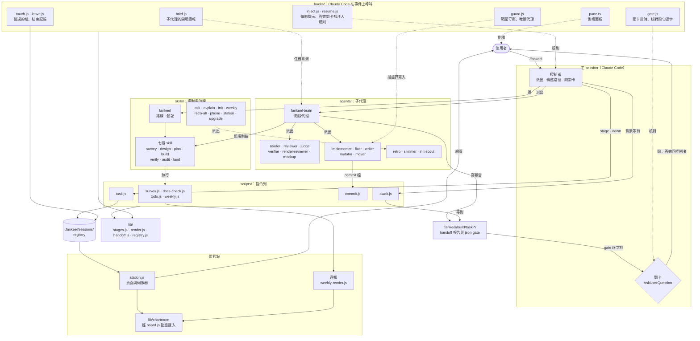

# 專案框架圖與七段流程圖重畫 Implementation Plan

**Goal:** 把 mockup 的兩塊落回正式頁：七段流程圖區換成 `stages-main`、`stages-legend`、`stages-build-inside`，`layout.md` 的框架圖換成 `arch2.mmd`。

**Architecture:** 兩項交付各動一個頁面、各配一個既有測試檔，互不共用檔案，可同時開工。
流程圖的來源是已經調過一次的 mockup（request r-0074：`stages-build-inside` 共 8 張步驟卡，框架圖的拖拉範圍照 `assets/station/diagram.js`）；實作只做擷取與搬移，不重新設計。
每項先在測試裡寫下它的形狀（三條 class 線的段數、8 張步驟卡、框架圖的四個名字與 chartroom 的邊），看它紅，再換圖。

**Tech Stack:** Node >=22.5（`package.json` engines），`node:test`、`node:assert/strict`、`node:fs`、`node:path`，無任何依賴；頁面自含，不載入外部資源。

**Spec:** ../../../.fankeel/build/task-20261101T063810/design.md

mockup：`../../../.fankeel/build/2026-11-01-project-diagrams/mockup.html`（Task 1 的區塊來源，與 `page.css`、`gen.js` 同一資料夾；框架圖來源是同資料夾的 `arch2.mmd`）。

## Global Constraints

- `package.json` 沒有 `dependencies`，不得新增；測試只用 `node:test`、`node:assert/strict`、`node:fs`、`node:path`（`lib/stages.js` 以 `require` 讀入，算專案內檔案）。
- `package.json` 的 `engines` 是 `node >=22.5`；測試以 `node --test` 跑，單檔跑法 `node --test tests/<file>.js`。
- `.fankeel/docs.json`：`docs/01-guide` 是 `role: reference`、`audience: human`，`docs/02-architecture` 是 `role: reference`、`audience: human`；兩者都用繁體中文、frontmatter 帶 `status`、`last_verified`、`source_of_truth`。`layout.md` 的 `last_verified` 設成 `2026-11-01`。
- `.fankeel/docs.json` 的 `layout` 指向 `docs/02-architecture/layout.md` 的 `What lives where` 標題：只換 :20 的 mermaid 圖，不動標題與其下的 tree 列（`.fankeel/map.md` 的 tree 讀自這一節）。
- docs-check 的 `long-sentence`：一句最多 160 欄（`scripts/docs-check.js:521` 的 ORDER 之一）；`layout.md` 新增的說明句照此。
- `docs/01-guide/seven-stages.html` 不得載入外部資源：沒有 `src`／`href` 指向 `http(s)://` 或 `//`，沒有 `url(` 接 `//`，沒有 `@import`（`tests/guide-seven-stages.test.js` 第二條）。
- `seven-stages.html` 不得含去識別詞：`F:/`、`F:\`、`ymlab`、`Chartroom`、`chartroom`、`Latex`、`claude.ai/code`、`ddb6de22`、`FanFantom`、`.ts.net`、`d89cc304`、`94f510ec`、`d5a8f499`、`893f29f8`、`943ee70d`、`36f226c7`、`40b61b39`（出自 `docs/99-archive/2026-11-01-seven-stage-design.md`，測試第三條逐字檢查）。`layout.md` 不受此限，架構圖本來就含 `lib/chartroom`。
- `seven-stages.html` 保留八段 `<section class="stage" id="stage-*" data-stage="*">`（init、survey、design、plan、build、verify、audit、land，依此順序，第一條測試檢查），`<html lang="zh-Hant">` 不變。
- `docs/README.md:9` 的頁數（`Twenty-six pages`，`tests/contract.test.js:361-383` 數 reference bucket 的 `.md` 頁）不變：本計畫不新增 `.md` 頁。
- 每個 task 只跑自己的測試檔；整套 `npm test` 一次只跑一個，由 build 在 commit 前跑。
- `.fankeel/map.md` 是產生物，不手改。

## Risks

- 步驟卡的 id 是 `d-stage-*`（mockup 為避免和頁面八段 `#stage-*` 撞 id 而加 `d-`），節點連結指向卡片 — Task 1 — 先確認頁內每個 `href="#…"` 都找得到同名 id，且八個 `#stage-*` 仍在。
- 頁面原本的流程圖由頁內腳本畫（`renderMain`、`renderBuild`、`LEGEND`）；換成靜態標記後留下孤兒腳本與 CSS — Task 1 — 刪除前先 grep `flow`、`flow2`、`data-legend`、`mkSvg` 確認只剩被移除的區塊用到。
- mockup 的 class 線上，停靠點圓沒有標哪一條線 — Task 1 — 擷取時依 `<text class="cn">` 之後的圓補 `data-class`，測試以它計數。
- 架構圖每條邊的方向未逐條對過程式碼（設計稿的 unverified 項）— Task 2 — 只搬 `arch2.mmd` 原文，測試只鎖名字與一條 chartroom 外連邊，不宣稱方向正確。
- `layout.md` 的 mermaid 原本是英文短標籤，新圖是中文多行標籤，其他測試若比對舊圖內容會紅 — Task 2 — 先 `grep -rn "SK\[skills" tests docs`，無命中再換。

## Task 1: 七段流程頁換上 mockup 的三個區塊

**Files:**
- Modify: `docs/01-guide/seven-stages.html` — 流程圖區（`<section class="flow">` 與 BUILD 段內的 `flow2`、legend）換成 `stages-main`、`stages-legend`、`stages-build-inside`；刪掉只畫舊流程圖的腳本與 CSS
- Read: `.fankeel/build/2026-11-01-project-diagrams/mockup.html` — 桌面框 `frame-desktop` 底下的三個 `data-block` 區塊，擷取來源
- Read: `.fankeel/build/2026-11-01-project-diagrams/page.css` — 這三塊用的 CSS 規則（`.dg`、`.legend`、`.classes`、`.marks`、`.canvas`、`.sub`、`.fr` 的 container 設定）
- Read: `.fankeel/build/2026-11-01-project-diagrams/gen.js` — `.stg` / `.stc` 步驟卡 CSS 與資料（第 298-321 行附近），核對 8 張卡的內容
- Read: `lib/stages.js` — `CLASSES`（第 497 行）與它的 `module.exports`（第 766 行）
- Test: `tests/guide-seven-stages.test.js`

**Interfaces:**
- Consumes: `CLASSES` from `lib/stages.js`：`{ spike: { route: string[] }, bounded: { route }, architectural: { route } }`，路線長度分別是 2、5、7
- Produces: `seven-stages.html` 裡每個停靠點圓帶 `data-class="<class 名>"`；8 張 `<article class="stc" id="d-stage-<stage>">`；節點連結 `href="#d-stage-<stage>"`

**Dispatch:** implementer, sonnet — 計畫已寫明擷取哪些區塊、哪些規則與整段測試碼；是搬移加測試。

1. Write the failing test.

In `tests/guide-seven-stages.test.js`, after the `require` of `node:path`, add:

```js
const { CLASSES } = require('../lib/stages.js');
```

In `tests/guide-seven-stages.test.js`, after the last existing `test(...)`, add:

```js
const svgsWithStops = (text) => (text.match(/<svg\b(?:(?!<\/svg>)[\s\S])*<\/svg>/g) || [])
    .filter((s) => s.includes('class="stop"'));

test('each class line carries as many stops as that class has stages on its route', () => {
    const text = fs.readFileSync(PAGE, 'utf8');
    const svgs = svgsWithStops(text);
    assert.equal(svgs.length, 2, 'the desktop and the narrow diagram each draw the class lines');
    for (const svg of svgs) {
        const total = (svg.match(/<circle class="stop"/g) || []).length;
        let counted = 0;
        for (const name of Object.keys(CLASSES)) {
            const n = (svg.match(new RegExp('<circle class="stop" data-class="' + name + '"', 'g')) || []).length;
            assert.equal(n, CLASSES[name].route.length, name + ' line has ' + n + ' stops');
            counted += n;
        }
        assert.equal(counted, total, 'a stop is not marked with a class');
    }
});

test('there are eight step cards, each with a step naming a script or an agent in <code>', () => {
    const text = fs.readFileSync(PAGE, 'utf8');
    const cards = text.match(/<article class="stc" id="d-stage-[a-z]+"[\s\S]*?<\/article>/g) || [];
    assert.equal(cards.length, 8);
    assert.deepEqual(cards.map((c) => c.match(/id="d-stage-([a-z]+)"/)[1]), STAGES);
    for (const c of cards) {
        const named = c.match(/<li><b><code>[^<]*(?:\.js|\.ts|fankeel-[a-z-]+)[^<]*<\/code>/g) || [];
        assert.ok(named.length >= 1, c.slice(0, 60) + ' has no step naming a script or agent');
    }
});

test('the legend block and both BUILD lanes are on the page', () => {
    const text = fs.readFileSync(PAGE, 'utf8');
    assert.match(text, /data-block="stages-legend"/);
    for (const c of ['architectural', 'bounded', 'spike']) assert.match(text, new RegExp('<i class="sw ' + c + '">'));
    assert.match(text, /data-block="stages-build-inside"/);
    const lanes = (text.match(/<text class="lane"[^>]*>(?:Agent|Workflow)：/g) || []);
    assert.ok(lanes.filter((l) => l.includes('>Agent')).length >= 2, 'the Agent lane is missing from the wide or the narrow BUILD diagram');
    assert.ok(lanes.filter((l) => l.includes('>Workflow')).length >= 2, 'the Workflow lane is missing from the wide or the narrow BUILD diagram');
});

test('each of the eight stage nodes in the main diagram carries a step-count link that lands on its card', () => {
    const text = fs.readFileSync(PAGE, 'utf8');
    const main = text.match(/data-block="stages-main"[sS]*?</svg>/)[0];
    const links = [...main.matchAll(/<a href="#(d-stage-[a-z]+)"[^>]*>(?:(?!</a>)[sS])*?個步驟(?:(?!</a>)[sS])*?</a>/g)];
    assert.deepEqual(links.map((m) => m[1].replace('d-stage-', '')), STAGES);
    for (const m of links) assert.ok(text.includes('id="' + m[1] + '"'), m[1] + ' has no card');
});

test('every in-page link lands on an id, and the eight stage sections keep their anchors', () => {
    const text = fs.readFileSync(PAGE, 'utf8');
    for (const m of text.matchAll(/href="#([^"]+)"/g)) {
        assert.ok(text.includes('id="' + m[1] + '"'), 'link to #' + m[1] + ' has no target');
    }
    for (const s of STAGES) assert.ok(text.includes('id="stage-' + s + '"'), '#stage-' + s + ' is gone');
});
```

2. Run it and watch it fail:

```sh
node --test tests/guide-seven-stages.test.js
```

The first, second, fourth and fifth new tests (stop circles, step cards, legend and BUILD lanes, step-count links) fail: the old page draws everything by script, so none of that markup is in the file. The last new test (every link lands on an id, the eight `#stage-*` ids stay) passes already: it is a guard that the change must not break, not a red one. The three existing tests pass.

3. Write the page change in `docs/01-guide/seven-stages.html`. Extract from `.fankeel/build/2026-11-01-project-diagrams/mockup.html`, inside `<div class="frame frame-desktop" data-block="frame-desktop">` only (the phone frame repeats the same markup with other ids; the page needs one copy, and the 412px layout is the container query, not a second copy):
   - Replace the whole `<section class="flow" aria-labelledby="flow-h">…</section>` (the `h2#flow-h`, `div#flow.dgbox`, `div.legend[data-legend]`) with one `<section class="panel" aria-label="七段流程">` that holds `h2`、`p.lede`, then, copied verbatim, the three elements `<div class="canvas" data-block="stages-main">`, `<div class="legend" data-block="stages-legend">` and `<div class="sub" data-block="stages-build-inside">` (the last one includes its own `<style>` block with the `.stg` / `.stc` rules and the `@container (max-width:1000px)` and `(max-width:760px)` rules). Keep the `data-block` attributes.
   - Wrap that panel in `<div class="fr">` so the container queries have a container: `.fr{container-type:inline-size}` (`page.css` line 44).
   - In `<div class="canvas" data-block="stages-main">`, for the two `<svg class="dg …">` (`dg-wide` and `dg-narrow`), add `data-class="<name>"` to every `<circle class="stop"` so it reads `<circle class="stop" data-class="architectural" cx=…`. The name is the text of the nearest preceding `<text class="cn"…>architectural|bounded|spike</text>` in the same svg. Do this with a small throwaway `node -e` over the extracted string, not by hand; do not edit anything under `.fankeel/build/`.
   - In `<section class="stage wide" id="stage-build" …>`, delete the `<h3>BUILD 的裡面…</h3>`, `<div class="dgbox" id="flow2">` and `<div class="legend" data-legend="build" …>` lines (the 8-card block now carries BUILD's inside); keep `<h3>依賴深度決定分幾組</h3>` and the `.depth` lanes, and keep every `<section class="stage" id="stage-…" data-stage="…">` as it is.
   - Delete the page script's flow-drawing part: from the comment `// ---- flow diagrams: drawn from RUN…` through `const renderAll = …; renderAll(); mq.addEventListener('change', renderAll);` (`S`, `tw`, `wrap`, `mkSvg`, `node`, `arrow`, `gate`, `renderMain`, `renderBuild`, `LEGEND`, `mq`), but first `grep -n "mkSvg\|\bwrap(\|\btw(\|\bS(" docs/01-guide/seven-stages.html` and keep any helper that the code above that comment (the totals, bars, chain and groups drawing) still calls.
   - In the page `<style>`, delete the rules that styled the generated diagram (`.flow`, `.dgbox`, `.dg …` rules from the `/* flow diagrams */` comment, and `.legend .ln`, `.legend .bx`, `.flow .legend`) and add in their place the rules from `page.css` for `.panel`, `.canvas`, `.dg` and its parts (`.nb`, `.nn`, `.nl`, `.nt`, `.ar`, `.al`, `.mk`, `.gt`, `.guide`, `.ln`, `.cap`, `.stop`, `.cn`, `.cs`, `.lk`, `.dg-wide`, `.dg-narrow`), `.legend`/`.classes`/`.marks`/`.sw`/`.lnk`/`.rule`, `.sub`, `.fr`, and the `@container (max-width:760px)` block. The `:root` tokens already match `page.css` (the page also has `--gate-ink`); do not redefine them. Keep the page's other rules (`.hero`, `.bars`, `.stage`, `.depth`, `.chain`, `.groups`).
   - Do not add anything that loads from outside: the diagrams' `url(#…)` references are fragments and fine.

4. Run the tests and watch them pass:

```sh
node --test tests/guide-seven-stages.test.js
```

All eight pass. 版面沒有在瀏覽器裡看過時，報告要明說，結構測試是唯一的檢查。

5. Run the page-adjacent checks:

```sh
node scripts/docs-check.js
```

No new finding naming `docs/01-guide/seven-stages.html`.

6. Commit `docs/01-guide/seven-stages.html` and `tests/guide-seven-stages.test.js`: `docs: seven-stages page draws the stages with the reviewed mockup`.

## Task 2: 架構圖換成 arch2

**Files:**
- Modify: `docs/02-architecture/layout.md:20-37` — 第 20 行起的 mermaid fence 換成 `arch2.mmd` 全文；frontmatter `last_verified` 改成 `2026-11-01`
- Read: `.fankeel/build/2026-11-01-project-diagrams/arch2.mmd` — 新圖原文（下面的 fence 是它的全文，兩者應逐字相同）
- Read: `assets/station/diagram.js` — station 畫 mermaid 的程式，拖拉範圍的出處，不改
- Test: `tests/layout.test.js`

**Interfaces:**
- Consumes: none
- Produces: `layout.md` 的 mermaid fence 含節點 `guard.js`、`fankeel-brain`、`.fankeel/sessions`，且 `lib/chartroom` 節點（id `chart`）與 `station`、`wk` 各有一條邊

**Dispatch:** implementer, sonnet — 圖與測試碼都在計畫裡，是逐字搬移加斷言。

1. Write the failing test.

In `tests/layout.test.js`, after the last existing `test(...)`, add:

```js
test('the architecture diagram names the guard, the stage agent and the registry, and chartroom hangs off the body', () => {
  const md = fs.readFileSync(path.join(__dirname, '..', 'docs', '02-architecture', 'layout.md'), 'utf8');
  const block = (md.match(/```mermaid\n([\s\S]*?)\n```/) || [])[1];
  assert.ok(block, 'layout.md has no mermaid block');
  for (const name of ['guard.js', 'fankeel-brain', '.fankeel/sessions']) {
    assert.ok(block.includes(name), 'the diagram does not mention ' + name);
  }
  const chart = [...block.matchAll(/^\s*(\w+)\s*\[[^\n]*chartroom/gm)].map((m) => m[1]);
  assert.ok(chart.length >= 1, 'no node labelled chartroom');
  const edge = /^\s*(\w+)\s*(?:--\s*"[^"]*"\s*-->|-\.\s*"[^"]*"\s*\.->|-->|-\.->)\s*(\w+)\s*$/gm;
  const edges = [...block.matchAll(edge)].map((m) => [m[1], m[2]]);
  const outward = edges.filter(([a, b]) => (chart.includes(a) !== chart.includes(b)));
  assert.ok(outward.length >= 1, 'a chartroom node has no edge to a node outside chartroom');
});
```

2. Run it and watch it fail:

```sh
node --test tests/layout.test.js
```

The new test fails on `the diagram does not mention guard.js`; the existing ones pass.

3. In `docs/02-architecture/layout.md`, replace the block (the first line of the new text is the mockup `arch-source`'s init directive, kept: the mockup hands the whole text, init line included, to the same `pele.render` the station uses, and the approved render was drawn with it) that starts at the line ` ```mermaid ` (line 20) and ends at its closing fence (line 37) with the text below, and change the frontmatter line `last_verified: 2026-10-27` to `last_verified: 2026-11-01`. The sentence above the fence (line 17-18) stays.



4. Run the tests and watch them pass:

```sh
node --test tests/layout.test.js
```

All pass (the new test sees `guard.js`, `fankeel-brain`, `.fankeel/sessions` and the edges `station --> chart`, `wk --> chart`).

5. Check the page and its neighbours:

```sh
node scripts/docs-check.js
node --test tests/away-docs.test.js tests/cjk-docs.test.js tests/fankeel-onboard-doc.test.js tests/phone-docs.test.js
```

No new finding naming `docs/02-architecture/layout.md`; the four neighbouring doc tests pass (they read `layout.md`'s tree rows, which this task does not touch).

6. Commit `docs/02-architecture/layout.md` and `tests/layout.test.js`: `docs: layout.md draws the whole architecture, hooks to chartroom`.

## Coverage

| promise | task |
|---|---|
| 把 mockup 的兩塊各自落回正式頁：`stages-flow` 取代 seven-stages.html 的流程圖區 | Task 1 |
| `arch-source` 的 mermaid 取代 layout.md:20 的框架圖。 | Task 2 |
| docs/01-guide/seven-stages.html：流程圖區換成 mockup 的 `stages-main`（節點帶「N 個步驟」跳到卡片） | Task 1 |
| `stages-legend` | Task 1 |
| `stages-build-inside`（INIT＋七段 8 張步驟卡，每步「程式名＋一句說明」，加 Agent/Workflow 兩線的每任務步驟；412px 一欄） | Task 1 |
| 八張卡片與錨點 `#stage-*` 保留 | Task 1 |
| docs/02-architecture/layout.md：:20 的 mermaid 換成 `arch-source`（補 skills、agents、hooks、registry、scripts，station／chartroom 接回主體） | Task 2 |
| station 以 pele.js 畫它，拖拉範圍照 assets/station/diagram.js | Task 2 — station 已經用 `assets/station/diagram.js` 把 `layout.md` 的 mermaid 畫出來，mockup 的拖拉範圍就是抄它；所以由現有的 station 程式碼交付，本計畫不改它，只換 `layout.md` 的 mermaid 原文 |
| tests/guide-seven-stages.test.js, tests/layout.test.js：各加一條斷言 | Task 1, Task 2 |
| layout.test.js 新斷言「框架圖含 `guard.js`、`fankeel-brain`、`.fankeel/sessions`、`chartroom` 有對外邊」現在紅、落地後綠 | Task 2 |
| guide-seven-stages.test.js 新斷言三條 class 線的段數等於 lib/stages.js CLASSES 的 route 長度。 | Task 1 |
| against the map: .fankeel/map.md:15 指向 seven-stages.html；:42 的 tree 來自 layout.md，只換圖，不動 tree 列，無衝突。 | Task 2 |
| unverified: 架構圖每條邊的方向未逐條對過程式碼。 | struck — 設計稿自己標為未驗證；Task 2 的 Risks 已寫明只搬原文、不宣稱方向 |
