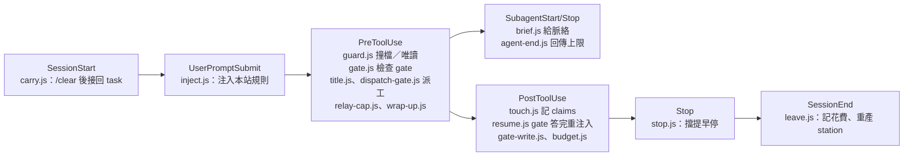

# Remove the station tour, draw the pipeline overview Implementation Plan

**Goal:** Delete the station 導覽 (`#/tour`, the promo films, their recorder and tests) leaving a TODO to rebuild it later, add a whole-route flowchart and a hooks timeline to `docs/02-architecture/pipeline.md`, and make the gate page's diagram frame follow the drawing's size instead of a fixed 460px.
**Architecture:** The tour comes out in the order that keeps the suite green at every commit: the page and its nav first (Tasks 1-3), then what `serve` answers (Task 4), then the files themselves (Task 5), then the TODO and the prose that described it (Tasks 6, 9-11). The diagram frame is two custom properties (`--dg-w`, `--dg-ph`) that `diagram.js` writes on the figure and `diagram.css` reads on `.gt-frame` only, so the docs reader and the phone page (`mobile.css`) keep their boxes. The pipeline overview is two mermaid fences pasted from the design.
**Tech Stack:** Node >=22.5 (`package.json` `engines`), CommonJS, `node:test`, no dependencies; browser code in `assets/station/` is vanilla ES5-style JS.
**Spec:** [design.md](../../../.fankeel/build/task-20261102T091626/design.md)

## Global Constraints

Generated from `node scripts/map.js` (`.fankeel/map.md`), `CONTRIBUTING.md` (this repository has no `CLAUDE.md`), `package.json` and the tests named.

- `lib/*.js` are pure functions; nothing in `lib/` reaches into `scripts/` or `hooks/`. `scripts/*.js` are thin wrappers over `lib/` (CONTRIBUTING.md, Scope table).
- Tests are `node --test`; every exported name needs an importer, and a new file must be `git add`ed before `tests/source.test.js` sees it (CONTRIBUTING.md).
- No new dependency, no new file under `hooks/`, no new CLI flag (CONTRIBUTING.md, Issue first).
- Filing follows `.fankeel/docs.json`: `docs/01-guide` and `docs/02-architecture` are reference, `docs/03-decisions` decisions, `docs/99-archive` archive (map.md, filing). Kept as they are: `docs/03-decisions/2026-09-29-promo30.md`, everything under `docs/99-archive`, `docs/90-agent/judgements`, `docs/90-agent/reports`, `docs/90-agent/todo/tour-1.md` (state done), `.claude/worktrees/*`.
- TODO entries live under `docs/90-agent/todo/`; body at least 200 characters (`MIN_BODY_CHARS`, `lib/todo.js`); `state` is one of `ready, decision, blocked, watch, done`; a path to a file still to be written is named without backticks (`scripts/todo.js`, the `checkFile` comment).
- Version numbers move only through `scripts/version.js` (CONTRIBUTING.md): the repository is `0.148.1` in all 18 places; a UI removal is a minor bump, `0.149.0`.
- `READ_CAP` is 1500 lines and `FILE_CAP` is 3 `Modify:` entries (`lib/plantasks.js:387-388`): `assets/station/station.js` (1964 lines), `assets/station/station.css` (2323) and `docs/90-agent/reference/station.md` (1725) are edited by line range.
- The design's proof: `grep -rli tour assets/station scripts/station.js tests/station-*.test.js` prints nothing. So no test named `tests/station-*.test.js` may spell the word, and new assertions about the tour go in `tests/removed-tour-page.test.js`, `tests/removed-tour-code.test.js` and `tests/removed-pages.test.js`.
- An implementer runs only its own test file; the parent runs `npm run test:fast` (`package.json` scripts) before committing a group.
- Station tests that boot the page do so with `global.window = { STATION: {} }; require('../assets/station/station.js')` (`tests/station-view.test.js:20-21`).
- Indentation is four spaces in `assets/station/*.js` bodies and `tests/`, two in `assets/station/diagram.css`; comments say why, not what.

## Risks

- Citations of the form `assets/station/station.js:N` in `docs/90-agent/reference/station.md` and `lib/spend.js:6` drift when Task 1 deletes three lines of `station.js` and Task 2 one line of `nav.js` — Tasks 1, 10, 11 — Task 1 fixes `lib/spend.js`, Tasks 10 and 11 run a line-shift script over the reference page and then `node scripts/docs-check.js --root .`.
- The figure's width is centred on its own column (`.gt-main`), not on the window, because `margin-inline` percentages resolve against the containing block — Task 7 — the design's prototype was tried in a browser only by hand, so Task 7 ends with a check at 1920 and 1280 wide that no test can make.
- `diagram.js` must measure the pan box after the figure is shown (`data-view=diagram`), because a hidden box has `clientWidth` 0 — Task 7 — the sizing block sits after `data-drawn` is set, not beside `pan.innerHTML`.
- `assets/station/icons/` (15 files, Material Icon Theme, read only by the deleted `tour-ring.js`) is left on disk: the design does not list it — Task 5 — it is named in the report for a later decision.
- `skills/fankeel-ask/SKILL.md:73` ("detour"), `skills/fankeel-land/SKILL.md:459` ("a tour of the diff") and `skills/fankeel-design/catalog/exclude.json:1134` (`ex-state-tour-first`, an onboarding anti-pattern) match the design's grep but are not the station tour — none of the tasks edits them.

## Task 1: The station page drops 導覽

**Files:**
- Modify: `assets/station/station.js:246-513` — `PAGES`, the `tourPage` forward, the nav entry, the comment above `NAV_TREE`, the export
- Modify: `assets/station/station.js:943-1814` — `VIEWS.tour`, the two `route.view === 'tour'` tests in the 3-second re-read
- Modify: `lib/spend.js:1-12` — the `station.js:978` citation in the header comment
- Test: `tests/removed-tour-page.test.js`
- Test: `tests/station-view.test.js`
- Test: `tests/station-dead-wizard.test.js`
- Test: `tests/station-docs-tour.test.js` — deleted, its two tests are what `removed-tour-page.test.js` replaces
- Test: `tests/station-todo-panel.test.js` — a comment names the deleted file

**Interfaces:**
- Consumes: none
- Produces: `assets/station/station.js` no longer exports `tourPage` and `parseHash('#/' + <the removed page>)` falls back to `{ view: 'now' }`; `FK_CHART.tourPage` (`chart.js`) is still there until Task 2 and nothing calls it

**Dispatch:** implementer, sonnet — the plan carries the code; transcription plus tests.

1. Write the failing test. Create `tests/removed-tour-page.test.js`:

```js
'use strict';
// The station's 導覽 page was removed on 2026-11-02 (TODO tour-2 brings it back): no hash route,
// no link in the left bar, no tourPage on what station.js exports.
const test = require('node:test');
const assert = require('node:assert/strict');

global.window = { STATION: {} };
const V = require('../assets/station/station.js');

test('the old hash falls back to the dashboard', () => {
    assert.deepEqual(V.parseHash('#/tour'), { view: 'now' });
});

test('the left bar has no 導覽 link, and station.js exports no tourPage', () => {
    const nav = V.navHtml('now', { waiting: 0 });
    assert.ok(!nav.includes('#/tour'), nav);
    assert.ok(!nav.includes('data-block="tour-nav"'), nav);
    assert.equal('tourPage' in V, false);
});
```

2. In `tests/station-view.test.js`, the nav test at line 1066-1072 drops the removed route from its list and its title says five:

```js
test('navHtml lights the page a view belongs to and links all five', () => {
    const out = V.navHtml('days', { waiting: 0 });
    assert.match(out, /<a href="#\/days" aria-current="page">/);
    for (const h of ['#/', '#/sessions', '#/days', '#/docs', '#/settings']) assert.ok(out.includes('<a href="' + h + '"'), h);
```

3. In `tests/station-dead-wizard.test.js`, delete line 31 (`assert.equal(typeof V.tourPage, 'function');`) so the test at 26-33 keeps its `parseHash` assertion only.

4. In `tests/station-todo-panel.test.js`, lines 8-9, replace the two comment lines

```js
// The page booted whole in a fresh vm context, the way tests/station-docs-tour.test.js
// boots it, on `hash`. Of the ids `todo` and `todo-<id>` only those in `present`
```

with one, in `tests/station-todo-panel.test.js`:

```js
// The page booted whole in a fresh vm context, on `hash`. Of the ids `todo` and `todo-<id>` only those in `present`
```

5. Run it and watch it fail: `node --test tests/removed-tour-page.test.js` fails on both tests.

6. In `assets/station/station.js`, edit bottom-up so the line numbers above stay true. Line 1814, drop the second view from the settings test:

```js
            if (route.view === 'settings') { drawFloat(); doc.getElementById('gen').textContent = genText(); return; }
```

In `assets/station/station.js`, line 1805:

```js
        var on = doc.hidden || route.view === 'settings' ? null : watched();
```

Delete line 943 whole: `    VIEWS.tour = function () { return tourPage(Boolean(S.serve)); };`

In `assets/station/station.js`, line 513 (inside the `return {` list of exports):

```js
            effortChip: effortChip,
```

Delete line 384 whole (the `{ ico: 'tour', ... block: 'tour-nav', ... },` entry, the last item of `NAV_TREE`).

In `assets/station/station.js`, line 373:

```js
    // Sessions, 花費, 文件 and 週報 (2026-10-27), then 設定 pinned under them (`pin`).
```

Delete line 301 whole: `    function tourPage() { return CHART().tourPage.apply(null, arguments); }`

In `assets/station/station.js`, line 246:

```js
    var PAGES = ['live', 'sessions', 'projects', 'docs', 'weekly', 'settings'];
```

7. In `lib/spend.js`, line 6, `station.js` moves up three lines (301, 384 and 943 are gone above `costHtml`):

```js
// `assets/station/station.js:975`'s `costHtml` folds them, so the two must
```

Check: `grep -n "function costHtml" assets/station/station.js` prints the line the citation names; if it prints another number, use that number.

8. Delete the old test file: `git rm -q tests/station-docs-tour.test.js`.

9. Run them and watch them pass: `node --test tests/removed-tour-page.test.js tests/station-view.test.js tests/station-dead-wizard.test.js tests/station-todo-panel.test.js`.

10. Commit:

```sh
git add assets/station/station.js lib/spend.js tests/removed-tour-page.test.js tests/station-view.test.js tests/station-dead-wizard.test.js tests/station-todo-panel.test.js
git rm -q --cached tests/station-docs-tour.test.js 2>/dev/null; git commit -m "feat: the station page drops the 導覽 view" -m "Co-Authored-By: Claude Sonnet 5.5 <noreply@anthropic.com>"
```

## Task 2: chart.js, nav.js and i18n.js drop the tour page, glyph and strings

**Files:**
- Modify: `assets/station/chart.js` — `tourPage` and its export
- Modify: `assets/station/nav.js` — the `tour` entry of `ICONS24`
- Modify: `assets/station/i18n.js` — four keys, `shared.tourTitle`, `shared.tourNeedsServe`, `nav.tour`, `nav.tourTitle`
- Test: `tests/removed-tour-code.test.js`
- Test: `tests/station-mod-chart.test.js`
- Test: `tests/station-quota-chart.test.js`
- Read: `tests/station-i18n.test.js` — keys English against the `loc()` calls; run, not changed

**Interfaces:**
- Consumes: Task 1 — nothing calls `tourPage` any more
- Produces: `FK_CHART` without `tourPage`; `tests/removed-tour-code.test.js` with a `read(file)` helper that Task 3 extends

**Dispatch:** implementer, sonnet — the plan carries the code; transcription plus tests.

1. Write the failing test. Create `tests/removed-tour-code.test.js`:

```js
'use strict';
// The 導覽 page's code is gone from the station's modules (TODO tour-2 brings it back):
// chart.js has no tourPage, nav.js no tour glyph, i18n.js no tour string.
const test = require('node:test');
const assert = require('node:assert/strict');
const fs = require('node:fs');
const path = require('node:path');

const read = (f) => fs.readFileSync(path.join(__dirname, '..', 'assets', 'station', f), 'utf8');

test('chart.js, nav.js and i18n.js hold no tour page, glyph or string', () => {
    for (const f of ['chart.js', 'nav.js', 'i18n.js']) assert.doesNotMatch(read(f), /tour/i, f);
});
```

2. Run it and watch it fail: `node --test tests/removed-tour-code.test.js` names `chart.js` first.

3. In `assets/station/chart.js`, delete lines 470-477 (the `// 導覽:` comment, its second line, the whole `function tourPage(serve) { ... }` and the blank line after it), then in the export list change line 481 to:

```js
            filterHtml: filterHtml, visibleBars: visibleBars, segTip: segTip, ovBarsSvg: ovBarsSvg, quotaSvg: quotaSvg
```

4. In `assets/station/nav.js`, delete line 45: `            tour: '<circle cx="12" cy="12" r="10"/><path d="m10 8 6 4-6 4Z"/>',`. `ICONS24` keeps `files` and `barh`, so the `.g24` branch at line 57 still runs.

5. In `assets/station/i18n.js`, delete lines 180-181 first (`'nav.tour': 'Tour',` and `'nav.tourTitle': ...`), then lines 63-64 (`'shared.tourTitle': 'fankeel tour',` and `'shared.tourNeedsServe': ...`). The Chinese halves went with `chart.js` and `station.js`; `tests/station-i18n.test.js` keys English against `loc()` calls, so nothing else is left.

6. In `tests/station-mod-chart.test.js`, line 8 becomes:

```js
        'segTip', 'projectRows']);
```

7. In `tests/station-quota-chart.test.js`, line 22 becomes:

```js
        PAGES: ['live', 'sessions', 'projects', 'docs', 'weekly', 'settings'],
```

8. Run: `node --test tests/removed-tour-code.test.js tests/station-mod-chart.test.js tests/station-quota-chart.test.js tests/station-i18n.test.js`.

9. Commit:

```sh
git add assets/station/chart.js assets/station/nav.js assets/station/i18n.js tests/removed-tour-code.test.js tests/station-mod-chart.test.js tests/station-quota-chart.test.js
git commit -m "feat: chart.js, nav.js and i18n.js drop the 導覽 page, glyph and strings" -m "Co-Authored-By: Claude Sonnet 5.5 <noreply@anthropic.com>"
```

## Task 3: station.css, dash.js and fmt.js stop naming the film

**Files:**
- Modify: `assets/station/station.css:1278-1368` — the `.tour-frame` rule and three comments
- Modify: `assets/station/dash.js` — the comment above `keelGlyph`
- Modify: `assets/station/fmt.js` — the comment above `parseHash`
- Test: `tests/removed-tour-code.test.js` — extends Task 2's file, so Task 3 runs after Task 2

**Interfaces:**
- Consumes: `read(file)` in `tests/removed-tour-code.test.js` (Task 2)
- Produces: none

**Dispatch:** implementer, sonnet — the plan carries the code; transcription plus tests.

1. Append the failing test to `tests/removed-tour-code.test.js`:

```js
test('station.css, dash.js and fmt.js no longer name the tour film or its frame', () => {
    for (const f of ['station.css', 'dash.js', 'fmt.js']) assert.doesNotMatch(read(f), /tour/i, f);
});
```

2. Run it and watch it fail: `node --test tests/removed-tour-code.test.js` names `station.css`.

3. In `assets/station/station.css`, edit bottom-up. In `assets/station/station.css`, line 1366:

```css
/* ---- the film's ground: dot paper, 22px pitch (11 film units) ---- */
```

In `assets/station/station.css`, lines 1321-1324, the four-line comment head (the `:root[data-style=keel]` rule on 1325 stays):

```css
/* ==== keel: the promo film's look, as station tokens ==========================
   Palette: the promo film's styleframes, kept in docs/03-decisions/2026-09-29-promo30.md.
   Dark: the film's own terminal card (C.ink ground,
   C.term text, termRule, termDot, termGood, termBad, dotLit). */
```

Delete line 1283 whole: `.tour-frame{display:block;width:100%;height:calc(100vh - 120px);min-height:640px;border:0;border-radius:var(--r-sm)}`. In `assets/station/station.css`, line 1281 becomes:

```css
/* Glyphs drawn on a 24 grid (nav.js ICONS24): this keeps their stroke at the bar's 1.5-on-16 weight. */
```

4. In `assets/station/dash.js`, lines 21-22 become:

```js
        // The promo film's v5 glyph (promo30v5 `glyph`, its small branch; ported
        // from .fankeel/build/2026-10-01-station-redesign/
```

5. In `assets/station/fmt.js`, line 26 becomes:

```js
        // `#/list` and `#/cmp` are the other pages the left bar opens;
```

6. Run: `node --test tests/removed-tour-code.test.js tests/station-modules.test.js`.

7. Commit:

```sh
git add assets/station/station.css assets/station/dash.js assets/station/fmt.js tests/removed-tour-code.test.js
git commit -m "chore: station.css, dash.js and fmt.js stop naming the tour film" -m "Co-Authored-By: Claude Sonnet 5.5 <noreply@anthropic.com>"
```

## Task 4: serve stops answering the tour files

**Files:**
- Modify: `scripts/station.js:70-82` — the comment and the `STATIC` regex
- Modify: `scripts/render.js:134-141` — the comment that uses a tour page as its example
- Test: `tests/removed-pages.test.js`
- Test: `tests/station-module-lists.test.js`
- Test: `tests/station-memo-static.test.js`
- Test: `tests/render-cli.test.js`

**Interfaces:**
- Consumes: `STATIC` exported by `scripts/station.js`
- Produces: `STATIC` matching only `SERVED` names; `tests/removed-pages.test.js` which Task 5 extends

**Dispatch:** implementer, sonnet — the plan carries the code; transcription plus tests.

1. Write the failing test. Create `tests/removed-pages.test.js`:

```js
'use strict';
// The station tour was removed on 2026-11-02 and is to be rebuilt (TODO tour-2).
// Nothing the station serves, writes or tests names it.
const test = require('node:test');
const assert = require('node:assert/strict');
const fs = require('node:fs');
const path = require('node:path');
const { STATIC } = require('../scripts/station.js');

test('serve answers none of the tour files, whether or not they are on disk', () => {
    for (const n of ['tour.html', 'tour.css', 'tour.js', 'tour-keel.js', 'tour-ring.js', 'tour-reel-kit.js', 'tour-player.js']) {
        assert.ok(!STATIC.test('/station/' + n), n);
    }
});
```

2. Run it and watch it fail: `node --test tests/removed-pages.test.js`.

3. In `scripts/station.js`, replace lines 72-79 (the comment and the `STATIC` line; `SERVED` on line 78 stays as it is):

```js
// The files `serve` answers from ASSETS, by name: the page's own two, the
// language table, the phone page's two and every module lib/station.js reads
// off index.html (`station.MODULES`). A list, so nothing else under the plugin
// directory is reachable by url.
const SERVED = ['station.js', 'i18n.js', 'station.css', 'mobile.js', 'mobile.css', ...station.MODULES];
const STATIC = new RegExp('^/station/(' + SERVED.map((n) => n.replace(/\./g, '\\.')).join('|') + ')$');
```

4. In `scripts/render.js`, line 138 (inside the comment above `toUrl`) names `tour.html#quickstart@330`; make it `page.html#quickstart@330`, keeping the line break where it is.

5. In `tests/station-module-lists.test.js`, line 23 becomes:

```js
    for (const n of ['station.js', 'i18n.js', 'station.css', 'mobile.js', 'mobile.css']) assert.ok(STATIC.test('/station/' + n), n);
```

6. In `tests/station-memo-static.test.js`: line 4, `// static files are a fixed list that now includes the tour and i18n.js.`, becomes `// static files are a fixed list that includes i18n.js.` Replace the test at lines 94-108 and delete the test at lines 111-125 (the one reading `tour.html`'s script tags). The replaced test:

```js
test('the page files and i18n.js are on the list, byte for byte, with their content types', async () => {
    const f = fixture();
    const s = await serve({ configDir: f.cfg, port: 0, idleMs: 60e3, open: false });
    try {
        for (const [name, type] of [['i18n.js', /text\/javascript/], ['station.js', /text\/javascript/], ['station.css', /text\/css/],
            ['mobile.js', /text\/javascript/], ['mobile.css', /text\/css/]]) {
            const res = await get(s.url + 'station/' + name);
            assert.equal(res.status, 200, name);
            assert.match(res.headers['content-type'], type, name);
            assert.equal(res.headers['cache-control'], 'no-store', name);
            assert.equal(res.text, fs.readFileSync(path.join(ASSETS, name), 'utf8'), name);
        }
    } finally {
        s.close();
    }
});
```

and the 404 test's name list (line 131) becomes `['index.html', 'nope.json', 'Station.js', 'station_x.js', '..%2F..%2Fpackage.json', 'station-x.js']`.

7. In `tests/render-cli.test.js`, replace every `tour.html` (lines 21, 28 and 32) with `page.html`; the test still proves that a `#fragment` survives `toUrl` on a Windows-style path.

8. Run them and watch them pass: `node --test tests/removed-pages.test.js tests/station-module-lists.test.js tests/station-memo-static.test.js tests/render-cli.test.js`.

9. Commit:

```sh
git add scripts/station.js scripts/render.js tests/removed-pages.test.js tests/station-module-lists.test.js tests/station-memo-static.test.js tests/render-cli.test.js
git commit -m "feat: serve stops answering the tour files" -m "Co-Authored-By: Claude Sonnet 5.5 <noreply@anthropic.com>"
```

## Task 5: Delete the tour films, the recorder and their tests

**Files:**
- Modify: `assets/station/tour*` — deleted: `tour.html`, `tour.css`, `tour.js`, `tour-keel.js`, `tour-music.js`, `tour-player.js`, `tour-reel-kit.js`, `tour-reel-stages.js`, `tour-reel.js`, `tour-ring.js`
- Modify: `scripts/tour-record.js` — deleted
- Modify: `tests/tour*` — deleted: `tour-ctx.js` and eleven `tour*.test.js`
- Test: `tests/removed-pages.test.js` — extends Task 4's file, so Task 5 runs after Task 4

**Interfaces:**
- Consumes: none
- Produces: none; the tour is gone from the tree

**Dispatch:** implementer, sonnet — the plan carries the code; transcription plus tests.

1. Append the failing tests to `tests/removed-pages.test.js`:

```js
const walk = (d) => fs.readdirSync(d, { withFileTypes: true })
    .flatMap((e) => (e.isDirectory() ? walk(path.join(d, e.name)) : [path.join(d, e.name)]));

test('no file under assets/station is a tour file or names the tour', () => {
    const root = path.join(__dirname, '..');
    const files = walk(path.join(root, 'assets', 'station'));
    assert.deepEqual(files.filter((f) => /tour/i.test(path.basename(f))), []);
    for (const f of files.filter((x) => /\.(js|css|html)$/.test(x))) {
        assert.doesNotMatch(fs.readFileSync(f, 'utf8'), /tour/i, path.relative(root, f));
    }
    assert.doesNotMatch(fs.readFileSync(path.join(root, 'scripts', 'station.js'), 'utf8'), /tour/i);
});

test('the recorder and every tour test are gone, and no station test names the tour', () => {
    const root = path.join(__dirname, '..');
    assert.equal(fs.existsSync(path.join(root, 'scripts', 'tour-record.js')), false);
    const tests = fs.readdirSync(path.join(root, 'tests'));
    assert.deepEqual(tests.filter((n) => /^tour/.test(n)), []);
    for (const n of tests.filter((x) => /^station-.*\.test\.js$/.test(x))) {
        assert.doesNotMatch(fs.readFileSync(path.join(root, 'tests', n), 'utf8'), /tour/i, n);
    }
});
```

2. Run it and watch it fail: `node --test tests/removed-pages.test.js` — the first new test lists the ten asset files.

3. Delete the files; git expands the quoted pathspecs itself:

```sh
git rm -q -- 'assets/station/tour*' scripts/tour-record.js 'tests/tour*'
git status --short | grep -c '^D'
```

The count printed is 23 (10 assets, 1 script, 12 tests).

4. Run it and watch it pass: `node --test tests/removed-pages.test.js`. Then the design's own proof, which prints nothing:

```sh
grep -rli tour assets/station scripts/station.js tests/station-*.test.js
```

5. `assets/station/icons/` (15 files read only by the deleted `tour-ring.js`) stays; say so in the report.

6. Commit:

```sh
git add tests/removed-pages.test.js
git commit -m "feat: delete the station tour films, their recorder and tests" -m "Co-Authored-By: Claude Sonnet 5.5 <noreply@anthropic.com>"
```

## Task 6: A TODO to rebuild the tour, and the one entry that pointed at the recorder

**Files:**
- Modify: `docs/90-agent/todo/tour-2.md` — created by `scripts/todo.js new`
- Modify: `docs/90-agent/todo/explain-2.md` — its `link:` and one sentence name the deleted recorder
- Modify: `docs/90-agent/todo/tour-1.md`, `station-4.md`, `station-5.md`, `station-7.md` — only if todo-check reports their `link:` dead (step T)

**Interfaces:**
- Consumes: Task 5 — the recorder must already be gone, or `todo.js new` and `todo-check.js` see paths that still exist
- Produces: TODO id `tour-2` (state `ready`), which Tasks 10 and 11 name in prose

**Dispatch:** implementer, sonnet — the plan carries the command and the edits.

1. Write the entry. The id is `tour-<n>`, one past `tour-1`:

```sh
node scripts/todo.js new --label tour --title "station 導覽之後做回來" \
  --description "2026-11-02 station 的導覽（#/tour、promo 影片、錄影腳本、測試）整組移除，之後重做一頁更小的；做完 = 左側列有入口、serve 開得出來、有測試、文件寫著" \
  --state ready --link docs/03-decisions/2026-09-29-promo30.md \
  --body "2026-11-02 task-20261102T091626 把 station 的導覽整組移除：assets/station 的 tour 檔、scripts 的錄影腳本、各處的測試與文件描述全刪，只留 docs/03-decisions/2026-09-29-promo30.md 的決定紀錄與 docs/99-archive 的封存頁。這一筆記著它是被拿掉、不是被放棄，之後要做回來。重做時從 promo30 那份決定紀錄出發，先定這一頁要回答什麼，再決定要不要影片。做完的標準：station 左側列有導覽入口、頁面從 serve 開得出來而且寫出的檔案有說明、有測試守著、docs/01-guide/station.md 與 docs/90-agent/reference/station.md 寫著它做什麼；舊的五支影片和錄影腳本不整組搬回來。"
```

It must print the new file's path; if it refuses (`not filed — the entry names what the tree does not have`), the body named a path in backticks that is gone: keep paths unbackticked.

2. In `docs/90-agent/todo/explain-2.md`, line 6 becomes `link: docs/03-decisions/2026-09-29-promo30.md`, and in line 12 the clause

```
用已經有的 scripts/tour-record.js 加本機 TTS 做一條講解影片
```

becomes

```
用本機 TTS 做一條講解影片（原有的 tour-record.js 錄影腳本已於 2026-11-02 隨 station 導覽移除，要用時先看 tour-2）
```

3. Run them: `node scripts/todo-check.js` (its last line says all links resolve) and `node scripts/todo.js list` (lists `tour-2`).

4. Commit:


T. Run `node scripts/todo-check.js`. If it reports a dead link in `docs/90-agent/todo/tour-1.md`, `station-4.md`, `station-5.md` or `station-7.md`, point each reported entry's `link:` line at the archived design instead:

```sh
for f in tour-1 station-4 station-5 station-7; do sed -i 's#^link: assets/station/tour[^ ]*#link: docs/99-archive/2026-09-27-tour.md#' docs/90-agent/todo/$f.md; done
node scripts/todo-check.js
```

If it reports none, change nothing and say so in the report.

```sh
git add docs/90-agent/todo/
git commit -m "docs: TODO tour-2 — rebuild the station tour later" -m "Co-Authored-By: Claude Sonnet 5.5 <noreply@anthropic.com>"
```

## Task 7: The gate page's diagram frame follows the drawing

**Files:**
- Modify: `assets/station/diagram.css:13-14` — the fixed `.gt-frame .dg-pan{height:460px}` becomes two custom-property rules
- Modify: `assets/station/diagram.js:128-132` — `one()` writes `--dg-w` and `--dg-ph` once the figure is shown
- Test: `tests/station-diagram.test.js`

**Interfaces:**
- Consumes: `pele.render(code, opts)` returns `{ svg, width, height }` (the drawing's natural size in px); `FLOOR` (0.8) in `diagram.js`
- Produces: custom properties `--dg-w` (natural width, px) and `--dg-ph` (pan height at the opening scale plus 16px) on each drawn `figure.dg`; `mobile.css:699` (`.gc-dg .dg-pan`) is not touched

**Dispatch:** implementer, sonnet — the plan carries the code; transcription plus tests.

1. Write the failing tests. Append to `tests/station-diagram.test.js` (it already has `fs`, `path`, `ASSETS`, `loaded()` and `fake()`):

```js
test('the gate page frame follows the drawing: --dg-w is its natural width, --dg-ph its height at the opening scale, floor 0.8', () => {
    const D = loaded();
    const size = (width, height, boxW) => {
        const f = fake(), props = {};
        f.fig.style = { setProperty: (k, v) => { props[k] = v; } };
        f.pan.clientWidth = boxW;
        f.pele.render = () => ({ svg: '<svg></svg>', width, height });
        D.draw(f.root, { pele: f.pele });
        return props;
    };
    const tall = size(600, 1500, 624);
    assert.equal(tall['--dg-w'], '600px');
    assert.ok(parseFloat(tall['--dg-ph']) > 460, tall['--dg-ph']);
    const wide = size(1500, 200, 1344);
    assert.equal(wide['--dg-w'], '1500px');
    assert.ok(parseFloat(wide['--dg-ph']) < 300, wide['--dg-ph']);
    const squeezed = size(1500, 200, 600);
    assert.equal(parseFloat(squeezed['--dg-ph']), Math.ceil(200 * 0.8) + 16);
});

test('diagram.css sizes the gate frame from those properties, no longer fixes it at 460px, and leaves the phone box alone', () => {
    const css = fs.readFileSync(path.join(ASSETS, 'diagram.css'), 'utf8');
    assert.doesNotMatch(css, /\.gt-frame \.dg-pan\{height:460px\}/);
    assert.match(css, /\.gt-frame \.dg-pan\{height:min\(max\(var\(--dg-ph,460px\),180px\),85vh\)\}/);
    assert.match(css, /\.gt-frame \.dg\{[^}]*width:max\(100%,var\(--dg-want\)\)/);
    assert.doesNotMatch(fs.readFileSync(path.join(ASSETS, 'mobile.css'), 'utf8'), /--dg-/);
});
```

2. Run it and watch it fail: `node --test tests/station-diagram.test.js` fails on both new tests (no property is written; the 460px rule is still there).

3. In `assets/station/diagram.css`, replace line 14 (`.gt-frame .dg-pan{height:460px}`) with:

```css
/* gate page: the figure is as wide as the drawing needs, up to the window less 24px a side, and breaks out of the 1440px column, centred on it;
   its pan is as tall as the drawing opens at (diagram.js writes --dg-w and --dg-ph), 180px to 85vh. A hand-dragged height still wins. */
.gt-frame .dg{--dg-want:min(calc(100vw - 48px),calc(var(--dg-w,0px) + 24px));width:max(100%,var(--dg-want));margin-inline:calc((100% - max(100%,var(--dg-want)))/2);position:relative;z-index:1}
.gt-frame .dg-pan{height:min(max(var(--dg-ph,460px),180px),85vh)}
```

4. In `assets/station/diagram.js`, in `one()`, after the block that sets `data-view` and `aria-pressed` (the `fig.setAttribute('data-view', 'diagram');` line and the `forEach` under it) and before `if (o.mark) fig.setAttribute('data-mark', '1');`, add:

```js
        // The frame follows the drawing (gate page, diagram.css): --dg-w widens the figure, then the pan's own width says what scale the
        // drawing opens at, floor FLOOR, and --dg-ph is that scale times its natural height. Measured here, after the figure is shown:
        // a pan that is still display:none has no width.
        if (fig.style && fig.style.setProperty && r.width > 0 && r.height > 0) {
            fig.style.setProperty('--dg-w', r.width + 'px');
            var open = Math.max(FLOOR, Math.min(1, (pan.clientWidth || r.width) / r.width));
            fig.style.setProperty('--dg-ph', Math.ceil(r.height * open) + 16 + 'px');
        }
```

5. Run it and watch it pass: `node --test tests/station-diagram.test.js tests/station-mobile-diagram.test.js tests/mobile-diagrams.test.js`.

6. By hand, which no test can do: open a gate page whose report holds a tall flowchart and a wide one (`node scripts/station.js serve`, then the gate page of a held task) at 1920 and at 1280 wide, and look at whether the frame is wider than the column, centred, and whole. Say in the report what was seen, or that it was not run.

7. Commit:

```sh
git add assets/station/diagram.css assets/station/diagram.js tests/station-diagram.test.js
git commit -m "feat: the gate page's diagram frame follows the drawing's size" -m "Co-Authored-By: Claude Sonnet 5.5 <noreply@anthropic.com>"
```

## Task 8: pipeline.md gets the whole-route flowchart and the hooks timeline

**Files:**
- Modify: `docs/02-architecture/pipeline.md:1-303` — `last_verified`, and two mermaid blocks after the `# Stages, and the route through them` table and its paragraph
- Test: `tests/pipeline-doc.test.js`
- Modify: `docs/README.md:192,402,408` — only if docs-check reports the backticked tour file names (step R)

**Interfaces:**
- Consumes: Task 5, for the README step only: the tour files must already be gone
- Produces: none

**Dispatch:** implementer, sonnet — the plan carries the text; transcription plus a test.

1. Write the failing test. Append to `tests/pipeline-doc.test.js` (it already has `test`, `assert`, `fs`, `path` and `PIPELINE`):

```js
test('the stages section opens with one whole-route flowchart and one hooks timeline, and every script they name exists', () => {
  const md = fs.readFileSync(PIPELINE, 'utf8');
  const from = md.indexOf('\n# Stages, and the route through them');
  const to = md.indexOf("\n### Another plugin's process skill, for the same stage");
  assert.ok(from > 0 && to > from, 'both headings found');
  const blocks = [...md.slice(from, to).matchAll(/```mermaid\n([\s\S]*?)```/g)].map((m) => m[1]);
  assert.equal(blocks.length, 2);
  assert.match(blocks[0], /subgraph S\["① survey/);
  assert.match(blocks[1], /SessionStart/);
  const root = path.join(__dirname, '..');
  for (const name of new Set(blocks.join('\n').match(/[a-z][a-z-]*\.js/g))) {
    assert.ok(['scripts', 'hooks'].some((d) => fs.existsSync(path.join(root, d, name))), name);
  }
});
```

2. Run it and watch it fail: `node --test tests/pipeline-doc.test.js` — `assert.equal(blocks.length, 2)` finds 0.

3. In `docs/02-architecture/pipeline.md`, line 3 becomes `last_verified: 2026-11-02`. Then, between the line that ends the paragraph after the stages table (line 301, the link to design.md) and the heading 'Another plugin's process skill, for the same stage' (line 303), insert the following, with one blank line before and after each paragraph and each fence. First paragraph:

```md
Drawn once on a single page, the whole route is below: which script each stage calls, and what it reads or writes. A script marked `(?)` is placed by inference, not by a call site the stage's own skill names.
```

Then, in `docs/02-architecture/pipeline.md`, the first fence:

```mermaid
flowchart TB
  U([/fankeel]) --> INIT
  subgraph INIT["進場 init"]
    i1["orient.js — 盤點專案、目錄、TODO"]
    i2["task.js start — 寫 registry，定 class 與 route"]
    i3["onboard.js — 有 onboard: 才跑；docs 樹、CLAUDE.md 是否就緒"]
  end
  INIT --> S
  subgraph S["① survey — 已經有什麼"]
    s1["map.js — 寫 .fankeel/map.md：各目錄用途"]
    s2["survey.js 詞 — 掃檔名、宣告、markdown 標題"]
    s3["todo.js list、layout.js — 相關 TODO、目錄結構"]
    s4["task.js route — 依 class 調整路線"]
  end
  S -->|gate| D
  subgraph D["② design — 同意的做法"]
    d1["render.js、tune.js — 前端才有：mockup 截圖、逐塊微調"]
    d2["board.js check (?) — 交出前檢查 .board"]
  end
  D -->|gate| P
  subgraph P["③ plan — 無脈絡也能執行的拆解"]
    p1["ledger.js --plan — 檢查每項需求都有 task 覆蓋"]
    p2["task.js intends — 預告會碰哪些檔"]
  end
  P -->|gate| B
  subgraph B["④ build — 改動本身"]
    b1["ledger.js groups/ready/complete — 帳本：哪些可並行、做到哪"]
    b2["commit.js — 每個 task 一個 commit"]
    b3["review-check.js (?)、lenses.js — 逐 task 審查"]
    b4["suite.js、docs-check.js — gate 前：全套測試、文件引用"]
  end
  B -->|gate| V
  subgraph V["⑤ verify — 證據，不是信心"]
    v1["ledger.js ranges — 每列需求派一個 verifier"]
    v3["verify-map.js --range — 改了的程式對到哪些測試"]
    v4["security-local.js --range — 本地安全掃描"]
    v5["suite.js、docs-check.js — 全套測試；這次改動讓哪些文件變假"]
  end
  V -->|gate| A
  subgraph A["⑥ audit — 什麼不再為真"]
    a1["docs-check.js、residue.js — 死連結、殘留檔"]
    a2["memory-check.js、input-check.js — 記憶、每回合讀入量"]
    a3["docs-audit.js — 約兩週一次：drift、已落地的 plan、索引"]
    a4["knip、deptry — 沒用到的程式與相依"]
  end
  A -->|gate| L
  subgraph L["⑦ land — 不比你來時更髒"]
    l1["suite.js — 合併前後各一次"]
    l2["todo-check.js、version.js、archive.js — TODO 仍真、版號、封存 plan"]
    l3["map.js — 重寫地圖"]
    l4["land.js merge/clean — 合併、清 worktree"]
    l5["record.js、conversation.js — 紀錄、retro bundle"]
  end
  L --> E([task.js land → 收工])
```



Second paragraph, in `docs/02-architecture/pipeline.md`:

```md
The hooks do not belong to one stage. They fire on Claude Code's own events, in this order, around every stage above.
```

Then, in `docs/02-architecture/pipeline.md`, the second fence:



4. Run it and watch it pass: `node --test tests/pipeline-doc.test.js`. Then `node scripts/docs-check.js --root .` prints no new finding for `docs/02-architecture/pipeline.md`.

5. Commit:


R. Run `node scripts/docs-check.js --root .`. If it reports `tour-keel.js`, `scripts/tour-record.js` or `tour-record.js --lang` in `docs/README.md`, drop the backticks on exactly those spans (the rows describe archived work, so the names stay as plain words):

```sh
sed -i -e '192s/`tour-keel.js`/tour-keel.js/' -e '402s#`scripts/tour-record.js`#scripts/tour-record.js#' -e '408s/`tour-record.js --lang`/tour-record.js --lang/' docs/README.md
```

If it reports none, leave README.md alone.

```sh
git add docs/02-architecture/pipeline.md tests/pipeline-doc.test.js docs/README.md
git commit -m "docs: pipeline.md — whole-route flowchart and hooks timeline" -m "Co-Authored-By: Claude Sonnet 5.5 <noreply@anthropic.com>"
```

## Task 9: The guide, the layout tree and the verify checklist stop describing the tour

**Files:**
- Modify: `docs/01-guide/station.md:34` — the 導覽 row of the pages table
- Modify: `docs/02-architecture/layout.md:106` — the `assets/` row
- Modify: `.fankeel/verify/station.md` — the served-files bullet (line 18) and step 8 (line 39), step 9 renumbered

**Interfaces:**
- Consumes: Task 5 — the files are gone before the prose says so
- Produces: none

**Dispatch:** implementer, sonnet — the plan carries the edits.

1. In `docs/01-guide/station.md`, delete line 34 (the row beginning `| 導覽 | `#/tour` |`). The table's other rows stay, 設定 stays last.

2. In `docs/02-architecture/layout.md`, line 106, the clause `copied beside every page a write produces, and tour.html, tour.css and tour*.js, the one-minute promo film; tune/overlay.js,` becomes `copied beside every page a write produces; tune/overlay.js,`. The rest of the line is unchanged.

3. In `.fankeel/verify/station.md`, delete line 18 (`- The tour, `/station/tour.html`, served from `assets/station/` with the scripts it loads.`), delete the step line `8. GET `<url>station/tour.html` answers 200.`, and renumber the cleanup step `9. Cleanup: ...` to `8. Cleanup: ...`.

4. Run: `node scripts/docs-check.js --root .` and `grep -n -i tour docs/01-guide/station.md docs/02-architecture/layout.md .fankeel/verify/station.md` (prints nothing).

5. Commit:

```sh
git add docs/01-guide/station.md docs/02-architecture/layout.md .fankeel/verify/station.md
git commit -m "docs: guide, layout and verify checklist drop the station tour" -m "Co-Authored-By: Claude Sonnet 5.5 <noreply@anthropic.com>"
```

## Task 10: The reference page, first half — shifted citations and the two cross-references

**Files:**
- Modify: `docs/90-agent/reference/station.md:1-870` — citations after Tasks 1-2 moved lines; the "(under Search, the tour and the served files)" wording at 702-703 and the anchor link at 847

**Interfaces:**
- Consumes: Tasks 1 and 2 — the line shifts (`station.js`: line 301 gone, 384 gone, 943 gone; `nav.js`: line 45 gone)
- Produces: the heading anchor `#search-and-the-served-files`, which Task 11 gives the heading in the second half; a shared file with Task 11, so Task 11 runs after this one

**Dispatch:** implementer, sonnet — the plan carries the script and the edits.

1. Shift the citations in lines 1-870. The mapping for `assets/station/station.js:N` is N below 301 unchanged, 302-383 minus 1, 385-942 minus 2, above 943 minus 3; for `assets/station/nav.js:N` it is N above 45 minus 1. The script touches only lines 1-870 and only the `assets/station/` form, so `scripts/station.js:N` is left alone:

```sh
node -e '
const fs = require("fs");
const [file, lo, hi] = [process.argv[1], +process.argv[2], +process.argv[3]];
const sh = (n, nav) => nav ? (n > 45 ? n - 1 : n) : n < 301 ? n : n < 384 ? n - 1 : n < 943 ? n - 2 : n > 943 ? n - 3 : n;
const lines = fs.readFileSync(file, "utf8").split("\n");
for (let i = lo - 1; i < hi; i++) lines[i] = lines[i].replace(/assets\/station\/(station|nav)\.js:(\d+)(?:-(\d+))?/g, (m, f, a, b) => "assets/station/" + f + ".js:" + sh(+a, f === "nav") + (b ? "-" + sh(+b, f === "nav") : ""));
fs.writeFileSync(file, lines.join("\n"));
' docs/90-agent/reference/station.md 1 870
git diff --stat docs/90-agent/reference/station.md
```

2. In `docs/90-agent/reference/station.md`, lines 702-703: `(under Search, the` / `tour and the served files) reads` become

```md
(under Search and the
served files) reads
```

3. Line 847: the link becomes `[Search and the served files](#search-and-the-served-files).`

4. Run: `node scripts/docs-check.js --root .`. Any `station.js:N` or `nav.js:N` citation it reports in lines 1-870 is moved by hand to the line `grep -n` gives for the quoted text.

5. Commit:

```sh
git add docs/90-agent/reference/station.md
git commit -m "docs: reference/station.md — shifted citations, search-and-served-files link" -m "Co-Authored-By: Claude Sonnet 5.5 <noreply@anthropic.com>"
```

## Task 11: The reference page, second half — the nav paragraph, the tour section and the served list

**Files:**
- Modify: `docs/90-agent/reference/station.md:871-1725` — the nav paragraph (925-934), the 文件 paragraph's link (1078), the section heading (1361), the tour film paragraphs (1404-1463), the served-files paragraph (1465-1477), and the citations

**Interfaces:**
- Consumes: Task 10 (same file, its first half), Task 6 (`tour-2` exists), Task 5
- Produces: none

**Dispatch:** implementer, sonnet — the plan carries the script and the text.

1. Shift the citations in lines 871-1725 with the same script as Task 10, run on that range:

```sh
node -e '
const fs = require("fs");
const [file, lo, hi] = [process.argv[1], +process.argv[2], +process.argv[3]];
const sh = (n, nav) => nav ? (n > 45 ? n - 1 : n) : n < 301 ? n : n < 384 ? n - 1 : n < 943 ? n - 2 : n > 943 ? n - 3 : n;
const lines = fs.readFileSync(file, "utf8").split("\n");
for (let i = lo - 1; i < hi; i++) lines[i] = lines[i].replace(/assets\/station\/(station|nav)\.js:(\d+)(?:-(\d+))?/g, (m, f, a, b) => "assets/station/" + f + ".js:" + sh(+a, f === "nav") + (b ? "-" + sh(+b, f === "nav") : ""));
fs.writeFileSync(file, lines.join("\n"));
' docs/90-agent/reference/station.md 871 1725
```

2. Edit `docs/90-agent/reference/station.md` from the bottom up, so the line numbers above stay true. Replace lines 1465-1477 (the paragraph beginning `` `serve` answers a fixed list of files from `assets/station/` ``) with:

```md
`serve` answers a fixed list of files from `assets/station/` — `STATIC` in
`scripts/station.js`: `station.js`, `station.css`, `i18n.js`, the five spend modules
`spend-talk.js`, `spend-kinds.js`, `spend-range.js`, `spend-panel.js` and `quota-share.js`, the
手機遠端 card's `remote-card.js`, the redesigned pages' nine modules as `<name>.js` and
`<name>.css` (`tip`, `live-page`, `sessions-page`, `projects-page`, `project-page`,
`session-page`, `session-dispatch`, `session-talk` and `gate-frame`), the diagram module's
`diagram.js` and `diagram.css`, the vendored `vendor/pele.js` (pele 1.10.0, MIT, pinned by sha256 in
`tests/station-diagram.test.js`; `vendor/PELE-LICENSE` beside it is not served), and the phone page's `mobile.js` and `mobile.css`.
`SERVED` takes `diagram.js`, `diagram.css` and `vendor/pele.js` from `station.MODULES`
(`const MODULES = modulesOf(SHELL)`, `lib/station.js:1213`). Any other name under the station path is a 404, so nothing else in the plugin directory is
reachable by url.
```

Before saving, read the old paragraph's lines 1467-1474 once more: every module name it listed other than the `tour` ones is kept, character for character; only the tour sentence goes.

3. In `docs/90-agent/reference/station.md`, replace lines 1404-1463 (from `導覽 (`#/tour`) frames ...` through `` `promo30`, `promo30v3` and `promo30v4` render byte-identically. ``, the five film paragraphs) with one paragraph:

```md
The station has no 導覽 page. `#/tour`, the films it played (`reel`, `promo30` to `promo30v5`), their score and the recorder that wrote them to MP4 were removed on 2026-11-02, to be rebuilt later as TODO `tour-2`. The decisions behind the films stay in [promo30](../../03-decisions/2026-09-29-promo30.md); the first two designs are in `docs/99-archive/`.
```

4. Line 1361: the heading becomes `## Search and the served files`. Line 1078: the link becomes `[Search and the served files](#search-and-the-served-files)`.

5. In `docs/90-agent/reference/station.md`, lines 930-932: the sentence that says 設定 and 導覽 are pinned, with 導覽 a single link carrying the `tour-nav` block, becomes the two lines below; 週報 was missing from that paragraph already.

```md
`#/days` and 依專案 `#/projects`. 文件 is a single link, `#/docs`. 週報 is a single link, `#/weekly`. 設定 is pinned under them and has one
kid, 精靈 `#/settings`. Every entry is a plain link, and `navHtml`
```

The sentence before it ("defines six ordered entries") is true again with 現在, Sessions, 花費, 文件, 週報 and 設定.

6. Run: `node scripts/docs-check.js --root .` and `grep -n -i "tour" docs/90-agent/reference/station.md` — what is left names `tour-2`, the promo30 decision and the archive, and nothing else. Any `station.js:N` or `nav.js:N` citation docs-check reports is moved by hand to the line `grep -n` gives.

7. Commit:

```sh
git add docs/90-agent/reference/station.md
git commit -m "docs: reference/station.md — the station has no tour page" -m "Co-Authored-By: Claude Sonnet 5.5 <noreply@anthropic.com>"
```

## Task 12: Minor version bump

**Files:**
- Modify: `package.json` — `version`
- Modify: `.claude-plugin/plugin.json` — `version`
- Modify: `skills/*/SKILL.md` — the `version:` frontmatter line in each of the sixteen skills

**Interfaces:**
- Consumes: none
- Produces: `0.149.0` in all 18 places

**Dispatch:** implementer, sonnet — one command.

1. Set the number; a removed UI page is a minor bump (`0.148.1` to `0.149.0`):

```sh
node scripts/version.js 0.149.0
node scripts/version.js
```

The second command prints `fankeel version — 0.149.0, in all 18 places.`

2. Run: `node --test tests/contract.test.js`. The parent then runs `npm run test:fast`, `node scripts/docs-check.js --root .`, `node scripts/todo-check.js` and the design's proof, `grep -rli tour assets/station scripts/station.js tests/station-*.test.js`, which prints nothing.

3. Commit:

```sh
git add package.json .claude-plugin/plugin.json skills
git commit -m "chore: 0.149.0 - station tour removed, pipeline overview, gate diagram frame" -m "Co-Authored-By: Claude Sonnet 5.5 <noreply@anthropic.com>"
```

## Coverage

| promise | task |
|---|---|
| 做法：tour 整組刪掉（包括 tour-record.js 和 promo30 的舊測試），各處引用一併拿掉 | Task 5 |
| 保留 promo30 決定紀錄與封存頁，另開一筆 TODO 記著之後要做回來 | Task 6 |
| pipeline.md 第 286 行那一節之後，加一張從頭到尾的總覽圖和一張 hooks 時間軸 | Task 8 |
| gate 頁的圖框改成依圖的比例決定高度，不再固定 460px | Task 7 |
| assets/station/tour*.js, tour.css, tour.html（10 檔） — 刪除 | Task 5 |
| scripts/tour-record.js, tests/tour*.test.js, tests/tour-ctx.js, tests/station-docs-tour.test.js — 刪除 | Task 5 (`station-docs-tour.test.js` in Task 1) |
| assets/station/station.js, chart.js, nav.js, i18n.js, station.css, dash.js, fmt.js — 拿掉 tour 頁與導覽入口 | Tasks 1, 2, 3 |
| scripts/station.js:75-79 — STATIC 正規式拿掉 `tour(?:-…)` | Task 4 |
| tests/station-view, station-module-lists, station-mod-chart, station-quota-chart, station-todo-panel, station-memo-static, station-dead-wizard, render-cli 的 .test.js — 拿掉 tour 斷言 | Tasks 1, 2, 4 |
| docs/01-guide/station.md, docs/90-agent/reference/station.md, docs/02-architecture/layout.md, docs/README.md, skills/fankeel-ask/SKILL.md, skills/fankeel-land/SKILL.md, skills/fankeel-design/catalog/exclude.json — 拿掉 tour 描述 | Tasks 9, 10, 11; struck — `docs/README.md` only links the kept decision and archive pages, and the three skill files match the word "tour" in "detour", "a tour of the diff" and an onboarding anti-pattern id, not the station tour (see Risks) |
| docs/90-agent/todo/（新一筆） — `todo.js new`：station tour 之後做回來，body ≥200 字 | Task 6 |
| package.json, .claude-plugin/plugin.json — minor 升版（移除 UI） | Task 12 |
| docs/02-architecture/pipeline.md — 加下方兩張 mermaid | Task 8 |
| assets/station/diagram.css:13-14, diagram.js:one() — `.dg-pan` 高度＝圖原生高 × 縮放（下限 80%），夾在 180px 到 85vh 之間 | Task 7 |
| `.gt-frame .dg` 寬度＝min(視窗寬−48px, 圖原生寬＋24px)，至少原欄寬，置中突破 1440px 欄寬；縮放下限 80% 不變；手機 mobile.css:699 不動 | Task 7 |
| tests/（diagram 高度測試） — 直立圖框高 > 460、橫向圖框高 < 300 | Task 7 |
| `grep -rli tour assets/station scripts/station.js tests/station-*.test.js` 無結果 | Task 5 |
| 全套 suite 綠 | Task 12 (the parent runs `npm run test:fast`) |
| station 頁導覽無 tour | Task 1 |
| gate 頁直立總覽圖的框高超過 460px、hooks 時間軸的框高低於 300px | Task 7 |
| 1920 寬視窗下總覽圖框寬 > 1300px | Task 7 (step 6, by hand) |
| docs-check.js --root . 對 pipeline.md 無新錯誤 | Task 8 |
